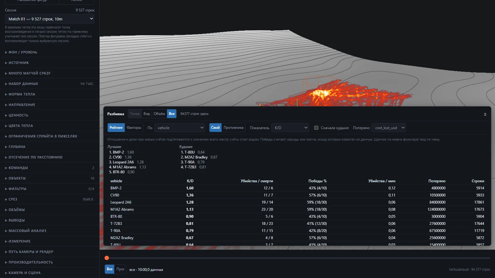
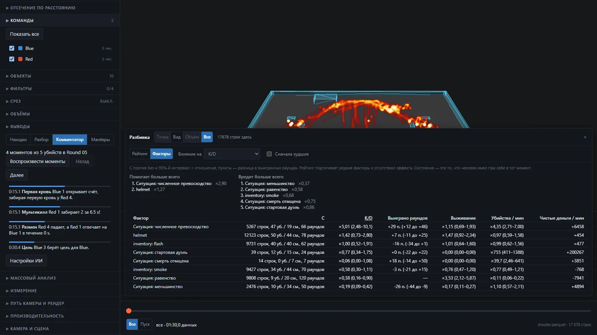

# Разбивка: кто и что лучше работает в каком месте

**Разбивка** отвечает на один вопрос: в этом месте какая техника, игрок или оружие работает лучше всего? Используйте её, чтобы найти танк, который побеждает у моста, или проверить, действительно ли шлем помогает.

Она ранжирует то, что происходит в одном месте (выбранная точка, вид, объём или всё показанное), по любой категории. И она измеряет каждый фактор состояния «с» и «без».

## Попробовать {#try-it}

1. Загрузите матч с убийствами и смертями и откройте **Объёмы**.
2. Нарисуйте объём вокруг места, которое вас интересует, и выберите его.
3. Нажмите **Разбивка…** в разделе «Статистика».
4. В **По** выберите *Техника* и меру *K/D* (убийства на смерть).
5. Читайте список, лучшие сверху. Нажмите **Сначала худшие**, чтобы перевернуть его. Щёлкните по имени, чтобы отфильтровать вид по нему; щёлкните ещё раз, чтобы снять фильтр.

## Открыть {#open-it}

| Откуда | Область, с которой она начинается |
| --- | --- |
| **Разбивка…** в [Объёмах](volumes.md) (раздел «Статистика») | выбранный объём |
| **Разбивка здесь** на карточке выбора, после щелчка по точке | сфера вокруг этой точки (**Радиус**, по умолчанию 3% размера данных) |
| разделённая панель **Разность** | вид |

Заголовок переключает область: **Точка**, **Вид** (что камера видела при последнем подсчёте; **Пересчитать** после перемещения), **Объём** (выбрать один) или **Все**. Подсчёт идёт в фоне; строка состояния говорит, сколько строк в области.

## Рейтинг {#ranking}

Выберите, по чему ранжировать, и меру:

| Мера | Что это |
| --- | --- |
| A, B | строки с каждой стороны карты разности, разделённые так же, как их делит тепло |
| A / B, A - B, A / (A + B) | два слоя друг против друга |
| K/D | убийства против смертей |
| Побед, % | выигранные раунды (или матчи), если данные говорят, кто выиграл |
| Убийства / мин | убийства в минуту присутствия (по промежуткам между отсчётами движения) |
| Заработано, Потеряно, Чистые деньги | суммы столбцов `earn_*` и `cost_*`; выбор валюты задаёт переключатель |

Убийства, смерти, присутствие, победы и деньги считают каждую строку, которую вид показывает в этом месте, с любой стороны разделения или вне его.

Отношения и частоты тянутся к значению всего места там, где счёт маленький, поэтому 2 убийства за одну жизнь не попадут на верх списка. Счёт показан рядом.

Можно ранжировать по группам, игрокам и матчам, по любому столбцу категорий (технике, оружию, стороне, типу закупки, агенту или набору), по любому числовому столбцу в диапазонах (броня, стоимость снаряжения), по **классу** столбца оружия (винтовка, снайперская, пистолет-пулемёт, пистолет…) и по тому, сколько предметов **утилит** содержит столбец-список, например `inventory`.

**Свой** ранжирует по собственному значению строки. **Противника** ранжирует по значению другой стороны: оружию жертвы при убийстве, оружию убийцы при смерти (нужен столбец `other` / `victim`, который их называет).

## Состояние в момент события {#state-at-the-time}

Значение строки — её собственное, если строка не записывает его (строка события без снаряжения) или если это смерть (в столбце оружия может быть оружие убийцы). Тогда берётся то, что этот же человек нёс последним раньше в матче.

## Факторы: с, против, без {#factors-with-against-without}

Переключитесь с **Рейтинга** на **Факторы**, выберите **Влияние на** и читайте *Больше всего помогает* и *Больше всего вредит*:

Влияние каждого фактора на K/D, выигранные раунды, выживаемость (минут на смерть), убийства в минуту и чистые деньги в минуту — с 95% интервалом. Отношения даются как x, выигранные раунды — как разница в очках. Рейтинг тянет каждую оценку к отсутствию эффекта на её собственную неопределённость, поэтому редкий фактор должен иметь ясный эффект, чтобы попасть высоко. Показанный интервал — без такого сглаживания.

Данные с раундами добавляют **ситуации** ближнего боя ([Ближний бой и раунды](close-quarters.md)), которые вычисляются один раз для набора данных: *ослеплён* (`state_flashed` строки или вражеская вспышка в пределах 15 м за последние 3 с), *смерть обменяна*, *открывающая дуэль*, а также *численное превосходство*, *равные числа* или *численное неравенство* (игроки живы на стороне строки против врага). Смерть засчитывается в той ситуации, в которой была её жертва незадолго до смерти.

За один проход измеряется не больше 256 факторов.

## Для разработчиков {#for-developers}

### Сглаживание малых выборок {#pulling-small-samples}

Значение для ранжирования равно `(n + m*r0) / (d + m)`: `n` и `d` — счёты, `r0` — отношение всего места, а `m` — вес этого априорного значения.

### Для авторов конвертеров: именование столбцов факторов {#for-converter-authors-naming-factor-columns}

Конвертер добавляет фактор, назвав его столбец:

| Столбец | Фактор |
| --- | --- |
| `state_<name>` число | включён, пока значение ненулевое (`state_scoped`, `state_suppressor`) |
| `state_<name>` категория | один фактор на каждое значение (`state_ammo` = AP, HE...) |
| `active_<name>` | то же самое для того, что включено или недавно использовано: способность, ультимейт, гаджет, бафф (`active_ult`, `active_stim`) |
| столбец-список (`inventory`, `loadout`, `perks`, `abilities`, `attachments`, `modules`, `buffs`, `debuffs`, `upgrades`, или имя `state_`/`active_`, оканчивающееся на `s`) | один фактор на каждый предмет значения `a\|b\|c` |
| флаги снаряжения, которые уже встречаются (`helmet`, `defuser`, `armor`, `scoped`, `airborne`, `duck`, `flashed`...) | включены, пока значение ненулевое |
| `ammoType`, `shellType`, `ammoName` | последний выпущенный снаряд |

Результаты: столбец `won` из 0/1 (сторона строки выиграла раунд или матч) и столбец `round` - [столбцы итога](data-formats.md#outcome-columns); если в файле есть и `won`, и `matchWon`, *Победы %* считает раунды. Деньги: `earn_<currency>` и `cost_<kind>_<currency>`. Доход только одного вида (`earn_round_cs2`, точные награды за раунд от конвертера) заменяет лишь доход этого вида в модели стоимости (`round` также включает установки и обезвреживания), а модель по-прежнему оценивает остальное.

Сопоставление само загружает эти столбцы рядом со списком самого файла: каждый `state_*`, `active_*`, `won`, `round` и каждый столбец-список, кроме тех, которые статистика файла Parquet показывает как имеющие одно значение на всём протяжении (каждый загруженный столбец занимает 4 байта на строку).
