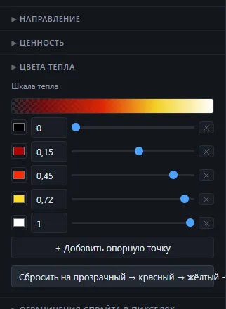

# Цвет и экспозиция

Эти элементы управления решают, какое количество тепла получает какой цвет. **Точка насыщения** — это количество тепла, при котором точка считается раскалённо-белой.

## Быстрые исправления {#quick-fixes}

- Всё белое: увеличьте **Точку насыщения** или нажмите **Автоэкспозиция по полю**.
- Ничего не видно: уменьшите **Точку насыщения** или нажмите **Автоэкспозиция по полю**.
- Видны только несколько одиночных точек: увеличьте **Минимальное тепло**.

Каждый элемент управления на этой странице действует в момент, когда тепло превращается в цвет. Поэтому перетаскивание любого из них сразу перерисовывает картинку и **никогда не перезапускает накопление**.

## Точка насыщения {#saturation-point}

**Точка насыщения** (раздел «Форма тепла»): накопленное тепло, которое соответствует верху шкалы цветов (при линейном отклике; о других откликах см. ниже). Логарифмический ползунок идёт от 0,1 до 4000, а ручку можно тянуть до 10 000 000, потому что накопленное тепло растёт вместе с числом строк. По умолчанию — 24. При каждой загрузке сначала выполняется **аналитическая оценка**, а затем **замер** по самой картинке.

Правильно выбрать это значение — значит получить тепловую карту, а не пустой или белый экран. Вычислить его надёжно нельзя: телеметрия так сильно сгущается — точка появления, дверной проём, узкое место, — что отношение пикового значения плотности к среднему отличается на порядок между наборами данных и между углами камеры.

## Автоэкспозиция {#auto-exposure}

**Автоэкспозиция по полю** замеряет поле, которое шейдер реально построил. Пустые пиксели она пропускает, берёт 98-й перцентиль освещённых пикселей и ставит его на 85% пути до точки насыщения. Так верх шкалы остаётся для настоящих пиков.

Панель затем показывает строку *замерено X% кадра; 98-й перцентиль R помещён у верха шкалы*. При отклике *С насыщением* значение в 85% от точки насыщения попадает примерно на 69% шкалы, а не на 85%.

Она также работает **автоматически**:

- через 8 отрисованных кадров после загрузки набора данных;
- через 8 кадров после изменения [фильтров](filters.md) (фильтрация, которая оставляет всего сотню событий из всех позиций, меняет плотность на порядки);
- через 8 кадров после переключения между точечным теплом и [линейным теплом](line-heat.md) или при смене маршрутов, которые рисует линейное тепло, потому что линия откладывает гораздо меньше тепла на каждый отсчёт, чем спрайт.

Если ничего не освещено, автоматический запуск оставляет насыщение без изменений. Кнопка переходит к аналитической оценке и пишет *нечего замерять — использована аналитическая оценка*.

### Следовать за видом {#follow-the-view}

**Следовать за видом** (раздел «Форма тепла», по умолчанию включено) заново замеряет экспозицию каждый раз, когда камера останавливается. Так область, в которую вы влетаете, использует всю шкалу цветов, а не шкалу, замеренную для всей карты. Мелкие изменения игнорируются, и шкала меняется плавно, без скачков. Работает в четырёх режимах тепла, но не в наложении фигур.

Снимите флажок, чтобы зафиксировать шкалу и сравнивать места по одной шкале. Перетаскивание **Точки насыщения** вручную тоже её фиксирует.

## Отклик на плотность {#density-response}

**Отклик на плотность** — то, как *k* (тепло / насыщение) переходит на шкалу:

| Отклик | Формула | Применение |
|---|---|---|
| **С насыщением** (по умолчанию) | t = 1 - e^(-k) | Асимптотически приближается к верху шкалы, как стопка полупрозрачных спрайтов. Ничто никогда не обрезается до сплошного белого, поэтому это безопасный выбор для незнакомых данных. |
| **Линейная** | t = k | Единственное отображение, где одинаковый цвет означает одинаковое количество. Используйте его, чтобы сравнить два набора данных или два временных окна. |
| **Логарифмический** | t = log₂(1 + 7k) / 3 | Сжимает длинный хвост, поэтому одна экстремальная горячая точка перестаёт прижимать всё остальное к низу шкалы. Поднимает редкие участки. |

## Минимальное тепло {#minimum-heat}

**Минимальное тепло** (по умолчанию выключено, от 0 до 100%): каждый пиксель, несущий хоть какое-то тепло, поднимается минимум до этой точки шкалы. Увеличьте его и уменьшите радиус спрайта, чтобы увидеть, *где что-либо вообще происходило*: одиночные точки данных станут хорошо видны, а не останутся чуть выше прозрачного. Не включайте его, когда оцениваете плотность, потому что он намеренно выравнивает низ шкалы. Порог (k > 0,0001) оставляет по-настоящему пустые пиксели пустыми.

## Редактор шкалы {#the-ramp-editor}

В разделе **Цвета тепла**. Его подпись говорит, для чего нужна шкала: *Шкала тепла* в режимах «Тепло» и «Линии», *Положительная (прибавляющие команды)* в режиме «Разность», *Шкала непрозрачности (цвет задаёт группа)* в [Тепле команд](team-heat.md), где используется только её прозрачность.



Полоса вверху показывает шкалу. Ниже — по одной строке на каждую опорную точку:

| Часть | Значение |
|---|---|
| Цветовой образец | Цвет опорной точки (палитра браузера). |
| Число | Положение опорной точки на шкале, от 0 до 1 (0 = нет тепла). |
| Ползунок | Непрозрачность опорной точки, от 0 до 100%. |
| ✕ | Удаляет опорную точку; недоступно, когда осталось только две. |

**+ Добавить опорную точку** добавляет опорную точку посередине между последними двумя, с цветом и непрозрачностью последней точки. **Сбросить на прозрачный → красный → жёлтый → белый** возвращает значение по умолчанию.

Опорные точки можно задавать в любом порядке: при построении шкалы их сортируют. **Прозрачность** определяет, как тепло смешивается со сценой, поэтому нулевой конец шкалы по умолчанию полностью прозрачен.

### Шкалы по умолчанию {#the-default-ramps}

| Положение | Положительная (Тепло, Линии, Разность +) | Отрицательная (Разность −) |
|---|---|---|
| 0,00 | чёрный, прозрачность 0 | чёрный, прозрачность 0 |
| 0,15 | rgb(180, 0, 0), прозрачность 0,55 | rgb(0, 170, 60), прозрачность 0,55 |
| 0,45 | rgb(255, 40, 0), прозрачность 0,85 | rgb(0, 190, 200), прозрачность 0,85 |
| 0,72 | rgb(255, 220, 40), прозрачность 0,95 | rgb(40, 80, 255), прозрачность 0,95 |
| 1,00 | белый, прозрачность 1 | rgb(170, 60, 255), прозрачность 1 |

## Пока камера движется {#while-the-camera-moves}

Когда камера движется, накопление перезапускается каждый кадр. Если включено **Рисовать все строки каждый кадр** (по умолчанию), каждый кадр движения всё равно точный. Если выключено, кадр движения показывает одну выборочную оценку: более яркие, взвешенные по весу сгустки, которые сходятся к более гладкой истинной картине, когда вы останавливаетесь. Так и должно быть; см. [Накопление](accumulation.md).

## Для разработчиков {#for-developers}

### Проход композитинга {#the-composite-pass}

После накопления тепла значение каждого пикселя превращается в цвет за один проход композитинга ([`COMPOSITE_FS`](https://github.com/Holdi601/3DHeat/blob/main/src/render/webgl2/shaders.ts)). Шаги такие:

```
k = |heat| / saturation point
t = response(k)                         clamped to 0..1
if minimum heat > 0 and k > 0.0001:  t = minimum + (1 - minimum) × t
colour, alpha = ramp(t)                  (the negative ramp when heat < 0, Difference only)
pixel = mix(scene, colour, alpha)
```

### Аналитическая оценка {#the-analytic-estimate}

**Аналитическая оценка** ([`estimateSaturation`](https://github.com/Holdi601/3DHeat/blob/main/src/data/calibrate.ts)) считает, что строки распределены по footprint данных в плоскости X-Z: среднее тепло = строки × (π r² / площадь footprint) × 1/3 × интенсивность в центре (1/3 — среднее по диску для линейного спада), умноженное на предполагаемое отношение пикового значения к среднему, равное 25, и ограниченное диапазоном от 0,1 до 1 000 000. Ей нужно лишь попасть в пределы порядка.

### Замер {#metering}

[`exposure.ts`](https://github.com/Holdi601/3DHeat/blob/main/src/render/exposure.ts):

1. цель теплового буфера считывается с GPU с прореживанием до не более 40 000 значений;
2. пустые пиксели (тепло ≤ 0,0001) отбрасываются: большая часть теплового поля пуста, и если учитывать их, всё получится недоэкспонированным, как у фотоэкспонометра, направленного на чёрный фон;
3. эталоном служит 98-й перцентиль освещённых пикселей;
4. точка насыщения становится эталон / 0,85, так что эталон стоит на 85% пути до точки насыщения, а верх шкалы остаётся для настоящих пиков.

### Таблица цветов {#the-colour-table}

Шкала запекается в таблицу 256 × 2 RGBA (положительная шкала в первой строке, отрицательная — во второй) ([`buildColorLut`](https://github.com/Holdi601/3DHeat/blob/main/src/render/colors.ts)). Цвета интерполируются в линейном свете и хранятся как sRGB; прозрачность интерполируется линейно.
