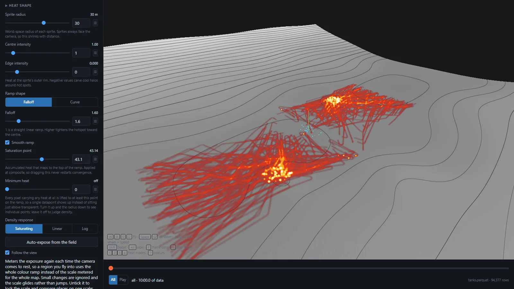

# Демо-данные: попробуйте просмотр за пять минут



Своих данных пока нет? Репозиторий создаёт их сам. Всё в нём выдумано: долина, двор и матчи трёх вымышленных стилей игры, где игроков зовут *Blue 1* или *Red 3*. Все картинки на этом сайте сделаны с этими данными.

## Создать данные {#make-it}

```bash
node tools/demo-data.mjs
```

Команда пишет в `tools/.shots/demo/`:

| Файл | Что это |
|---|---|
| `demo-valley.glb` | долина 12 км с двумя холмами и деревней, как 3D-уровень |
| `demo-yard.glb` | двор 160 м с зданиями и стеной, как 3D-уровень |
| `tanks.parquet` | 10 танковых матчей, 8 на 8: движение, выстрелы, попадания с местом на корпусе, пожары, убийства, подбитая техника, наводка башни, победители |
| `tanks/match-NN.parquet` | те же матчи, по одному файлу на матч, для [много матчей сразу](many-matches.md) |
| `air.parquet` | воздушный бой 4 на 4 с ракетами, ловушками, убийствами и промахами |
| `shooter.parquet` | 12 раундов по 5 на 5 пешком: выстрелы, убийства, установка бомбы, заработанные и потраченные деньги, шлемы и снаряжение |
| `mass/` | папка маленьких `.3dheat`-матчей для [массового анализа](mass-analysis.md) |
| набор кругов гонки | два круга одной машины на вымышленной трассе, для [Анализ заездов](race-analysis.md) |

Каждая таблица записывает названия своих столбцов в метаданные, поэтому загружается без сопоставления.

## Попробовать {#try-it}

1. Запустите просмотр (`start.bat` в Windows или один раз `npm install`, затем `npm run dev` на любой системе) и откройте `http://127.0.0.1:5273/`.
2. **Фон / уровень → 3D-модель…** и выберите `demo-valley.glb`.
3. **Источник → Файлы…** и выберите `tanks.parquet`.
4. Нажмите `F`, чтобы вместить данные в кадр. Вы увидите [тепло](heat.md) десяти матчей.
5. Попробуйте панель режимов: **Разность** (Blue против Red), **Тепло команд**, **Линии**.
6. Откройте **Выводы** (в боковой панели Тепловой карты): там найдены места, где стреляли, попадали и уничтожали заметно чаще, чем в других, — вокруг двух холмов.
7. Откройте вкладку **Матч**, в **Матчи в повторе** выберите *Match 01* и нажмите **Пуск** на временной шкале: [повтор](match-replay.md).


Для шутера загрузите `demo-yard.glb` и `shooter.parquet`; для воздушного боя — `air.parquet` (фигуры лучше видны при **Размер фигур** 4, это ползунок на панели **Просмотр команд** боковой панели Тепловой карты).

## Скриншоты {#the-screenshots}

Картинки сайта делает из этих данных скрипт, на любом языке просмотра:

```bash
node tools/demo-data.mjs
HEAT3D_FIGURE_PACK=none npx vite --port 5321 --strictPort --host 127.0.0.1   # PowerShell: $env:HEAT3D_FIGURE_PACK="none"; npx vite ...
node tools/docs-shots.mjs --lang en
```

Сервер для скриншотов работает без локального пакета фигур, поэтому показывается только публичный каталог фигур. Картинки попадают в `docs/assets/img/<lang>/`. См. [Поддержка документации](maintaining.md).
