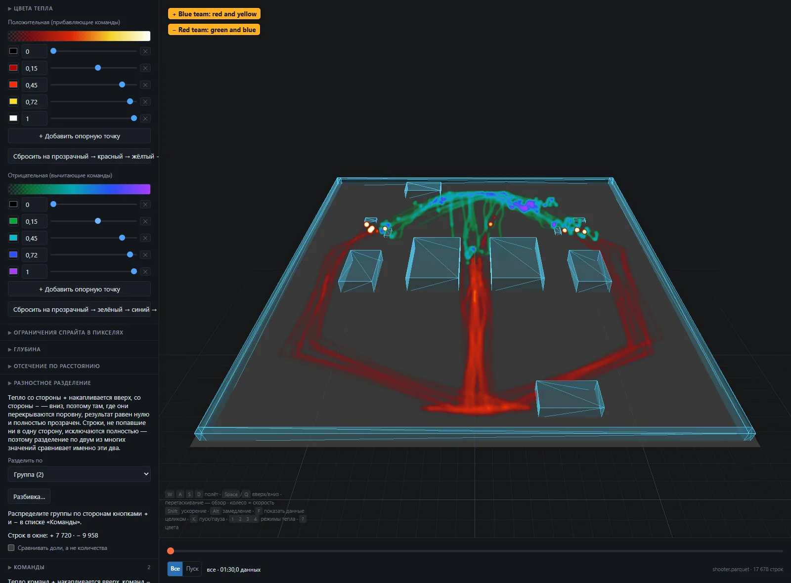

# Разность

Красным там, где команда A была больше, сине-зелёным там, где больше была команда B, и ничего там, где они были равны.

**Разность** (клавиша 2) — это знаковое тепло. Строки одной совокупности добавляют тепло; строки другой вычитают его. Там, где две совокупности перекрываются поровну, результат равен нулю и полностью прозрачен; там, где одна доминирует, она показана цветами своей стороны: по умолчанию тёплыми (прозрачный → красный → жёлтый → белый) для стороны **+** и холодными (прозрачный → зелёный → синий → фиолетовый) для стороны **−**.

## Как пользоваться {#how-to-use-it}

1. Нажмите `2` (или выберите **Разность** на панели режимов).
2. Откройте **Разностное разделение** на боковой панели.
3. Выберите, что **Разделить по**: обычно *Группы*.
4. Поставьте одну группу (или значение) на **+**, а другую на **−**.
5. Читайте цвета: тёплый означает сторону +, холодный — сторону −. Панель предупреждает, если у одной стороны нет строк (см. [Сообщения, которые вы можете увидеть](#messages-you-may-see)).

*Какие* две совокупности сравнивать — это и есть весь вопрос, поэтому разделить можно по любому сохранённому столбцу, а не только по группам. Строки, которые попадают **ни на одну** сторону, **не учитываются**, а не считаются нулём: именно поэтому разбиение по двум из многих значений сравнивает именно эти два и сочетается с [фильтрами](filters.md) — отфильтруйте до одной карты, а затем разделите её по сборке.

Режиму нужны две стороны: столбец групп с как минимум двумя группами или разбиение по столбцу, сохранённому для фильтрации. На данных с меньше чем двумя группами загрузка начинается с разбиения по столбцу — сначала по столбцу *Source file* при загрузке нескольких файлов, иначе по первому столбцу категории с двумя значениями, иначе по первому числовому столбцу с размахом, — так что *сравнение двух загрузок* работает и на данных без групп. Режим недоступен, только если нет ни того, ни другого; так же и когда разбиение по столбцу оставляет одну сторону пустой.

## Панель «Разностное разделение» {#the-difference-split-panel}

Показывается в режиме «Разность», под панелями тепла.

**Разделить по** предлагает:

| Вариант | Показывается как | Правило разбиения |
|---|---|---|
| Группы | *Group (N)* (когда есть столбец группы) | Каждая группа на +, − или ни на одну, задаётся в [Списке команд](teams-list.md) |
| Столбец категории | *column (N values)* | Значения на +, − или ни на одну |
| Числовой столбец | *column (numeric)* | Диапазон значений для каждой стороны |
| Файл-источник | *Source file - compare two loads* (когда загружено несколько файлов) | Файлы на +, − или ни на одну |

Предлагаются только столбцы, отмеченные под *Сохранить для фильтрации* при загрузке.

### Сравнивать доли, а не количества {#compare-shares-not-counts}

**Сравнивать доли, а не количества** (по умолчанию выключено) взвешивает каждую сторону на единицу, делённую на её собственное число строк, так что сторона с вдвое большим числом строк не побеждает одним числом. Цвет тогда показывает, где каждая сторона непропорционально частее другой. Используйте, когда у двух сторон очень разные объёмы данных, например две сессии разной длины.

### Сообщения, которые вы можете увидеть {#messages-you-may-see}

Панель предупреждает, когда картина не является настоящей разностью:

| Сообщение | Значение |
|---|---|
| *N + / M −* (или *N + / M − / K unused*) | Сколько значений на каждой стороне (и на ни одной). |
| No row in the window is on the **+** side | Рисуется только сторона **−**. Сдвиньте окно временной шкалы или смените разбиение. |
| No row in the window is on the **−** side | Рисуется только сторона **+**. |
| No value is on either side | Разность ничего не рисует. Поставьте хотя бы одно значение на **+** или **−**. |
| *column* cannot be split this way | Выбранный столбец не подходит для этого разбиения. Выберите столбец заново. |
| The split column did not fit in GPU memory for N of M chunks | Эти строки не рисуются. Увеличьте бюджет GPU в разделе Производительность → Бюджеты ресурсов или загрузите меньше строк. |

### По группам {#by-group}

Панель лишь указывает на [Список команд](teams-list.md), где у каждой группы есть кнопки **+** и **−**. При каждой загрузке первая половина групп (округлённо вверх) ставится на +, остальные на −; **Разделить поровну** в Списке команд делает то же самое ещё раз. Группа, которая не на той ни на другой стороне, или скрыта своим флажком, не вносит вклада.

### По значениям категории {#by-category-values}

| Часть | Значение |
|---|---|
| `a + / b − / c unused` | Сколько значений на каждой стороне и на ни одной. |
| **Очистить** | Снимает каждое значение со стороны. |
| Список значений | Каждое значение с кнопками **+** и **−** (нажмите активную кнопку ещё раз, чтобы снять значение с этой стороны). Пустое значение перечисляется как *(missing)*. |
| Примечание о пределе | Перечисляются только первые 200 значений: *Showing the first 200 of N values. A column this wide is better narrowed with a filter first, or split by range if its values are ordered.* |

Выбор столбца ставит его первое значение на + и второе на −. Когда ни у одной стороны нет значений, разбиение возвращается к группам, а не показывает пустой кадр. *Source file* работает так же, по одному значению на файл: так сравниваются два экспорта, два тестовых запуска или две сборки.

### По диапазону {#by-range}

| Часть | Значение |
|---|---|
| Подсказка | Минимум и максимум столбца. |
| **Положительный диапазон (+)**, **от** / **до** | Строки со значением в этом диапазоне, включая оба конца, складываются. |
| **Отрицательный диапазон (−)**, **от** / **до** | Строки в этом диапазоне вычитаются. |
| **Разделить посередине** | Ставит + на [минимум, середина], а − на [середина, максимум]; это также происходит при выборе столбца. |

Значение в обоих диапазонах считается как +. Диапазоны не обязаны покрывать столбец; значения вне обоих пропускаются. *The first two minutes against the last two* — это разбиение по диапазону на столбце, похожем на время.

## Доля +: карта доли побед {#share-of--the-win-rate-map}

**Разница** / **Доля +** вверху панели выбирает, что рисуется. *Доля +* окрашивает каждое место по доле стороны + среди строк обеих сторон там, по сравнению с этой долей во всём показанном: тепло выше неё, холодно ниже, ничего там, где она такая же, и ничего там, где у места слишком мало строк. С выигранными раундами на + и проигранными на − это карта доли побед; **Доля побед в раундах** и **Доля побед в матчах** настраивают это одним нажатием, когда в данных есть [столбцы итога](data-formats.md#outcome-columns). См. [Доля побед](win-rate.md).

## Цвета {#colours}

Раздел **Цвета тепла** в этом режиме показывает два редактора шкал: **Положительная (прибавляющие команды)** и **Отрицательная (вычитающие команды)**, каждый со своей кнопкой сброса (*Сброс к прозрачный → красный → жёлтый → белый*, *Сброс к прозрачный → зелёный → синий → фиолетовый*). Составное изображение берёт модуль чистого тепла через [точку насыщения и отклик](colour-and-exposure.md), а отрицательную шкалу выбирает там, где чистое значение меньше нуля. См. [Цвет и экспозиция](colour-and-exposure.md#the-ramp-editor).

Используйте отклик плотности *Linear*, когда важен размер разности: это единственный отклик, при котором одинаковый цвет означает одинаковое число.

## Для разработчиков {#for-developers}

Каждая строка получает знак +1, −1 или 0 в вершинном шейдере ([`POINT_HEAT_VS`](https://github.com/Holdi601/3DHeat/blob/main/src/render/webgl2/shaders.ts)); 0 отбрасывает строку до того, как будет нарисован какой-либо фрагмент.

- По группе знак берётся из таблицы групп на 4 096 записей, индексированной id группы строки (id группы едет в четвёртом канале текселя позиции строки).
- По категории знак берётся из второй таблицы на 4 096 записей, заполняемой для каждого значения категории, а значение строки читается из текстуры фильтра столбца; значение за концом таблицы отбрасывается на обоих бэкендах.
- По диапазону значение строки сравнивается с двумя диапазонами.

Смена разбиения перезапускает накопление.

**Скрытые группы остаются скрытыми при любом разбиении.** При разбиении по столбцу таблица групп больше не несёт знаков; она хранит 1 для показанной группы и 0 для скрытой ([`frameSignTables`](https://github.com/Holdi601/3DHeat/blob/main/src/render/filterTables.ts)), и обе таблицы доходят до шейдера вместе: две строки одной текстуры знаков на WebGL2, две половины одного буфера хранения на WebGPU. Строка рисуется, только когда её группа показана *и* её значение столбца стоит на стороне. Поэтому группа, снятая в [Списке команд](teams-list.md) или оставленная вне фокуса стороны на вкладке «Матч», не вносит вклада, как бы ни разделяли разность.
