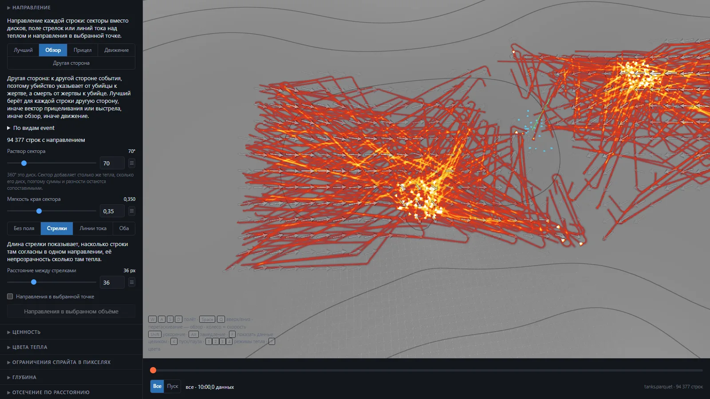

# Направленная тепловая карта

Обычное тепло показывает, **где** что-то происходит. Направленное тепло показывает ещё и **в какую сторону**: куда смотрели люди, куда целились, куда двигались или где была другая сторона боя.

Обычный спрайт — это полный диск (360 градусов). При **Раствор сектора** 70 градусов тот же спрайт становится узким клином, который указывает направление строки, и добавляет тот же общий объём тепла.

## Как пользоваться {#how-to-use-it}

1. Загрузите данные, в которых есть направление (см. [Что даёт строке направление](#what-gives-a-row-a-direction)).
2. Выберите в панели режимов **Тепло**, **Разность** или **Тепло команд**.
3. Откройте раздел **Направление** на боковой панели.
4. Выберите **источник** (какое направление использовать), затем включите рисование:
   - уменьшите **Раствор сектора** ниже 360°, чтобы рисовать каждую строку клином, указывающим её направление, а не диском;
   - выберите **Поле**, чтобы нарисовать поверх тепла стрелки или линии тока;
   - отметьте **Направления в выбранной точке** и щёлкните по теплу, чтобы получить полярную диаграмму этой точки.

Строка состояния говорит, сколько строк имеют направление из выбранного источника.

## Настройки {#settings}

| Настройка | По умолчанию | Что делает |
|---|---|---|
| Источник: **Лучшие**, **Вид**, **Прицел**, **Движение**, **Другая сторона** | Лучшие | Какое направление получает каждая строка. *Лучшие* берёт для строки другую сторону, иначе прицел, иначе вид, иначе движение. |
| **По виду события** | как выше | Свой источник для каждого вида события, например *Другая сторона* для убийств и *Вид* для позиций. Показывается, когда в данных есть столбец событий не больше чем с 40 значениями. |
| **Раствор сектора** | 360° | 360° — обычный диск (выключено). Меньшее значение даёт более узкий клин. Клин добавляет столько же тепла, сколько его диск, поэтому суммы и разности остаются сопоставимыми. |
| **Мягкость края сектора** | 0,35 | 0 — клин с резким краем, 1 — мягкий веер. |
| **Поле**: Без поля, Стрелки, Линии тока, Оба | Без поля | Стрелки: длина стрелки показывает, насколько строки в этом месте согласны в одном направлении, непрозрачность — сколько там тепла. Стрелки видны только там, где есть тепло. |
| **Расстояние между стрелками** | 28 px | Расстояние между стрелками на экране. |
| **Анимировать линии тока** | включено | Пока включено, линии тока текут. |
| **Направления в выбранной точке** | выключено | Щёлкните по теплу, чтобы увидеть направления в этом месте (ниже). |
| **Направления в выбранном объёме** | | Та же диаграмма для всего, что внутри выбранного [объёма](volumes.md). |

## Полярная диаграмма в точке {#the-polar-chart-at-a-spot}

Когда включено **Направления в выбранной точке**, щёлкните по теплу. Строки близко к этой точке (в пределах 1,5 радиуса спрайта) собираются в розу из 24 секторов по 15°:

- **оранжевые** лепестки: исходящие направления (куда указывают строки);
- **синие** лепестки: входящие направления (откуда они пришли);
- **площадь** лепестка растёт с его счётом; стрелка показывает главное направление;
- линии под диаграммой дают главный пеленг, насколько строки согласованы (R, от 0 до 1), разброс в градусах и число строк.

0° — это верх диаграммы, то есть мировая −Z (север для записей Tacview). Точка также отмечена в трёхмерном виде стрелкой и кольцом.

## Что даёт строке направление {#what-gives-a-row-a-direction}

| Источник | Что нужно в данных |
|---|---|
| Вид | столбец рыскания (сопоставлен как направление взгляда): `yaw`, `heading`, `azimuth`, `view_yaw`, `rot_z` |
| Прицел | пары чисел, например `aim_x`/`aim_y`, `shot_x`/`shot_y`, `fire_x`/`fire_y`, `hit_dir_x`/`hit_dir_y` (необязательный `…_z`) |
| Движение | ничего лишнего: шаг от предыдущего отсчёта того же человека (не больше 10 с назад, в той же сессии) |
| Другая сторона | столбец, который называет другую сторону события (`other`, `victim`, `target`, `killer`, `attacker`, `shooter`, `other_player` ...), значения которого — имена людей; убийство указывает от убийцы к жертве, смерть — от жертвы к убийце |

## Советы {#tips}

- Клиньям нужен какой-то размер на экране: меньше нескольких пикселей их снова рисуют дисками.
- Используйте *Другую сторону* для строк убийств, чтобы видеть, **откуда** выигрывались бои, и *Вид* для строк позиций, чтобы видеть, **куда смотрят люди**.
- При **Разности** клинья двух сторон указывают в свои направления, поэтому спорные линии огня выделяются.
