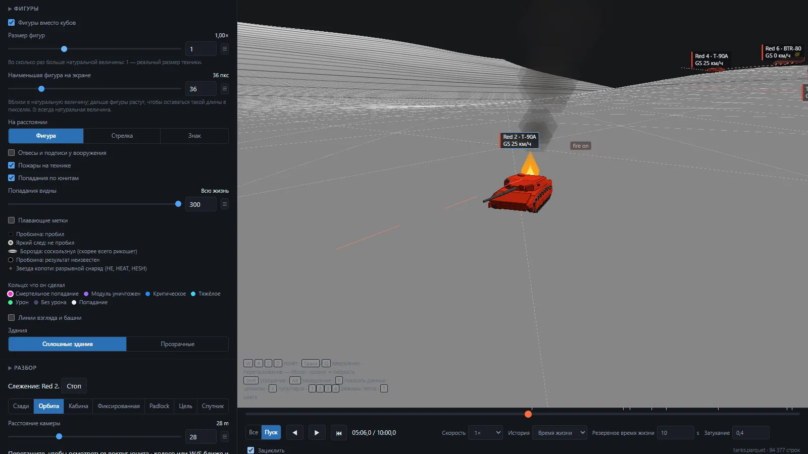

# Фигуры

**Фигура** — это маленькая 3D-модель того, чем единица является на самом деле: танк, реактивный самолёт, корабль, солдат. [Повтор](match-replay.md) рисует каждую единицу её фигурой в натуральную величину вместо простой коробки.

Здесь около 2 000 именованных машин, самолётов, кораблей, видов оружия и солдат, все построены самим просмотрщиком.

## Что есть в каталоге {#what-is-in-the-catalogue}

| Область | Примеры |
|---|---|
| Люди | солдат стоя, на корточках, лёжа; снайпер, противотанковый, санитар, экипаж |
| Суша | танки, боевые машины пехоты, зенитные средства, артиллерия, грузовики и легковые, поезда и трамваи |
| Воздух | истребители, штурмовики, бомбардировщики, транспортные, вертолёты, от бипланов до современных реактивных |
| Море | боевые корабли по классам, авианосцы, подводные лодки, катера, торговые суда |
| Оружие | ракеты, реактивные снаряды, бомбы, торпеды, осветительные и дымовые ракеты |
| Метки | дымовые, световые и зажигательные гранаты, заложенные бомбы, флаги, точки появления, маршрутные точки |
| Ближний бой | солдаты в плитоносках со штурмовой винтовкой, пистолетом-пулемётом, дробовиком, DMR, LMG, пистолетом или щитом; дроны, камеры, колючая проволока, щиты, укрепление стен, баррикады, заряды для пролома, ловушки, окна, гранаты, дефьюзер |

## Как делаются фигуры {#how-the-figures-are-made}

- **Построены по опубликованным размерам.** Большинство фигур делает собственный построитель фигур просмотрщика по открытым числам: длина, ширина, высота, опорные катки, башня и пушка, крылья и хвост. Их форма затем подстраивается под открытые фотографии, чертежи и опубликованные размеры. Модели ни одной игры не используются.
- **Свободные модели.** Несколько фигур используют свободные 3D-модели (CC0 или CC BY), где они точнее; иногда их сочетают с построенным корпусом. Авторы работ CC BY указаны на странице [Авторство фигур](figure-credits.md); работы CC0 не требуют указания авторства и там не перечислены.
- У каждой фигуры есть полная, грубая и дальняя версии (уровни детализации, LOD), поэтому можно нарисовать тысячи сразу.

## Какую фигуру получает единица {#which-figure-a-unit-gets}

Просмотрщик смотрит на собственные столбцы данных:

1. **Имена** — столбцы с названиями *Name*, *Vehicle*, *Unit*, *Unit type*, *Model*, *Aircraft*, *Plane*, *Tank*, *Ship*, *Craft*, *Loadout*, *Kit* или *Figure* — сопоставляются с каталогом: точно, через около 4 000 псевдонимов (игровые идентификаторы единиц нескольких игр), по самому длинному известному началу (`F-16C_50` — это F-16C) или по самому короткому имени фигуры, которое с него начинается.
2. Имя, чья фигура не подходит к **типу** единицы, не используется (грузовик по имени *Typhoon* — это не истребитель).
3. **Типы** — столбцы с названиями *Type*, *Class*, *Kind*, *Category*, *Icon*, *Role* или *Domain* — дают фигуру класса: метки Tacview (`Air+FixedWing`, `Ground+Heavy+Armor+Vehicle+Tank`, `Sea+Watercraft+Warship`, `Weapon+Missile`), значки карт или простые слова (tank, helicopter, infantry).
4. Данные без того и другого — это данные о людях: каждый — солдат.

Поэтому проще всего получить нужные фигуры со столбцом `vehicle` с настоящими именами или со столбцом `type` с метками Tacview.

**Моя единица показана коробкой или солдатом.** Добавьте столбец `vehicle` с настоящим именем или столбец `type` с меткой Tacview. Наведите курсор на единицу, чтобы увидеть, какое имя было сопоставлено. Данные, в которых есть такие столбцы, но ничего не говорят о единице, оставляют её коробкой; данные без обоих рисуются как солдаты.

## Фигуры для ближнего боя (Rainbow Six Siege) {#close-quarters-figures-rainbow-six-siege}

Таблицы, записанные как у считывателя повторов Rainbow Six Siege (столбцы `operator`, `pawn`, `primaryClass`, `side`), получают собственные фигуры:

- **Игроки** — это их оперативник: у каждого из 78 оперативников своя фигура высотой около 1,8 м, в своей одежде — два или три цвета для куртки, брюк и снаряжения по их обычному публичному облику (чёрный, оливковый, песочный, городской серый, белый, тёмно-синий, с красным, оранжевым или бирюзовым снаряжением) — и со своими формами, на треть крупнее, чем в жизни, там, где их нужно видеть сверху: головной убор (шлемы, визор или тяжёлый шлем, кепки, вязаные шапки, береты, широкая панама boonie или меховая шапка, капюшоны, шарфы, волосы), лицо (защитные очки, противогаз, очки, маска, борода, очки с тремя линзами), лёгкое, среднее или тяжёлое телосложение (тяжёлые — широкие, с большими наплечными пластинами и воротником), длинное пальто или костюм, маскхалат «гилли», то, что они носят на спине (молот, заряды, дроны, баллоны, топливный бак, трубу пусковой установки, арбалет, панели, глушилку, щит) или на руке (пусковую установку, металлическую руку), свой щит (высокий щит, полицейский щит, щит с фонарями) и акцентный цвет на плечах. Они держат класс своего основного оружия. Оперативник, которого просмотрщик не знает, — простой солдат в плитоноске цвета команды.
- **Сторона** видна отдельно от одежды: кольцо на земле под каждым оперативником, **янтарное для атаки, бледно-голубое для обороны**, с цветом команды внутри, и повязки на руке и голове того же цвета. Столбец `stance` (stand, crouch, prone) задаёт позу; без него они стоят.
- **Различимы на дистанции повтора:** при отрисовке высотой 48 пикселей сверху и в три четверти любые два оперативника одной стороны отличаются явной разницей в цвете или другой формой (проверено тестами просмотрщика).
- **Подписи** называют игрока и оперативника, которым он играет в этот момент, с ролью оперативника в виде символа: ✸ жёсткий пролом, ⚒ мягкий пролом, ➤ вход, ✦ фраггер, ✚ поддержка, ⬟ щит, ◉ разведка, ◇ флекс, ↺ охрана фланга, ⚓ якорь, ✕ ловушки, ⇄ роумер, ↯ против гаджетов, ▣ против пролома.
- **Дроны** — это двухколёсный метательный дрон шириной около 30 см, каждый отдельным треком, названным по владельцу («Ash · drone 2»).
- **Установленные гаджеты** стоят там, где их поставили, с этого момента до конца раунда, каждый как фигура того, что он делает: камера, колючая проволока, развёртываемый щит, заряд для пролома, заряд для жёсткого пролома, маленький липкий заряд, напольная ловушка, клеймор с лазерной растяжкой, одностороннее окно, бронепанель, граната, газовый баллон, глушилка, датчик, лазерные ворота, ящик с припасами. Одна фигура служит для всех гаджетов, которые делают одно и то же. Гаджет, вид которого в данных не указан, — небольшое устройство с огоньком.
- **Дефьюзер** стоит там, где его установили, все свои 45 секунд.

Каждый дрон и гаджет при загрузке файла становится отдельным треком, поэтому собственная фигура игрока остаётся на его теле. Оперативники — упрощённые формы по их публичным описаниям и изображениям (что они носят, устройство, которое является их способностью), а гаджеты получают форму по тому, что они делают. Всё это собственные разработки просмотрщика в реальном размере предмета (клеймор шириной около 22 см, панель размером с дверь 1 м × 2,1 м), а не модели из игры.

## Настройки {#settings}

Раздел **Фигуры** на боковой панели повтора задаёт размер, наименьший размер на экране, во что превращаются дальние единицы (фигура, стрелка, символ) и эффекты, которые на них рисуются. См. [Повтор матча](match-replay.md#figures). Дым, огонь и другие эффекты по времени: [Фигуры в наложении фигур](figure-replay.md).

## Необязательный локальный набор фигур {#an-optional-local-figure-pack}

Вы можете хранить на своём компьютере необязательный набор собственных фигур. Его фигуры занимают место фигур каталога с теми же именами. Он никогда не входит в репозиторий или опубликованную сборку; без него ничего не меняется.
