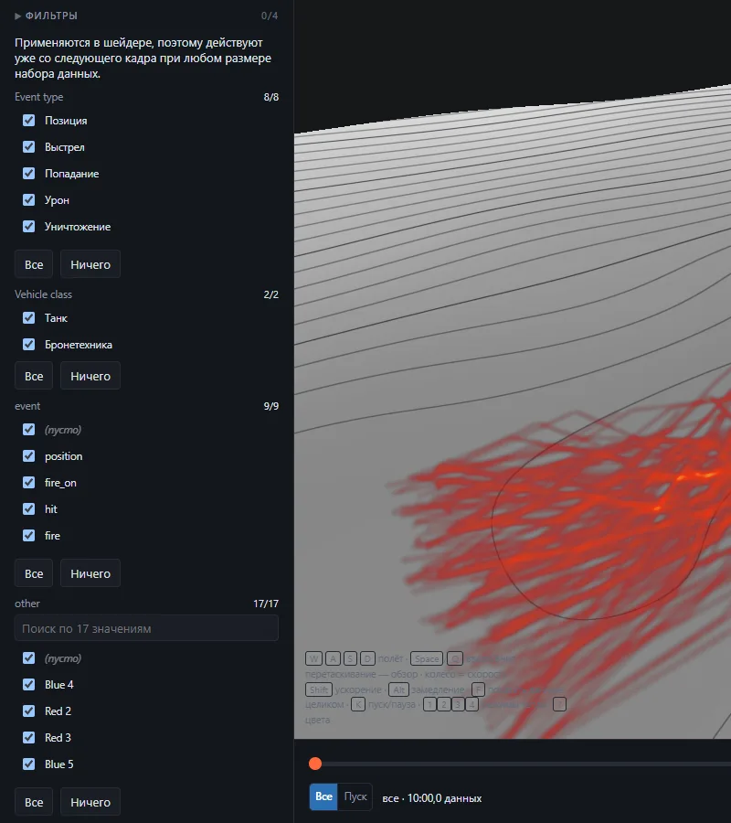
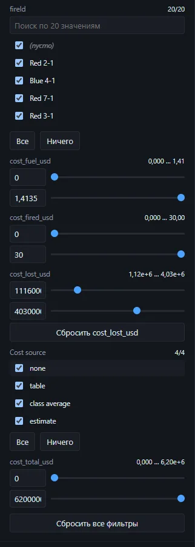

# Фильтры

**Фильтры** скрывают строки, которые вам не нужны, например один класс техники или один вид события, и картинка обновляется сразу. Панель перечисляет столбцы, сохранённые при загрузке в разделе *Сохранить для фильтрации* ([Сопоставление столбцов](column-mapping.md)), а также *Исходный файл*, если загружено несколько файлов.

## Попробуйте {#try-it}

1. Загрузите набор данных и откройте **Фильтры** в боковой панели.
2. В разделе **Класс техники** снимите отметку с *Tank*. Картинка изменится сразу.
3. Нажмите **Сбросить все фильтры**, чтобы отменить.

Первые строки — собственные столбцы просмотра (ниже). Строки после них берутся из вашего файла.

## Столбцы, которые добавляет просмотр {#columns-the-viewer-adds}

При загрузке просмотр сам выделяет четыре столбца и ставит их **первыми** в списке, с названиями и значениями на вашем языке. Поэтому один и тот же фильтр работает для любой игры и любого источника данных:

| Столбец | Значения | Как определяется |
|---|---|---|
| **Тип события** | 23 вида: Позиция, Выстрел, Пуск (ракета, реактивный снаряд, бомба), Попадание, Промах (оружие закончилось рядом с целью), Взрыв, Урон, Уничтожение, Смерть, Уничтожен, Авария, Катапультирование / покидание, Появление, Исчезновение, Взлёт, Посадка, Контакт с землёй, Остановка на земле, Перевооружение / заправка, Захват / цель, Ложная цель, Сообщение, Другое | столбец `event`, `events`, `event_type` или `event_name`; собственные слова каждой игры (`shot`, `burst`, `fired`, `struck`, `flare`, `plant` ...) сопоставляются с этими видами. Полная таблица: [Типы и классы событий](ref-event-types.md). |
| **Игрок или ИИ** | Игрок, ИИ | столбец `ai`, `is_ai`, `bot` или `actor`; иначе `is_player` / `human`; иначе идентификатор аккаунта (`user_id`, `steam_id`; пусто или 0 — это ИИ); для записей Tacview — есть ли у объекта пилот |
| **Класс техники** | 17 классов: Истребитель, Штурмовик, Бомбардировщик, Другой самолёт, Вертолёт, Танк, Бронемашина, Противовоздушная оборона, Артиллерия, Грузовик / легковой, Корабль, Подводная лодка, Пехота, Оружие, Ложная цель, Сооружение, Другое | название техники или юнита (сверяется с [каталогом фигур](figures.md)) и столбцы типа |
| **Класс цели** | те же классы | техника другой стороны (`other_vehicle`, `target_vehicle`, `victim_type` ...) |

Сразу за ними идут [столбцы итога](data-formats.md#outcome-columns), если они есть в данных: **Итог раунда** и **Итог матча** (*Любой*, *Победа*, *Поражение*) и **Как закончился раунд**, со значениями на вашем языке. Фильтруйте по ним или разделите по ним тепло как [карту доли побед](win-rate.md).

Перечисляются только встречающиеся виды. Столбцы значений (`cost_*`, `earn_*`, `net_*` и *Cost source*, см. [Взвешивание по ценности](value-weighting.md)) фильтруются как любой числовой столбец: например, снимите отметку с *estimate* в *Cost source*, чтобы оставить только строки с ценой.

Список категорий из более чем 12 значений получает поле поиска (*Search n values*) и кнопку **Только эти**, которая разрешает ровно подходящие значения.

Какие столбцы можно фильтровать, решается при загрузке, потому что их нужно прочитать тогда. Если сохранённых столбцов нет, панель это сообщает и указывает на *Сохранить для фильтрации*.

## Числовые столбцы (диапазон) {#numeric-columns-range}

| Часть | Значение |
|---|---|
| Название и `min ... max` | Столбец и текущий диапазон (полный диапазон столбца, пока фильтр не задан). |
| Первая строка: поле ввода и ползунок | Нижняя граница. Если тянуть ползунок выше верхней границы, она сдвигается вместе с ним. |
| Вторая строка: поле ввода и ползунок | Верхняя граница. Если тянуть ниже нижней границы, сдвигается и она. |
| **Сбросить *столбец*** | Убирает этот фильтр. |

Ползунки охватывают от минимума до максимума столбца в 1 000 шагов; поля ввода принимают любое значение. Строка проходит, если её значение лежит внутри диапазона, включая обе границы. Большие значения показываются в экспоненциальной форме (`1.23e6`).

## Столбцы-категории {#category-columns}

| Часть | Значение |
|---|---|
| Название и `разрешено/всего` | Столбец и сколько его значений разрешено. |
| Список значений | Флажок для каждого значения; пустое значение показывается как *(пусто)*. |
| **Все** / **Ничего** | Разрешить все значения / ни одного. |

Если разрешить все значения, фильтр снимается.

## Правила {#rules}

- **Четыре фильтра сразу.** В заголовке видно `активно/4`. Пятый фильтр не применяется, и панель об этом сообщает. Выбор в [Объектах](entities.md) (или фокус на игроке во вкладке Матч) тоже занимает один из четырёх. Фильтр, который охватывает весь столбец, никого не занимает.
- **У столбца-категории не больше 4 096 значений**; более широкий при загрузке не сохраняется.
- **Фильтры работают по И** вместе с видимостью команд, разностным разделением, временным окном, отсечением по расстоянию и [срезом](slice.md).
- **Изменение фильтра перезапускает накопление и через несколько кадров заново измеряет экспозицию**, потому что фильтрация может сильно изменить плотность ([Цвет и экспозиция](colour-and-exposure.md#auto-exposure)).
- **Сбросить все фильтры** убирает все фильтры столбцов. Видимость команд и выбор игроков, заданные в другом месте, сохраняются.
- Фильтры столбцов меняют режимы тепла. Они не меняют фигуры в [повторе фигур](box-replay.md), которые следуют видимости команд и выбору в Объектах. Выбор в Объектах меняет и то и другое.
- В [линейном тепле](line-heat.md) фильтр проверяется по строке, в которой *заканчивается* каждый отрезок.
- При каждом новом наборе данных все фильтры сбрасываются.

## Для разработчиков {#for-developers}

**Слоты.** Каждый активный фильтр занимает один из четырёх слотов GPU ([`MAX_FILTER_SLOTS`](https://github.com/Holdi601/3DHeat/blob/main/src/render/types.ts)), текстуру по 4 байта на строку. Слоты отдаются фильтрам в порядке их последнего изменения ([`filterSlots`](https://github.com/Holdi601/3DHeat/blob/main/src/render/filterTables.ts), общий для шейдера и обеих панелей). Сверх четырёх выводится ошибка: *Применяются только первые 4 фильтра. Снимите один — остальные игнорируются, а не объединяются молча*, а у лишних фильтров в названии стоит *столбец (не применяется)*. Фильтры работают построчно в вершинном шейдере, поэтому смена порога не требует повторного разбора и повторной загрузки.

**Фильтры, которых панель не показывает.** В состоянии приложения есть ещё два вида ([`FilterSpec`](https://github.com/Holdi601/3DHeat/blob/main/src/state/types.ts)):

- фильтр **групп**, который задаёт вкладка Матч, когда выделяет одну сторону. Он скрывает остальные группы во всех режимах, включая [разность](difference.md), разделённую по столбцу.
- фильтр **персон**, который задают панель [Объекты](entities.md) и вкладка Матч, когда выделяет одного игрока. Он ограничивает повтор фигур и режимы тепла. В тепле это фильтр-категория по идентификаторам персон, и он занимает один из четырёх слотов. Его маска хранит 65 536 идентификаторов ([`FILTER_MASK_CAPACITY`](https://github.com/Holdi601/3DHeat/blob/main/src/render/types.ts)); персона сверх этого числа не рисуется в тепле, пока фильтр активен, даже если выбрана. Повтор фигур её по-прежнему показывает.
