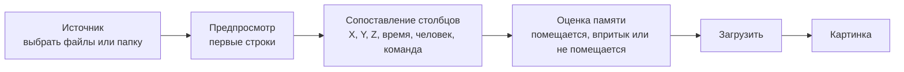

# Загрузка данных

Прежде чем 3DHeat сможет что-то нарисовать, ему нужна таблица: каждая строка говорит, где что-то было и, если это известно, когда и кто. Этот раздел показывает, как файл становится картинкой. Данных пока нет? Попробуйте [демо-данные](demo-data.md).

**Сделайте это сейчас:**

1. В боковой панели Тепловой карты откройте **Источник** и нажмите **Файлы…** (или перетащите файл или папку на зону сброса).
2. Посмотрите **Сопоставление столбцов**: поля обычно уже заполнены.
3. Проверьте, что **Оценка памяти** говорит *помещается*.
4. Нажмите **Загрузить**.

Всё, что показывает вкладка Тепловая карта, берётся из одного **набора данных**: таблицы строк, у каждой из которых есть позиция и, по желанию, время, человек, группа, сессия, направление взгляда и любое число дополнительных столбцов, сохранённых для фильтрации. Этот раздел объясняет, как создаётся набор данных.

## Путь от файлов к картинке {#the-path-from-files-to-picture}

1. **Выберите файлы** в панели **Источник**: один файл, несколько, дерево папок или перетаскиванием. Принимаются Parquet, CSV, Tacview, GPS-треки и другие; полный список есть в [Форматах данных](data-formats.md#files). См. [Загрузка файлов](loading-files.md).
2. **Предпросмотр.** Открывается первый файл выбора: его имена столбцов, первые 50 строк, какие столбцы выглядят числовыми и (для Parquet) логический тип каждого столбца и собственная инструкция чтения файла, запись `heat3d` в футере.
3. **Автосопоставление.** Столбцы назначаются ролям — X, Y, Z, время, человек, сессия, группа, направление взгляда, — и несколько из них сохраняются для фильтрации. Каждая догадка видна в панели **Сопоставление столбцов** и может быть изменена. См. [Сопоставление столбцов](column-mapping.md) и [Оси, единицы и время](axes-units-and-time.md).
4. **Подсчёт.** Число строк каждого файла считывается (точно из футеров Parquet, оценкой для CSV), поэтому панель может сказать до загрузки, сколько памяти нужно и помещается ли загрузка. Если не помещается, панель предлагает загрузить каждую *N*-ю строку. См. [Память и бюджеты](memory-and-budgets.md).
5. **Загрузка.** Фоновый воркер разбирает только сопоставленные столбцы каждого файла — несколько файлов сразу, до бюджета [потоков разбора](memory-and-budgets.md#parser-threads) — и объединяет их в порядке выбора в один набор данных: один общий словарь людей, групп и сессий для всех файлов, одно общее начало времени, все строки, отсортированные по времени. См. [Сессии, персоны и группы](sessions-persons-groups.md).
6. **Выгрузка.** Главный поток сообщает «Загрузка N строк в GPU» на один кадр, затем упаковывает строки в память GPU в пределах бюджета GPU. См. [Пребывание в памяти GPU](gpu-memory.md).
7. **Первая картинка.** Камера вмещает данные в кадр, радиус спрайта и насыщение задаются по протяжённости данных и числу строк, а после 8 отрисованных кадров насыщение измеряется по самой картинке ([Цвет и экспозиция](colour-and-exposure.md)).

## Требования, проверяемые до загрузки {#requirements-checked-before-a-load}

| Нужно | Что происходит без этого |
|---|---|
| **Минимум два из X / Y / Z** | Загрузка отклоняется. При ровно двух третья ось равна 0, и данные рисуются плоской плоскостью в 3D-сцене, — именно так и выглядит тепловая карта карты сверху. |
| Столбец времени | Необязательно. Без него временная шкала отключена, вид остаётся в режиме **Все**, и боковая панель об этом сообщает. |
| Столбец человека | Необязательно. Нужен для [наложения фигур](box-replay.md) (фигура на каждого человека), [линейного тепла](line-heat.md) (путь каждого человека), интерполяции, следов и истории **Время жизни**. |
| Столбец группы | Необязательно. Нужен для [тепла команд](team-heat.md) и режима [разности](difference.md) (минимум две группы). |

Режим, который загруженные данные не могут поддержать, отображается серым на панели режимов; при наведении видно причину.

## Без собственных данных {#without-your-own-data}

В панели **Набор данных** (под **Источником**) есть [генератор синтетических данных](synthetic-generator.md), который создаёт набор в форме королевской битвы любого размера — полезно, чтобы попробовать просмотр и проверить, что потянет машина.

## Страницы этого раздела {#pages-in-this-section}

- [Загрузка файлов](loading-files.md) — выбор файлов, папки, перетаскивание, объединение нескольких файлов, правило файлов движения, прогресс и отмена
- [Сопоставление столбцов](column-mapping.md) — каждое поле панели сопоставления, как работает автосопоставление, подсказки `heat3d`
- [Оси, единицы и время](axes-units-and-time.md) — вертикальная ось, отражения, масштаб единиц, единицы времени, направление взгляда
- [Сессии, персоны и группы](sessions-persons-groups.md) — что делает каждая, ограничения, общие имена, размер объектов, панель Набор данных
- [Генератор синтетических данных](synthetic-generator.md)
- [Память и бюджеты](memory-and-budgets.md) — модель занимаемой памяти, проверка помещения, прореживание, потолок сортировки, бюджеты ресурсов
