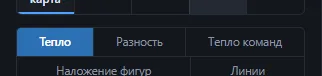

# Режимы тепла

Каждая точка добавляет немного свечения, свечения складываются, и получившуюся кучу раскрашивают цветами. Режимов пять — это пять способов её раскрасить, и каждый отвечает на один вопрос.

Панель режимов вверху боковой панели вкладки Тепловая карта выбирает, как рисуется [набор данных](glossary.md). Клавиши 1-4 выбирают Тепло, Разность, Тепло команд и Линии. У наложения фигур клавиши нет.

| Режим | На какой вопрос отвечает |
|---|---|
| **Тепло** | Где это произошло и сколько раз? |
| **Разность** | Какая сторона делала это чаще? |
| **Тепло команд** | Чьё это было? |
| **Линии** | По каким путям ходили люди? |
| **Наложение фигур** | Кто где был и когда? |

| Режим (подпись на панели) | Клавиша | Что рисует | Что нужно |
|---|---|---|---|
| **Тепло** | 1 | Аддитивная плотность: каждая видимая строка добавляет радиальный спрайт, обращённый к камере. [Тепло](heat.md) | набор данных |
| **Разность** | 2 | Знаковая плотность: одна группа прибавляет, другая вычитает. [Разность](difference.md) | две стороны: минимум две группы или разделение по сохранённому столбцу |
| **Тепло команд** | 3 | Плотность, окрашенная по группам: свой оттенок у каждой группы, смешиваются там, где группы пересекаются. [Тепло команд](team-heat.md) | столбец группы |
| **Наложение фигур** | — | Фигура (или коробка) на каждого человека, движется по временной шкале: повтор. [Наложение фигур](box-replay.md), [Повтор матча](match-replay.md) | столбец человека |
| **Линии** | 4 | Линейное тепло: линия от каждой выборки человека до его следующей, тепло спадает в стороны. [Линии](line-heat.md) | столбцы человека и времени |

Режим, который данные не могут поддержать, отображается серым, а подсказка объясняет причину, например: *Недоступно — режиму «Разность» нужны две группы или сохранённый столбец для разделения; в этих данных одна группа.* Когда новый набор данных не поддерживает текущий режим, вид переключается на **Тепло**.

Клавиши 1-4 проверяются по данным так же: клавиша недоступного режима ничего не делает.

## Какие панели показывает каждый режим {#which-panels-each-mode-shows}

| Панель | Тепло | Разность | Тепло команд | Наложение фигур | Линии |
|---|---|---|---|---|---|
| Маршруты ([линейное тепло](line-heat.md)) | | | | | да |
| Форма тепла (с **Следовать за видом** и **Одинаковая плотность при любом масштабе**), Цвета тепла, пиксельные ограничения спрайта, Глубина, Отсечение по расстоянию | да | да | да | | да |
| Направление ([направленное тепло](directional-heat.md)), Значение ([взвешивание по ценности](value-weighting.md)) | да | да | да | | да |
| Просмотр команд ([наложение фигур](box-replay.md)) | | | | да | |
| Разностное разделение ([разность](difference.md)) | | да | | | |
| [Команды](teams-list.md), [Объекты](entities.md), [Фильтры](filters.md), Фон / уровень, [Срез](slice.md), [Измерение](measure.md), Путь камеры и рендер, Производительность, Камера и сцена | да | да | да | да | да |

## Что общего у всех режимов тепла {#what-every-heat-mode-shares}

Все четыре режима тепла (всё, кроме наложения фигур) — одна и та же машина с разными входами ([`engine.ts`](https://github.com/Holdi601/3DHeat/blob/main/src/render/engine.ts)):

1. **Какие строки.** [Временная шкала](timeline.md) выбирает непрерывный диапазон строк, отсортированных по времени. [Фильтры](filters.md), видимость групп, разностное разделение, [отсечение по расстоянию](depth-and-culling.md#distance-culling) и [срез](slice.md) решают для каждой строки в вершинном шейдере, участвует ли она и с какой силой.
2. **Сплаттинг.** Каждая участвующая строка рисуется спрайтом (или, в режиме Линии, отрезком) в плавающую **цель тепла**, прибавляя своё значение шкалы. Когда строк больше, чем может вынести кадр, рисуется стратифицированная выборка строк с весами для компенсации. См. [Выборка и бюджеты](sampling-and-budgets.md).
3. **Накопление.** Пока ничего не меняется, кадры складываются, пока каждая строка не внесёт вклад ровно один раз. См. [Накопление](accumulation.md).
4. **Композитинг.** Накопленное значение в каждом пикселе делится на **точку насыщения**, формируется **отзывом на плотность**, поднимается **минимальным теплом** и ищется в **шкале цветов**, чья прозрачность смешивает её со сценой. См. [Цвет и экспозиция](colour-and-exposure.md).

Всё из шага 4 применяется при композитинге, поэтому перетаскивание этих элементов никогда не перезапускает накопление. Всё из шагов 1-2 его перезапускает.

## Страницы этого раздела {#pages-in-this-section}

- [Тепло](heat.md) — обычный режим тепла и обзор его панелей
  — [Форма спрайта](sprite-shape.md) — радиус, интенсивности, спад, редактор кривой, пиксельные ограничения, сплющивание
  — [Цвет и экспозиция](colour-and-exposure.md) — редактор шкалы, точка насыщения, автоэкспозиция, минимальное тепло, отклик на плотность
  — [Глубина и отсечение](depth-and-culling.md) — перекрытие уровнем, скрытие за рельефом, отсечение по расстоянию
- [Разность](difference.md) — разностное разделение
- [Тепло команд](team-heat.md)
- [Линии](line-heat.md) — маршруты
- [Наложение фигур](box-replay.md) — режим повтора (файл по-прежнему называется box replay)
- [Направленное тепло](directional-heat.md)
- [Взвешивание по ценности](value-weighting.md)
