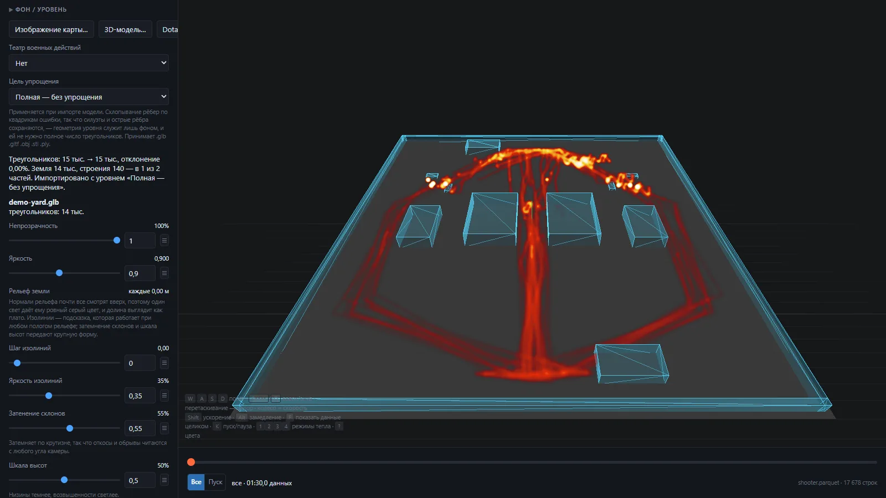
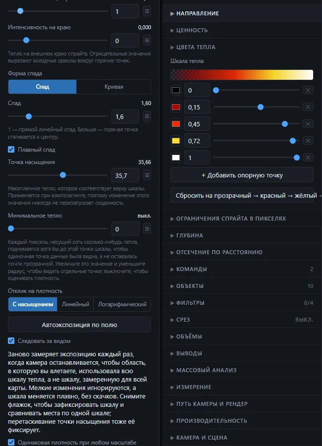

# Тепло

Тепло окрашивает места, где случилось много всего: красным там, где случилось немного, и раскалённо-белым там, где много. Оно отвечает на вопрос «где это происходит и сколько».

**Тепло** (клавиша 1) — режим по умолчанию. Каждая видимая [строка](glossary.md) добавляет круглый [спрайт](glossary.md), обращённый к камере; перекрывающиеся спрайты складываются в буфер с плавающей точкой; сумма переводится через шкалу цветов — по умолчанию прозрачный → красный → жёлтый → белый — и рисуется поверх сцены.

На картинке — тепло раунда стрелялки на уровне со зданиями: горячие места лежат в комнатах и на лестницах, а не только на земле.

## Как пользоваться {#how-to-use-it}

1. Загрузите данные и нажмите `1` (или выберите **Тепло** на панели режимов).
2. Если всё белое или пустое, нажмите **Автоэкспозиция по полю** в разделе **Форма тепла**.
3. Меняйте **Радиус спрайта**, пока соседние точки не сольются в полосы: меньше — видны отдельные пятна, больше — видны области.
4. Откройте **Цвета тепла**, чтобы поменять цвета, или **Глубина**, чтобы холмы и стены скрывали тепло за собой.

Те же панели управляют [Разностью](difference.md), [Тепло команд](team-heat.md) и [Линии](line-heat.md); они отличаются тем, что прибавляется (знаковое, окрашенное или вдоль линий), а не тем, как это делается.

## Панели и их значения по умолчанию {#the-panels-and-their-defaults}

Каждый элемент ниже соответствует параметру шейдера, поэтому его изменение стоит только перерисовки. У ползунков есть поле ввода рядом и ручка перетаскивания (маленький захват справа: тяните вверх или вниз, дальше — быстрее, Shift — точнее); если дорожка ползунка заканчивается раньше настоящего предела, ручка может уйти за неё до *потолка ручки*, указанного здесь. Значения, помеченные *при загрузке*, пересчитываются для каждого нового набора данных.

### Форма тепла (открыт) {#heat-shape-open}

| Элемент | По умолчанию | Диапазон (потолок ручки) | Подробнее |
|---|---|---|---|
| **Радиус спрайта** | 6 м; при загрузке протяжённость / 120 | 0.05-2000 м, логарифмически (50 000) | [Форма спрайта](sprite-shape.md#sprite-radius) |
| **Интенсивность в центре** | 1 | 0-10 (1000) | [Форма спрайта](sprite-shape.md#centre-and-edge-intensity) |
| **Интенсивность на краю** | 0 | -2-10 (1000) | [Форма спрайта](sprite-shape.md#centre-and-edge-intensity) |
| **Форма спада** | *Спад* | *Спад* / *Кривая* | [Форма спрайта](sprite-shape.md#ramp-shape-falloff-or-curve) |
| **Спад** (только для Спада) | 1.6 | 0.1-8 (64) | [Форма спрайта](sprite-shape.md#falloff) |
| **Плавный спад** (только для Спада) | вкл. | | [Форма спрайта](sprite-shape.md#falloff) |
| Редактор кривой (только для Кривой) | пресет *Плавно* | | [Форма спрайта](sprite-shape.md#the-curve-editor) |
| **Точка насыщения** | 24; при загрузке оценка, затем измерение | 0.1-4000, логарифмически (10 000 000) | [Цвет и экспозиция](colour-and-exposure.md#saturation-point) |
| **Минимальное тепло** | выкл. (0) | 0-100% | [Цвет и экспозиция](colour-and-exposure.md#minimum-heat) |
| **Отклик на плотность** | *Насыщение* | *Насыщение* / *Линейный* / *Логарифм* | [Цвет и экспозиция](colour-and-exposure.md#density-response) |
| **Автоэкспозиция по полю** | | кнопка | [Цвет и экспозиция](colour-and-exposure.md#auto-exposure) |
| **Следовать за видом** | вкл. | | Заново измеряет экспозицию каждый раз, когда камера остановилась, так что область, в которую вы влетели, использует всю шкалу цветов. Мелкие изменения игнорируются, и масштаб плавно скользит. Снимите отметку или потяните **Точку насыщения**, чтобы зафиксировать масштаб и сравнивать места в одном масштабе. [Цвет и экспозиция](colour-and-exposure.md#follow-the-view) |
| **Одинаковая плотность при любом масштабе** | вкл. | | Один цвет означает одно и то же число строк на площадь земли, как близко вы бы ни были. Спрайт, который пиксельные ограничения увеличивают (вдали) или уменьшают (вблизи), сохраняет тепло, которое дал бы его настоящий размер, поэтому картинка, выставленная с большого расстояния, не гаснет, когда вы в неё влетаете. Выключено — ограниченный спрайт вносит весь свой вес при ограниченном размере. [Форма спрайта](sprite-shape.md#pixel-clamps) |
| **Спроецировать на плоскость земли** | выкл. | | [Форма спрайта](sprite-shape.md#flatten-onto-ground-plane) |

### Цвета тепла (закрыт) {#heat-colours-closed}

| Элемент | По умолчанию | Подробнее |
|---|---|---|
| Образцы групп и **Разделение цветов** (только Тепло команд) | 1.4 | [Тепло команд](team-heat.md) |
| Редактор **Шкалы тепла** (*Положительная (прибавляющие команды)* в Разности, *Шкала непрозрачности* в Тепле команд) | прозрачный → красный → жёлтый → белый | [Цвет и экспозиция](colour-and-exposure.md#the-ramp-editor) |
| **Сбросить на прозрачный → красный → жёлтый → белый** | | |
| Шкала **Отрицательная (вычитающие команды)** (только Разность) | прозрачный → зелёный → синий → фиолетовый | [Разность](difference.md#colours) |

### Пиксельные ограничения спрайта (закрыт) {#sprite-pixel-clamps-closed}

| Элемент | По умолчанию | Диапазон (потолок ручки) | Подробнее |
|---|---|---|---|
| **Мин. радиус в пикселях** | 1 px | 0-16 (512) | [Форма спрайта](sprite-shape.md#pixel-clamps) |
| **Макс. радиус в пикселях** | 96 px | 2-1024, логарифмически (8192) | [Форма спрайта](sprite-shape.md#pixel-clamps) |

### Глубина (открыт) {#depth-open}

| Элемент | По умолчанию | Подробнее |
|---|---|---|
| **Скрывать за рельефом** | вкл. | [Глубина и отсечение](depth-and-culling.md#hide-behind-terrain) |
| **Скрытое за геометрией** | 0.8 (*на 80% темнее*) | [Глубина и отсечение](depth-and-culling.md#hidden-behind-geometry) |

### Отсечение по расстоянию (закрыт) {#distance-culling-closed}

| Элемент | По умолчанию | Диапазон (потолок ручки) | Подробнее |
|---|---|---|---|
| **Ближняя** | выкл. (0) | 0.5-5000 м, логарифмически; низ дорожки = выкл. (200 000) | [Глубина и отсечение](depth-and-culling.md#distance-culling) |
| **Дальняя** | выкл. (0) | 1-200 000 м, логарифмически; низ = выкл. (10 000 000) | [Глубина и отсечение](depth-and-culling.md#distance-culling) |
| **Резать плоскостью** | вкл. | | [Глубина и отсечение](depth-and-culling.md#distance-culling) |
| **Резать и уровень** | вкл. | | [Глубина и отсечение](depth-and-culling.md#distance-culling) |

Клавиши: `[` и `]` двигают дальнюю границу внутрь и наружу, `\` переключает её ([Глубина и отсечение](depth-and-culling.md#keyboard)).

### Направление и Значение {#direction-and-value}

Ещё два раздела идут ниже Формы тепла. **Направление** рисует каждую строку клинышком и добавляет стрелки: см. [Направленное тепло](directional-heat.md). **Значение** взвешивает тепло по тому, что стоила или принесла каждая строка: см. [Взвешивание по ценности](value-weighting.md).

## Что сохраняется {#what-is-saved}

Настройки тепла выше не хранятся между сессиями: перезагрузка страницы возвращает значения по умолчанию. В браузере сохраняются две вещи: последняя скорость воспроизведения (`heat3d.speed`, см. [Временная шкала](timeline.md)) и настройки далёких фигур [наложения фигур](box-replay.md) (стиль знаков, размер, метки попаданий и так далее). Так же сохраняются язык, [инвертированные мировые оси](camera.md#invert-world-axis), запомненные названия машин на вкладке гонок и [библиотека уровней](level-library.md). Полный список — в [Сохранённых настройках](ref-settings-storage.md).
