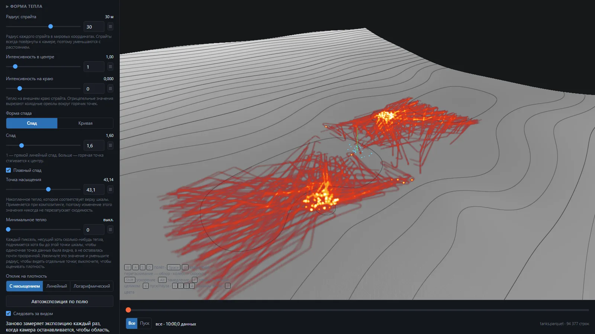
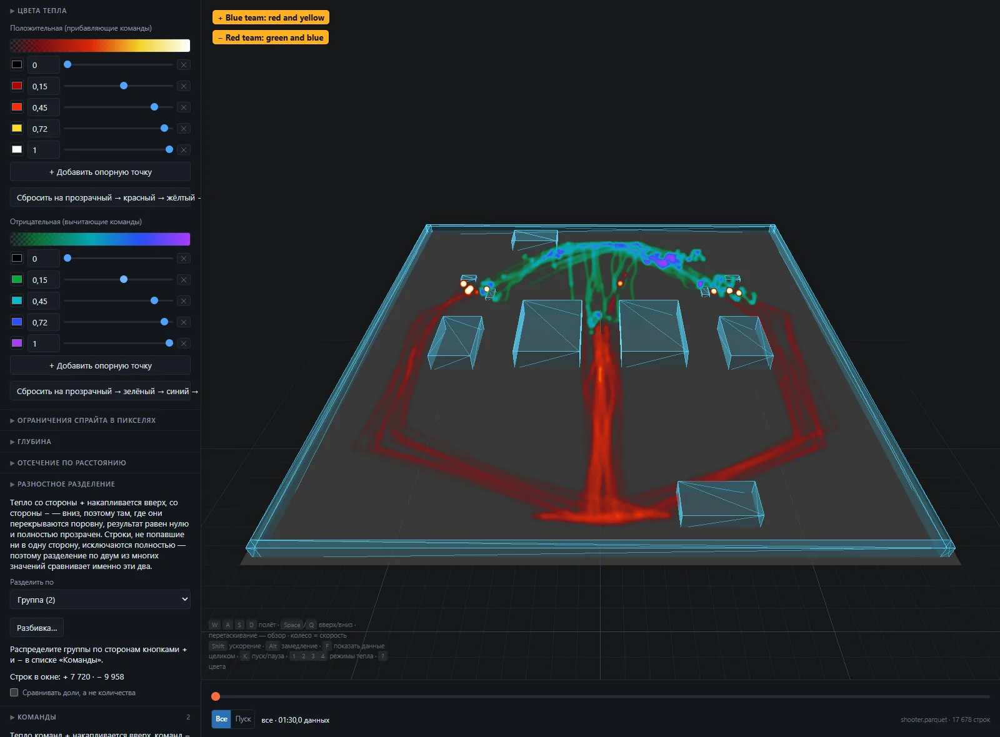
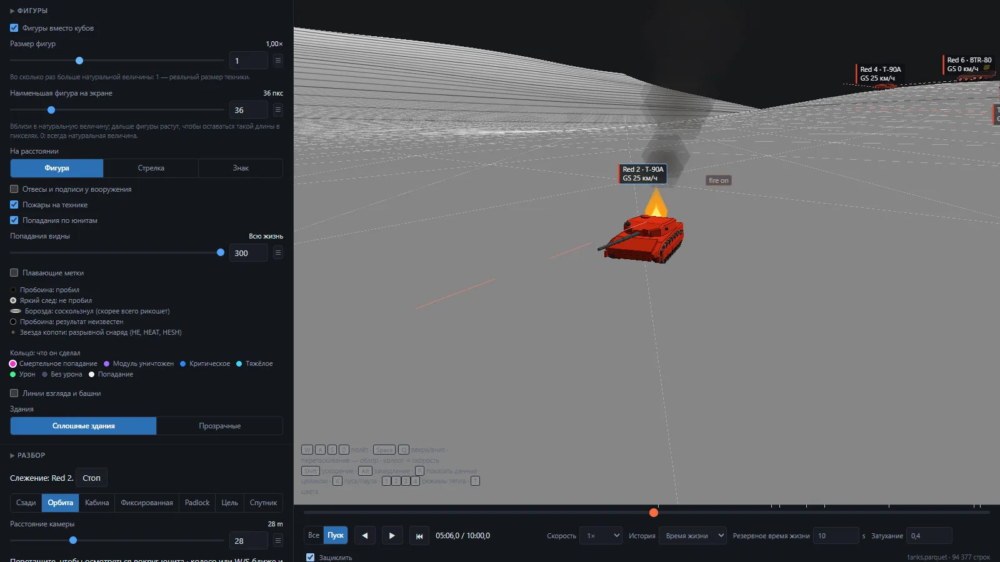
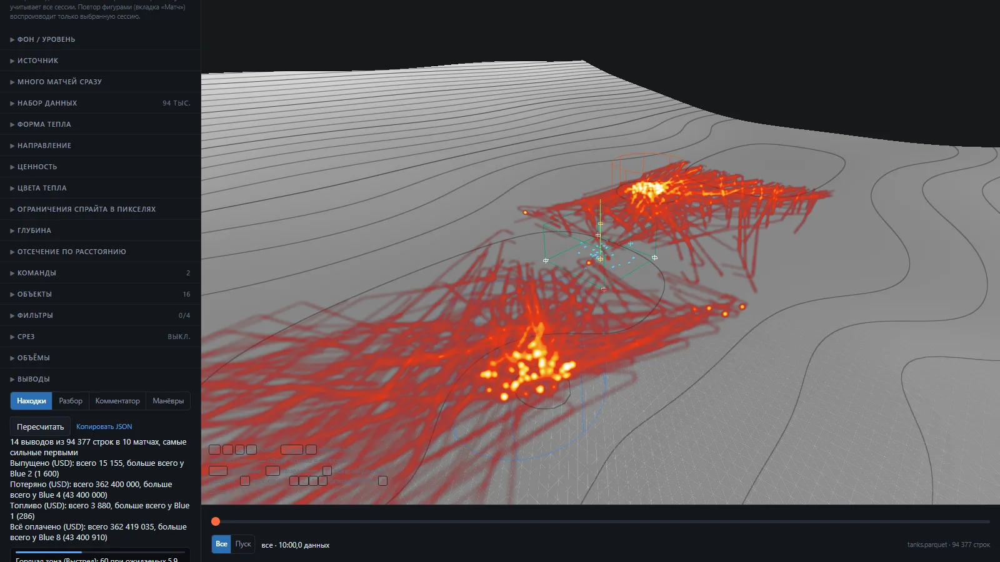
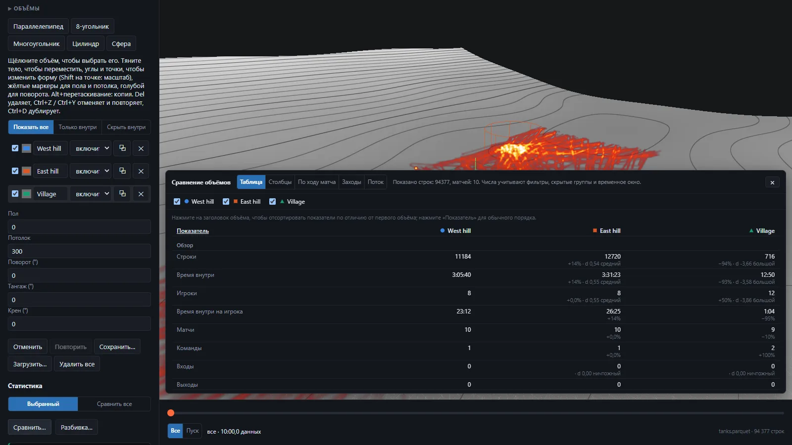
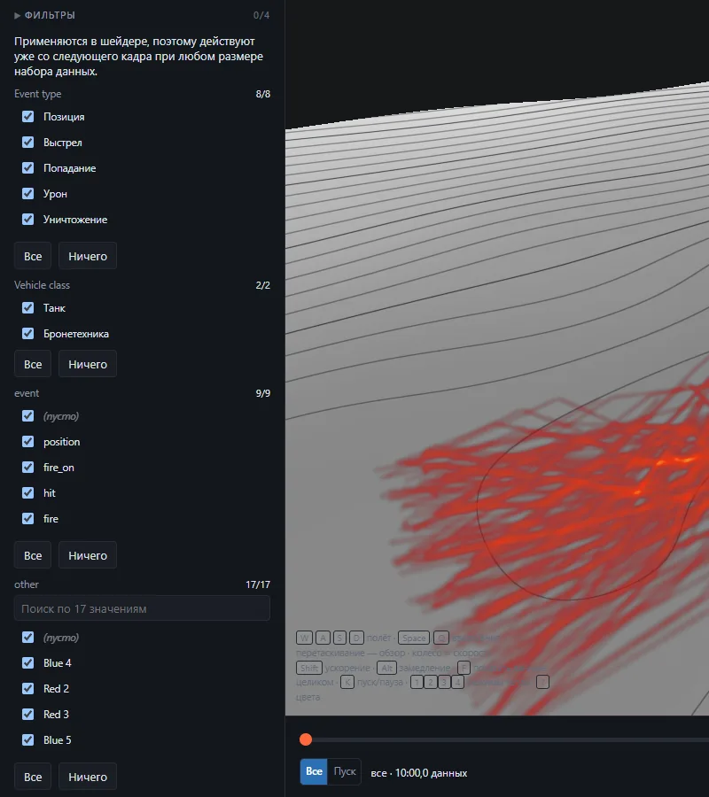
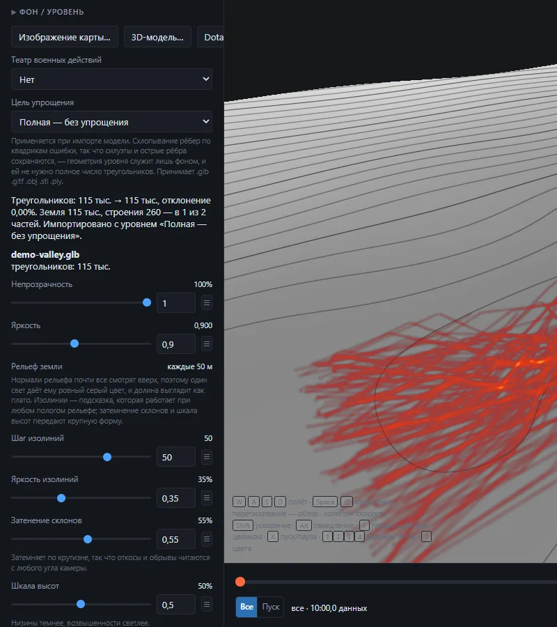

# 3DHeat

3DHeat показывает, где что-то происходило в игре — куда ходили игроки, где они сражались и падали, — в виде светящихся цветов, внутри которых можно летать, или в виде маленьких 3D-фигурок, которые воспроизводят матч.

Загрузите позиции — CSV, Parquet, записи Tacview, конвертированные повторы, один файл, папку или тысячи матчей — и смотрите их как **тепловую карту, внутри которой можно летать**, как **фигуры, воспроизводящие матч**, как линии вдоль маршрутов, которыми шли люди, или как одну совокупность против другой. Просмотр сам находит то, что выделяется, и работает целиком в вашем браузере: ничего никуда не загружается. 3DHeat и все его инструменты бесплатны и открыты, распространяются по лицензии [MIT](https://github.com/Holdi601/3DHeat/blob/main/LICENSE).



**Впервые здесь?** Создайте [демо-данные](demo-data.md) и пройдите их семь шагов. Все картинки на этом сайте сделаны с ними.

## Что он делает {#what-it-does}

| | |
|---|---|
|  | **[Режимы тепла](heat-modes.md)** — тепло, [разность](difference.md) (красное там, где чаще была одна сторона, зелёно-голубое там, где чаще другая), [тепло команд](team-heat.md), [линии](line-heat.md); [направленное тепло](directional-heat.md) с клинышками, полями стрелок и полярными графиками; тепло [с весом по ценности](value-weighting.md): сколько стоили оружие, техника и топливо. |
|  | **[Повтор матча](match-replay.md)** — каждый юнит как [фигура](figures.md) того, чем он является, знаки NATO или русские знаки вдалеке, ракеты и трассеры, метки попаданий, обломки, пожары, башни, цели, камеры в стиле Tacview и тактический дисплей; [много матчей сразу](many-matches.md). |
|  | **[Выводы](insights.md)** — сильные позиции, смертельная местность, ловушки возрождения, узкие места и выдающиеся игроки, найденные и ранжированные с доказательствами; письменный разбор, при желании написанный ИИ на ваш выбор; комментатор для одного матча; [линза знаний](knowledge.md). |
|  | **[Объёмы](volumes.md)** — рисуйте коробки, призмы, цилиндры и сферы, фильтруйте по ним, считайте, что происходит внутри, экспортируйте и сравнивайте места бок о бок; [разбивка](breakdown.md) того, кто и что лучше всего справляется в месте. |
|  | **[Фильтры](filters.md)** — по типу события, игроку или ИИ, классу техники, ценности, любому столбцу, на видеокарте при любом размере данных. |
|  | **[Уровни](levels.md)** — изображения карт, 3D-уровни, сделанные [инструментами данных](#related-repositories), упрощение, [фон мира](world-backdrop.md) с настоящим рельефом для данных полёта. |

Также: вкладка [Анализ заездов](race-analysis.md) для кругов гоночных игр, вкладка [Матч](match-analysis.md) с итогами матчей Counter-Strike 2, [доска тактики](tactics-board.md) для планов на уровне, [анализ попаданий](hit-analysis.md) по технике, [массовый анализ](mass-analysis.md) тысяч матчей, [путь камеры и видео](camera-path-and-video.md), [40 языков](languages.md), [метрические или имперские единицы](settings.md).

## Вкладки {#the-tabs}

Вкладки находятся вверху боковой панели, под названием, меню единиц и языка.

| Вкладка | Для чего она |
|---|---|
| **Тепловая карта** | Любая позиционная таблица: режимы тепла, наложение фигур, фильтры, объёмы, выводы, уровни, измерение и видео. |
| **Анализ заездов** | Два или больше кругов одной трассы: где теряется время, почему и что поменять. |
| **Матч** | Повтор матча фигурами и итоги матчей Counter-Strike 2. |
| **Тактика** | Планы на уровне: фигуры, маршруты, брошенное снаряжение, области и заметки в шагах, которые проигрываются. |
| **Техника** | Где каждая единица получила попадание, кем и чем. |

## Установка и запуск {#install-and-run}

3DHeat можно использовать, менять и передавать бесплатно (лицензия MIT), так же как и каждый инструмент из раздела [Связанные репозитории](#related-repositories).

### Windows, самый простой способ {#windows-the-easy-way}

В корне репозитория лежат три пакетных файла.

| Файл | Что делает |
|---|---|
| `start.bat` | Запускает просмотр. Находит Node.js, даже если его нет в `PATH` (ищет в `%ProgramFiles%\nodejs`, `%ProgramFiles(x86)%\nodejs` и `%LOCALAPPDATA%\Programs\nodejs`), а если Node.js нет, предлагает установить LTS-выпуск командой `winget install -e --id OpenJS.NodeJS.LTS`. При первом запуске спрашивает разрешение перед загрузкой зависимостей (около 300 МБ в `node_modules\` внутри папки, ничего системного). Отказывается запускаться, если порт 5273 уже занят, и указывает на `restart.bat`. Если папка — копия git без локальных изменений и есть более новая версия, спрашивает, обновиться ли (Y/N; без ответа 60 с оставляет эту версию; см. [Обновления](updates.md)). Затем запускает dev-сервер на `http://127.0.0.1:5273/` и открывает браузер. **Окно и есть сервер**: оставьте его открытым; закройте его или нажмите Ctrl+C, чтобы остановить. |
| `restart.bat` | Запускает `stop.bat quiet`, затем `start.bat`. Нужен только после изменения `vite.config.ts`, добавления зависимости или когда сервер завис — правки исходников подхватываются на лету. |
| `stop.bat` | Останавливает то, что слушает порт 5273, по идентификатору процесса, найденному через `netstat`, а не по имени образа, так что другие процессы Node.js на машине не трогаются. Ждёт около двух секунд, пока сокет освободится. С аргументом `quiet` не делает паузы в конце. |

### Вручную (любая ОС) {#by-hand-any-os}

```bash
git clone --recursive https://github.com/Holdi601/3DHeat.git
cd 3DHeat
npm install
npm run dev      # http://127.0.0.1:5273
```

Папка `exporters/` содержит отдельные инструменты данных как подмодули git, каждый — собственный репозиторий; после обычного клонирования выполните `git submodule update --init`. Сам просмотр для работы их не требует. `exporters/ext/` содержит необязательные конвертеры (повторы War Thunder, World of Tanks, World of Warships, Squad; карты DCS и IL-2), вынесенные отдельно, чтобы проблема с одним из них не затрагивала остальные.

В это не входят никакие данные игр: уровни, карты и записи создаются на вашем компьютере инструментами из игр, которыми вы владеете.

### Скрипты npm {#npm-scripts}

| Скрипт | Что запускает |
|---|---|
| `npm run dev` | Dev-сервер Vite на порту 5273, привязанный к `127.0.0.1`. |
| `npm run build` | Проверка типов (`tsc --noEmit`) и производственная сборка в `dist/`. |
| `npm run preview` | Раздаёт производственную сборку. |
| `npm run typecheck` | Только проверка типов. |
| `npm test` / `npm run test:watch` | Модульные и интеграционные тесты (vitest). |
| `npm run smoke` | Управляет настоящим приложением в безголовом Chromium и проверяет, что на холсте есть окрашенные пиксели; снимки экрана идут в `tools/.smoke/`. Ожидает, что dev-сервер уже запущен. |
| `npm run smoke:f16` | Тот же набор с `?heat=f16`, принудительно включая путь накопления half-float (см. [Накопление half-float](half-float-accumulation.md)). |
| `npm run bench` | Тест скорости загрузки, пишет `tools/.smoke/ingest-bench.json`. |
| `npm run test:heavy` | Тесты, которым нужны большие настоящие файлы данных; они сами пропускаются, если файлов нет. |
| `npm run inspect -- <file.parquet>` | Печатает схему Parquet-файла и несколько строк (`tools/inspect-parquet.mjs`). |

### Что добавляет dev-сервер {#what-the-dev-server-adds}

Просмотр — это статическая веб-страница, но dev-сервер (см. `vite.config.ts`) добавляет два локальных маршрута, которых нет у статической публикации `dist/`:

- `/__host/memory` сообщает установленную и свободную оперативную память машины и, где может прочитать, память видеокарты (из `nvidia-smi`, а в Windows — из реестра видеоадаптера). Благодаря этому [бюджеты памяти](memory-and-budgets.md) используют настоящие цифры, а не ограниченные догадки браузера.
- `/__heat3d/update` проверяет, отстала ли копия, и может обновить её перемоткой вперёд ([Обновления](updates.md)).

Сервер слушает только `127.0.0.1`, так что ни один из маршрутов не доступен из сети. Открывайте его как `http://127.0.0.1:5273`: `localhost` может разрешиться в IPv6-петлю `::1`, где ничего не слушает. Он не отправляет заголовков изоляции между источниками (COOP/COEP): ничто в просмотре не использует `SharedArrayBuffer`, а рабочие потоки передают данные переносом, которому они не нужны.

## Требования к браузеру и GPU {#browser-and-gpu-requirements}

- **Браузер с WebGPU или WebGL2.** WebGPU пробуется первым (он есть в Chrome и Edge); без него используется бэкенд WebGL2. WebGL2 должен предлагать `EXT_color_buffer_float` (рисование в текстуры с плавающей точкой), иначе просмотр показывает «Не удаётся инициализировать рендерер.» См. [Два бэкенда](backends.md). Просмотр разрабатывается и тестируется в Chromium; другие браузеры не проверялись.
- **Включено аппаратное ускорение.** Когда браузер рисует на процессоре (SwiftShader, llvmpipe, Microsoft Basic Render Driver и подобные), красный баннер вверху боковой панели говорит об этом и о том, как исправить. См. [Определение программного рендеринга](software-rendering.md).
- **Дискретная видеокарта помогает, но не обязательна.** Оба бэкенда запрашивают адаптер высокой производительности. Объём данных, который можно держать в GPU, — это бюджет, который вы видите и можете менять ([Память и бюджеты](memory-and-budgets.md)).
- **Необязательные возможности** используют другие API браузера: видеозапись требует WebCodecs `VideoEncoder` с VP9 или VP8 ([Путь камеры и видео](camera-path-and-video.md)); упрощение сетки уровней требует WebAssembly; перетаскивание папок использует File and Directory Entries API; библиотека уровней использует IndexedDB; геймпады используют Gamepad API.

## Карта документации {#documentation-map}

**Начало**: [Демо-данные](demo-data.md) · [Загрузка данных](getting-data-in.md) ([загрузка файлов](loading-files.md), [сопоставление столбцов](column-mapping.md), [оси, единицы и время](axes-units-and-time.md), [сессии, персоны и группы](sessions-persons-groups.md), [Tacview](tacview-acmi.md), [конвертеры](converters.md), [.3dheat](container.md), [память и бюджеты](memory-and-budgets.md))

**Смотреть**: [Режимы тепла](heat-modes.md) ([тепло](heat.md), [форма спрайта](sprite-shape.md), [цвет и экспозиция](colour-and-exposure.md), [глубина и отсечение](depth-and-culling.md), [разность](difference.md), [тепло команд](team-heat.md), [линейное тепло](line-heat.md), [наложение фигур](box-replay.md), [направленное тепло](directional-heat.md), [взвешивание по ценности](value-weighting.md)) · [Временная шкала](timeline.md) · [Уровни](levels.md) ([изображения карт](map-images.md), [3D-уровни](model-levels.md), [внешний вид](level-appearance.md), [библиотека](level-library.md), [фон мира](world-backdrop.md), [его источники](world-backdrop-sources.md)) · [Камера](camera.md) ([геймпад](gamepad.md), [клавиши](keyboard-reference.md)) · [Путь камеры и видео](camera-path-and-video.md)

**Анализ**: [Фильтры и инструменты](filters-and-tools.md) ([фильтры](filters.md), [команды](teams-list.md), [объекты](entities.md), [срез](slice.md), [измерение](measure.md), [объёмы](volumes.md), [разбивка](breakdown.md)) · [Выводы](insights.md) ([линза знаний](knowledge.md)) · [Массовый анализ](mass-analysis.md)

**Разбор**: [Повтор матча](match-replay.md) · [Много матчей сразу](many-matches.md) · [Фигуры](figures.md) ([в наложении фигур](figure-replay.md), [авторство](figure-credits.md)) · [Паритет с Tacview](tacview-parity.md) · [Анализ попаданий](hit-analysis.md)

**Другие вкладки**: [Анализ заездов](race-analysis.md) ([метод](race-analytics.md), [другие игры](other-games.md)) · [Разбор матча](match-analysis.md) · [Доска тактики](tactics-board.md) ([скорости](tactics-speeds.md))

**Сам просмотр**: [Глоссарий](glossary.md) · [Настройки, единицы и клавиши](settings.md) · [Языки](languages.md) · [Обновления](updates.md) · [Внутреннее устройство отрисовки](rendering-internals.md) ([бэкенды](backends.md), [накопление](accumulation.md), [выборка и бюджеты](sampling-and-budgets.md), [half-float](half-float-accumulation.md), [память GPU](gpu-memory.md), [программный рендеринг](software-rendering.md), [производительность и статистика](performance-and-stats.md)) · [Форматы данных](data-formats.md) · [Справочник](reference.md) · [Поддержка документации](maintaining.md)

## Связанные репозитории {#related-repositories}

Просмотр читает данные; эти инструменты их создают. Каждый — собственный публичный репозиторий (MIT) со своей документацией. Ни один из них не поставляет данные игр: уровни, карты и записи создаются на вашем компьютере из игр, которыми вы владеете.

| Репозиторий | Что делает | Для чего полезен |
|---|---|---|
| [3DHeat-GameFiles](https://github.com/Holdi601/3DHeat-GameFiles) | Читает трассы и уровни из архивов, которые поставляют игры (Forza Horizon, BeamNG, Assetto Corsa Rally; читалки для Unreal, Unity, Frostbite и Source 2), в glTF | 3D-уровень под вашим теплом или повтором |
| [3DHeat-GameCapture](https://github.com/Holdi601/3DHeat-GameCapture) | Записывает телеметрию кругов из интерфейсов, которые публикуют гоночные игры, и восстанавливает уровни по видео игрового процесса | круги для Анализа заездов; уровень там, где файлы не читаются |
| [3DHeat-UnrealExporter](https://github.com/Holdi601/3DHeat-UnrealExporter) | Плагин Unreal Editor, экспортирующий уровень в один файл glTF | уровни ваших проектов Unreal |
| [3DHeat-CS2](https://github.com/Holdi601/3DHeat-CS2) | Демки Counter-Strike 2 в таблицы тепловых карт и итоги матчей, карты CS2 в геометрию | тепло CS2, повторы и вкладка Матч |
| [3DHeat-Watcher](https://github.com/Holdi601/3DHeat-Watcher) | Записывает вашу игру в фоне по тому, что публикуют игры: телеметрия, интеграции состояния игры, журналы, повторы | собственная статистика без ручной работы |
| [3DHeat-Ext-WarThunder](https://github.com/Holdi601/3DHeat-Ext-WarThunder) | Повторы War Thunder (`.wrpl`) в таблицы: воздушные и наземные треки, выстрелы, попадания, уничтожения, башни, цели | повторы War Thunder, метки попаданий и выводы |
| [3DHeat-Ext-WoT](https://github.com/Holdi601/3DHeat-Ext-WoT) | Повторы World of Tanks в таблицы: позиция каждой машины, смерти и уничтожения | тепло и повторы World of Tanks |
| [3DHeat-Ext-WoWs](https://github.com/Holdi601/3DHeat-Ext-WoWs) | Повторы World of Warships в таблицы: позиция каждого корабля и потопления | тепло и повторы World of Warships |
| [3DHeat-Ext-Squad](https://github.com/Holdi601/3DHeat-Ext-Squad) | Демки серверов Squad в таблицы: позиция, команда и отряд каждого игрока | тепло и повторы Squad |
| [3DHeat-Ext-DCS](https://github.com/Holdi601/3DHeat-Ext-DCS) | Местности DCS World из вашей установки в уровни: земля, дороги, города, аэродромы, поля, вода | записи DCS и Tacview на их настоящей местности |
| [3DHeat-Ext-IL2](https://github.com/Holdi601/3DHeat-Ext-IL2) | Карты IL-2 Great Battles в уровни | записи IL-2 на их карте |

## Кратко о структуре исходников {#source-layout-briefly}

| Папка | Содержимое |
|---|---|
| [`src/data/`](https://github.com/Holdi601/3DHeat/tree/main/src/data) | Выбор файлов, загрузка CSV и Parquet, автосопоставление, проверка, модель памяти, сборка набора данных, разбор моделей, классификация, упрощение, библиотека уровней |
| [`src/render/`](https://github.com/Holdi601/3DHeat/tree/main/src/render) | Цикл кадров (`engine.ts`), выборка, оба бэкенда, камера, геймпад, измерение, путь камеры, запись видео |
| [`src/state/`](https://github.com/Holdi601/3DHeat/tree/main/src/state) | Состояние приложения (`store.ts`) со всеми значениями по умолчанию, доменные типы (`types.ts`), кривая спрайта |
| [`src/ui/`](https://github.com/Holdi601/3DHeat/tree/main/src/ui) | Панели боковой панели, временная шкала, наложения |
| [`src/race/`](https://github.com/Holdi601/3DHeat/tree/main/src/race), [`src/match/`](https://github.com/Holdi601/3DHeat/tree/main/src/match) | Вкладки Анализ заездов и Матч |
| [`src/i18n/`](https://github.com/Holdi601/3DHeat/tree/main/src/i18n) | Переводы |
| [`src/insights/`](https://github.com/Holdi601/3DHeat/tree/main/src/insights) | Выводы: детекторы, разбор, комментатор, провайдеры ИИ, линза знаний |
| [`src/mass/`](https://github.com/Holdi601/3DHeat/tree/main/src/mass) | Массовый анализ многих матчей |
| [`src/volumes/`](https://github.com/Holdi601/3DHeat/tree/main/src/volumes) | Объёмы, их статистика, экспорт и сравнение |
| [`src/breakdown/`](https://github.com/Holdi601/3DHeat/tree/main/src/breakdown) | Разбивка и факторы |
| [`src/overlay/`](https://github.com/Holdi601/3DHeat/tree/main/src/overlay) | Наложение многих матчей |
| [`src/figures/`](https://github.com/Holdi601/3DHeat/tree/main/src/figures) | Каталог фигур и их построитель |
| [`src/vehicle/`](https://github.com/Holdi601/3DHeat/tree/main/src/vehicle) | Анализ попаданий (вкладка Техника) |
| [`src/tactics/`](https://github.com/Holdi601/3DHeat/tree/main/src/tactics) | Доска тактики |
| [`src/world/`](https://github.com/Holdi601/3DHeat/tree/main/src/world) | Фон мира |
| [`src/units/`](https://github.com/Holdi601/3DHeat/tree/main/src/units) | Единицы измерения |
