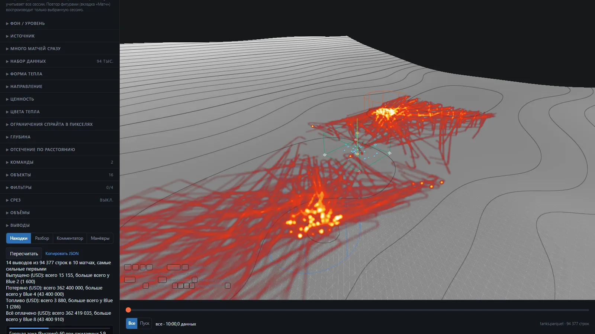
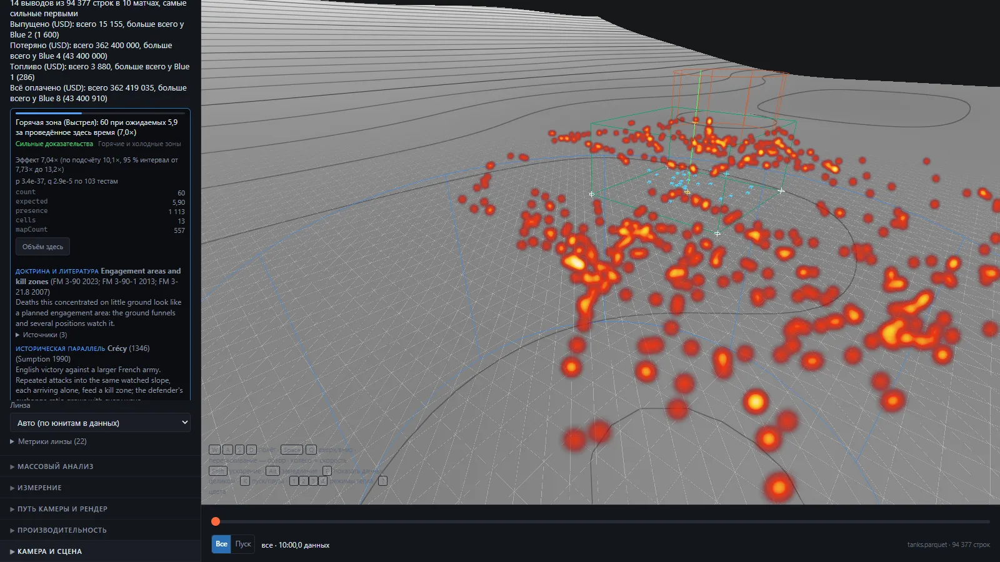
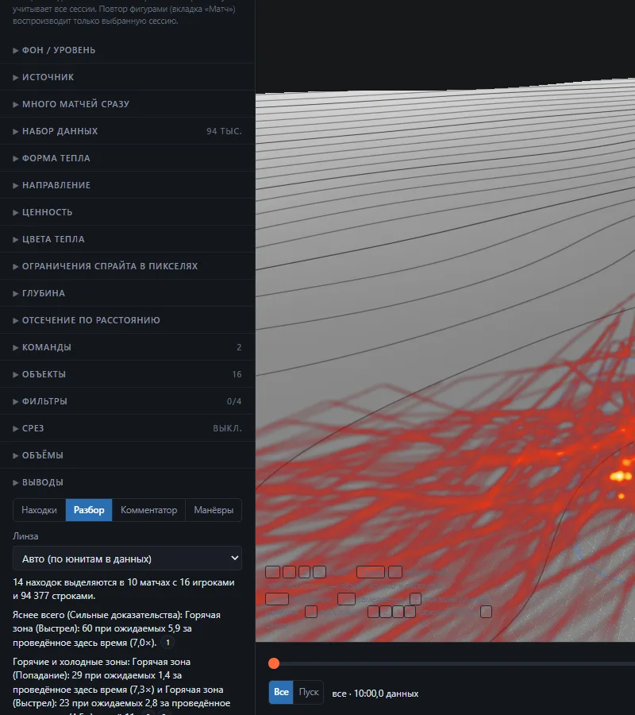
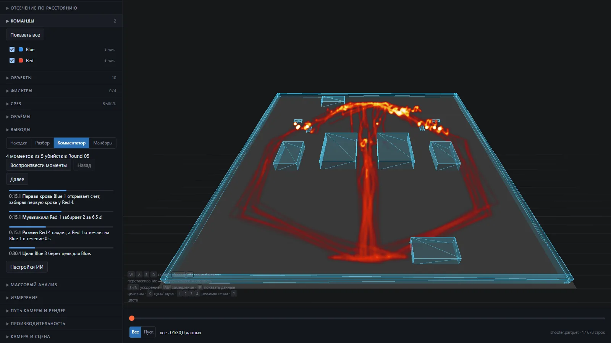

# Выводы

**Выводы** просматривает загруженные данные в поисках того, что выделяется: сильные позиции, смертельная местность, ловушки возрождения, узкие места, игроки, далеко опережающие сверстников, — и сообщает о них, начиная с самого сильного, с доказательствами. Это помогает за минуту понять, где матч был выигран или проигран. Затем можно написать разбор, а в одном повторе можно работать комментатором, который перескакивает к важным моментам.

Всё считается в вашем браузере. Ничто не покидает ваш компьютер, пока вы не включите внешний ИИ (см. [Внешний ИИ](#external-ai)).

Раздел **Выводы** находится в боковой панели вкладок Тепловая карта и Матч. У него три вкладки: **Находки**, **Разбор** и **Комментатор**.

## Находки {#findings}

1. Загрузите данные и откройте **Выводы**. Нажмите **Найти выводы** (индикатор «Подсчёт… n%» показывает ход).
2. Читайте список. У каждой находки есть полоса силы, фраза, качество доказательств (*Сильное свидетельство*, *Хорошее свидетельство* или *Некоторое свидетельство*), детектор, который её нашёл, и класс техники, если это важно.
3. **Щёлкните по находке**: просмотр применит её фильтры, перенесёт камеру к месту и перейдёт ко времени, и откроются подробности: эффект с 95%-ным интервалом, значения p и q, посчитанные доказательства и **Объём здесь**, который рисует [объём](volumes.md) вокруг места.
4. **Вернуть фильтры** возвращает ваши фильтры. **Копировать JSON** копирует весь отчёт.

Подсчёт использует текущие фильтры, скрытые группы и выбранный матч по всему временному диапазону. Если вы меняете фильтры потом, появляется пометка об этом; нажмите **Пересчитать**.

Строки в начале списка (например, итоги по деньгам) подводят итог всем данным до находок.

### Детекторы {#the-detectors}

| Детектор | Что находит | Что нужно в данных |
|---|---|---|
| **Сильные позиции** | Места, где шансы «убийство к смерти» намного лучше, чем на остальной карте, и *безопасная земля*, где за время пребывания погибает мало | события убийств и смертей |
| **Горячие и холодные зоны** | Места, где вид события (выстрелы, попадания, захваты ...) случается гораздо чаще или реже, чем предсказывает время, проведённое там | столбец событий |
| **Открытая местность и укрытия** | Смерти на открытом месте рядом с близкой геометрией уровня и медленно при быстром движении | смерти; 3D-уровень для части с геометрией |
| **Споны** | Сильные точки возрождения, ловушки возрождения, безопасные точки, время до первого контакта | время и люди |
| **Класс по месту** | Класс техники или игроки против ИИ, которые намного лучше или хуже в области | уничтожения плюс столбец класса техники или игрока/ИИ |
| **Игроки** | Игроки, которые убивают или погибают намного чаще или реже других в том же классе | люди и уничтожения |
| **Узкие места и фланги** | Узкие места (намного больше переходов, чем на окружающей земле) и фланговые маршруты (редко используются, но ведут к уничтожениям) | люди |
| **Значение** | *Дорогая земля* и *Прибыльная земля* | [столбцы значений](value-weighting.md) |
| **Что решило раунды** | Что отличало выигранные раунды от проигранных, и игроки, которые добавили или стоили больше всего вероятности победы (см. [Кто победил](#who-won-what-decided-the-rounds)) | раунды, убийства и смерти и [столбцы результата](data-formats.md#outcome-columns) (`won`) |

Детекторы, которые не могут работать на данных, перечислены внизу с причиной.

### Как ранжируются находки {#how-findings-are-ranked}

Каждое место или группа проверяется против остальной карты (точные биномиальные тесты или тесты частот). Доля ложных открытий удерживается на уровне 5% (Бенджамини-Хохберг). Случайность может выглядеть как закономерность; это держит ложные тревоги низкими: среди показанных находок ожидается не больше примерно одной из двадцати, обусловленной случаем. Эффекты от малого числа событий подтягиваются к «нет эффекта» перед ранжированием. Показывается не больше 60 находок, и каждый детектор получает несколько мест в верхней части.

### Кто победил: что решило раунды {#who-won-what-decided-the-rounds}

Если данные говорят, кто выиграл каждый раунд ([столбец результата](data-formats.md#outcome-columns) `won`: CS2, Rainbow Six Siege, War Thunder ...), Выводы строятся вокруг результата. Для каждой стороны они делят раунды по тому, что в них произошло, и сравнивают доли побед:

| Фактор | Раунды стороны с ним | ... и без него |
|---|---|---|
| Открывающая дуэль | сторона сделала первое убийство | сторона погибла первой |
| Закупка | её закупка была лучше, чем у другой стороны | хуже |
| Размененная первая смерть | её первую смерть разменяли в течение 5 с | не разменяли |
| Установка | сторона установила бомбу | без установки |
| Гранаты | больше гранат, чем в её обычном раунде | меньше |
| Ранний контакт | первая дуэль случилась раньше медианного времени матча | позже |
| Удержанное место | игрок стоял на месте 5 с или дольше | никто |
| Рано занятое место | игрок добрался туда за первые 25 с (маршрут) | никто |

Каждое сравнение — это разность двух долей побед с её 95% интервалом (Newcombe), точным p Фишера и q по всем проверенным факторам (Benjamini-Hochberg). Ветвь меньше чем из 8 раундов помечается *мало раундов*. Сравнения ниже 5% доли ложных открытий становятся выводами; самые сильные встают выше выводов других детекторов (вывод о результате весит в 1,35 раза больше, чем вывод с тем же эффектом и доказательствами).

Выдуманный пример на 40 раундах:

> **T** выиграла 79% из 19 раундов, в которых удерживала **Mid**, против 24% из 21 без этого (55 пунктов, 95% от 26 до 74) — q 0,004.

Выводы также следят за **вероятностью победы** в раунде — шансом, который был у каждой стороны в каждый момент, по живым игрокам, установке и часам: она подогнана к раундам, если их 30 или больше, иначе берётся из фиксированной априорной модели (и текст говорит, откуда). Из неё получаются **переломные моменты** (убийства и установки, которые сильнее всего сдвинули шанс) и **добавленная вероятность победы** каждого игрока: его убийства и установки идут ему в плюс, его смерти — в минус, в раундах за матч, в среднем за раунд с интервалом, с проверкой против нуля. Места получают такой же баланс: какая сторона больше всего выиграла в дуэлях, которые там шли.

Данным нужны раунды, убийства и смерти с обеими сторонами и столбец `won`; именованные места (`place`) для удержанных мест, столбец `buy` для закупки.

## Разбор {#debrief}

Вкладка **Разбор** записывает находки в короткий текст: вступление, самая ясная находка, одна для тактики, одна для баланса, затем — если данные говорят, кто победил, — что решило раунды, остальные сгруппированы по детектору, и сколько из них опираются на более слабые доказательства.

Что решило раунды, описано в четырёх абзацах: счёт и откуда берутся вероятности победы; самые сильные факторы с их числами, интервалом и q (если ни один не проходит долю ложных открытий, текст говорит *пока ничто не наверняка* и всё равно называет самые сильные); три крупнейших переломных момента; и игроки, которые добавили и стоили больше всего вероятности победы, с местами, которые выиграли больше всего. Выдуманный пример:

> T выиграла 23, а CT выиграла 17 из 40 раундов с известным результатом (T: 58%, 95% от 42% до 72%). Вероятности победы берутся из модели, подогнанной к этим раундам.
>
> Что отличало выигранные раунды от проигранных: T выиграла 79% из 19 раундов, в которых удерживала Mid, против 24% из 21 без этого (55 пунктов, 95% от 26 до 74) (q 0,004), ...
>
> Переломные моменты: раунд 17 на 48 с, убийство от CT на точке B изменило её шанс с 31% до 58%, и она взяла раунд, ...

У каждого абзаца есть пронумерованные кнопки, которые показывают его находки. **Копировать текст** копирует его.

Встроенный рассказчик работает офлайн, на вашем языке. Селектор **Линза** над ним (см. [Линза знаний](knowledge.md)) решает, какую литературу цитируют абзацы.

### Внешний ИИ {#external-ai}

**Настройки ИИ** позволяют написать разбор модели ИИ на ваш выбор:

| Настройка | Значение |
|---|---|
| **Провайдер** | Anthropic (Claude), OpenAI (ChatGPT), OpenRouter, Ollama (локально), LM Studio (локально), сервер llama.cpp (локально) или любая конечная точка, совместимая с OpenAI |
| **Базовый URL**, **Модель** | Заполняются провайдером; **Показать модели** запрашивает сервер |
| **API-ключ** | Отправляется только на базовый URL. Никогда не записывается в журнал, никогда не сохраняется в видах, экспортах или файлах `.3dheat`. Большинству локальных серверов ключ не нужен. |
| **Запомнить ключ в этом браузере** | По умолчанию выключено: ключ забывается, когда страница закрывается |
| **Использовать внешний ИИ** | По умолчанию выключено |
| **Отправлять имена игроков** | По умолчанию выключено: игроки отправляются как P1, P2 ... |

Затем введите необязательный вопрос и нажмите **Написать с помощью ИИ**. Отправляются только находки и их числа — никогда строки ваших данных. Ответ появляется потоком; упомянутые находки становятся кнопками. Если данные говорят, кто победил, модели велят начать с того, что решило раунды, с интервалом и q каждого числа, и сказать, когда фактор опирается на мало раундов или когда вероятности победы берутся из априорной модели.

## Комментатор {#caster}

Для **одного матча** (выберите, если загружено несколько), **Комментатор** находит моменты, достойные внимания: первая кровь, мультиубийства, размены, клатчи, смены в целях, камбэки, выдающиеся игроки, дальние выстрелы и **переломные моменты** — убийства, которые сильнее всего сдвинули шанс стороны выиграть раунд (по числу живых игроков с каждой стороны, в раундах без возрождений).

Если данные говорят, кто выиграл каждый раунд, это говорит каждый момент: *«Анна убивает Бена: шанс T выиграть раунд меняется с 38% до 62% — и они выигрывают раунд.»* Момент стороны, которая потом победила, весит больше, когда комментатор выбирает, какие моменты оставить, а камбэк считается в выигранных раундах.

- Щёлкните по моменту: вид переключится на повтор, перейдёт к моменту чуть раньше, долетит туда и будет следовать за игроком.
- **Воспроизвести моменты** проигрывает каждый до конца и переходит дальше; **Назад** / **Далее** пролистывают их.
- Если включён внешний ИИ, **Комментарии от ИИ** пишут комментарий по списку моментов (виды, время, имена или псевдонимы, команды, классы, расстояния).

Нужны люди и события убийств/смертей (или захватов); столбец `other`/`victim` делает возможными размены и дальние выстрелы.

## Линза знаний {#knowledge-lens}

Находку можно прочитать через **линзу** устоявшихся знаний: военная доктрина, воздушный и морской бой, городские операции, гейм-дизайн и киберспорт (или *Авто*, выбирается по единицам в данных). Открытая находка тогда показывает ближайшую запись **доктрины и литературы** и **историческую параллель** со ссылками, а **Метрики линзы** считают по этой литературе меры на данных (подгонки Ланчестера, обменные соотношения, соотношения сил, секторы обстрела, ключевая местность, размены, инициатива). Разбор и запрос к ИИ включают их. Всё об этом — в [Линзе знаний](knowledge.md).

Метрики линзы также измеряют, как игроки ведут себя как толпа и как группа: выравнивание и кружение, загон по маршрутам, полосы и следы, скученность, лидеры и ведомые, отставшие, точка излома при потерях, риск после потерянной жизни, серии, согласие в покупках и реакция на входящий огонь — каждое против собственной нулевой модели: [Коллективное поведение](collective-behaviour.md).

## Данные, которые делают выводы полезными {#data-that-makes-insights-work}

- позиции с **временем**, столбцами **человека** и **команды**;
- столбец **событий** с уничтожениями и смертями (`kill`, `death`), и другие (`hit`, `fire`, `capture` ...);
- столбец **другой стороны** (`other`, `victim`) для размен и направлений;
- столбец **техники** или **типа** для классов; столбец `ai` для игроков против ИИ;
- столбец **сессии** / **матча** / **раунда**, когда матчей несколько.

В [демо-данных](demo-data.md) есть всё это.
