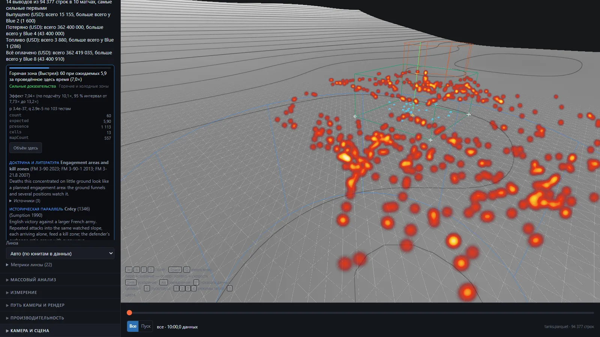

# Линза знаний

Когда [Выводы](insights.md) что-то находят, эта часть объясняет находку идеями из военной истории, геймдизайна и спортивной аналитики и называет книгу или статью, из которой они взяты. Используйте её, чтобы узнать *почему* паттерн важен, а не только то, что он существует.

## Попробуйте {#try-it}

1. Загрузите данные и откройте **Выводы**, затем нажмите **Найти выводы**.
2. Щёлкните по находке, чтобы открыть её.
3. Прочитайте **Доктрина и литература** и **Историческая параллель**; полные ссылки свёрнуты ниже.
4. Смените **Линза** (например, на *Военная доктрина*), чтобы прочитать ту же находку через другой корпус литературы.

## Как это работает {#how-it-works}

Панель «Выводы» оценивает свои находки так, как это сделал бы профессиональный аналитик: через военную доктрину и исследование операций, исторические сражения и литературу по геймдизайну, дизайну уровней и аналитике. Она делает это офлайн, по отобранной базе знаний внутри просмотрщика, и передаёт тот же материал внешней модели, когда та пишет разбор.

## Что показывает панель {#what-the-panel-shows}

- **Линза** выбирает корпус литературы, через который читаются находки: *Авто* (выбирается по видам юнитов в данных: авиация, корабли, наземная техника, пехота), *Военная доктрина*, *Воздушный бой*, *Морской*, *Городской бой*, *Геймдизайн и баланс*, *Киберспорт*. Записи вне выбранной линзы не показываются.
- Каждая открытая находка показывает ближайшую запись **доктрины и литературы** и ближайшую **историческую параллель**, с полными ссылками, свёрнутыми ниже.
- **Метрики линзы** перечисляет меры исследования операций, вычисленные по тем же строкам (ниже), каждая с её смыслом и литературой.
- **Разбор** добавляет строки для ведущих находок и метрик линзы: «Доктрина и литература: ...» и «Историческая параллель: ...», каждая со ссылками на авторов и год и с источниками, свёрнутыми под ней.
- **Написать с помощью ИИ** отправляет самые подходящие записи (краткое содержание, урок, находки, к которым они относятся, полные ссылки) вместе с отчётом и просит модель цитировать их по id — `{concept.lanchester-square}` — и не использовать других источников.

Подписи переведены; сами знания на английском.

## Метрики линзы {#lens-metrics}

Вычисляются в рабочем потоке выводов, за тот же проход по строкам, что и детекторы (`src/insights/lensMetrics.ts`). Каждая не показывается, когда данные не могут её нести.

| Метрика | Что измеряет | Нужно |
|---|---|---|
| Подгонка Ланчестера | Потери каждой стороны за 20 с, регрессия по живой силе обеих сторон (Пуассон, квазиправдоподобные ошибки); показатели по силе противника и своей, проверенные против квадратичного закона (прицельный огонь) и линейного (площадной огонь) | время, команды, убийства и смерти |
| Коэффициент обмена | Убийства на смерть по стороне и по месту; доля смертей на самом смертоносном наземном участке, который держит 5% времени, против доли, которую даёт один шанс при таком числе смертей; коэффициент Джини смертей по времени; I Морана для частот смертей | убийства и смерти |
| Локальное соотношение сил | Свои и вражеские юниты живы в пределах дальности боя каждого убийства (дальность задана данными: вдвое больше медианного расстояния до ближайшего врага); доля убийств локально превосходящей стороны и её избыток над тем, что предсказывают одни числа | время, команды, персоны |
| Секторы обстрела | Видимость из самых загруженных мест убийств на 2,5D-поверхности препятствий (геометрия уровня до высоты стены или пройденная земля) против средней точки, и ранговая корреляция видимости и доли убийств | позиции; загруженный уровень делает точнее; не для воздуха |
| Энергетическое состояние | Удельная энергия (высота плюс высота, которую могла бы купить скорость) у воздушных убийц и воздушных жертв, сравниваемая статистикой Манна–Уитни | классы авиации, время, высота |
| Ключевая местность | Как часто каждое место входит в три самых загруженных места убийств матча | несколько матчей |
| Взаимная поддержка (размены) | Смерти, на которые товарищ ответил убийством в пределах дальности боя и 5 с | время, команды |
| Первый удар | Столкновения — убийства, сгруппированные по матчу, по 20 с тишины и по трём дальностям боя — которые выиграла сторона, открывшая счёт | время, команды |
| Модель залпа | Уравнение залпов Хьюза, подогнанное под 20-секундные периоды кораблей в контакте: выведенные из строя корабли на атакующий корабль и спасённые на обороняющийся; подгонка Ланчестера только по кораблям | классы кораблей, время, команды |
| Боевая эффективность | Убийства на юнит-час в бою каждой стороны и отношение двух больших (показатель боевой эффективности в смысле Дюпюи) с его 95%-интервалом, и доля убийств каждой стороны при равном локальном числе | время, команды |
| Дальности боя | Расстояние до ближайшего врага при убийствах, при запусках и при первом выстреле каждой жизни (обнаружение до вступления в бой), по виду юнита | время, команды; запуски там, где они есть в данных |
| Цепочка убийства | Секунды от последнего запуска убийцы до убийства и от его первого выстрела в бою до убийства | время; запуски или события огня |
| Концентрация или рассредоточение | В каждом 20-секундном периоде разброс двух больших сторон и доля убийств у более плотной | время, команды |
| Вылеты | По стороне: вылеты (взлёты или появления авиации), посадки, потерянные самолёты и убийства самолётами; частота потерь и убийства на вылет | классы авиации; взлёты или появления |

Данные с раундами добавляют меры ближнего боя и киберспорта — вероятность победы в раунде, ценность действий, первые дуэли, размены, выглядывающий против держащего, прицел, перекрёстный огонь, гранаты, численное преимущество, клатчи, расстановки, после установки, смертельные воронки и влияние игрока: см. [Ближний бой и раунды](close-quarters.md).

Треки и команды добавляют меры коллективного поведения из науки о толпах, коллективного движения, поведенческой экономики и военной психологии — выравнивание и кружение, стадность маршрутов, полосы и тропы, скученность, лидеры и последователи, отставшие, точка излома, риск после потерь, серии, согласие и подавление покупок, каждая против собственной нулевой модели: см. [Коллективное поведение](collective-behaviour.md).

Оружие, приманки и здания не считаются юнитами. Когда строки оружия называют свой запускающий юнит (столбец `Shooter` или `Launcher`, как в данных, полученных из Tacview), запуск засчитывается этому юниту, по его имени или id объекта.

## Как находки встречаются с литературой {#how-findings-meet-the-literature}

Записи и находки встречаются через **таксономию паттернов** (`src/insights/knowledge/patterns.ts`): концентрация, локальное превосходство, прицельный и площадной огонь, узкие места, зоны поражения, секторы обстрела, обратный скат, фланговый охват, взаимная поддержка, энергетическое преимущество, давление появления, баланс и так далее. Каждый вид детектора и каждая метрика линзы указывают, какие паттерны показывают их числа (`src/insights/lens.ts`); каждая запись знаний указывает, к каким паттернам она относится, с весом. Релевантность записи к находке — это взвешенное перекрытие, масштабированное тем, насколько домен записи (суша, воздух, море, город) подходит к данным, и собственной силой находки. Обоснование, которое показывается, — это числа находки в одном предложении, за которым идёт урок записи.

## Каталог {#catalogue}

Каждый паттерн, концепт, метод, исторический случай, принцип дизайна и исследование с библиографией: см. [Каталог знаний](knowledge-catalogue.md).

## Для разработчиков {#for-developers}

### Добавление записей {#adding-entries}

1. Выберите файл по типу: `concepts.ts` и `concepts-more.ts`, `methods.ts`, `cases.ts`, `cases-land.ts`, `cases-air-sea.ts`, `cases-esports.ts`, `design.ts` (принципы дизайна) или `studies.ts` в `src/insights/knowledge/`.
2. Дайте новый id `<type>.<slug>` (никогда не переиспользуйте старый), его линзы, домены и паттерны, к которым она относится, с весами 0..1. Добавляйте паттерн в `patterns.ts` только тогда, когда находка может его показать, и связывайте его с находкой или метрикой в `lens.ts`.
3. Напишите краткое содержание и урок **своими словами**. Цитаты — только из работ, перешедших в общественное достояние (`pd: true` в ссылке), и короткие.
4. Цитируйте: добавьте любую новую работу в `refs.ts` с авторами, годом, названием и издателем (журнал с томом и страницами); URL или DOI — там, где есть публичная запись.
5. Запустите `npx vitest run src/insights/lens.test.ts` (уникальные id, известные паттерны, разрешаемые ссылки, цитаты из общественного достояния, случаи с датой и исходом) и `node tools/knowledge-doc.mjs`, чтобы обновить [каталог](knowledge-catalogue.md).
