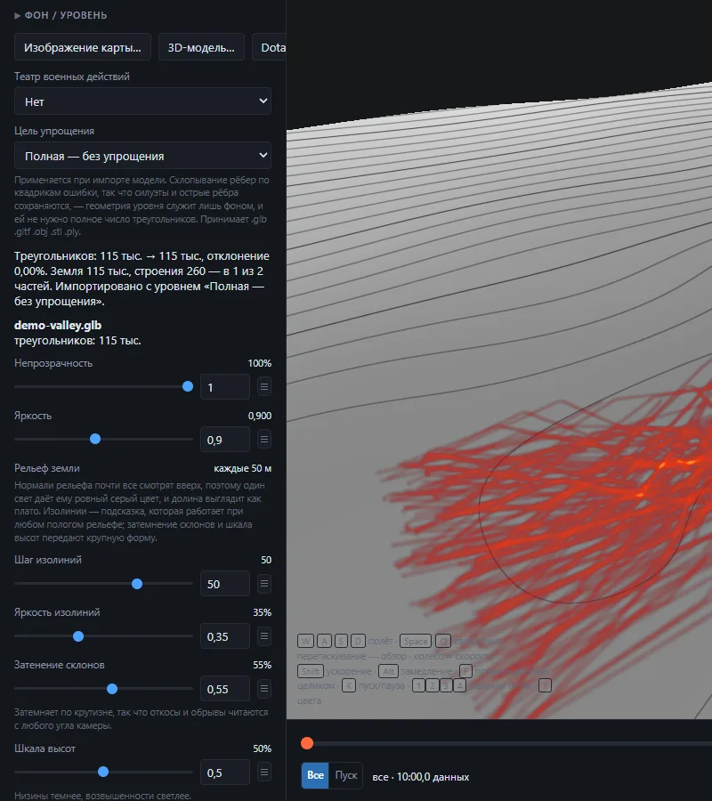

# Уровни и фоновая геометрия

Уровень — это 3D-место, где происходила игра: карта, город, трасса. Поставьте его за свои данные, и вы увидите, *где* находится тепло. Панель **Фон / уровень** (см. [Глоссарий](glossary.md), слово «уровень») даёт три вида контекста:

- **изображение карты**, привязанное к местности двумя опорными точками — см. [Изображения карт](map-images.md);
- **3D-уровень** — `.glb`, `.gltf`, `.obj`, `.stl` или `.ply`, разделённый на землю, сооружения и воду и упрощённый при импорте — см. [3D-уровни](model-levels.md) и [Внешний вид уровня](level-appearance.md);
- **реальный мир как фон** — для записи, которая сообщает, где на Земле она сделана (файл Tacview ACMI): настоящий рельеф, дороги, воду, аэродромы и здания из открытых данных — см. [Фон мира](world-backdrop.md).

Если ничего не загружено, сцена тёмная, с сеткой и цветными осями (**Сетка** и **Оси** в [Камера и сцена](camera.md)), и панель пишет: *Ничего не загружено — сцена показывает сетку и оси. Добавьте изображение карты или сетку уровня, чтобы дать теплу контекст.*

Уровень общий для всех трёх вкладок: трасса, загруженная на вкладке Анализ заездов, — тот же уровень, который показывает тепловая карта.

## Поставить уровень за свои данные {#put-a-level-behind-your-data}

1. Сначала загрузите данные ([Загрузка данных](getting-data-in.md)), чтобы уровень подогнался под них.
2. Откройте **Фон / уровень** в боковой панели.
3. Нажмите **Изображение карты…** для картинки или **3D-модель…** для 3D-уровня и выберите файл. Для записи из реального мира используйте **Реальный мир как фон** или **Театр военных действий**.
4. Дождитесь окончания строки прогресса. Большая модель сначала упрощается (см. **Цель упрощения** ниже).
5. Нажмите **F** в виде, чтобы вместить всё в кадр. Меняйте **Непрозрачность** и **Яркость**, пока тепло не будет выделяться на фоне уровня.
6. Нажмите **Сохранить в библиотеку**, если будете использовать уровень снова ([Библиотека уровней](level-library.md)).

## Что уровень делает с теплом {#what-a-level-does-for-the-heat}

- Он **перекрывает**: точки данных за ним затемняются по поверхностям, а точки за рельефом скрываются ([Глубина и отсечение](depth-and-culling.md)). Без уровня перекрытия нет.
- Его **режет** [Срез](slice.md) и, при *Резать и уровень*, [отсечение по расстоянию](depth-and-culling.md#distance-culling) вместе с теплом.
- Это единственное, что размывает [глубина резкости](camera.md#depth-of-field), кроме сетки и коробок.
- 3D-уровень **расширяет дальнюю плоскость камеры**, если он больше данных: ближняя и дальняя плоскости калибруются по набору данных, а экспортированная карта шириной в несколько километров иначе целиком оказалась бы за дальней плоскостью и оставила бы пустой вид. Дальняя плоскость становится 3 × горизонтальная протяжённость уровня, если это больше; ближняя плоскость двигается вместе с ней (не меньше дальней / 100 000), чтобы сохранить точность глубины, от которой зависит перекрытие; скорость полёта поднимается до не меньше протяжённость / 12. Плоскость только расширяется, никогда не сужается.

## Панель сверху вниз {#the-panel-top-to-bottom}

| Часть | Подробнее |
|---|---|
| **Изображение карты…**, **3D-модель…** | Загрузить один; он заменяет текущий уровень. |
| **Реальный мир как фон**, **Забыть тайлы карты** | Только для набора данных с географической привязкой: построить настоящее место под ним как уровень или удалить скачанные тайлы. [Фон мира](world-backdrop.md) |
| **Цель упрощения** | Бюджет треугольников для следующего импорта модели: *Полный — без упрощения* (по умолчанию), *Высокая — 8M*, *Средняя — 3M*, *Низкая — 800k*, *Силуэт — 100k*. [3D-уровни](model-levels.md#simplification) |
| Прогресс и **Отмена** | Пока идёт декодирование или импорт. |
| Заметка об импорте | Треугольники до и после, разделение на землю / сооружения / воду, использованный уровень детализации. |
| Название и размер | `ширина×высота px · x × z m/px` для изображения, `N треугольников (из M)` для модели. |
| **Непрозрачность**, **Яркость** | Для обоих видов. |
| Элементы изображения | **Обесцветить**, **Отразить север/юг**, **Размещение** (две опорные точки), **Подогнать под границы данных**, **Высота**. [Изображения карт](map-images.md) |
| Элементы модели | Рельеф земли, вода, треугольники земли, каркас, текстура, захваченный цвет, сооружения, классификация частей. [Внешний вид уровня](level-appearance.md) |
| **Сохранить в библиотеку**, **Убрать** | [Библиотека уровней](level-library.md); Убрать выгружает уровень. |
| **Библиотека** | Уровни, сохранённые в этом браузере. [Библиотека уровней](level-library.md) |

## Страницы этого раздела {#pages-in-this-section}

- [Изображения карт](map-images.md)
- [3D-уровни](model-levels.md) — форматы, части, классификация, упрощение, текстуры
- [Внешний вид уровня](level-appearance.md) — каждый элемент управления для 3D-уровня
- [Библиотека уровней](level-library.md)
- [Фон мира](world-backdrop.md) — настоящий мир под записью из открытых данных

Как получить уровни из игр и движков, — задача отдельных инструментов-экспортёров (см. [README](https://github.com/Holdi601/3DHeat/blob/main/README.md) репозитория); формат, который они записывают, описан в [3D-уровни](model-levels.md#the-exporter-contract).
