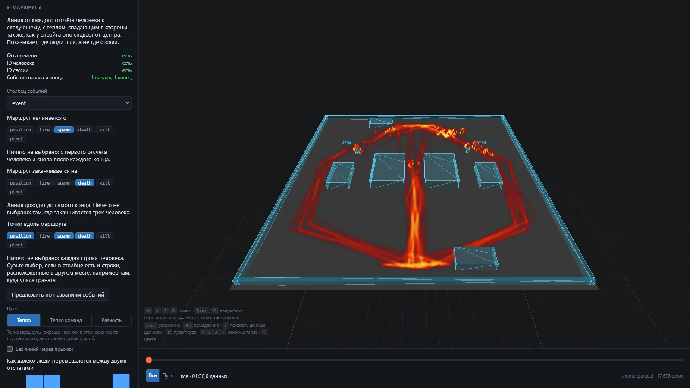

# Линейное тепло

Тепло показывает, где люди стояли. Линии показывают пути, по которым они шли.

**Линии** (клавиша 4) — это линейное тепло: линия от каждого отсчёта [персоны](glossary.md) до её следующего, размазанная с тем же спадом, что у [спрайта](glossary.md), — поперёк линии, а не вокруг точки. Оно показывает, где люди *ходили*, а не где стояли: коридор, пройденный один раз, виден так же, как комната, в которой сидели, а редкие отсчёты быстрого игрока соединяются в сплошной маршрут, а не в пунктирный след. Нужны столбец персоны и столбец времени.

## Как пользоваться {#how-to-use-it}

1. Нажмите `4` (или выберите **Линии** на панели режимов).
2. Откройте **Маршруты** и проверьте зелёный список: ось времени и id персоны должны быть.
3. Нажмите **Предложить по названиям событий**, чтобы заполнить, где маршруты начинаются и заканчиваются.
4. Прочитайте строку статистики: «N маршрутов, M из них доходят до конца».
5. Если линии перескакивают через карту, настройте **Самый длинный шаг** (см. [Предел прыжка](#the-jump-limit)).

Линия имеет смысл только между началом и концом, поэтому панель **Маршруты** говорит, что ограничивает маршрут. Всё, начиная с [Правил маршрута](#the-rules-of-a-route), — подробности, которые можно пропустить.

## Панель «Маршруты» {#the-routes-panel}

Показывается над панелями тепла в режиме «Линии».

### Что есть в данных {#what-the-data-has}

Список проверки: зелёный, когда есть, янтарный, когда нет:

| Строка | Состояния |
|---|---|
| **Ось времени** | *есть* / *нет — нужна* |
| **ID персоны** | *есть* / *нет — нужен* |
| **ID сессии** | *есть* / *нет — все строки одна сессия* |
| **События начала и конца** | *N начал, M концов* / *ничего не выбрано — целые треки* (зелёным только при столбце событий и хотя бы одном начале и одном конце) |

### Управление {#controls}

| Элемент | Значение |
|---|---|
| **Столбец событий** | Столбец категории, значения которого — события (появление, гибель, позиция, ...). *Нет — целые треки*: трек каждой персоны в каждой сессии — один маршрут, прерываемый там, где в треке разрыв. Предлагаются только столбцы, сохранённые для фильтрации при загрузке. |
| **Маршрут начинается с** | Значения событий, которые начинают маршрут (появление, возрождение, высадка). Ничего не выбрано: маршрут начинается с первого отсчёта персоны и снова после каждого конца. |
| **Маршрут заканчивается на** | Значения событий, которые заканчивают маршрут (гибель, эвакуация, телепорт). Линия идёт до самой строки конца. Ничего не выбрано: маршрут заканчивается там, где заканчивается трек персоны. |
| **Точки вдоль маршрута** | Значения событий, строки которых лежат вдоль маршрута. Ничего не выбрано: каждая строка персоны. Сузьте, когда в столбце есть строки, поставленные в другом месте, например где упала граната. |
| **Предложить по названиям событий** | Заполняет три списка по названиям значений (ниже). |
| **Цвет** | *Тепло*, *Тепло команд* или *Разность*. Те же маршруты в раскраске этого режима: каждая группа своим оттенком или одна сторона против другой, со списком групп, разбиением и шкалами, работающими так же, как в этих режимах. По умолчанию *Тепло*. Тепло команд и разность нужен столбец группы. |
| **Без линий через прыжки** / **Самый длинный шаг** | Следующий отсчёт персоны дальше этого — возрождение, телепорт или падение, а не место, куда она пошла, поэтому линия между ними не проводится. Заполняется при загрузке, когда данные показывают явный разрыв (ниже), и выключено, когда не показывают. Работает с столбцом событий и без него. |
| Строка статистики | `N маршрутов, M из них доходят до конца, K сегментов`, обновляется несколько раз в секунду. |

Каждый список — ряд переключаемых чипов, по одному на значение, сначала самые частые; наведение на чип показывает число его строк. Предлагается не больше 120 значений (*ещё N значений не показано*).

Выбор другого столбца событий применяет предложение, когда предложение выбирает этот же столбец, и иначе начинает с пустых списков.

### Предложение {#the-suggestion}

При каждой загрузке и по **Предложить по названиям событий** ([`suggestLineSettings`](https://github.com/Holdi601/3DHeat/blob/main/src/data/lines.ts)):

- **Столбец событий:** первый сохранённый столбец категории с именем `event`, `eventname` или `eventtype`; иначе `kind`, `type` или `action`; иначе любой, содержащий *event*, *kind*, *action* или *type*.
- **Начала:** значения, содержащие *spawn, deploy, join, enter, start, begin, respawn, revive, land/landed/landing, drop*, — если только они не совпадают также с конечным словом.
- **Концы:** значения, содержащие *death, died, dead, kill/killed, eliminat…, extract, evac, teleport, leave, left, disconnect, quit, exit, end, finish, downed*, кроме значений `kill` и `kills` (убийство — то, что делает убийца, а не конец его маршрута).
- **Точки:** значения, которые точно равны *position, location, player location, move, movement, tick, sample* или *pos*; когда такие находятся, начала и концы добавляются к точкам тоже. Когда ни одного нет, точки пусты (каждая строка).

### Предел прыжка {#the-jump-limit}

Там, где люди прыгают, длины шагов делятся на две группы почти без промежутка между ними: то, что персона проходит между двумя отсчётами, и ширина карты. При загрузке ([`suggestMaxJump`](https://github.com/Holdi601/3DHeat/blob/main/src/data/lines.ts)) шаги считаются по удвоениям их квадрата длины, до 16 миллионов штук, а предел ставится посередине первого диапазона выше медианы, который шириной не меньше одного удвоения длины, в котором на корзину приходится меньше 0,02% шагов и есть шаги за ним. Если такого диапазона нет, ничего не обрезается: отличить прыжок от быстрой машины было бы нечем; тогда включённый вручную предел начинается с одной десятой диагонали данных.

График над пределом показывает, какими на самом деле бывают шаги, с линией на пределе: столбцы справа от неё не рисуются. Обе оси логарифмические, потому что прыжки могут быть сотой долей шагов и в тысячу раз длиннее. Наведение на столбец показывает его диапазон и долю; щелчок по графику ставит предел туда. Под ним — доля шагов больше предела.

## Правила маршрута {#the-rules-of-a-route}

Строки проходятся по порядку времени, отдельно для каждой персоны ([`buildLines`](https://github.com/Holdi601/3DHeat/blob/main/src/data/lines.ts)):

1. Строки [общего имени](sessions-persons-groups.md#names-worn-by-several-things-at-once) пропускаются полностью.
2. Когда выбраны точки, строка, которая не является ни началом, ни концом, ни точкой, пропускается.
3. Строки следуются отдельно для каждой персоны в каждой сессии, поэтому персона, чьи сессии чередуются по времени, имеет по маршруту в каждой. Маршрут закрывается, когда у предыдущей строки не было преемника (её [время жизни](sessions-persons-groups.md#person) — «нет»): маршрут никогда не пересекает границу сессии или разрыв, который загрузка сочла отсутствием следующего отсчёта. Какому маршруту принадлежит строка, вычисляется один раз и сохраняется, 4 байта на строку, поэтому смена самого длинного шага эту часть не повторяет.
4. Строка **начала** закрывает любой открытый маршрут и открывает там новый.
5. Когда выбраны начала, строка вне маршрута игнорируется. Без начал любая не-конечная строка вне маршрута открывает его.
6. Любая другая строка внутри маршрута добавляет **сегмент** от предыдущей строки маршрута до этой.
7. Строка **конца**, которая продлевает маршрут, закрывает его после своего сегмента; такой маршрут считается *доходящим до конца*.
8. Шаг длиннее **Самого длинного шага** закрывает маршрут там, где он был, и новый маршрут начинается на дальнем конце, если только эта строка не конец. Через него линия не проводится, а строка статистики его считает.

Каждый сегмент хранится на своей *конечной* строке, поэтому сегменты остаются в порядке времени, и окно [временной шкалы](timeline.md), выборка, [фильтры](filters.md), видимость групп и знак разности работают с ними так же, как с точками. Фильтр поэтому применяется к строке, в которой заканчивается сегмент.

## Воспроизведение {#playback}

В режиме **Все** каждый маршрут рисуется целиком. В режиме **Пуск** каждая персона — точка, движущаяся между своими отсчётами, и за ней рисуется её маршрут:

- сегмент, который начинается после ползунка, не рисуется;
- сегмент, в середине которого находится персона, рисуется до её интерполированной позиции, с концевой заглушкой в голове;
- тепло гаснет по **хвосту**: при истории *Накопительно* хвост неограничен, и весь пройденный маршрут остаётся; при *Окно* он гаснет до нуля за *Охват* (по умолчанию 30 с). При *Время жизни* хвост тоже равен *Охвату*, а в режиме «Линии» временная шкала показывает для этой истории и рамку *Охват* (вместо *Fallback life* и *Fade*, которые линейное тепло не использует).

Во время проигрывания каждый кадр рисуется целиком, а не накапливается, потому что головы движутся каждый кадр, и скользящее среднее размазало бы каждую в полосу.

## Для разработчиков {#for-developers}

### Память {#memory}

Маршруты строятся в главном потоке, когда входят в режим «Линии» (или меняются настройки маршрутов), и освобождаются при выходе из него: 5 байт на строку в памяти и 8 байт на строку на GPU (начальная позиция каждого сегмента, квантованная до 16 бит на ось внутри ограничивающего куба данных, и его флаги).

### Как рисуется линия {#how-a-line-is-drawn}

Оба бэкенда рисуют каждый сегмент от его конечной строки как **18 вершин** ([`lineHeatVs`](https://github.com/Holdi601/3DHeat/blob/main/src/render/webgl2/shaders.ts) и его двойник на WGSL):

- Полуширина на каждом конце — это [радиус спрайта](sprite-shape.md#sprite-radius) на расстоянии этого конца с применёнными пиксельными ограничениями. Линия уже 2,5 пикселя рисуется шириной 2,5 пикселя, а её тепло уменьшается, чтобы соответствовать, так что тонкие линии не пропадают и не светлеют.
- Тепло спадает **поперёк** линии с тем же профилем, что у спрайта: спад или кривая, центральная и краевая интенсивность.
- Круглые заглушки рисуются **только** там, где маршрут начинается или заканчивается, чтобы стыки соседних сегментов не превращались в нитку бусин.
- Геометрия строится в экранном пространстве и интерполируется там линейно, поэтому спад остаётся центрированным на линии, как бы она ни уходила в глубину. Сегмент, пересекающий ближнюю плоскость, обрезается там, а не отбрасывается.

Тепло точек и тепло линий откладывают очень разное количество тепла на строку, поэтому насыщение заново измеряется, когда вы переключаетесь между ними ([Цвет и экспозиция](colour-and-exposure.md#auto-exposure)).
