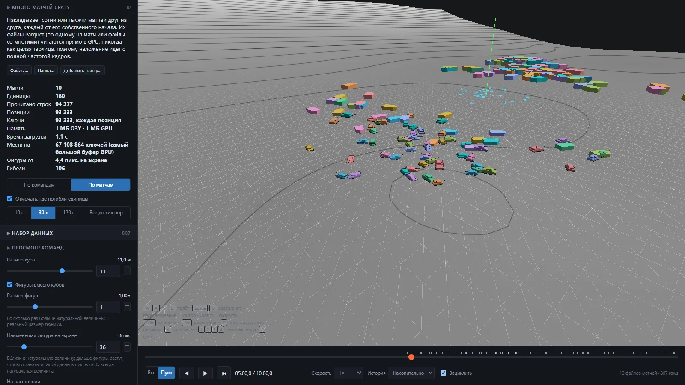

# Много матчей сразу

**Много матчей сразу** проигрывает множество матчей поверх друг друга, так что вы видите, куда обычно ходят игроки каждого матча. Используйте, чтобы сравнить сотни или тысячи матчей на одной картинке.

Каждый матч начинается с собственного начала, и его единицы движутся как фигуры. Файлы сразу попадают в видеокарту, и полная таблица не строится, поэтому воспроизведение идёт плавно там, где обычная загрузка закончилась бы нехваткой памяти.

## Как пользоваться {#how-to-use-it}

1. Откройте **Много матчей сразу** на боковой панели тепловой карты.
2. Нажмите **Файлы…** (выберите много файлов), **Папка…** (папка и её подпапки) или **Добавить папку…** (добавить к уже загруженному).
3. Просмотрщик переключается на наложение фигур и начинает с начала. Нажмите **Пуск**.

Каждый файл — это один матч (или несколько). Подходят файлы Parquet и [`.3dheat`](container.md) контейнеры. Файлу нужны столбцы положения, времени и единицы; столбцы имени, типа и стороны сохраняются. Прочие файлы и вспомогательные файлы конвертеров (полёт, сообщения, события, чат, цели) пропускаются. Обычную таблицу см. в [Загрузка данных](getting-data-in.md).

## Настройки {#settings}

| Настройка | Что делает |
|---|---|
| **По командам** / **По матчам** | Окрашивать по стороне или отдельным цветом для каждого матча. |
| **Отмечать, где погибли единицы** | Метка там, где погибла каждая единица, на 10 с, 30 с, 120 с или на всё время до сих пор. |

Панель показывает, сколько матчей, единиц, строк и положений прочитано, сколько памяти занято и сколько длилась загрузка. *Места под* — сколько ещё положений видеокарта может принять. *Фигуры от* — размер на экране, ниже которого единица рисуется как маленькая стрелка вместо своей фигуры.

Внешний вид фигур использует те же элементы управления, что и [повтор матча](match-replay.md#figures): **Размер фигур**, **Наименьшая фигура на экране** и **На расстоянии**.

## Советы {#tips}

- Когда всё не помещается в памяти, положения разреживаются (сохраняется только положение каждые несколько метров), и панель это сообщает.
- Режимы тепла тоже работают с данными наложения.
- Статистику по тысячам матчей без их рисования см. в [Массовый анализ](mass-analysis.md).
