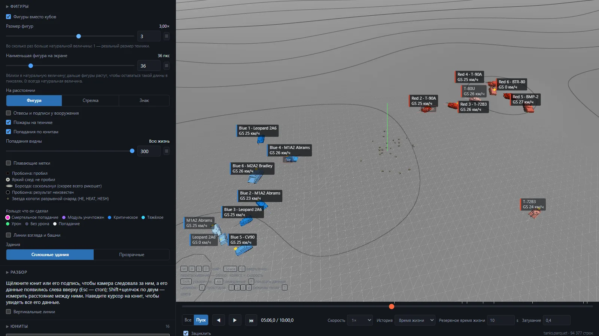
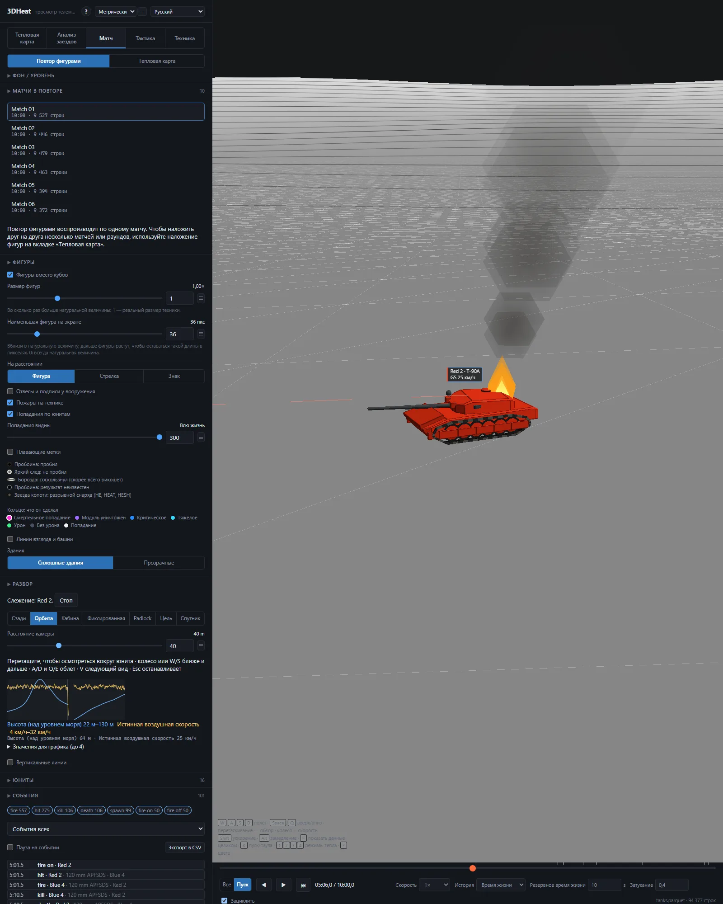
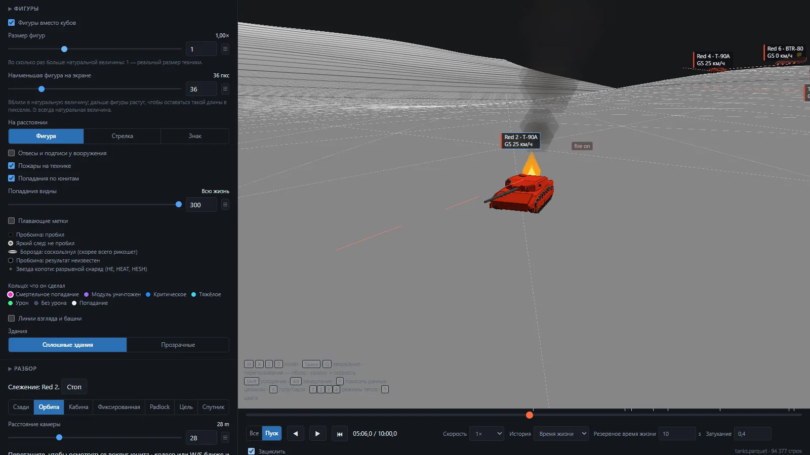
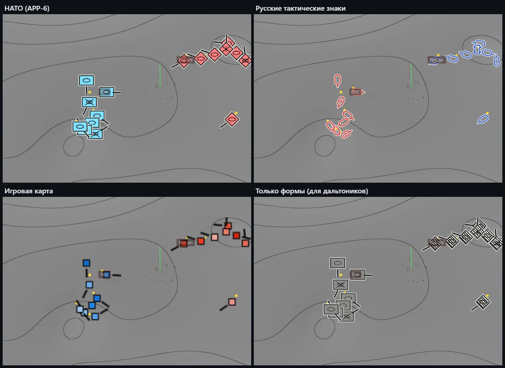
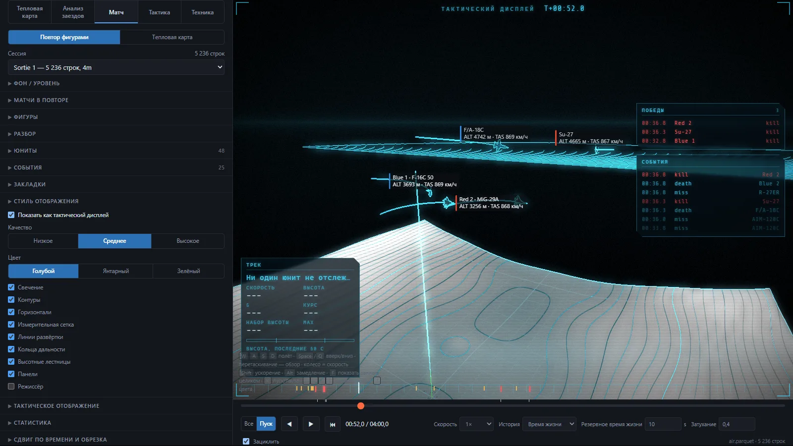
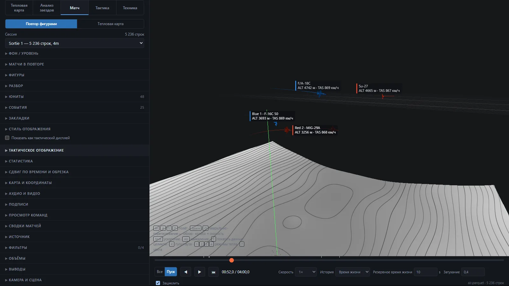

# Повтор матча

Повтор — это фильм о матче, где каждый игрок нарисован тем, что он вёл. Используйте его, чтобы снова посмотреть бой, проследить за одним юнитом и увидеть, кто в кого попал.

Выстрелы, попадания, пожары и обломки рисуются на юнитах и целях уровня. Камеры, подписи и тактический дисплей помогают читать бой. Знакомы с Tacview? [Паритет с Tacview](tacview-parity.md) показывает, где находится каждый его инструмент.

## Начать повтор {#start-a-replay}

1. Загрузите запись через **Источник → Файлы…** или перетащив её на панель «Источник» (любая таблица со столбцом **человек** и столбцом **время**, файл Tacview, сконвертированный реплей, матч в формате [`.3dheat`](container.md)). См. [Загрузка данных](getting-data-in.md).
2. Откройте вкладку **Матч** и выберите **Повтор фигурами** или выберите **Наложение фигур** в панели режимов на вкладке «Тепловая карта».
3. В разделе **Матчи в повторе** выберите один матч, все сразу или несколько.
4. Нажмите **Пуск** на временной шкале (или `K`). Перетащите временную шкалу, чтобы перескочить.

Фигуры заменяют кубы у каждого юнита, чьё имя или тип известны (см. [Фигуры](figures.md)). Данные без столбца имени или типа рисуются как солдаты.

## Фигуры {#figures}

| Настройка (раздел **Фигуры**) | По умолчанию | Что делает |
|---|---|---|
| **Фигуры вместо кубов** | включено | Выключено — рисуются простые кубы. |
| **Размер фигур** (во сколько раз истинного размера) | 1 | 1 — настоящий размер; от 0,25 до 20 раз (логарифмическая шкала). Больше помогает издалека. |
| **Наименьшая фигура на экране** | 36 px | Далёкие фигуры растут, чтобы оставаться такой длины: от 0 до 200 px; 0 оставляет истинный размер. |
| **На расстоянии**: Фигура, Стрелка, Знак | Фигура | Во что превращается далёкий юнит. |
| **Знаки** | NATO (APP-6) | NATO (APP-6), русские тактические знаки, значки **Игровая карта** или **Только формы (для дальтоников)**. |
| **Размер знака**, **Моя сторона**, **Враждебные / нейтральные**, **Метки курса** | 28 px (от 12 до 64), автоматически, враждебные, включено | Как выглядят знаки и какая сторона считается своей. |
| **Вертикальные линии** | включено | Линия от каждого юнита прямо вниз до земли, чтобы высоты читались в 3D. |
| **Отвесы и подписи у вооружения** | выключено | Линии до земли и подписи у ракет и бомб. |
| **Пожары на технике** | включено | Пламя с момента, когда юнит загорелся, до тушения. |
| **Попадания по юнитам** | включено | Метки там, куда попали выстрелы (см. ниже). **Попадания видны**: от 1 до 300 секунд или **Всю жизнь**. **Плавающие метки**: метки, нарисованные над поверхностью. |
| **Линии взгляда и башни** | выключено | Пунктир: куда смотрит игрок; сплошная: куда направлено орудие. |
| **Здания** | сплошные | Сплошные или прозрачные здания, если уровень их раскрашивает. |

### Знаки на расстоянии {#symbols-at-a-distance}

Когда юнит был бы меньше **Наименьшей фигуры на экране**, он может стать знаком, который остаётся читаемым. Форма говорит о виде (например, скруглённый прямоугольник с меткой гусениц для брони), а цвет — о стороне. Откройте меню **Знаки**, чтобы изменить стиль.

### Метки попаданий, обломки и пожары {#hit-marks-wrecks-and-fires}

- **Метки попаданий** лежат на поверхности, с которой встретился выстрел, в масштабе фигуры. Их вид показывает, что произошло: дыра (пробил), яркий всплеск (не пробил), борозда (рикошет), звезда копоти (фугасный снаряд). Цветное кольцо говорит, что это сделало: смертельный выстрел, модуль уничтожен, критическое, сильное, повреждение, без повреждения, попадание. Наведите курсор на метку, чтобы увидеть название снаряда.
- Уничтоженный юнит рисуется **обгоревшим** как обломок от гибели до возрождения или удаления. Его знак перечёркнут.
- **Пожары** горят на юните с момента, когда он загорелся, до тушения.
- **Башни** поворачиваются туда, куда по данным направлено орудие (или, если таких данных нет, туда, куда смотрит игрок).

### Оружие, ложные цели и трассеры {#weapons-decoys-and-tracers}

Если включено **Оружие, выстрелы и попадания** (раздел «Просмотр команд»): ракеты, реактивные снаряды, бомбы и торпеды летят как собственные фигуры со следом дыма; пули и снаряды — трассеры; попадания и взрывы вспыхивают. Трассер, нарисованный **пунктиром**, вычислен по попаданию, потому что в данных самого выстрела не было. Вспышки и дипольные отражатели рисуются как ложные цели. Они скрыты из списка юнитов, если не отмечено *Ложные цели и снаряды*.

## Камеры {#cameras}

Щёлкните по юниту или его подписи, чтобы **следовать** за ним. В разделе **Повтор** доступны **Сзади**, **Орбита**, **Кабина** (с индикатором на лобовом стекле, `H`), **Фиксированная**, **Padlock**, **Цель** и **Спутник**. Клавиша `V` переключает их, **Расстояние камеры** задаёт, как далеко. Esc останавливает слежение.

- **Вид из двух юнитов**: выберите **Цель** (или щёлкните по юниту с Ctrl/Alt), чтобы смотреть на него от того, за кем следите; **Поменять** меняет их местами.
- **Показатель**: Shift + щелчок по двум юнитам — пеленг, дальность и разница высот между ними.
- **2D-карта** (`M`): угол или весь вид, со следами и именами.
- **Закладки** (`B`): сохраняют момент и камеру. Собственные убийства, смерти и отметки записи тоже перечислены.
- **События**: каждое событие по времени; щелчок переносит туда. `Page Up` и `Page Down` переходят между событиями; **Пауза на событии** останавливается на каждом.

## Тактическое отображение {#tactical-display}

Раздел **Тактическое отображение** рисует для ни одного юнита, для выбранных, для всех или для одного вида (самолёты, наземные, корабли, оружие): векторы скорости и путь вперёд, линии носа и подъёмной силы, конусы радаров, захваты, линии передачи данных, зоны и линии боя, линии видимости, куда смотрят игроки (конусы взгляда), наведение башен и записанную камеру.

### Стиль отображения {#display-style}

`T` (или переключатель **Показать как тактический дисплей**) переключает вид в стиль радарного экрана: свечение, контуры, линии уровня, сетку измерений, линии развёртки, кольца дальности, шкалы высоты, панели с убийствами и событиями и **Режиссёра**, который сам переводит камеру к событиям.

## Цели {#objectives}

Если матч приходит с целями, раздел **Цели** рисует их на уровне: зоны захвата (с владельцем и ходом захвата), точки появления, аэродромы, районы и цели бомбардировок. У каждого слоя свой переключатель и подписи. Цели видны сквозь землю. Если загружено несколько игровых режимов, **Режим** фильтрует матчи по режиму. Цели берутся из файла матча конвертера рядом с записью или внутри контейнера [`.3dheat`](container.md).

Матчи Rainbow Six Siege приносят свои точки закладки: две комнаты каждой точки рисуются на своём полу контурами с названиями, вычисленными по тому, где стояли игроки, пока игра называла комнату; точка карты, которую в матче не играли, берётся из таблицы точек конвертера в виде круга. В повторе точка раунда в позиции воспроизведения подсвечивается янтарным, остальные остаются серыми. Они входят в слой зон захвата.

## Подписи и статистика {#labels-and-statistics}

- **Подписи**: правила для каждого вида (**Выбранные**, **Самолёты**, **Наземные**, **Корабли**, **Оружие**, **ИИ**): показывать или нет, какие значения и **Приоритет** — кому достаётся место, когда подписи перекрываются. **Разводить подписи** переносит подпись рядом с её юнитом, если она закрывает другой, и убирает её там, где нет места. **Размер подписей** — от 60 до 250%. **Вернуть имя, технику, высоту и скорость** сбрасывает правила.
  - Наземные юниты начинают с имени, техники и скорости.
  - Самолёты начинают с имени, техники, высоты и скорости.
  - Корабли начинают с имени, техники, скорости и курса.
  - Наведите курсор на юнит, чтобы увидеть все его значения.
- **Статистика**: по команде и юниту: убийства, смерти, выстрелы, попадания, доля попаданий, взлёты, посадки, время в воздухе, максимальная скорость, высота и перегрузка G, расстояние. Экспорт в CSV.
- **Графики**: значения юнита во времени, сравнение двух юнитов или одного значения против другого.

## Много матчей сразу {#many-matches-at-once}

Чтобы наложить сотни или тысячи матчей друг на друга, см. [Много матчей сразу](many-matches.md). Подробности фигур (дым, пожар и другие эффекты по времени): [Фигуры в наложении фигур](figure-replay.md). Список возможностей Tacview: [Паритет с Tacview](tacview-parity.md), дочерняя страница этой.
