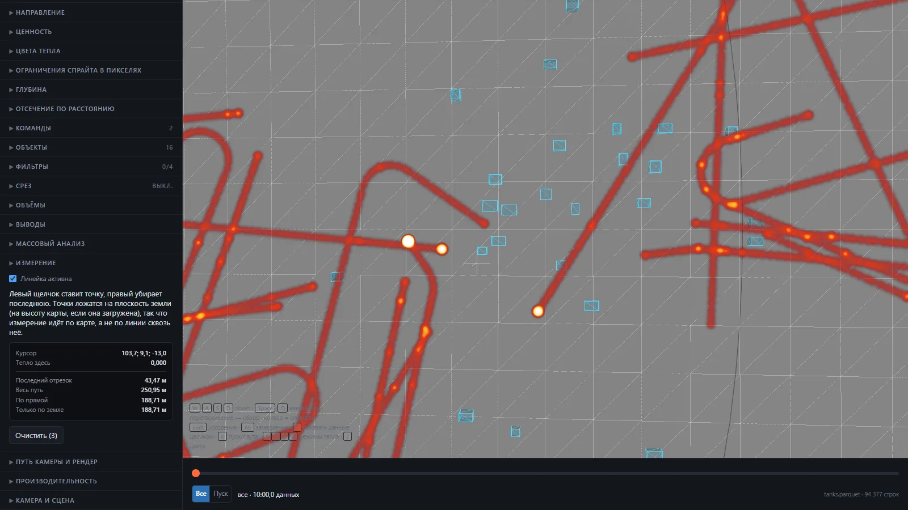

# Измерение

**Показатель** превращает мышь в линейку и говорит, насколько оживлено место под курсором. Используйте его, чтобы узнать, как далеко друг от друга два места или сколько движения на одном месте.

## Попробовать {#try-it}

1. Откройте **Показатель** на боковой панели и поставьте отметку **Линейка активна**.
2. Щёлкните левой кнопкой мыши по трём местам на карте. Каждый щелчок ставит точку.
3. Посмотрите **Весь путь** (длину всего пути) и **Последний отрезок** (последний участок).
4. Щёлкните правой кнопкой, чтобы убрать последнюю точку, или нажмите **Очистить (3)**, чтобы убрать все.

| Действие | Эффект |
|---|---|
| Щелчок левой кнопкой | Ставит точку там, где курсор встречает плоскость земли. Щелчок, при котором между нажатием и отпусканием курсор сдвинулся больше чем на 4 пикселя, — это перетаскивание камеры, а не точка. |
| Щелчок правой кнопкой | Убирает последнюю точку. |
| Движение | Положение курсора и тепло под ним обновляются в реальном времени. |

Камера работает, пока линейка включена: перетаскивание по-прежнему осматривает, клавиши по-прежнему управляют полётом. Пока линейка включена, она забирает каждый щелчок, поэтому [выбор щелчком](camera.md#click-to-pick) ждёт, пока она не выключена.

**Плоскость земли** — это высота [изображения карты](map-images.md), когда оно загружено, иначе самая низкая Y набора данных (0, если его нет). Точки ставятся на эту плоскость, поэтому линейка меряет по карте, а не по прямой через неё. С 3D-уровнем плоскость по-прежнему берётся по самой низкой Y набора данных, а не по поверхности уровня: чтобы поставить точку на настоящую поверхность, выключите линейку и щёлкните по ней ([выбор щелчком](camera.md#click-to-pick)), — тогда координаты читаются по треугольникам самого уровня.

## Показания {#readouts}

| Строка | Значение |
|---|---|
| **Курсор** | Мировые X, Y, Z точки под курсором на плоскости. |
| **Тепло здесь** | Сколько тепла в пикселе под курсором. Большее число — больше движения в этом месте. Это значение, которое подаётся в цветовую шкалу до того, как точка насыщения его делит, поэтому его можно сравнить с [точкой насыщения](colour-and-exposure.md#saturation-point). |
| **Последний отрезок** | Расстояние от последней точки до курсора (или между двумя последними точками). |
| **Весь путь** | Длина ломаной через каждую точку и курсор. |
| **По прямой** | Трёхмерное расстояние от первой точки до курсора (или последней точки). |
| **Только по земле** | То же самое, только по X и Z. |
| **Очистить (N)** | Убирает все точки. |

Расстояния показываются в сантиметрах при значении меньше 1 единицы, в метрах при значении меньше 1 000 и в километрах при большем, если считать, что одна единица мира — метр ([Оси, единицы и время](axes-units-and-time.md#unit-scale)). Координаты мировые, в том числе когда ось [инвертирована для показа](camera.md#invert-world-axis).

Точки и линия между ними рисуются в области просмотра как наложение, с размером по шагу сетки. Точки линейки не сохраняются в видах; они остаются, когда вы загружаете другие данные.

## Для разработчиков {#for-developers}

**Тепло здесь** читается с GPU не чаще чем раз в 120 мс, потому что чтение одного пикселя останавливает конвейер. Используется тот же путь, что и у `engine.readHeatProbe()`: значение делится на усиление, с которым был записан кадр, поэтому на пути накопления в half-float (`?heat=f16`) оно в тех же единицах, что и на 32-битной цели ([Накопление в half-float](half-float-accumulation.md)).
