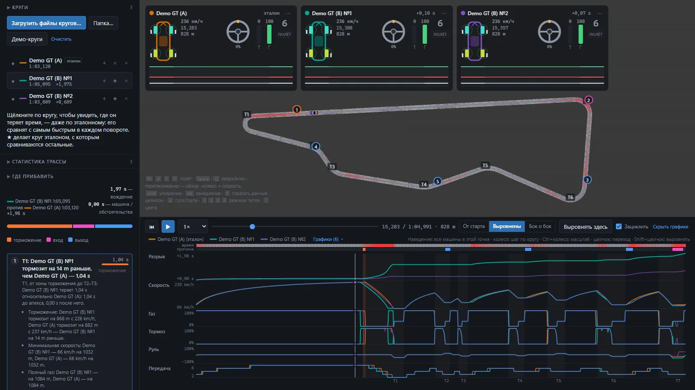

# Анализ заездов

Вы проехали одну и ту же трассу дважды. Вкладка **Анализ заездов** проигрывает оба заезда вместе в 3D, показывает, где один круг был медленнее, и объясняет почему. Кругов ещё нет? Нажмите **Демо-круги**.

Вкладка сравнивает два или больше кругов одной трассы. Она использует общий холст, камеру и загруженную модель трассы (**Фон / уровень**) вместе с тепловой картой; всё остальное у неё своё: собственная боковая панель и собственная полоса под видом. Слова *круг*, *эталон* и *вершина* объяснены в [глоссарии](glossary.md).

Эта страница — карта вкладки. У каждой части есть своя страница:

| Страница | Что охватывает |
|---|---|
| [Загрузка кругов](race-loading-laps.md) | все форматы файлов, папки и трассы, названия машин, демо-круги, список кругов, эталон и фокус |
| [Повтор и 3D-сцена](race-replay-and-scene.md) | панель управления, три режима повтора, выравнивание машин, камера преследования, линии, карты, машины, подписи, зеркальные миры |
| [Графики и HUD](race-charts-and-hud.md) | графики по дистанции, выбор графика, наведение и масштаб, карточки машин, таблица каналов |
| [События управления машиной](race-control-events.md) | блокировки, пробуксовка, избыточная и недостаточная поворачиваемость, вращения, удары, аварии, ABS/TC, ручной тормоз, воздух — как каждое определяется, с каждым порогом |
| [Разбор поворот за поворотом](race-corner-analysis.md) | выравнивание по дистанции, повороты и участки, баланс времени поворота, каждая причина и порядок их проверки, форма линии и совет |
| [Профили машин и сравнение](race-car-profiles.md) | что может каждая машина, измерено по её кругам; *Сравнение машин*; что машина решает в каждом повороте |
| [Статистика трассы](race-course-statistics.md) | много кругов одной трассы: ошибки по поворотам и видам, карта ошибок, экспорт тепловой карты, пределы производительности |
| [Анализ заездов: метод](race-analytics.md) | исследование, на котором основаны правила, с источниками |
| [Другие гоночные игры](other-games.md) | что просмотр делает с кругами каждой игры: скольжение и занос, вычисленные там, где игра их не присылает, зеркальные миры, дополнительные каналы |

## Экран {#the-screen}

**Боковая панель**, сверху вниз (разделы можно сворачивать):

1. **Круги** — загрузка, список, показ и скрытие, эталон, фокус, преследование.
   См. [Загрузка кругов](race-loading-laps.md).
2. **Статистика трассы** — только при трёх и более загруженных кругах.
   См. [Статистика трассы](race-course-statistics.md).
3. **Где прибавить** — находки по фокусному кругу, поворот за поворотом.
   См. [Разбор поворот за поворотом](race-corner-analysis.md).
4. **Поворот за поворотом** (или *Поворот за поворотом — класс X* при нескольких классах) — самый быстрый круг через каждый поворот и его линия. Показывается при двух и более кругах.
5. **Контроль машины** — блокировки, заносы, сносы и удары фокусного круга.
   См. [События управления машиной](race-control-events.md).
6. **Сравнение машин** (или **Машина**, если машина одна) — см. [Профили машин и сравнение](race-car-profiles.md).
7. **Вид** — какая карта нарисована на трассе и что рисуется.
   См. [Повтор и 3D-сцена](race-replay-and-scene.md).
8. Общие панели **Фон / уровень** и **Камера и сцена** (модель трассы, инверсия осей, камера) — описаны вместе с тепловой картой и в [Камере](camera.md).

**Вид** показывает трассу, проложенные линии, карту, машины, подписи, закреплённые на трассе, и до шести карточек машин в левом верхнем углу (см. [Графики и HUD](race-charts-and-hud.md)). Если круги не загружены, там написано: «Круги не загружены. Перетащите сюда два или больше файлов кругов или загрузите демо-круги с боковой панели».

**Полоса под видом** содержит панель управления повтором и, если не скрыта, графики по дистанции.

## Быстрый старт {#quick-start}

1. Откройте вкладку **Анализ заездов** (рядом с **Тепловой картой** вверху боковой панели).
2. Загрузите круги. Нажмите **Демо-круги**, чтобы увидеть, что вкладка делает с тремя вымышленными кругами. Для собственных кругов сначала запишите их ([форматы файлов и рекордеры](race-loading-laps.md#file-formats)), затем нажмите **Загрузить файлы кругов…** или **Папка…**, либо перетащите файлы или папки на вид.
3. Самый быстрый полный круг становится эталоном; самый медленный из остальных получает фокус. Щёлкните по любому кругу в списке, чтобы сфокусировать его; ★ делает круг эталоном.
4. Читайте **Где прибавить**. Щёлкните по находке: машины выравниваются за 40 м до неё, камера её вмещает, повтор проигрывает этот участок, и открываются измерения.
5. Наведите курсор на графики, чтобы переместить каждую машину к этому метру; Shift+щелчок выравнивает их там.

## Клавиатура {#keyboard}

Пока открыта вкладка Анализ заездов:

| Клавиша | Действие |
|---|---|
| **K** | пуск / пауза повтора |
| **Home** | к началу повтора |
| цифровые клавиши | ничего (в тепловой карте переключают режимы) |

Клавиши, набранные в текстовом поле или выпадающем списке, игнорируются. Клавиши камеры работают как в тепловой карте (**W A S D**, **Пробел** вверх, **Q** вниз, **Shift** быстрее, **Alt** медленнее, мышь — для обзора; всё в [Камере](camera.md)); **F** вмещает загруженные круги (как при загрузке кругов).

## Много кругов {#many-laps}

- Все загруженные круги анализируются и учитываются; десятки занимают секунду-две.
- Сверх **8** кругов (`SHOW_ALL_UP_TO`) добавленные круги рисуются, только если они эталон, фокусный круг или лучший круг класса фокусного круга. Переключатели *Показать все* / *Только просматриваемые*.
- Сверх **10** видимых машин (`PLAIN_PAST`) круги, на которые не смотрят (не фокус, не преследуемая машина и не эталон), рисуются линиями, прореженными до точки каждые 6 м вместо 1.5 м, и простыми машинами.
- Графики рисуют не больше **8** кругов; HUD показывает не больше **6** карточек.
- Статистика трассы появляется от **3** кругов.

Подробнее: [Статистика трассы](race-course-statistics.md#performance-with-many-laps).

## Настройки вида по умолчанию {#default-view-settings}

| Настройка | По умолчанию |
|---|---|
| Карта | Карта времени |
| Проложенные линии, Машины, Шины и подвеска, Подписи, Трасса из кругов | вкл. |
| Все значения на карточках | выкл. |
| Размер машин | 1× |
| Графики | показаны |
| Режим повтора | От линии |
| Скорость повтора | 1× |
| Зациклить | вкл. |

Ничего из этого не сохраняется; перезагрузка начинает с значений по умолчанию. В браузере запоминаются язык и названия машин, полученные из файлов кругов (см. [Загрузка кругов](race-loading-laps.md#car-names)).

## Для разработчиков {#for-developers}

### Что происходит при загрузке кругов {#what-happens-when-laps-are-loaded}

Каждый раз, когда меняется набор кругов, эталон или язык, весь анализ выполняется заново (`analyse` в [`src/race/analysis.ts`](https://github.com/Holdi601/3DHeat/blob/main/src/race/analysis.ts)):

1. К каждому кругу добавляются производные каналы там, где игра их не присылает: угол дрифта, проскальзывание колёс по скоростям колёс, нахождение в воздухе, рыхлый грунт, скорость рыскания ([`derive.ts`](https://github.com/Holdi601/3DHeat/blob/main/src/race/derive.ts)).
2. Выбирается эталон, и каждый круг проецируется на его путь и пересэмплируется каждые 2 м ([`align.ts`](https://github.com/Holdi601/3DHeat/blob/main/src/race/align.ts)).
3. По кругам определяется, зеркальен ли мир игры ([`handedness.ts`](https://github.com/Holdi601/3DHeat/blob/main/src/race/handedness.ts)).
4. Повороты находятся на эталоне и группируются в участки от одной зоны торможения до следующей ([`segments.ts`](https://github.com/Holdi601/3DHeat/blob/main/src/race/segments.ts)).
5. Для каждой машины: её огибающая (сцепление, торможение, тяга по скорости), её профиль и её кривые шин ([`envelope.ts`](https://github.com/Holdi601/3DHeat/blob/main/src/race/envelope.ts), [`profile.ts`](https://github.com/Holdi601/3DHeat/blob/main/src/race/profile.ts), [`control.ts`](https://github.com/Holdi601/3DHeat/blob/main/src/race/control.ts)).
6. Для каждого круга и участка: что он сделал (точка торможения, самая медленная точка, полный газ, ...) и линия, по которой он ехал ([`line.ts`](https://github.com/Holdi601/3DHeat/blob/main/src/race/line.ts)).
7. Для каждого круга: его события управления машиной, каждое сопоставлено с кругом, с которым его сравнивают в этом месте.
8. Для каждого круга и участка: баланс времени относительно круга сравнения и находка словами.
9. Карта времени и карта причин для каждого круга.

Тексты создаются на текущем языке; смена языка запускает анализ заново (и переименовывает демо-круги). Сбой анализа показывается под кнопками **Круги** как ошибка, а круги остаются загруженными.

### Исходные файлы {#source-files}

| Файл | Назначение |
|---|---|
| `src/race/adapters.ts`, `ibt.ts` | чтение файлов кругов |
| `src/race/lap.ts`, `carNames.ts`, `synthetic.ts` | тип круга, названия, демо-круги |
| `src/race/derive.ts`, `handedness.ts` | производные каналы, зеркальные миры |
| `src/race/align.ts`, `segments.ts`, `line.ts` | ось дистанции, повороты, линии |
| `src/race/analysis.ts` | сравнение поворотов, причины, находки |
| `src/race/envelope.ts`, `profile.ts` | что может машина |
| `src/race/control.ts`, `impacts.ts` | управление машиной, попадания и аварии |
| `src/race/stats.ts` | много кругов |
| `src/race/replay.ts`, `scene.ts`, `glyph.ts`, `geometry.ts` | повтор и отрисовка |
| `src/race/schema.ts`, `graphs.ts` | таблица каналов, строки графиков |
| `src/ui/race/*` | боковая панель, графики, HUD, подписи |
| `src/state/raceStore.ts` | состояние вкладки и часы повтора |
