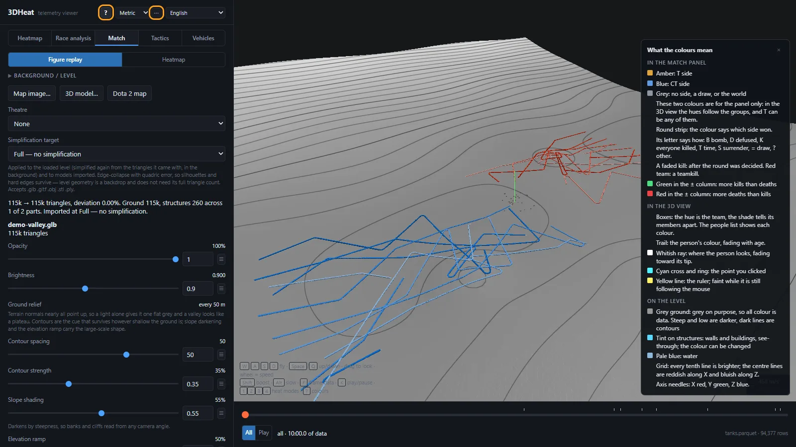

# Настройки, единицы и клавиши

Небольшие элементы управления вверху боковой панели меняют то, как просмотр с вами общается: язык, единицы (метры или футы, км/ч или узлы) и режим справки, который объясняет цвета. Ваш выбор запоминается в браузере.

## Шапка {#the-header}

Вверху боковой панели:

| Элемент | Что делает |
|---|---|
| **?** | Режим справки: что означает каждый цвет (также `?` или `F1`) |
| Меню **Единицы** | Метрические, Имперские, Авиационные или Морские |
| Кнопка **...** рядом с **Единицы** | Открывает окно «Выберите единицу для каждой величины»: по одному списку на величину |
| Меню **Язык** | Язык просмотра: [40 языков](languages.md) или язык браузера |

Числа, которые вы вводите в поля, можно писать с точкой или с запятой (`0.35` или `0,35`). Просмотр понимает оба варианта и показывает числа так, как их пишет язык просмотра.

## Единицы {#units}

1. Выберите набор в меню **Единицы**. Все величины переключаются вместе.
2. Чтобы поменять только одну величину, нажмите кнопку **...** рядом с ней и выберите для неё единицу. После этого в меню появится `*` за названием набора.
3. Величина, которую вы не меняли, следует набору. Выберите «As preset», чтобы вернуться.

| Величина | Метрические (по умолчанию) | Имперские | Авиационные | Морские |
|---|---|---|---|---|
| Расстояние | км | mi | NM | NM |
| Высота, длина | м | ft | ft | м |
| Скорость | км/ч | mph | kt | kt |
| Вертикальная скорость | м/с | ft/min | ft/min | м/с |
| Температура | °C | °F | °C | °C |
| Давление | гПа | inHg | гПа | гПа |
| Масса, топливо | кг, л | lb, gal | lb, gal | т, м³ |
| Угол | градусы | градусы | градусы | градусы |

Другие единицы, которые можно выбрать для одной величины: расстояние км, mi, NM; скорость км/ч, м/с, kt, mph; вертикальная скорость м/с, ft/min, м/мин; температура °C, °F, K; давление гПа, inHg, mmHg, psi; масса кг, lb, т; угол градусы или угловые тысячные NATO (6400 на круг). Единицы одинаковы везде в просмотре: в подписях, карточках, графиках и статистике.

## Режим справки {#help-mode}

Нажмите `?` или `F1` либо кнопку **?**. Откроется раздел **Что означают цвета**: легенды для 3D-вида, шкал тепла, цветов команд, цветов уровня, статусных цветов панелей, панели матча и вида гонки. Режим остаётся включённым, пока вы его не выключите. На вкладке Матч он объясняет и цвета панели матча.

## Что помнит браузер {#what-the-browser-remembers}

Эти настройки хранятся в браузере между визитами (ничего никуда не отправляется):

- язык, единицы и режим справки;
- настройки фигур, знаков, подписей, камеры и тактического дисплея повтора;
- скорость воспроизведения и зеркальность;
- закладки для каждой записи, объёмы для каждого набора данных, слои целей;
- настройки внешнего ИИ (ключ только если вы отметили *Запомнить*).

Настройки тепла, фильтры и режим начинаются заново при каждой загрузке. Полный сгенерированный список: [Сохранённые настройки](ref-settings-storage.md).

## Клавиши, которые просмотр оставляет за собой {#keys-the-viewer-keeps-from-the-browser}

Сессия с большими данными грузится долго, поэтому просмотр не даёт браузеру случайно её сбросить:

- `Ctrl`/`Cmd` + буквы, которые печатают, сохраняют, открывают, перезагружают, закрывают или открывают новые окна, ничего не делают вне текстовых полей; `F1`, `F3`, `F5`, `F6` и `F7` ничего не делают.
- Закрытие или перезагрузка вкладки с загруженными данными или уровнем сначала спрашивает подтверждение.
- В полноэкранном режиме просмотр блокирует клавиши, которые использует сам (W, T, N, S, R, P, Q, Esc), чтобы браузер их не перехватил.

Полный список: [Клавиши браузера](ref-browser-keys.md). Все клавиши самого просмотра: [Справочник клавиатуры и мыши](keyboard-reference.md).
