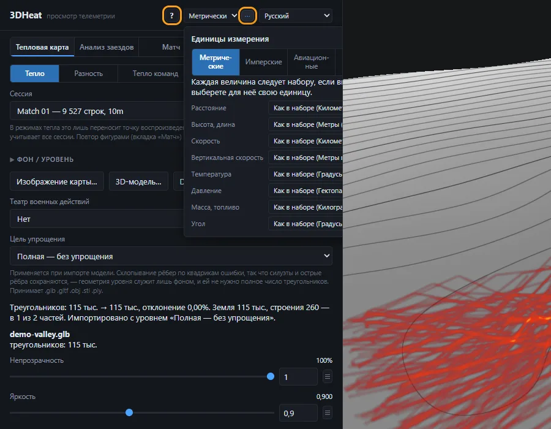
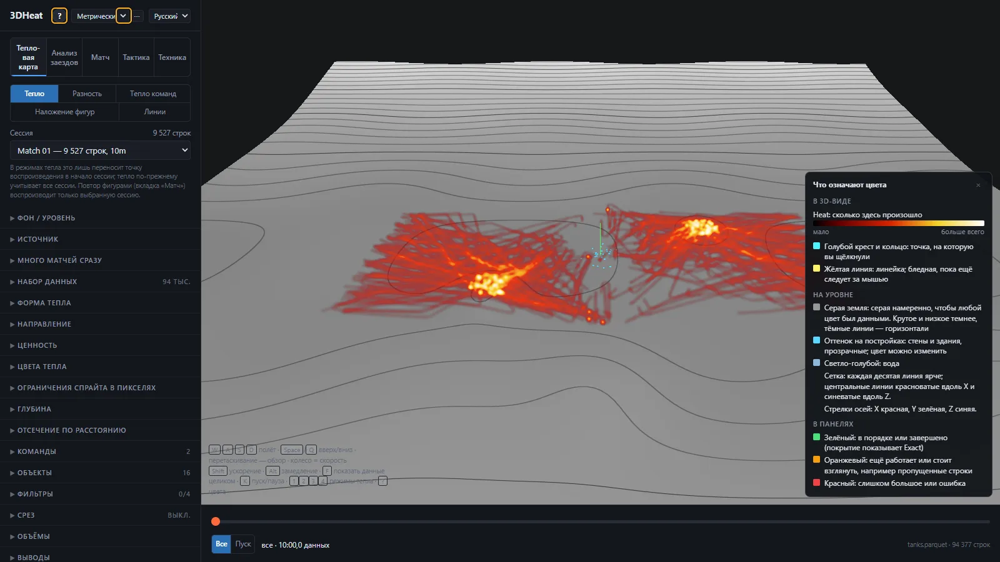
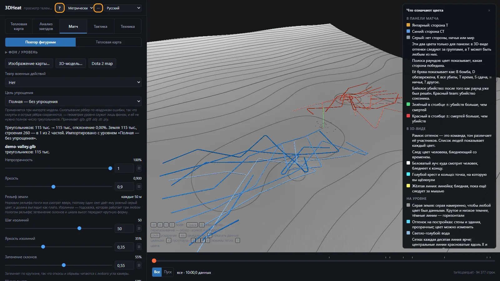

# Настройки, единицы и клавиши

Небольшие элементы управления вверху боковой панели меняют то, как просмотрщик с вами говорит: язык, единицы (метры или футы, км/ч или узлы) и режим справки, который объясняет цвета. Ваш выбор запоминается в браузере.

## Шапка {#the-header}

Вверху боковой панели:

| Элемент | Что делает |
|---|---|
| **?** | Режим справки: что означает каждый цвет (также `?` или `F1`) |
| Меню **Единицы** | Метрические, Имперские, Авиационные или Морские |
| Кнопка **...** рядом с **Единицы** | Открывает «Выбрать единицу для каждой величины»: один выпадающий список на величину |
| Меню **Язык** | Язык просмотрщика: [40 языков](languages.md) или язык браузера |

В числа, которые вы вводите в поле, можно писать и точку, и запятую (`0.35` или `0,35`). Просмотрщик понимает оба и показывает числа так, как их пишет язык просмотрщика.

## Единицы {#units}

1. Выберите набор в меню **Единицы**. Все величины переключаются вместе.
2. Чтобы изменить только одну величину, нажмите кнопку **...** рядом с ней и выберите для неё единицу. В меню после набора появится `*`.
3. Величина, которую вы не меняли, следует набору. Выберите «Как в наборе», чтобы вернуться.

| Величина | Метрические (по умолчанию) | Имперские | Авиационные | Морские |
|---|---|---|---|---|
| Расстояние | км | мили | мор. мили | мор. мили |
| Высота, длина | м | фут | фут | м |
| Скорость | км/ч | миль/ч | уз. | уз. |
| Вертикальная скорость | м/с | фут/мин | фут/мин | м/с |
| Температура | °C | °F | °C | °C |
| Давление | гПа | дюйм рт. ст. | гПа | гПа |
| Масса, топливо | кг, л | фунт, галлон | фунт, галлон | т, м³ |
| Угол | градусы | градусы | градусы | градусы |

Другие единицы, которые можно выбрать для одной величины: расстояние — км, мили, мор. мили; скорость — км/ч, м/с, уз., миль/ч; вертикальная скорость — м/с, фут/мин, м/мин; температура — °C, °F, K; давление — гПа, дюйм рт. ст., мм рт. ст., psi; масса — кг, фунт, т; угол — градусы или тысячные NATO (6400 на круг). Единицы везде в просмотрщике одинаковые: подписи, карточки, графики, статистика.

## Режим справки {#help-mode}

Нажмите `?` или `F1` либо кнопку **?**. Откроется *Что означают цвета*: легенды для 3D-вида, шкал тепла, цветов команд, цветов уровня, цветов статуса панелей, панели матча и вида заезда. Режим остаётся включённым, пока вы его не выключите. На вкладке «Матч» он объясняет и цвета панели матча.

## Что запоминает браузер {#what-the-browser-remembers}

Эти настройки хранятся в браузере между визитами (ничего никуда не отправляется):

- язык, единицы и режим справки;
- настройки фигур, символов, подписей, камеры и тактического отображения повтора;
- скорость воспроизведения и зеркальное отражение;
- закладки для каждой записи, объёмы для каждого набора данных, слои целей;
- внешние настройки ИИ (ключ — только если поставить отметку *Запомнить*).

Настройки тепла, фильтры и режим при каждой загрузке начинаются заново. Полный, сгенерированный список: [Сохранённые настройки](ref-settings-storage.md).

## Клавиши, которые просмотрщик оставляет за собой {#keys-the-viewer-keeps-from-the-browser}

Сессия с большими данными грузится долго, поэтому просмотрщик не даёт браузеру выбросить её по ошибке:

- `Ctrl`/`Cmd` + буквы, которые печатают, сохраняют, открывают, перезагружают, закрывают или открывают новые окна, ничего не делают вне текстовых полей; `F1`, `F3`, `F5`, `F6` и `F7` ничего не делают.
- Закрытие или перезагрузка вкладки с загруженными данными или уровнем сначала спрашивает.
- В полноэкранном режиме просмотрщик блокирует клавиши, которые использует (W, T, N, S, R, P, Q, Esc), чтобы браузер их не перехватил.

Полный список: [Клавиши браузера](ref-browser-keys.md). Все собственные клавиши просмотрщика: [Справочник клавиатуры и мыши](keyboard-reference.md).
