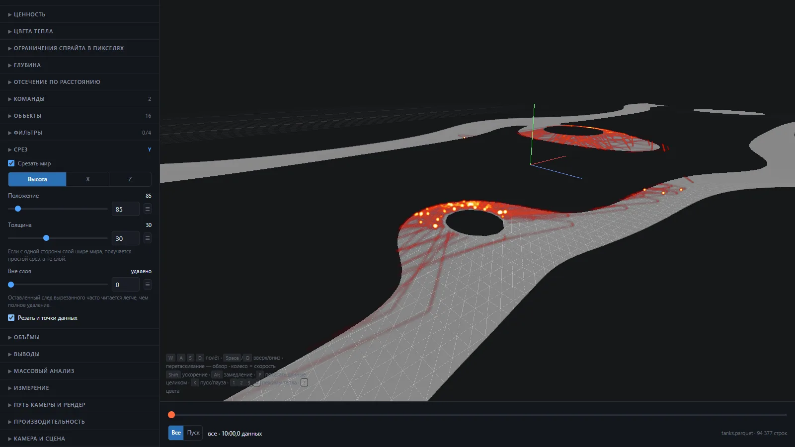

# Срез

**Срез** режет мир, как кусок торта, чтобы можно было заглянуть внутрь зданий. Используйте его, когда стены закрывают интересное тепло, например чтобы увидеть один этаж здания.

## Попробовать {#try-it}

1. Загрузите уровень и какие-нибудь данные и откройте **Срез**.
2. Поставьте отметку **Срезать мир**. Ось — **Высота**.
3. Тяните **Позицию** вверх и вниз: слой движется по уровню.
4. Сделайте **Толщину** тонкой для плана этажа или широкой для «всё ниже этой отметки».
5. Оставьте **Вне слоя** на 0, чтобы убрать остальное, или поднимите, чтобы оставить слабый след.



Слой режет **геометрию уровня и точки данных вместе** — если резать только уровень, тепло висело бы там, где раньше было здание. Это пара к [глубинному перекрытию](depth-and-culling.md): когда уровень правильно прячет то, что за ним, внутренность здания тоже скрыта. Панель показывается, когда есть что резать (набор данных или 3D-уровень); в её заголовке при включении показана ось, а иначе — *выкл.*.

```
вид сбоку         Position = где слой
 ----------       Thickness = насколько высок слой
 | floor 3 |
 |=========|  <--- слой (оставлен)
 | floor 2 |  <--- вне слоя: убрано (или слабо)
 | floor 1 |
 ----------
```

## Элементы управления {#controls}

| Элемент | По умолчанию | Значение |
|---|---|---|
| **Срезать мир** | выключено | Включает слой. Пока позиция стоит на начальном 0, а толщина на начальных 500, включение переносит их в середину оси и на 15% её протяжённости. |
| Ось | **Высота** | *Высота* (Y), *X* или *Z*. Смена оси переносит слой в середину новой оси. |
| **Позиция** | середина | Центр слоя в мировых единицах по протяжённости оси (500 шагов). |
| **Толщина** | 15% протяжённости | От 1/500 протяжённости до двойной протяжённости, логарифмическими шагами. Показывает *за пределами мира*, когда она так же широка, как протяжённость: тогда одна сторона выходит за мир, и это уже простой срез, а не слой. |
| **Вне слоя** | 0, *убрано* | Какая часть того, что лежит снаружи, остаётся видимой, 0–100%. Слабый след отрезанного часто легче читать, чем полное удаление. |
| **Резать и точки данных** | включено | Если выключено, тепло остаётся целым и видно сквозь срез — удобно, чтобы видеть, что над слоем и под ним. |

Протяжённость оси — это протяжённость 3D-уровня, когда он загружен, иначе — протяжённость набора данных.

Срез не зависит от [отсечения по расстоянию](depth-and-culling.md#distance-culling), которое режет вдоль направления взгляда, а не вдоль оси мира; они сочетаются. Любое изменение настроек среза перезапускает накопление тепла.

## Для разработчиков {#for-developers}

Слой проверяется для мировой позиции каждой строки в вершинном шейдере: строка снаружи слоя умножает свой вклад на значение *Вне слоя*, поэтому при 0 она отбрасывается до того, как рисуется любой фрагмент. Шейдеры уровня применяют ту же проверку к каждому фрагменту земли, конструкций и воды.
