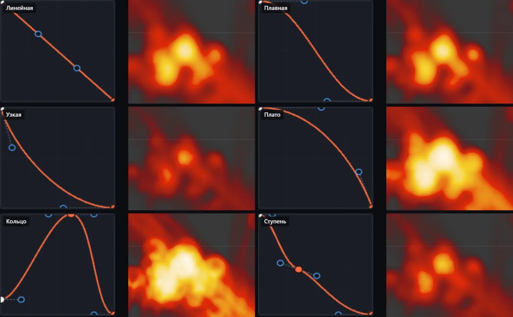

# Форма спрайта

Каждая строка рисуется как круглый спрайт, который всегда повёрнут к камере. Его размер и профиль от центра до края — **спад** — решают, будет ли горячая точка выглядеть как плотная точка, мягкое облако, диск или кольцо. Эти элементы управления находятся в разделах **Форма тепла** и **Ограничения спрайта в пикселях** боковой панели. Они действуют на [Тепло](heat.md), [Разность](difference.md), [Тепло команд](team-heat.md) и, как половина ширины линии, на [Линейное тепло](line-heat.md).

Любое их изменение перезапускает накопление: поле нужно перерисовать с новой формой.

Думайте о каждой точке как о мягком пятне света. Маленькое пятно показывает отдельные места; большое пятно сливает соседей в облако. Форма определяет, насколько мягкий край.



## Радиус спрайта {#sprite-radius}

Радиус спрайта в **мировых единицах** (подписан как метры). По умолчанию 6. При каждой загрузке значение равно горизонтальному размеру данных / 120, чтобы соседние отсчёты вдоль пути сливались в полосу, а не выглядели как тонкий волосок. Логарифмический ползунок от 0,05 до 2000, ручку можно тянуть до 50 000.


Далёкие объекты выглядят меньше, поэтому спрайт уменьшается на экране с расстоянием. При параллельной проекции он одинаков везде. Это одна из причин, почему параллельный вид лучше подходит для сравнения горячих точек ([Камера](camera.md#projection)).

## Ограничения в пикселях {#pixel-clamps}

**Ограничения спрайта в пикселях** (по умолчанию закрыто) задают границы экранного радиуса после преобразования выше.

| Элемент | По умолчанию | Диапазон (прокрутка) | Зачем |
|---|---|---|---|
| **Мин. радиус в пикселях** | 1 px | 0–16 (512) | Не даёт далёким данным исчезнуть, став меньше пикселя. |
| **Макс. радиус в пикселях** | 96 px | 2–1024, логарифмически (8192) | Защита от перерисовки. Спрайт, покрывающий N пикселей, стоит N операций смешивания, поэтому неограниченный радиус вблизи камеры превращает быстрый кадр в медленный. Выше высоты области просмотра ограничение уже ничего не режет. |

**Одинаковая плотность при любом масштабе** (в разделе «Форма тепла», по умолчанию включено) работает вместе с ограничениями. Спрайт, который ограничение делает больше (издалека) или меньше (вблизи), сохраняет тепло, которое дал бы его истинный размер. Поэтому цвет означает одно и то же число строк на единицу площади земли при любом масштабе. Если выключено, ограниченный спрайт добавляет весь свой вес при ограниченном размере, и картинка меняется, когда вы влетаете внутрь.

## Интенсивность в центре и на краю {#centre-and-edge-intensity}

Тепло, которое спрайт добавляет в точном центре (**Интенсивность в центре**, по умолчанию 1, от 0 до 10, прокрутка 1000), и на его краю (**Интенсивность на краю**, по умолчанию 0, от -2 до 10, прокрутка 1000). Значение шкалы *t* (1 в центре, 0 на краю, с формой от спада или кривой ниже) задаёт переход между ними (формула — в разделе [Для разработчиков](#for-developers)).

**Отрицательная интенсивность на краю** заставляет край вычитать тепло. Это вырезает холодный ореол вокруг каждой горячей точки и делает кластеры более резкими относительно друг друга. Видимость учитывает [перекрытие](depth-and-culling.md) и [срез](slice.md); угасание — это [угасание по сроку жизни](timeline.md#history); знак — ±1 в [Разности](difference.md).

## Форма спада: Спад или Кривая {#ramp-shape-falloff-or-curve}

**Форма спада** переключает между двумя способами задать *t* по спрайту. Пусть *d* — расстояние от центра (0) до края (1):

### Спад {#falloff}

Показывается, когда выбран *Спад* (по умолчанию).

- **Спад** (по умолчанию 1,6, от 0,1 до 8, прокрутка 64): `t = (1 - d) ^ falloff`. 1 — прямой линейный спад; больше — тянет тепло к центру и стягивает горячую точку; меньше 1 — делает её плоским диском.
- **Плавный спад** (по умолчанию включено): применяет к *t* S-кривую smoothstep, поэтому спрайт плавно проявляется у края, а не обрывается видимой границей.

### Редактор кривой {#the-curve-editor}

Показывается, когда выбрана *Кривая*. Это буквальное сечение спрайта: расстояние от центра поперёк (*центр* слева, *край* справа), тепло вверх. Кривая — это составная кубическая кривая Безье через контрольные точки, у каждой из которых две ручки.

| Действие | Эффект |
|---|---|
| Двойной щелчок по графику | Добавляет точку на этом расстоянии (держится между 0,02 и 0,98), на кривой и с её наклоном в этом месте, поэтому добавление ничего не меняет, пока вы её не перетащите. |
| Перетаскивание точки | Перемещает её. Высоты держатся между 0 и 1. |
| Перетаскивание маленького кружка | Изгибает соседний отрезок (двигает эту ручку). |
| Alt + щелчок или правый щелчок по точке | Удаляет её. Две крайние точки удалить нельзя. |
| Кнопка пресета | Заменяет кривую пресетом. |

Крайние точки закреплены в центре и на краю, но их высоту можно менять.

**Пресеты** ([`curve.ts`](https://github.com/Holdi601/3DHeat/blob/main/src/state/curve.ts)):

| Пресет | Форма | Применение |
|---|---|---|
| **Линейная** | Прямая от 1 до 0 | Совпадает со *Спадом* 1 при выключенном *Плавном спаде*. |
| **Плавная** | S-кривая | Кривая по умолчанию; то, что даёт *Плавный спад* при спаде 1. |
| **Узкая** | Крутое ядро, длинный слабый хвост | Редкие данные. |
| **Плато** | Ровная, затем быстрый спад | Читается как диск, а не как пятно. |
| **Кольцо** | 0,15 в центре, 1 на 62% радиуса, 0 на краю | Полый спрайт: показывает, где проходят пути, а не где они останавливаются. |
| **Ступень** | Спад в две стадии, 0,45 на 35% | Отделяет плотное ядро от окружения. |

## Спроецировать на плоскость земли {#flatten-onto-ground-plane}

**Спроецировать на плоскость земли** (по умолчанию выключено) игнорирует высоту каждой строки и рисует всё тепло на одной высоте, самой низкой по Y в наборе данных. Это классическая двумерная тепловая карта. Если включено, перекрытие по глубине и *Скрывать за рельефом* выключаются (каждая точка сидела бы ровно на той поверхности, с которой её сравнивают), и раздел «Глубина» об этом сообщает.

## Для разработчиков {#for-developers}

### Формулы {#formulas}

Экранный радиус в пикселях: `radius × P[1][1] / w × высота области просмотра / 2`, где `P` — матрица проекции, а `w` — глубина точки в виде.

Тепло, которое добавляет спрайт:

```
heat added = mix(edge, centre, t) × sample weight × sign × fade × visibility
```

### Кривая {#the-curve}

Ручки ограничены по горизонтали своим отрезком, поэтому кривая всегда является функцией расстояния. Если перетащить ручку далеко за следующую точку, она прижмётся к ней, а не загнёт кривую назад. Иначе результат зависел бы от того, какой корень решателя нашёл.

### Как рисуется кривая {#how-the-curve-is-drawn}

Кривая запекается в таблицу из 256 записей при каждом изменении, загружается как текстура с плавающей точкой 16 бит и берётся для каждого фрагмента с линейной фильтрацией и смещением на полтексела, чтобы оба конца оставались точными. Решать уравнение Безье относительно x нужно итерациями, а это не место в самом горячем шейдере программы. Выборка из таблицы к тому же дешевле `pow()`, который использует спад. 16 бит, а не 8, потому что 8 бит дают полосы, когда просуммированы тысячи спрайтов. 16-битное полу-плавающее значение можно фильтровать в базовом WebGL2, а 32-битное требует расширения.
