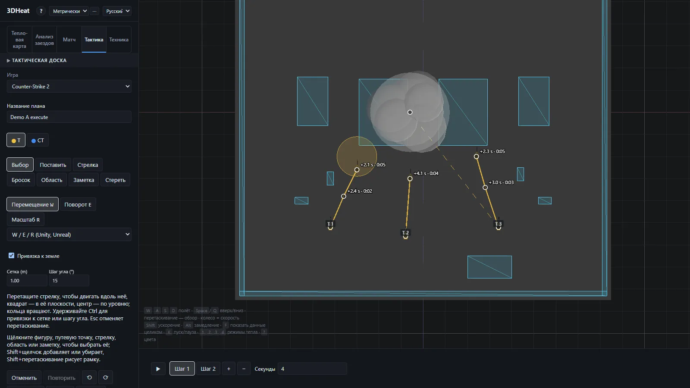

# Доска тактики

Вкладка **Тактика** — это доска для рисования командного плана: вы ставите фигурки на карту, рисуете стрелки, куда они пойдут, и нажимаете «пуск», чтобы посмотреть, как это выйдет. Используйте её, чтобы спланировать раунд или атаку до игры. Она использует холст, камеру и [уровень](levels.md) вместе с остальными вкладками и больше ничего; план — это не данные и тепла не рисует.

## Первый план {#your-first-plan}

1. Откройте вкладку **Тактика**. Выберите **Игра** (например, Counter-Strike 2), а для Valorant нажмите **Загрузить карты Valorant** и выберите **Карта**. Либо сначала загрузите [уровень](levels.md).
2. Выберите **Сторону** (она задаёт цвет) и нажмите **Вид сверху**.
3. Выберите **Поставить**, выберите фигуру в **Фигуры** (чтобы найти её, используйте **Поиск фигур**) и щёлкните по карте. Поставьте две или три.
4. Выберите **Стрелка**, щёлкните по фигуре, затем по пути, по которому она должна пойти, и нажмите **Enter**, чтобы завершить стрелку.
5. Нажмите **+** под видом, чтобы добавить шаг 2. Каждая фигура начинается там, где закончилась её стрелка. Рисуйте там новые стрелки.
6. Нажмите **▶** (или `K`), чтобы проиграть план от показанного шага до конца.
7. Назовите план в поле **Название плана** и нажмите **Сохранить**.

## Начало плана {#starting-a-plan}

| Элемент | Что делает |
|---|---|
| **Игра** | Выбирает стороны и фигуры, которые предлагает палитра: Counter-Strike 2 (T, CT; игроки и снаряжение), Valorant (Атака, Защита; игроки и общие способности), Battlefield, Squad, Arma (пехота, наземная техника, авиация, лодки), DCS / War Thunder / IL-2 (реактивные самолёты, самолёты с винтом, вертолёты, ПВО, наземные, корабли, оружие) и Другое. План, в котором уже есть фигуры, сохраняет свои стороны при смене игры. |
| **Название плана** | Имя, под которым план сохраняется. |
| **Карта**, **Загрузить карты Valorant** | При выбранном Valorant: **Загрузить карты Valorant** получает список карт с [valorant-api.com](https://valorant-api.com); **Карта** затем кладёт миникарту выбранной карты как уровень, вписанный сверху. Изображение загружается при выборе и никогда не поставляется с программой. Уведомление Riot показывается, пока оно на экране (см. ниже). |
| **Сторона** | Сторона, которой принадлежит следующая фигура, стрелка или область; она берёт цвет стороны. |

Без уровня доска — это плоская земля. Загрузите уровень в **Фон / уровень**, чтобы планировать на настоящей карте: карта CS2, экспортированная инструментом CS2, уровень из библиотеки или картинка карты.

## Инструменты {#tools}

| Инструмент | Щелчок | Примечания |
|---|---|---|
| **Выбор** | Фигура, точка маршрута, стрелка, область или заметка выбирает её. | Shift+щелчок добавляет или убирает; Shift+перетаскивание рисует рамку вокруг того, что добавить. У выбранного появляется гизмо трансформации (см. ниже); `Delete` или `Backspace` удаляет его. `M` переносит выбранную фигуру к следующему щелчку. |
| **Поставить** | Ставит выбранную фигуру. | Фигура выбирается в палитре **Фигуры** (с **Поиском фигур**). Если ничего не выбрано, `R` поворачивает следующую фигуру на 15° перед постановкой (`Shift+R` — в другую сторону). |
| **Стрелка** | Каждый щелчок добавляет точку; Enter, двойной щелчок или правый щелчок завершают, Esc отбрасывает. | **Движение**, **Атака** (шире наконечник) или **Наблюдение** (тонкая линия на уровне глаз). Стрелка, начатая на фигуре, — это маршрут этой фигуры на данном шаге: при проигрывании фигура по нему идёт, а следующий шаг начинается там, где он закончился. |
| **Бросок** | Бросающий, затем место падения. | Пунктирная дуга между ними; выбранное снаряжение (дым, вспышка, коктейль Молотова ...) появляется в месте падения и остаётся с этого шага дальше. |
| **Область** | Середина, затем край. | Диск цветом стороны. |
| **Заметка** | Где поставить заметку; запрашивает её текст. | Показывается как булавка, текст над ней. |
| **Стереть** | Фигуру, стрелку, область или заметку. | Удаляет её с этого шага дальше; на её первом шаге — удаляет полностью. |

**Отменить** и **Повторить** (`Ctrl+Z`; `Ctrl+Y` или `Ctrl+Shift+Z`) проходят по каждому изменению. Линия под планом показывает, сколько в нём фигур, стрелок и шагов. **Вид сверху** смотрит строго вниз (ортографически), **3D-вид** возвращает перспективу, **Вписать** вмещает план, а если план пуст — уровень.

**Размер фигур** масштабирует все фигуры на доске; 1× — натуральный размер, который сверху даёт несколько пикселей на человека.

## Перемещение, поворот и масштаб {#moving-turning-and-scaling}

Всё на доске можно двигать, как в 3D-редакторе: фигуры, снаряжение, маркеры, отдельные точки маршрута и целые стрелки, области и заметки. У выбранного появляется гизмо в середине:

| Режим | Клавиши | Ручки |
|---|---|---|
| **Перемещение** | W (или G) | Стрелка на каждую ось (X красная, Y зелёная и вверх, Z синяя) двигает вдоль неё; квадрат двигает в своей плоскости; центр двигает над уровнем под указателем. |
| **Поворот** | E (или R) | Кольцо на каждую ось поворачивает вокруг неё. Кольца одной фигуры — её собственные рысканье, тангаж и крен; группа поворачивается вокруг осей мира относительно своей середины. |
| **Масштаб** | R (или S) | Раздвигает или сдвигает выбор от середины вдоль оси или во все стороны; радиус области растёт вместе с ним. |

**Клавиши** переключают между W / E / R (Unity, Unreal) и G / R / S (Blender); клавиши выбирают режим, только пока что-то выбрано, иначе двигают камеру. Так, `R` означает **Масштаб** в схеме W / E / R и **Поворот** в схеме G / R / S, пока что-то выбрано, а когда ничего не выбрано — поворачивает следующую фигуру для постановки. Все клавиши доски перечислены в [справочнике клавиатуры](keyboard-reference.md#tactics-board). Удерживайте **Ctrl** при перетаскивании, чтобы привязать перемещение к **Сетке** (метры) или поворот к **Шагу угла**. **Привязка к земле** (включена по умолчанию) ставит перемещённых людей, технику, маркеры, точки маршрута и области на поверхность уровня; авиация и вертолёты сохраняют высоту, а перетаскивание вдоль стрелки Y никогда не привязывается. Перетаскивание ручки никогда не двигает камеру. **Esc** отменяет перетаскивание, и каждое изменение — один шаг **Отменить**.

Точки маршрута показываются точками на стрелках показанного шага: щёлкните по одной, чтобы выбрать её, перетащите, чтобы передвинуть, Delete — чтобы убрать. Раздел **Выбрано** показывает положение выбора в метрах, рысканье, тангаж и крен фигуры в градусах и радиус области, всё с возможностью ввода.

## Тайминг {#timing}

Маршрут фигуры имеет время: каждый участок занимает свою длину по уровню — измеряется по поверхности каждые пару метров, так что холм или лестница между двумя точками учитываются — со скоростью её **режима** движения в этой игре плюс любая **задержка** у точки маршрута. Пехота ползёт, приседает, идёт (тихо), бежит или спринтует; техника и лодки ползут, идут осторожно, обычно или быстро; самолёты и вертолёты летят медленно, крейсерски, боевой скоростью или на максимуме. Если игра не имеет режима (у CS2 нет спринта), берётся ближайший из имеющихся. То, как склон замедляет движение, зависит от игры: в CS2 и Valorant учитывается только горизонтальное расстояние, как в самих играх; военные симуляторы замедляют пехоту на подъёме (функция походного хода Тоблера), а технику — по уклону.

Скорости берутся из таблиц по играм с их источниками (см. [Скорости движения](tactics-speeds.md)): CS2 — по удерживаемому оружию, из определений оружия игры; Valorant — по оружию; Battlefield, Squad, Arma и авиационные игры — по типу и классу техники. **Движется как** выбирает профиль фигуры (оружие, тип техники); **Своя (m/s)** переопределяет любой режим для этой фигуры. Режимы названы так, как их показывает доска: *Ползком*, *Присев*, *Шагом (тихо)*, *Бегом*, *Спринтом*; *Осторожно*, *Обычно*, *Быстро*; *Медленно*, *Крейсерская*, *Боевая*, *Максимум*.

У каждой точки маршрута показано время от предыдущей и время от начала плана («+3.9 s · 0:12»). В маршруте выбранной фигуры перечислен каждый участок с режимом, длиной и временем, задержка и прибытие. **Прибытия** под **Тайминг** выстраивает все фигуры с маршрутами на одну временную линию, первое прибытие сверху. При **Играть в реальном времени** (по умолчанию включено) шаг длится до прибытия самого медленного маршрута, и каждая фигура движется со своей скоростью; **Секунды** тогда — наименьшая длительность шага. **Единиц уровня на метр** говорит, в чём измеряется уровень: 39.37 для карт CS2 (игровые единицы), 1 для карт в метрах.

## Сравнение с данными матчей {#compare-with-match-data}

**Загрузить файлы матчей…** читает таблицы матчей CS2 для карты (Parquet-файлы инструмента CS2, сколько нужно; только нужные столбцы, в фоне); **Использовать загруженные данные** берёт данные, загруженные в просмотр. Затем:

- **Самое раннее прибытие на карте** окрашивает карту временем от начала раунда, за которое игрок впервые добрался до каждого места: кнопка **Самый быстрый** показывает самое быстрое по всем раундам, **Типично (медиана)** — средний раунд; зелёный — рано, красный — поздно, для одной стороны или для обеих. Это показывает, что возможно и когда.
- Выбранный маршрут сравнивается с тем, чего игроки достигали от его начала (или от начала раунда) до его конца; каждый конец — диск заданного радиуса: «Самый быстрый замеченный 14.2 s (имя), p10 15.0 s, медиана 18.3 s по 41 проходу; ваш план 15.1 s».
- Скорости, с которыми игроки реально двигались — бег, ходьба, приседание, по столбцам ходьбы и приседания таблиц, — в m/s.

## Шаги {#steps}

Полоса под видом содержит шаги. План начинается с одного; **+** добавляет шаг, и каждая фигура начинает его там, где закончился её маршрут на предыдущем шаге; **−** удаляет показанный. **Секунды** — сколько длится показанный шаг при проигрывании. **▶** (K) проигрывает от показанного шага до конца: фигуры с маршрутом идут по нему, фигуры, перенесённые на новое место на следующем шаге, туда переезжают, остальные стоят. Пока шаг показан, место каждой фигуры на следующем шаге рисуется слабым призраком, а стрелки предыдущего шага слабо видны под стрелками этого.

## Сохранение {#saving}

Раздел **Файл** содержит **Сохранить**, **Открыть** и **Очистить**. **Сохранить** записывает план в файл `<name>.h3dplan.json` (обычный JSON: стороны, шаги, фигуры с местом на каждом шаге, стрелки, области, заметки); **Открыть** читает его обратно. Файл другой версии или не план отклоняется с причиной. **Очистить** опустошает план; **Отменить** его возвращает.

## Фигуры {#figures}

Каждую фигуру создаёт сам просмотр: простые формы в опубликованном размере типа, с признаками, которые отличают её от соседей, — опорные катки и башня танка, орудия, ракеты и радары зенитной машины, план крыла, хвост и двигатели самолёта, роторы и короткие крылья вертолёта. Ничего не взято из игр. Конструкция, придуманная игрой, показывается как общая фигура своего класса. Как данные находят свою фигуру, см. [Фигуры](figures.md#which-figure-a-unit-gets).

## Уведомление Riot {#riots-notice}

Карты Valorant показываются по политике Riot Games «Legal Jibber Jabber», которая разрешает бесплатным проектам сообщества их использовать и требует такого уведомления везде, где они появляются. Текст уведомления, как его показывает просмотр, — на английском, без перевода, потому что это юридическая формулировка: *3DHeat was created under Riot Games' "Legal Jibber Jabber" policy using assets owned by Riot Games. Riot Games does not endorse or sponsor this project.* Способности на доске — общие формы, а не арт Riot.
