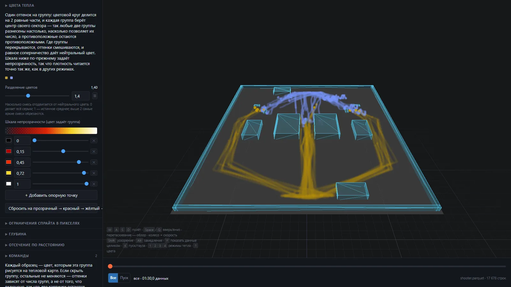

# Тепло команд

«Тепло команд» показывает, где была каждая команда, каждая в своём цвете. Там, где команды пересекаются, цвета смешиваются.

**Тепло команд** (клавиша 3) — это поле плотности из [Тепло](heat.md), в котором каждой [группе](glossary.md) дан свой оттенок. Там, где группы перекрываются, их оттенки смешиваются; ровный поединок выходит нейтральным. Непрозрачность по-прежнему несёт плотность точно так же, как в других режимах, поэтому картинка сразу отвечает на вопросы *сколько* и *чьё*. Нужен столбец группы.

Это не [наложение фигур](box-replay.md): оно рисует одну фигуру на персону, а здесь — поле тепла, окрашенное по тому же столбцу.

## Как пользоваться {#how-to-use-it}

1. Нажмите `3` (или выберите **Тепло команд** на панели режимов).
2. Откройте **Цвета тепла**. Образцы показывают цвет каждой группы; наведите курсор на образец, чтобы увидеть имя команды.
3. Если всё выглядит серым, поднимите **Разделение цветов**.
4. Снимите отметку с группы в [Списке команд](teams-list.md), чтобы убрать её; остальные цвета остаются на своих местах.

## Элементы управления {#controls}

В разделе **Цвета тепла**:

| Элемент | По умолчанию | Значение |
|---|---|---|
| Образцы | | Цвет каждой группы для первых 12 групп, затем *+N ещё*. Наведите курсор, чтобы увидеть имя группы и цвет. |
| **Разделение цветов** | 1,4 | Насколько смесь отодвигается от нейтрального, 0–4. 0 делает всё серым; 1 — настоящее среднее; после примерно 2 самые яркие смеси выходят за пределы отображаемого диапазона и ограничиваются по каждому каналу, что сдвигает их оттенок. |
| **Шкала непрозрачности (цвет задаёт группа)** | обычная шкала тепла | Здесь используется только **альфа** шкалы: прозрачно там, где ничего нет, непрозрачно наверху. Её цвета игнорируются. |

Группа, чья подпись означает «нет группы» (`0`, пусто, `none`, `unknown`, `null` или `-1`), рисуется серой.

Все остальные элементы управления теплом — форма, насыщение, отклик, минимальное тепло, глубина, отсечение — работают так же, как в [Тепло](heat.md).

В [Списке команд](teams-list.md) в этом режиме цвет тепла каждой группы показан как её образец. Скрытие группы оставляет цвета всех остальных групп на месте: оттенки берутся из общего числа групп, а не из того, что включено, поэтому два изображения остаются сравнимыми.

## Для разработчиков {#for-developers}

### Палитра {#the-palette}

Из [`colors.ts`](https://github.com/Holdi601/3DHeat/blob/main/src/render/colors.ts):

- Цвета лежат на цветовой плоскости **Oklab** при фиксированной светлоте (0,7) и насыщенности (0,115), поэтому каждая группа одинаково яркая, и красная группа не выглядит горячее синей.
- При *n* группах круг оттенков делится на *n* равных частей, и группа *i* берёт **центр** своей части, `(i + 0.5) / n` оборота. Любые две группы настолько далеки друг от друга, насколько позволяет число, а противоположности остаются противоположными при любом числе.
- Используется не более **16** различных оттенков. При большем числе групп идентификаторы распределяются повторным делением пополам (идентификаторы с обратными битами: 0, ½, ¼, ¾, ⅛, …), чтобы соседние идентификаторы не делили оттенок; группы сверх 16 неизбежно делят.
- Группа, чья подпись означает «нет группы» — `0`, пусто, `none`, `unknown`, `null` или `-1`, без учёта регистра, — рисуется **нейтральным серым**, а не занимает кусок круга. Так обрабатывается только первая такая подпись в списке групп.

Разделение по умолчанию равно 1,4, а не 1, потому что при 1 смесь пяти равномерно разнесённых оттенков *и есть* серая: правильно, но не читается. Чуть больше 1 оставляет ничьи честными и делает видимым разделение 60/40.

### Как это работает {#how-it-works}

Цель тепла в этом режиме имеет четыре канала. Каждый спрайт добавляет свою плотность *v* в первый канал, а *v* × координаты Oklab группы *a* и *b* во второй и третий. При композиции смесь пикселя — это среднее, взвешенное плотностью: *a* = G / R, *b* = B / R, масштабированное разделением цветов и переведённое в sRGB при светлоте палитры. Деление на накопленную плотность делает оттенок независимым от того, сколько данных, и поэтому каждый элемент управления плотностью продолжает действовать только на непрозрачность.

Цель с четырьмя каналами требует в четыре раза больше памяти GPU, чем цель тепла с одним каналом при том же разрешении.
