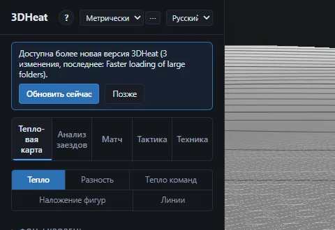

# Обновления

Просмотрщик сообщает, когда существует более новая версия, и обновляется сам, только если вы согласитесь. Ничего на вашем компьютере не меняется без вашего ответа.

## Обновление просмотрщика {#update-the-viewer}

1. **На странице.** Когда есть более новая версия, под именем вверху боковой панели появляется окно: «Доступна новая версия 3DHeat». Нажмите **Обновить сейчас**. Страница перезагрузится сама, когда всё будет готово. **Позже** скрывает окно до перезагрузки страницы.
2. **Если написано запустить restart.bat**, закройте окно сервера (чёрное окно, которое открыл `start.bat`) и дважды щёлкните `restart.bat`.
3. **При запуске просмотрщика.** `start.bat` тоже проверяет. Если есть новая версия, он спрашивает `Update now? [Y/N]`. Нажмите `Y`, чтобы обновиться. Нажмите `N` или подождите 60 секунд без ответа, чтобы запустить версию, которая у вас есть.



Копия с вашими собственными изменениями никогда не обновляется за вас: окно лишь сообщает, что обновление ждёт, и просит зафиксировать или отложить (stash) изменения и выполнить `git pull`. Копия, которая установлена не через git (например, из zip-архива), ничего не показывает.

Как работает проверка, шаг за шагом:

```
page ---(after 4 s, then every 6 h)---> dev server ---> git fetch
   behind?  no  -> nothing is shown
            yes -> your own changes or commits?  yes -> tell you only
                                                 no  -> [Update now] -> git pull
                                                        -> reload, or "run restart.bat"
```

## Правила безопасности {#the-safety-rules}

- **Только перемотка вперёд** (`git pull --ff-only`): обновление никогда не сливает, не перебазирует и ничего не переписывает.
- **Нет локальных изменений**: копия с незафиксированными изменениями в отслеживаемых файлах (`git status --porcelain --untracked-files=no` не пуст) никогда не обновляется автоматически. Чужая работа не должна перезаписываться обновлением. Такая копия лишь получает сообщение, что обновление ждёт. Неотслеживаемые файлы (данные, экспорты) изменениями не считаются.
- **Нет локальных коммитов**: копия с коммитами, которых нет в upstream («разошлась»), не обновляется. Перемотка вперёд не может её поднять, а слияние — дело `git pull` вручную. Страница и `start.bat` говорят об этом одними и теми же словами, а `start.bat` запускает ту версию, которая есть.
- **Только со страницы самой программы**: запрос обновления к серверу разработки должен нести особый заголовок и, когда браузер присылает `Origin`, приходить с хоста самого сервера (ниже).
- Обновляется только копия git с upstream-веткой. Всё остальное (копия без `.git`, компьютер без git, статическая сборка) не трогается и ничего не говорит.

## Что делает start.bat {#what-startbat-does}

`start.bat` (дважды щёлкните по нему; окно и есть сервер) делает по порядку:

1. Находит Node.js: в `PATH`, иначе в `%ProgramFiles%\nodejs`, `%ProgramFiles(x86)%\nodejs` или `%LOCALAPPDATA%\Programs\nodejs`. Если его нет, предлагает установить его командой `winget install -e --id OpenJS.NodeJS.LTS` (спрашивает Y/N; после этого окно нужно открыть заново, чтобы Windows увидела новый `PATH`).
2. **Обновления**, если установлен git и в папке есть `.git`:
   - `git fetch --quiet` (нет сети или upstream: молча пропускается);
   - считает `git rev-list --count HEAD..@{u}`; если ничего не отстаёт, ничего не говорит;
   - локальные изменения: «A newer version of 3DHeat is available (N changes), but this copy has local changes, so it is not updated. Commit or stash them, then run git pull.» — и запускает имеющуюся версию;
   - собственные коммиты (`git rev-list --count @{u}..HEAD` не 0): «A newer version of 3DHeat is available (N changes), but this copy has commits of its own that the newest version does not, so it is not updated. Update it with git pull.» — и запускает имеющуюся версию;
   - иначе «A newer version of 3DHeat is available (N changes).» и вопрос **Update now? [Y/N]**. `N` или отсутствие ответа в течение 60 секунд печатает «Not updated; starting the version you have.» и запускает имеющуюся версию. При `Y`: «Updating...», сообщает, меняются ли `package.json` или `package-lock.json`, запускает `git pull --ff-only` (если и это не удалось, например из-за сети: «The update did not go through; starting the version you have.»), затем `git submodule update --init` (закреплённые инструменты, см. [Поддержка документации](maintaining.md#the-tools-under-exporters)), затем `npm install`, если файлы пакета изменились и существует `node_modules`, и «Updated.».
3. Не запускает второй сервер: если на порту **5273** что-то уже слушает, сообщает об этом и указывает на `restart.bat` / `stop.bat`.
4. При первом запуске (нет `node_modules`) спрашивает, прежде чем скачивать зависимости (около 300 МБ в `node_modules\`, ничего системного).
5. Запускает сервер разработки на `127.0.0.1:5273` (`--strictPort`) и открывает браузер, когда он готов.

`restart.bat` останавливает сервер (по порту) и снова запускает `start.bat`, поэтому задаёт тот же вопрос. `stop.bat` только останавливает.

## Для разработчиков {#for-developers}

### Во время работы: маршрут обновления {#while-it-runs-the-update-route}

Сервер разработки (плагин Vite `heat3d-self-update` в `vite.config.ts`) отдаёт `/__heat3d/update`. Он существует только на сервере разработки: не в статической сборке и не в `vite preview`.

**`GET /__heat3d/update`** отвечает, отстаёт ли копия:

```json
{ "checkout": true, "upstream": "origin/main", "behind": 3, "ahead": 0, "dirty": false, "latest": "the newest commit's subject" }
```

- `checkout: false`, когда папка не является копией git;
- он выполняет `git fetch --quiet` **не чаще раза в 30 минут** (запросы между этим отвечают по последним полученным данным);
- `behind` и `ahead` берутся из `git rev-list --count HEAD..@{u}` и `@{u}..HEAD`, `dirty` из `git status --porcelain --untracked-files=no`, `latest` — тема (subject) новейшего коммита upstream;
- без upstream-ветки: `upstream: null` и `behind: 0`.

**`POST /__heat3d/update/apply`** подтягивает копию:

1. Отказ `403 { ok: false, reason: "forbidden" }`, если в запросе нет заголовка `X-Heat3d-Update: 1` и, когда он несёт `Origin`, хост этого origin не совпадает с `Host` запроса. Межсайтовая форма не может отправить особый заголовок без предварительного CORS-запроса, который этот сервер никогда не разрешает.
2. Делать нечего (не копия, нет upstream, не отстаёт): `{ ok: true, updated: false }`.
3. Локальные изменения: `{ ok: false, reason: "dirty" }`; локальные коммиты: `{ ok: false, reason: "diverged" }`.
4. Иначе: отмечает изменяемые файлы (`git diff --name-only HEAD @{u}`), выполняет `git pull --ff-only` (тайм-аут 2 мин), `git submodule update --init` (сбой игнорируется), `npm install`, если `package.json` или `package-lock.json` изменились (тайм-аут 15 мин), и отвечает `{ ok: true, updated: true, restart }`. `restart` объясняет, почему запущенный сервер не может подхватить обновление: `"dependencies"`, когда зависимости переустановлены, `"config"`, когда изменился только файл `vite.config`, `false`, когда перезапуск не нужен.
5. Сбой команды git или npm отвечает `{ ok: false, reason: "<ошибка, до 300 символов>" }`.

Ответы — JSON с `Cache-Control: no-store`. Сервер слушает только `127.0.0.1`, поэтому маршрут недоступен из сети.

### Уведомление на странице {#the-notice-in-the-page}

`UpdateBanner`, под именем вверху боковой панели:

- Он спрашивает маршрут через **4 секунды** после загрузки страницы (не в первые секунды: у страницы есть набор данных для загрузки и GPU для запуска) и затем **каждые 6 часов**, пока страница открыта.
- Он не показывает **ничего**, когда маршрута нет (статическая сборка), папка не является копией git или ничего не новее: уведомление при каждом запуске — то, к чему люди привыкают и перестают его замечать.
- Отстаёт, без локальных изменений: «Доступна новая версия 3DHeat (N изменений, новейшее: <тема>).» с кнопками **Обновить сейчас** и **Позже** (*Позже* скрывает его до перезагрузки страницы).
- Отстаёт, с локальными изменениями: та же фраза и «В этой копии есть локальные изменения, поэтому она не обновляется автоматически; зафиксируйте или отложите их, затем выполните git pull.». Кнопки нет.
- **Обновить сейчас** отправляет запрос на `/apply` («Обновление…»). Затем:
  - «Обновлено. Страница перезагружается.» — и страница перезагружается через 1,5 с (сервер уже отдаёт новые файлы);
  - когда зависимости переустановлены: «Обновлено. Зависимости изменились: закройте окно сервера и запустите **restart.bat**, чтобы завершить.»;
  - когда изменились только настройки сервера: «Обновлено. Настройки сервера изменились: закройте окно сервера и запустите **restart.bat**, чтобы завершить.»;
  - в итоге подтягивать нечего (`updated: false`: копию уже подтянул, например, `start.bat`): «Нечего обновлять: эта копия уже самая новая.» — и без перезагрузки;
  - отказ: фраза про локальные изменения, или «В этой копии есть собственные коммиты, которых нет в новейшей версии; обновите её командой git pull.», или «Обновление не прошло: <причина>».
