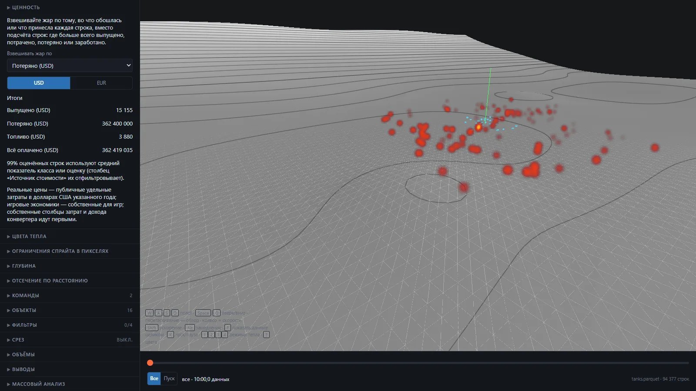

# Взвешивание по ценности

У каждого выстрела, боеприпаса, потерянной машины и литра топлива есть цена. Просмотрщик вычисляет, во что обошлась или что принесла каждая строка, и может взвесить тепло по ней, так что карта показывает **куда ушли деньги**, а не где находятся строки.

## Как пользоваться {#how-to-use-it}

1. Загрузите данные с событиями (выстрелы, убийства, гибели) и названиями машин или оружия.
2. Откройте **Значение** в боковой панели тепловой карты.
3. Выберите **Взвешивать жар по**, например *Потеряно (USD)*. Теперь тепло добавляет цену каждой строки вместо 1.
4. Посмотрите **Итоги**: сумму каждого столбца значений для показанного (действуют фильтры и временное окно).
5. Если цены — настоящие деньги, появляется переключатель **USD / EUR**.

Чтобы снова считать строки, выберите пустой первый пункт меню.

## Что можно взвесить {#what-can-be-weighed}

Столбцы значений добавляются при загрузке, по одному на каждый вид и валюту:

| Вид | На какие строки попадает | Как оценивается |
|---|---|---|
| **Выпущено** | выстрелы и пуски | оружие, иначе среднее для вида боеприпаса |
| **Потрачено** | покупка, появление | денежные столбцы игры (например, меню покупки в шутере) |
| **Потеряно** | гибели, уничтожения | собственная машина, иначе среднее её класса |
| **Уничтожен** | убийства | машина цели |
| **Нанесённый урон** | попадания | доля стоимости цели |
| **Топливо** | позиции | израсходованное топливо, из столбца топлива или оценённое по классу и времени |
| **Всё оплачено** | | выпущено + потрачено + потеряно + топливо |
| **Заработано** | награды | собственные столбцы наград игры (`earn_…`) |
| **Итог** | | заработано минус оплачено; рисуется как тепло со знаком (положительная шкала там, где заработано больше, отрицательная там, где оплачено больше) |

Имена столбцов: `cost_<вид>_<валюта>`, `earn_<валюта>` и `net_<валюта>`. Конвертер, который знает собственную валюту игры (например, конвертер повторов, пишущий в игровых кредитах), важнее встроенных таблиц цен.

## Таблицы цен {#the-price-tables}

| Таблица | Валюта |
|---|---|
| Реальная военная техника: ракеты, бомбы, снаряды, средства противодействия, самолёты, вертолёты, наземная техника, корабли, топливо | USD (EUR = USD × 0,92, фиксированный `EUR_PER_USD` в [`cost.ts`](https://github.com/Holdi601/3DHeat/blob/main/src/data/cost.ts); это не живой курс) |
| Меню покупок в шутерах и награды за убийства | кредиты игры |
| Танковые и морские игры | кредиты игры |
| Стратегии (несколько ресурсов) | один столбец на ресурс плюс один общий |
| Военные игры | очки |

Игра распознаётся по названиям в данных. Реальные цены берутся из открытых источников (бюджетных документов, энциклопедий) или помечены как оценки; с поправкой на инфляцию они не пересчитываются. Сгенерированный список таблиц — на странице [Таблицы значений](ref-value-tables.md).

## Оценки {#estimates}

Дополнительный столбец категории **Источник цены** говорит, как оценена каждая строка: `table` (таблица), `class average` (среднее класса), `estimate` (оценка) или `none` (нет). Раздел «Значение» показывает, какая доля оценённых строк — средние или оценки. Чтобы оставить только точно оценённые строки, снимите отметки *estimate* и *class average* в **Источник цены** на странице [Фильтры](filters.md).

## Где ещё показывается ценность {#where-else-value-shows}

- [Выводы](insights.md): находки *Дорогая земля* и *Зарабатывающая земля*.
- [Разбивка](breakdown.md): Заработано, Потеряно и Итог в деньгах по команде, игроку или оружию.
- [Объёмы и сравнение](volumes.md): столбцы значений в статистике и сравнении.
