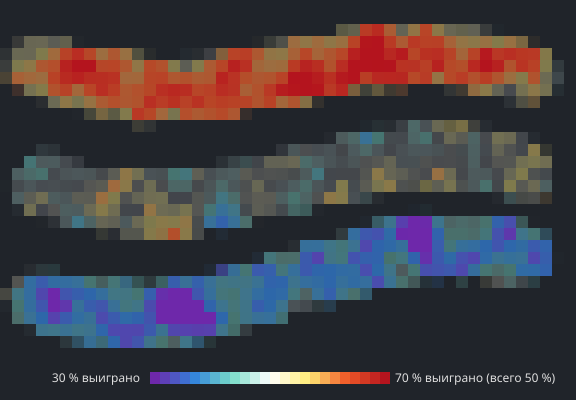

# Доля побед: как часто побеждает место, маршрут или приём

Где стоит игрок, куда он идёт, куда бросает гранаты и другие средства - и как часто его сторона после этого выигрывает раунд. **Карта доли побед** окрашивает каждое место по доле строк там, которые относятся к раундам, выигранным стороной строки, по сравнению с долей во всём показанном: тепло там, где она выше, холодно там, где ниже, ничего там, где она такая же.

*На картинке выдуманные данные: три маршрута на пустом уровне, 68 %, 50 % и 33 % их строк в выигранных раундах.*

Нужны данные о том, кто победил: [столбцы итога](data-formats.md#outcome-columns) (`won`, `matchWon`, `roundEndReason`). Их пишут конвертеры CS2 и War Thunder, а конвертер Tacview — для кампаний DCS-сервера ([DCS-серверы](tacview-acmi.md#dcs-servers-who-won-and-how-each-sortie-ended)); они могут быть в любом файле.

## Попробуйте {#try-it}

1. Загрузите матчи со столбцом итога и нажмите `2` (**Разность**).
2. В **Разностное разделение** нажмите **Доля побед в раундах** (или **Доля побед в матчах**). Это ставит выигранные раунды на **+**, проигранные на **−** и переключает панель на **Доля +**.
3. Читайте цвета. Панель показывает общую долю: *Всего 52,0 % из 1 200 000 строк на +.*
4. Сузьте с помощью [фильтров](filters.md): одна сторона (T или CT), один тип события (*Позиция* - где люди стояли, *Выстрел* или *Пуск (ракета, снаряд, бомба)* - откуда они стреляли или бросали), одна закупка, одна карта.

Место, тёплое по строкам *Позиция*, - это место, удерживавшие которое чаще выигрывали раунд. По строкам *Уничтожение* это место, где сделанные там убийства вели к выигранным раундам.

## Настройки {#the-settings}

| Настройка | Что делает | По умолчанию |
|---|---|---|
| **Разница** / **Доля +** | сама разность или доля стороны + среди строк обеих сторон | Разница |
| **Полный цвет при** | насколько выше или ниже общей доли место показывается полным цветом, в процентных пунктах | ± 20 пунктов |
| **Минимум строк, чтобы закрасить место** | место с меньшим числом строк не окрашивается; оно плавно появляется начиная с половины этого значения | 12 |
| **Притяжение к общей доле (строки)** | каждое место начинает с такого числа строк на общей доле, поэтому место с 3 строками, все выигранные, не показывается как 100 % | 12 |

Все три действуют на готовую картинку: их перемещение никогда не запускает накопление заново.

Доля может быть у любого разделения, не только у побед: *Доля +* с разделением по стороне показывает, где Ts составляли большую часть присутствия, а с разделением по файлам двух карт - где строки одного файла перевешивают строки другого.

## Строки, а не раунды {#rows-not-rounds}

Карта считает строки. Игрок, который стоит на одном месте двадцать секунд, добавляет строку на каждом отсчёте, и все они из одного раунда, поэтому доказательство в месте - это строки рядом с ним, а не раунды. Поэтому минимум и притяжение заданы в строках и поэтому они больше, чем даёт один раунд.

Для самих раундов:

- **[Разбивка](breakdown.md)** по точке, виду или объёму: *Победы %* считает раунд каждого игрока один раз, с тем же притяжением к общей доле места (4 раунда).
- Статистика **[Объёмов](volumes.md)**: *Доля побед* - раунды с игроком внутри объёма, каждый один раз, с притяжением к доле во всём показанном, вместе с числами.

## Фильтры итога {#outcome-filters}

Панель [Фильтры](filters.md) показывает столбцы итога сразу после собственных столбцов просмотра: **Итог раунда** и **Итог матча** (*Любой*, *Победа*, *Поражение*) и **Как закончился раунд** (Уничтожение всех, Бомба взорвана, Бомба обезврежена, Время вышло, Сдача, Ничья, Цель, Удержание зон, Потеря очков, Потеряна вся техника), на языке просмотра.

## Для разработчиков {#for-developers}

Проход тепла записывает три суммы в четырёхканальную цель, которую использует тепло команд: тепло `R = Σ|v|`, тепло стороны + `P` и `S = Σ v²/w`, где `w` - вес прохода (вес выборки, умноженный на усиление кадра). Композиция читает долю `P/R` (среднее, взвешенное ядром) и число строк, на которых она основана, `n = R²/S` (эффективный размер выборки Киша), притягивает долю к общей, `p = (n·P/R + m·r0)/(n + m)`, и окрашивает `p - r0` по диапазону на рампах разности.

`n` сокращает каждый множитель, общий для строк в пикселе, - усиление кадра, вес выборки, вес площади обрезанного спрайта, - поэтому картинка одинакова при любом масштабе и плотности выборки, а кадры из каждой k-й строки сливаются в целое без скачков цвета. Общая доля берётся из подсчётов сторон на CPU, с точностью до десятых долей процента; с GPU ничего не читается обратно. Арифметика и её проверки: [`render/rateMap.ts`](https://github.com/Holdi601/3DHeat/blob/main/src/render/rateMap.ts) и его тест.

Это стоит столько же, сколько тепло команд: четырёхканальная цель учетверяет пропускную способность смешивания в проходе тепла, только пока включена *Доля +*.
