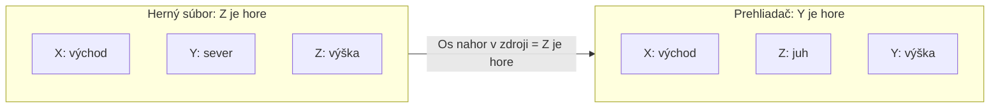

# Osi, jednotky a čas

Hry a mapy sa nezhodujú v tom, ktorým smerom je hore, aké dlhé je jednotka ani ako sa píše čas. Táto stránka popisuje tri nastavenia, ktoré zabezpečia, že vaše dáta stoja, majú správnu mierku a hrajú správnym smerom.

Ak vaša mapa stojí ako stena namiesto toho, aby ležala ako podlaha, prepnite **Os nahor v zdroji**.

So zlou hodnotou **Os nahor v zdroji** mapa stojí ako stena; so správnou leží ako podlaha.

## Svet, v ktorom prehliadač kreslí {#the-world-the-viewer-draws-in}

Svet prehliadača je **Y-hore**: X a Z sú rovina terénu, Y je výška. Väčšina herných motorov je **Z-hore**: pre ne sú X a Y terén a Z je výška. Niektoré motory sú navyše zrkadlové (ľavotočivé). Mapovanie hovorí, ako previesť osi súboru na osi prehliadača. (Technicky je prehliadač pravotočivý, konvencia three.js.)

### Os nahor {#up-axis}

**Os nahor v zdroji** v [Mapovaní stĺpcov](column-mapping.md):

| Nastavenie | Súbor (x, y, z) sa stane svetom (X, Y, Z) |
|---|---|
| *Z je hore (väčšina herných motorov)* – predvolené | (x, **z**, **y**): Z zo súboru sa stane výškou a Y zo súboru sa stane Z sveta |
| *Y je hore (grafická konvencia)* | (x, y, z) bez zmeny |

Pri dátach so Z-hore sa tri polia preznačia namiesto kopírovania ([`remapAxesInPlace`](https://github.com/Holdi601/3DHeat/blob/main/src/data/ingest.ts)), čo pri veľkých načítaniach ušetrí stovky megabajtov. Odhad sa robí zo vzorky: hore je ten zo stĺpcov Y a Z, ktorý má menší rozptyl.

### Prevrátenia {#flips}

**Prevrátiť X**, **Prevrátiť Y**, **Prevrátiť Z** zneguje *os súboru* s týmto názvom, ešte pred preznačením – takže pri Z-hore *Prevrátiť Y* zneguje to, čo sa nakoniec stane Z sveta. Prevrátenie mení načítané dáta: súradnice zobrazené [pravítkom](measure.md), rezom a pozíciou kamery sú už prevrátené.

Ak chcete zrkadlový svet nakresliť správne **bez** zmeny dát, použite namiesto toho **Kamera a scéna → Obrátiť os sveta** ([Kamera](camera.md#invert-world-axis)). Je to lepšia voľba pre hry s ľavotočivým svetom, lebo každá súradnica, ktorú nástroje ukazujú, zostane vlastnou súradnicou hry.

### Mierka jednotiek {#unit-scale}

**Mierka jednotiek** násobí každú pozíciu. *1 (m)* nastaví 1, *0,01 (cm→m)* nastaví 0,01 (jednotky Unreal Engine sú centimetre, preto použite 0,01; jednotky motora Source sú palce, preto použite 0,0254; ani jedno nie sú metre), a pole prijme ľubovoľnú hodnotu. Napísaná 0 alebo hodnota, ktorá nie je číslo, sa nahradí 1.

Prehliadač označuje vzdialenosti v metroch (polomer spritu, hranice orezania, pravítko, rýchlosť letu), čo platí len vtedy, keď je mierkou upravená jednotka sveta meter. Nič sa nepokazí, keď nie je; popisky iba hovoria „m“ bez ohľadu na to, čo jednotka je.

## Čas {#time}

### Jednotky času {#time-units}

Pravidlo palca: hodnoty ako 17000000000 (desať a viac číslic) sú Unixový časový údaj; hodnoty ako 0, 0,25, 0,5 sú sekundy od začiatku.

| Jednotka času (popisok v ponuke) | Čítaná ako | Zobrazený nástenný čas |
|---|---|---|
| *Sekundy (relatívne)* | hodnota × 1 s | nie |
| *Milisekundy (relatívne)* | hodnota × 0,001 s | nie |
| *Mikrosekundy (relatívne)* | hodnota × 10^-6 s | nie |
| *Nanosekundy (relatívne)* | hodnota × 10^-9 s | nie |
| *Unixový časový údaj (s)* | sekundy od 1970-01-01 UTC | áno |
| *Unixový časový údaj (ms)* | milisekundy od 1970-01-01 UTC | áno |
| *Reťazec ISO-8601* | text ako `2026-03-14T18:02:11.250Z`, spracovaný `Date.parse` prehliadača | áno |

Pri absolútnej jednotke (posledné tri) dataset zachová okamih nástenného času svojho najskoršieho riadku a časová os ukazuje aktuálny čas UTC (`HH:MM:SSZ`) vedľa prehrávacej hlavy.

**Stĺpce `TIMESTAMP` a `DATE` vo Parquete** sa dekódujú na skutočné okamihy, takže ich nastavenie jednotky sa ignoruje a panel to hovorí. Stĺpec `DATE` je celý deň: všetky riadky dňa zdieľajú jeden okamih a prehrávanie skáče po dňoch, na čo panel upozorňuje.

**Reťazce ISO-8601 fungujú rovnako v CSV aj v Parquete.** Textový stĺpec času s jednotkou ISO sa spracuje raz pre každý odlišný reťazec; ak sa žiadny nespracuje, načítanie zlyhá s hláškou *No parseable ISO-8601 timestamps in the mapped time column.* – a mapovanie aj tak odmietne štart, keď sa žiadna zo vzorkových hodnôt nespracuje. Stĺpec `TIMESTAMP` vo Parquete sa číta ako časový údaj bez ohľadu na nastavenú jednotku a číselný stĺpec Parquet s jednotkou ISO sa číta ako Unixové milisekundy. Textový stĺpec času s číselnou jednotkou sa pred načítaním odmietne: každá hodnota by sa čítala ako NaN.

### Ako sa čas ukladá {#how-time-is-stored}

Kým sa súbory spájajú, časy sú 64-bitové sekundy, takže absolútna epocha si zachová detail pod sekundu. Keď sú všetky súbory dnu, najskorší čas celého výberu sa stane 0 a každý riadok uloží 32-bitové sekundy od neho. 32-bitové desatinné číslo má 24 bitov mantisy: rozpätia do asi jedného a pol dňa sa rozlíšia lepšie než na 1/100 s, rozpätia do pol roka asi na sekundu. Riadok, ktorého čas chýba alebo nie je číslo, sa umiestni na 0, na začiatok.

Riadky sa potom zoradia podľa času, čo robí časovú os lacnou: časové okno sa nájde dvoma binárnymi vyhľadávaniami (pozri [Vzorkovanie a rozpočty](sampling-and-budgets.md)).

### Uplynutý čas verzus nástenný čas {#elapsed-time-versus-wall-clock}

Stĺpec času ako `match_time` alebo `round_time` počíta od vlastného začiatku každého zápasu. Ak ho zvolíte, každý zápas sa dostane na jednu spoločnú os – dobré na porovnanie, čo sa deje v 3. minúte každého zápasu – a panel na to upozorňuje. Stĺpec nástenného času ukáže zápasy v poradí, v akom sa skutočne odohrali, s prekrývaním tam, kde sa prekrývali.

## Smer pohľadu {#look-direction}

Smer pohľadu používa len [prehrávanie kociek](box-replay.md) (lúče z každej kocky). Ukladá sa ako dva uhly, odchýlka a sklon, v radiánoch.

- **Stĺpce odchýlky / sklonu** sa čítajú tak, ako sú, prevedené zo stupňov, ak je zvolené *Stupne*. Nepriraďujú sa k osi nahor ani k prevráteniam.
- **Stĺpce smerového vektora** prechádzajú rovnakým preznačením a prevrátením ako pozície a potom sa stanú odchýlkou = atan2(x, -z) a sklonom = atan2(y, √(x² + z²)) v osiach sveta, takže lúč ukazuje, kam kocka smeruje, aj vo svete so zrkadlovým zdrojom.

Ak stĺpce odchýlky / sklonu po prevrátení ukazujú nesprávnym smerom, riešením je stĺpec smerového vektora alebo upravené uhly.
