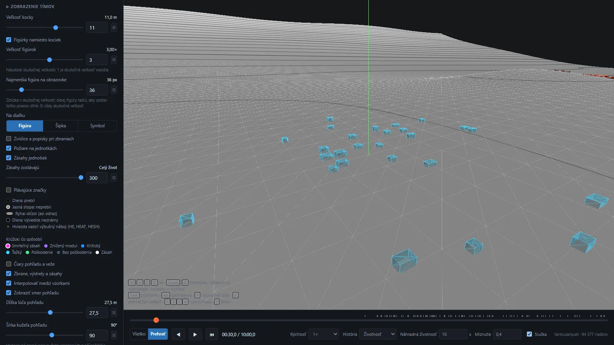

# Prekrytie figúrok (prehrávanie kociek)

Malý film: jedna figúra pre každú osobu, pohybujúca sa, ako plynie čas, so stopou za sebou.

Režim sa volá **Prekrytie figúrok** na paneli režimov. Táto stránka sa predtým volala „prehrávanie kociek“, lebo pred figúrkami bola každá osoba kocka; „prehrávanie figúrok“ a „prehrávanie kociek“ znamenajú to isté. **Prekrytie figúrok** nemá číselnú klávesu: vyberte ho na paneli režimov. Kreslí jednu figúru (alebo kocku) na [osobu](glossary.md), pohybujúcu sa pozdĺž [časovej osi](timeline.md), voliteľne s lúčmi pohľadu a stopami. Je to prehrávanie, nie hustota: *kto bol kde, kedy*. Potrebuje stĺpec osoby; bez stĺpca času sa každý vzorok nakreslí naraz.

## Ako to použiť {#how-to-use-it}

1. Načítajte dáta so stĺpcom osoby a stĺpcom času.
2. Vyberte **Prekrytie figúrok** na paneli režimov.
3. Prepnite časovú os na **Prehrať** a stlačte prehrávanie (`K`).
4. Otvorte **Zobrazenie tímov**, aby ste zmenili **Dĺžku stopy**, veľkosť figúr alebo lúče pohľadu.

V tomto režime sa nekreslí žiadne teplo a adaptívny rozpočet spritov je nečinný.

Predvolene sa každá osoba kreslí ako figúra toho, čím je, a nie ako kocka – pozri [Figúry](figures.md), ktorú figúru jednotka dostane, a [Prehrávanie zápasu](match-replay.md) pre popisky, kameru sledovania, meranie medzi dvoma jednotkami a zoznam udalostí.

## Panel Zobrazenie tímov {#the-team-viewer-panel}

Zobrazuje sa namiesto panelov tepla v tomto režime.

| Ovládací prvok | Predvolené | Rozsah (posuv) | Význam |
|---|---|---|---|
| **Figúrky namiesto kociek** | zapnuté | | Každá osoba ako figúra toho, čím je: vojak pešo, tank alebo lietadlo, ktoré dáta pomenúvajú. Čo o tom dáta nič nehovoria, zostane kockou. |
| **Veľkosť figúrok** | 1× | | 1× je skutočná veľkosť. |
| **Najmenšia figúra na obrazovke** | 36 px | 0 = vždy skutočná veľkosť | Skutočná veľkosť zblízka; ďalej figúry narastú, aby zostali takto dlhé v pixeloch. |
| **Zbrane, výstrely a zásahy** | zapnuté | | Zbrane v lete s dymom, stopovače, nárazy, zásahy a zabitia. Stopovače odvodené zo zásahu sú prerušované. |
| **Veľkosť kocky** | veľkosť entity, alebo rozsah / 500, pri načítaní | 0,05-200 m, logaritmicky (5000) | Dĺžka hrany každej kocky. Pozri [veľkosť entity](sessions-persons-groups.md#entity-size). |
| **Interpolovať medzi vzorkami** | zapnuté | | Medzi dvoma vzorkami tej istej osoby v tej istej relácii umiestni kocku úmerne medzi ne. Nikdy cez hranicu relácie. |
| **Zobraziť smer pohľadu** | zapnuté | | Lúč z každej kocky v smere pohľadu osoby (potrebuje [stĺpce pohľadu](axes-units-and-time.md#look-direction)). |
| **Dĺžka lúča pohľadu** | veľkosť entity × 4, alebo rozsah / 200, pri načítaní | 0,5-500 m, logaritmicky (20 000) | Zobrazuje sa, keď je smer pohľadu zapnutý. |
| **Dĺžka stopy** | 8 s | 0-300 s (86 400); 0 = vypnuté | Sekundy histórie kreslené za každou osobou. |
| **Kresliť každú surovú vzorku** | vypnuté | | Kocka pre každú uloženú vzorku v okne namiesto jednej interpolovanej kocky na osobu. Podvzorkované, aby zostalo interaktívne. |

Nápovedy v paneli vysvetľujú, že interpolácia a stopy spájajú vzorky len v rámci jednej relácie, a keď načítanie obsahuje [zdieľané mená](sessions-persons-groups.md#names-worn-by-several-things-at-once), koľko mien sa kreslí ako jednotlivé vzorky.

## Hraná relácia {#the-session-being-played}

Keď je stĺpec relácie, výber **Relácia** na vrchu bočného panela ([Relácie](sessions-persons-groups.md#the-session-picker)) rozhodne, ktorý zápas sa prehráva. Pri načítaní sa vyberie najaktívnejší. Kocky a stopy sa stanú len riadky tejto relácie a časová os beží cez rozsah tejto relácie, nie celého datasetu. *Všetky relácie* prehrá všetky relácie naraz, stále bez spájania vzoriek naprieč reláciami.

## Čo sa kedy kreslí {#what-is-drawn-when}

Z [`TrackCursor`](https://github.com/Holdi601/3DHeat/blob/main/src/data/tracks.ts):

**Žijúce kocky** (režim Prehrať, surové vzorky vypnuté). Pre každú viditeľnú osobu jej posledná vzorka v čase alebo pred prehrávacou hlavou:

- Ak má osoba ďalšiu vzorku, je v tej istej relácii a meno nie je zdieľané, kocka sa umiestni medzi tieto dve vzorky úmerne času, s odchýlkou interpolovanou po kratšom smere a sklonom lineárne (keď je *Interpolovať* zapnuté).
- Inak kocka zostane pri poslednej vzorke počas **Náhradnej životnosti** časovej osi (predvolene 10 s) a potom sa zahodí, aby sa vyradení hráči nezdržiavali.

**Režim Všetko** ignoruje prehrávaciu hlavu a nakreslí každú vzorku v rozsahu ako kocku.

**Surové vzorky** kreslia kocku pre každú uloženú vzorku v okne: *Rozsah* pri histórii *Okno*, inak všetko po prehrávaciu hlavu. Najviac 65 536 kociek; pri väčšom počte vzoriek sa kreslí každá *k*-tá.

**Stopy** (keď je dĺžka stopy nad 0 a surové vzorky sa nekreslia): čiara medzi každou dvojicou po sebe idúcich vzoriek osoby v posledných *dĺžka stopy* sekundách až po prehrávaciu hlavu, s vyblednutím z 80 % nepriehľadnosti na priesvitnú podľa veku. Stopa sa zastaví pri zmene relácie a pre zdieľané mená sa nekreslí. Najviac 131 072 vrcholov; pri väčšom počte sa riadky preskakujú rovnomerne.

**Kto je viditeľný:** osoba je skrytá, keď je jej skupina odškrtnutá v [zozname tímov](teams-list.md) (jej skupina je skupina jej prvého riadku), keď filter skupiny ju vylúči, alebo keď má panel [Entity](entities.md) výber, ktorý ju nezahŕňa. [Filtre](filters.md) stĺpcov sa na kocky nevzťahujú.

## Farby {#colours}

Jedna rodina odtieňov na skupinu a jeden odtieň na člena, takže jeden pohľad povie, na ktorej strane niekto je ([`teamMemberColor`](https://github.com/Holdi601/3DHeat/blob/main/src/render/colors.ts)). Odtiene skupín sa striedajú vo fixnom zozname desiatich – modrá, červená, zelená, jantárová, fialová, azúrová, purpurová, limetková, oranžová, indigová – a členovia skupiny sú rozložení po svetlosti 42-76 % a sýtosti 90-65 %.

## Poznámky {#notes}

- Prekrytie figúrok prebuduje svoje figúry, len keď sa niečo zmení; nečinná snímka prekreslí posledné.
- Riadok *Kocky* v [prekrytí štatistík](performance-and-stats.md) počíta kocky na obrazovke.
- Prekrytie figúrok sa kreslí v tej istej scéne ako level, takže [hĺbka ostrosti](camera.md#depth-of-field) rozmaže kocky, ale nikdy teplo.
