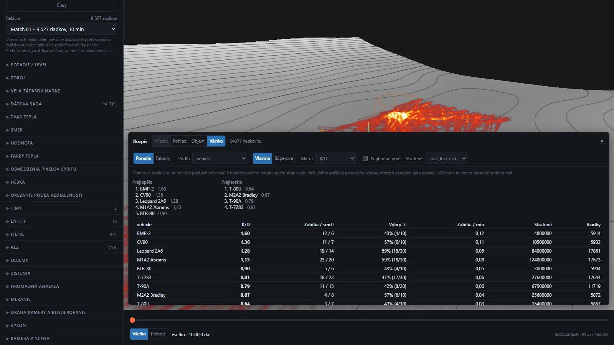
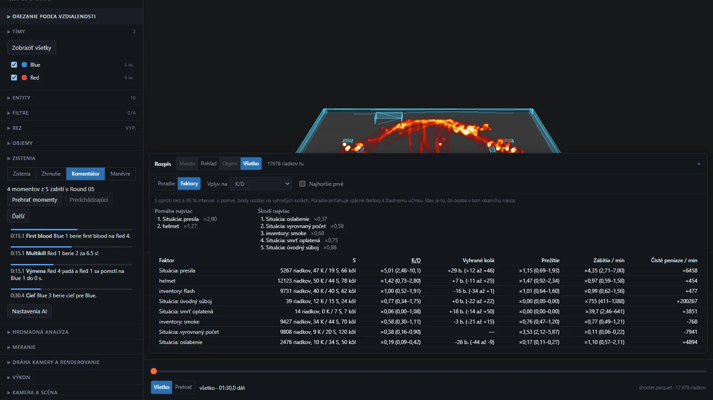

# Rozpis: kto a čo je najlepšie kde

**Rozpis** odpovedá na jednu otázku: na tomto mieste, ktorý vozidlo, hráč alebo zbraň je najlepšie? Použite ho, ak hľadáte tank, ktorý vyhráva na moste, alebo ak chcete zistiť, či prilba naozaj pomáha.

Zoradí, čo sa deje na jednom mieste (vybrané miesto, pohľad, objem alebo všetko zobrazené), podľa ľubovoľnej kategórie, a meria každý stavový faktor s a bez neho.

## Vyskúšajte to {#try-it}

1. Načítajte zápas so zabitiami a smrťami a otvorte **Objemy**.
2. Nakreslite objem okolo miesta, ktoré vás zaujíma, a vyberte ho.
3. Stlačte **Rozpis...** v časti Štatistiky.
4. V **Podľa** vyberte *Vozidlo* a mieru *K/D* (zabitia na smrť).
5. Prečítajte si zoznam, najlepší prvý. Stlačením **Najhoršie prvé** ho otočte. Kliknutím na meno filtrujte pohľad na neho; kliknutím znova filter zrušíte.

## Otvorenie {#open-it}

| Odkiaľ | Oblasť, s ktorou začína |
| --- | --- |
| **Rozpis...** v [Objemoch](volumes.md) (Štatistiky) | vybraný objem |
| **Rozpis tu** na karte bodu po kliknutí na bod | guľa okolo toho bodu (**Polomer**, predvolene 3 % veľkosti dát) |
| delené okno **Rozdiel** | pohľad |

Hlavička prepína oblasť: **Miesto**, **Pohľad** (čo kamera videla pri poslednom počítaní; po pohnutí **Spočítať znova**), **Objem** (vyberte jeden) alebo **Všetko**. Počíta na pozadí; stavový riadok hovorí, koľko riadkov je v oblasti.

## Poradie {#ranking}

Vyberte, podľa čoho zoraďovať, a mieru:

| Miera | Čo to je |
| --- | --- |
| A, B | riadky na každej strane mapy rozdielu, rozdelené tak, ako ich rozdeľuje teplo |
| A / B, A - B, A / (A + B) | obe vrstvy voči sebe |
| K/D | zabitia voči smrtiam |
| Výhra % | vyhraté kolá (alebo zápasy), tam, kde dáta hovoria, kto vyhral |
| Zabitia / min | prítomné zabitia za minútu (medzery vzoriek pohybu) |
| Zarobené, Stratené, Čistý príjem | súčty stĺpcov `earn_*` a `cost_*`; výber určí menu |

Zabitia, smrti, prítomnosť, výhry a peniaze počítajú každý riadok, ktorý pohľad na mieste ukazuje, na ktorejkoľvek strane delenia alebo na žiadnej.

Pomery a miery sa pri malých počtoch ťahajú k hodnote celého miesta, takže 2 zabitia v 1 živote sa nedostanú na vrch zoznamu. Počty sa zobrazujú vedľa nich.

Môžete zoraďovať podľa skupín, hráčov a zápasov, podľa ľubovoľného stĺpca kategórie (vozidlo, zbraň, strana, typ nákupu, agent alebo výbava), podľa ľubovoľného číselného stĺpca v rozsahoch (pancier, hodnota výbavy), podľa **triedy** stĺpca zbrane (puška, odstrelovačka, SMG, pištoľ...) a podľa toho, koľko kusov **pomôcok** obsahuje stĺpec zoznamu ako `inventory`.

**Vlastná** zoraďuje podľa vlastnej hodnoty riadku. **Súperova** zoraďuje podľa hodnoty druhej strany: zbrane obete pri zabití, zbrane vraha pri smrti (potrebuje stĺpec `other` / `victim`, ktorý ich pomenúva).

## Stav v čase {#state-at-the-time}

Hodnota riadku je jeho vlastná, pokiaľ riadok nič nezaznamenáva (udalostný riadok bez výbavy), alebo je to smrť (ktorej stĺpec zbrane môže pomenovať zbraň vraha); potom je to to, čo mal tá istá osoba naposledy pri sebe skôr v zápase.

## Faktory: s voči bez {#factors-with-against-without}

Prepnite z **Poradie** na **Faktory**, vyberte **Vplyv na** a čítajte *Najviac pomáha* a *Najviac škodí*:

Vplyv každého faktora na K/D, vyhrané kolá, prežitie (minúty na smrť), zabitia za minútu a čistý príjem za minútu, s 95% intervalom: pomery ako x, vyhrané kolá ako rozdiel v bodoch. Poradie ťahá každý odhad k nulovému vplyvu podľa jeho vlastnej neistoty, takže vzácny faktor potrebuje jasný vplyv, aby sa dostal vysoko; zobrazený interval je neťahaný.

Dáta s kolami pridávajú **situácie** z bojov na blízko ([Boj na blízko a kolá](close-quarters.md)), vypočítané raz pre dataset: *oslepený* (stĺpec `state_flashed` riadku, alebo nepriateľský záblesk do 15 m za posledné 3 s), *smrť vymenená*, *otváracie dvojboj* a *prevaha*, *rovnaký počet* alebo *nedostatok* (žijúci hráči na strane riadku proti nepriateľovi). Smrť sa počíta do situácie, v akej bola jej obeť tesne pred ňou.

V jednom prechode sa meria najviac 256 faktorov.

## Pre vývojárov {#for-developers}

### Ťahanie malých vzoriek {#pulling-small-samples}

Hodnota poradia je `(n + m*r0) / (d + m)`: `n` a `d` sú počty, `r0` je pomer celého miesta a `m` je váha tohto apriórneho odhadu.

### Pre autorov konvertorov: pomenovanie stĺpcov faktorov {#for-converter-authors-naming-factor-columns}

Konvertor pridá faktor tak, že pomenuje jeho stĺpec:

| Stĺpec | Faktor |
| --- | --- |
| `state_<názov>` číslo | zapnuté, kým je nenulové (`state_scoped`, `state_suppressor`) |
| `state_<názov>` kategória | jeden faktor na hodnotu (`state_ammo` = AP, HE...) |
| `active_<názov>` | to isté, pre niečo zapnuté alebo nedávno použité: schopnosť, ultimátum, pomôcka, buff (`active_ult`, `active_stim`) |
| stĺpec zoznamu (`inventory`, `loadout`, `perks`, `abilities`, `attachments`, `modules`, `buffs`, `debuffs`, `upgrades`, alebo názov `state_`/`active_` končiaci na `s`) | jeden faktor na položku hodnoty `a\|b\|c` |
| príznaky výbavy, ktoré sú už bežné (`helmet`, `defuser`, `armor`, `scoped`, `airborne`, `duck`, `flashed`...) | zapnuté, kým sú nenulové |
| `ammoType`, `shellType`, `ammoName` | naposledy vystrelené kolo |

Výsledky: stĺpec `won` s hodnotami 0/1 (strana riadku vyhrala kolo alebo zápas) a stĺpec `round` - [stĺpce výsledku](data-formats.md#outcome-columns); kde má súbor `won` aj `matchWon`, *Výhry %* počíta kolá. Peniaze: `earn_<mena>` a `cost_<druh>_<mena>`; príjem len podľa druhu (`earn_round_cs2`, presné odmeny za kolo z konvertora) nahradí iba model nákladov pre tento druh príjmu (`round` zahŕňa aj zasadenia a odzbrojenia) a model ocení zvyšok.

Mapovanie načíta tieto stĺpce samo, vedľa vlastného zoznamu súboru: každý stĺpec `state_*`, `active_*`, `won`, `round` a zoznamu, okrem tých, ktoré štatistiky súboru Parquet ukazujú ako jednu hodnotu počas celého priebehu (každý načítaný stĺpec je 4 bajty na riadok).
