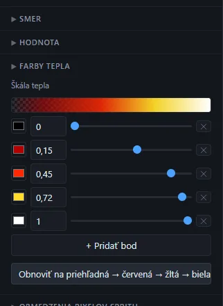

# Farba a expozícia

Tieto ovládacie prvky určujú, aká farba patrí ku ktorému množstvu tepla. **Bod nasýtenia** je to, koľko tepla sa počíta ako bielo rozžeravené.

## Rýchle opravy {#quick-fixes}

- Všetko je biele: zvýšte **Bod nasýtenia**, alebo stlačte **Automatická expozícia z poľa**.
- Nič nie je vidieť: znížte **Bod nasýtenia**, alebo stlačte **Automatická expozícia z poľa**.
- Vidno len zopár jednotlivých bodiek: zvýšte **Minimálne teplo**.

Každé ovládacie prvky na tejto stránke sa uplatní pri premene tepla na farbu, takže keď ktorýkoľvek z nich ťaháte, obraz sa hneď prekreslí a **nikdy nereštartuje nahromadenie**.

## Bod nasýtenia {#saturation-point}

**Bod nasýtenia** (sekcia Tvar tepla): nahromadené teplo, ktoré zodpovedá vrcholu farebnej škály (pri odozve *Lineárna*; ďalšie odozvy sú popísané nižšie). Logaritmický posuvník 0,1 až 4000, úchyt sa dá ťahať až do 10 000 000, lebo nahromadené teplo rastie s počtom riadkov. Predvolená hodnota je 24; pri každom načítaní sa najprv použije **analytický odhad** a potom sa hodnota **odmeria** z obrazu.

Správna hodnota rozhoduje o tom, či máte teplotnú mapu, alebo prázdnu (či bielu) obrazovku. Nedá sa spoľahlivo odvodiť, lebo telemetria sa zhlukuje tak silno – pri štarte, dverách, úzkom mieste – že pomer špičkovej hustoty k priemernej sa medzi súbormi dát a medzi uhlami kamery líši o rád.

## Automatická expozícia {#auto-exposure}

**Automatická expozícia z poľa** meria pole, ktoré shader skutočne vytvoril. Ignoruje prázdne pixely, zoberie 98. percentil osvetlených pixelov a umiestni ho na 85 % cesty k bodu nasýtenia, takže vrch farebnej škály zostáva pre skutočné špičky.

Panel potom ukazuje *namerané X % rámca; 98. percentil R umiestnený blízko vrchu škály*. Pri odozve *Nasycujúca* hodnota na 85 % bodu nasýtenia pripadne asi na 69 % škály, nie na 85 %.

Beží aj **automaticky**:

- 8 vykreslených snímok po načítaní súboru dát;
- 8 snímok po zmene [filtrov](filters.md) (filtrovanie každej pozície na sto udalostí mení hustotu o rády);
- 8 snímok po prepnutí medzi bodovým teplom a [teplom z čiar](line-heat.md), alebo po zmene trás, ktoré kreslí teplo z čiar, lebo čiara uloží na vzorku oveľa menej tepla ako sprite.

Keď nič nie je osvetlené, automatický beh nechá nasýtenie tak, ako je; tlačidlo sa vráti k analytickému odhadu a napíše *nič osvetlené na meranie – použitý analytický odhad*.

### Sledovať pohľad {#follow-the-view}

**Sledovať pohľad** (sekcia Tvar tepla, predvolene zapnuté) meria znova zakaždým, keď sa kamera zastaví, takže oblasť, do ktorej vletíte, využije celú farebnú škálu namiesto škály nameranej pre celú mapu. Drobné zmeny sa ignorujú a škála sa mení plynulo, nie skokom. Beží v štyroch režimoch tepla, nie v prekrytí figúr.

Zrušte začiarknutie, ak chcete škálu uzamknúť a porovnávať miesta na jednej škále. Ťahanie **Bodu nasýtenia** rukou ju tiež uzamkne.

## Odozva hustoty {#density-response}

**Odozva hustoty** – ako sa *k* (teplo / bod nasýtenia) premieta na farebnú škálu:

| Odozva | Vzorec | Použitie |
|---|---|---|
| **Nasycujúca** (predvolená) | t = 1 - e^(-k) | Blíži sa k vrcholu škály asymptoticky, ako naskladané priesvitné sprity. Nič sa nikdy nezreže na plnú bielu, preto je to bezpečná predvolená voľba pri neznámych dátach. |
| **Lineárna** | t = k | Jediné mapovanie, kde rovnaká farba znamená rovnaký počet. Použite ho na porovnanie dvoch súborov dát alebo dvoch časových úsekov. |
| **Logaritmická** | t = log₂(1 + 7k) / 3 | Stlačí dlhý chvost, takže jeden extrémny horúci bod prestane sploštiť všetko ostatné na spodok škály. Zdvihne riedke oblasti. |

## Minimálne teplo {#minimum-heat}

**Minimálne teplo** (predvolene vypnuté, 0 až 100 %): každý pixel, ktorý nesie akékoľvek teplo, sa zdvihne aspoň na tento bod škály. Zvýšte ho a polomer spritu znížte, aby ste videli, **kde sa niečo vôbec stalo** – jednotlivé dátové body sú potom jasne vidieť, namiesto toho, aby len tesne nad priehľadnou. Keď posudzujete hustotu, nechajte to vypnuté, lebo to podľa návrhu sploští spodok škály. Prah (k > 0,0001) udrží skutočne prázdne pixely prázdne.

## Editor škály {#the-ramp-editor}

V sekcii **Farby tepla**. Jeho popis hovorí, na čo škála slúži: *Škála tepla* v Teple a Čiarach, *Kladná (pripočítavajúce tímy)* v Rozdiele, *Škála nepriehľadnosti (farbu dáva skupina)* v [Teple tímov](team-heat.md), kde sa používa iba jej priehľadnosť.



Pás hore ukazuje náhľad škály. Pod ním je jeden riadok na bod:

| Časť | Význam |
|---|---|
| Farebný vzorok | Farba bodu (farebný výber prehliadača). |
| Číslo | Poloha bodu na škále, 0 až 1 (0 = žiadne teplo). |
| Posuvník | Nepriehľadnosť bodu, 0 až 100 %. |
| ✕ | Odstráni bod; vypnuté, keď zostanú len dva. |

**+ Pridať bod** pridá bod v polovici medzi posledné dva body, s farbou a nepriehľadnosťou posledného bodu. **Obnoviť na priehľadná → červená → žltá → biela** vráti predvolené nastavenie.

Body možno zadať v ľubovoľnom poradí; pri zostavovaní škály sa zoradia. **Alfa** je to, čo mieša teplo s scénou, preto je nulový koniec predvolenej škály úplne priehľadný.

### Predvolené škály {#the-default-ramps}

| Poloha | Kladná (Teplo, Čiary, Rozdiel +) | Záporná (Rozdiel −) |
|---|---|---|
| 0,00 | čierna, alfa 0 | čierna, alfa 0 |
| 0,15 | rgb(180, 0, 0), alfa 0,55 | rgb(0, 170, 60), alfa 0,55 |
| 0,45 | rgb(255, 40, 0), alfa 0,85 | rgb(0, 190, 200), alfa 0,85 |
| 0,72 | rgb(255, 220, 40), alfa 0,95 | rgb(40, 80, 255), alfa 0,95 |
| 1,00 | biela, alfa 1 | rgb(170, 60, 255), alfa 1 |

## Kým sa kamera hýbe {#while-the-camera-moves}

Keď sa kamera hýbe, nahromadenie sa reštartuje každú snímku. Keď je zapnuté **Kresliť každý riadok v každej snímke** (predvolene), každá pohybujúca sa snímka je stále presná; keď je vypnuté, pohybujúca sa snímka ukáže jeden vzorkovaný odhad – jasnejšie, váhou zväčšené zhluky – ktorý sa po zastavení zbieha k hladšiemu skutočnému obrazu. To je očakávané; pozri [Nahromadenie](accumulation.md).

## Pre vývojárov {#for-developers}

### Zložený prechod {#the-composite-pass}

Po nahromadení tepla sa hodnota každého pixela premení na farbu v jednom zloženom prechode ([`COMPOSITE_FS`](https://github.com/Holdi601/3DHeat/blob/main/src/render/webgl2/shaders.ts)). Kroky sú:

```
k = |heat| / saturation point
t = response(k)                         clamped to 0..1
if minimum heat > 0 and k > 0.0001:  t = minimum + (1 - minimum) × t
colour, alpha = ramp(t)                  (the negative ramp when heat < 0, Difference only)
pixel = mix(scene, colour, alpha)
```

### Analytický odhad {#the-analytic-estimate}

**Analytický odhad** ([`estimateSaturation`](https://github.com/Holdi601/3DHeat/blob/main/src/data/calibrate.ts)) predpokladá, že riadky sú rozložené po pôdorysnej ploche dát v osiach X-Z: priemerné teplo = riadky × (π r² / plocha pôdorysu) × 1/3 × intenzita v strede (1/3 je priemer lineárneho sklonu cez kruh), vynásobené predpokladaným pomerom špička k priemeru 25, orezané na 0,1 až 1 000 000. Stačí, aby bol v rámci jedného rádu správny.

### Meranie {#metering}

[`exposure.ts`](https://github.com/Holdi601/3DHeat/blob/main/src/render/exposure.ts):

1. cieľová hodnota tepla sa prečíta späť z GPU, znížená vzorkovaním na najviac 40 000 hodnôt;
2. prázdne pixely (teplo ≤ 0,0001) sa zahodia – väčšina tepelného poľa je prázdna a ich spriemerovanie by všetko podexponovalo, ako by expozimeter fotoaparátu nasmerovaný na čierne pozadie;
3. 98. percentil osvetlených pixelov je referencia;
4. bod nasýtenia sa stane referenciou / 0,85, takže referencia leží na 85 % cesty k bodu nasýtenia a vrch škály zostáva pre skutočné špičky.

### Tabuľka farieb {#the-colour-table}

Škála sa zapečie do tabuľky RGBA 256 × 2 (kladná škála v prvom riadku, záporná v druhom) ([`buildColorLut`](https://github.com/Holdi601/3DHeat/blob/main/src/render/colors.ts)). Farby sa interpolujú v lineárnom svetle a uložia sa ako sRGB; nepriehľadnosť sa interpoluje lineárne.
