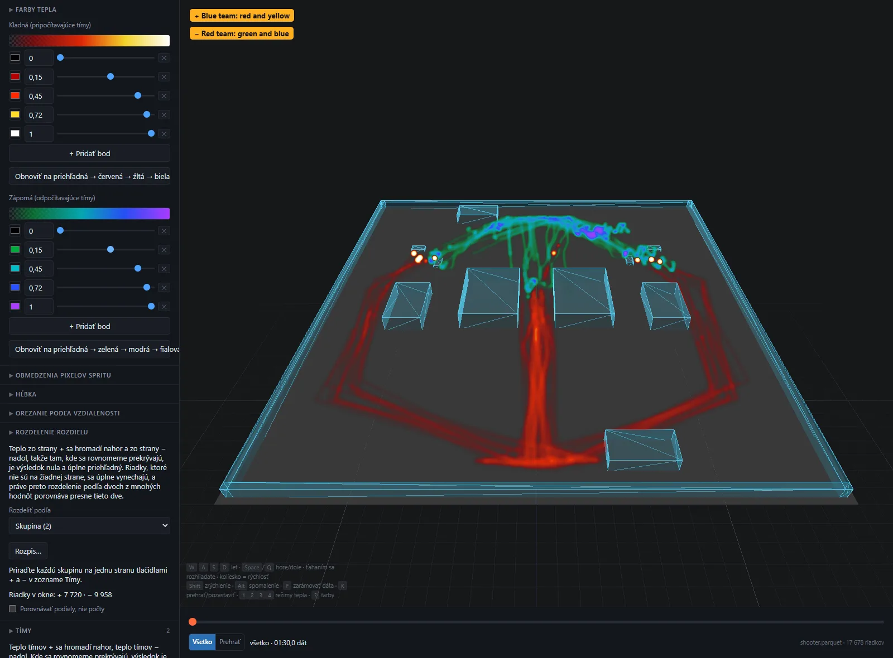

# Rozdiel

Červená tam, kde bol tím A viac, zelenomodrá tam, kde bol tím B, nič tam, kde boli rovnakí.

**Rozdiel** (kláves 2) je znamienkové teplo. Riadky jednej populácie pripočítavajú teplo; riadky inej ho odčítavajú. Tam, kde sa obe prekrývajú
rovnomerne, je výsledok nula a úplne priehľadný; kde jedna prevláda, zobrazí sa vo farbách tej strany - štandardne teplými (priehľadná → červená → žltá → biela)
pre stranu **+** a chladnými (priehľadná → zelená → modrá → fialová) pre stranu **−**.

## Ako to použiť {#how-to-use-it}

1. Stlačte `2` (alebo vyberte **Rozdiel** v lište režimov).
2. Otvorte **Rozdelenie rozdielu** v bočnom paneli.
3. Vyberte, čím sa **Rozdeliť podľa**: zvyčajne *Skupiny*.
4. Jednu skupinu (alebo hodnotu) dajte na **+** a inú na **−**.
5. Prečítajte farby: teplá znamená stranu +, chladná stranu −. Panel upozorní, ak jedna strana nemá riadky (pozri [Správy, ktoré môžete vidieť](#messages-you-may-see)).

*Ktoré dve populácie* je celá otázka, takže rozdelenie môže byť podľa ľubovoľného ponechaného stĺpca, nielen skupín. Riadky, ktoré spadnú na **žiadnu** stranu,
sa **vynechajú**, nepočítajú sa ako nula: práve preto rozdelenie nad dvoma z mnohých hodnôt porovná presne tie dve, a skladá sa s [filtrami](filters.md) -
prefiltrujte na jednu mapu a potom to rozdeľte podľa verzie.

Režim potrebuje dve strany: stĺpec skupiny s aspoň dvoma skupinami, alebo rozdelenie nad stĺpcom ponechaným na filtrovanie. Pri dátach s menej ako dvoma skupinami
sa načítanie spustí s rozdelením stĺpca - najprv stĺpec *Source file* pri načítaní viacerých súborov, inak prvý stĺpec kategórie s dvomi hodnotami, inak prvý číselný
stĺpec s rozpätím - takže *porovnať dve načítania* funguje aj na dátach bez akejkoľvek skupiny. Režim je nedostupný len pri dátach, ktoré nemajú ani jedno;
rovnako tak pri rozdelení stĺpca, ktoré na jednej strane nemá nič.

## Panel Rozdelenie rozdielu {#the-difference-split-panel}

Zobrazí sa v režime Rozdiel, pod panelmi tepla.

**Rozdeliť podľa** ponúka:

| Možnosť | Zobrazené ako | Pravidlo rozdelenia |
|---|---|---|
| Skupiny | *Skupina (N)* (keď existuje stĺpec skupiny) | Každá skupina na +, −, alebo na žiadnu, nastavené v [Zozname tímov](teams-list.md) |
| Stĺpec kategórie | *stĺpec (N hodnôt)* | Hodnoty na +, −, alebo na žiadnu |
| Číselný stĺpec | *stĺpec (číselný)* | Rozsah hodnôt pre každú stranu |
| Súbor pôvodu | *Source file - porovnať dve načítania* (keď sa načítalo viac súborov) | Súbory na +, −, alebo na žiadnu |

Ponúkajú sa len stĺpce ponechané pod *Ponechať na filtrovanie* pri načítaní.

### Porovnávať podiely, nie počty {#compare-shares-not-counts}

**Porovnávať podiely, nie počty** (štandardne vypnuté) váži každú stranu jednotkou delenou jej vlastným počtom riadkov, takže strana s päťnásobkom riadkov nevyhrá len číslami.
Farba potom ukazuje, kde je každá strana úmerne častejšia než druhá. Použite to, keď majú obe strany veľmi rozdielne množstvo dát, napríklad dve relácie rôznej dĺžky.

### Správy, ktoré môžete vidieť {#messages-you-may-see}

Panel upozorní, keď obraz nie je skutočný rozdiel:

| Správa | Význam |
|---|---|
| *N + / M −* (alebo *N + / M − / K nepoužitých*) | Koľko hodnôt je na každej strane (a na žiadnej). |
| Žiadny riadok v okne nie je na strane **+** | Kreslí sa len strana **−**. Posuňte okno časovej osi alebo zmeňte rozdelenie. |
| Žiadny riadok v okne nie je na strane **−** | Kreslí sa len strana **+**. |
| Žiadna hodnota nie je na žiadnej strane | Rozdiel nič nekreslí. Dajte aspoň jednu hodnotu na **+** alebo **−**. |
| *stĺpec* sa týmto spôsobom nedá rozdeliť | Zvolený stĺpec sa do rozdelenia nehodí. Zvoľte stĺpec znova. |
| Stĺpec rozdelenia sa nezmestil do pamäte GPU pre N z M častí | Tie riadky sa nekreslia. Zvýšte rozpočet GPU v časti Výkon → Rozpočty zdrojov, alebo načítajte menej riadkov. |

### Podľa skupiny {#by-group}

Panel len ukazuje na [Zoznam tímov](teams-list.md), kde má každá skupina tlačidlo **+** a **−**. Pri každom načítaní sa prvá polovica skupín (zaokrúhlená nahor)
dá na +, zvyšok na −; **Rozdeliť rovnomerne** v Zozname tímov to urobí znova. Skupina na žiadnej strane, alebo skrytá svojím políčkom, neprispieva ničím.

### Podľa hodnôt kategórie {#by-category-values}

| Časť | Význam |
|---|---|
| `a + / b − / c nepoužitých` | Koľko hodnôt je na každej strane a na žiadnej. |
| **Vymazať** | Dá každú hodnotu na žiadnu stranu. |
| Zoznam hodnôt | Každá hodnota s tlačidlom **+** a **−** (kliknutím na aktívne ju zrušíte na tej strane). Prázdna hodnota sa uvádza ako *(chýba)*. |
| Poznámka o limite | Uvádza sa len prvých 200 hodnôt: *Zobrazujem prvých 200 z N hodnôt. Taký široký stĺpec je lepšie najprv zúžiť filtrom, alebo rozdeliť podľa rozsahu, ak sú jeho hodnoty usporiadané.* |

Výber stĺpca dá jeho prvú hodnotu na + a druhú na −. Keď žiadna strana nemá žiadnu hodnotu, rozdelenie sa vráti k skupinám namiesto zobrazenia prázdneho rámca.
*Source file* funguje rovnako, jedna hodnota na súbor - takto sa porovnávajú dva exporty, dve testovacie jazdy alebo dve verzie.

### Podľa rozsahu {#by-range}

| Časť | Význam |
|---|---|
| Nápoveda | Minimum a maximum stĺpca. |
| **Kladný rozsah (+)**, **od** / **do** | Riadky s hodnotou v tomto rozsahu, vrátane oboch koncov, pripočítavajú. |
| **Záporný rozsah (−)**, **od** / **do** | Riadky v tomto rozsahu odčítavajú. |
| **Rozdeliť v strede** | Nastaví + na [minimum, stred] a − na [stred, maximum] - to isté, čo urobí výber stĺpca. |

Hodnota v oboch rozsahoch sa počíta ako +. Rozsahy nemusia pokrývať stĺpec; hodnoty mimo oboch sa vynechajú.
*Prvé dve minúty oproti posledným dvom* je rozdelenie podľa rozsahu nad stĺpcom podobným času.

## Podiel +: mapa podielu výhier {#share-of--the-win-rate-map}

**Rozdiel** / **Podiel +** v hornej časti panela vyberá, čo sa kreslí. *Podiel +* zafarbí každé miesto podľa podielu strany + na riadkoch oboch strán tam, oproti tomuto podielu vo všetkom zobrazenom: teplo nad ním, chladno pod ním, nič tam, kde je rovnaký, a nič tam, kde má miesto príliš málo riadkov. S vyhratými kolami na + a prehratými na − je to mapa podielu výhier; **Podiel vyhratých kôl** a **Podiel vyhratých zápasov** to nastavia jedným stlačením, keď dáta majú [stĺpce výsledku](data-formats.md#outcome-columns). Pozri [Podiel výhier](win-rate.md).

## Farby {#colours}

Sekcia **Farby tepla** v tomto režime ukazuje dva editory škál: **Kladná (pripočítavajúce tímy)** a **Záporná (odpočítavajúce tímy)**, každá s vlastným tlačidlom
resetu (*Resetovať na priehľadná → červená → žltá → biela*, *Resetovať na priehľadná → zelená → modrá → fialová*). Zložené zobrazenie berie absolútnu hodnotu čistého tepla
cez [bod sýtosti a odozvu](colour-and-exposure.md) a vyberá zápornú škálu tam, kde je čisté teplo pod nulou. Pozri [Farba a expozícia](colour-and-exposure.md#the-ramp-editor).

Použite odozvu hustoty *Lineárna*, keď záleží na veľkosti rozdielu: je to jediná odozva, kde rovnaká farba znamená rovnaký počet.

## Pre vývojárov {#for-developers}

Každý riadok dostane znamienko +1, -1 alebo 0 vo vertex shaderi ([`POINT_HEAT_VS`](https://github.com/Holdi601/3DHeat/blob/main/src/render/webgl2/shaders.ts)); 0 odmietne riadok ešte predtým, než sa nakreslí akýkoľvek fragment.

- Podľa skupiny pochádza znamienko zo 4 096-prvkovej tabuľky skupín indexovanej ID skupiny riadku (ID skupiny sa nesie vo štvrtom kanáli texelu pozície riadku).
- Podľa kategórie pochádza znamienko z druhej 4 096-prvkovej tabuľky, naplnenej pre každú hodnotu kategórie, a hodnota riadku sa číta z filtračnej textúry stĺpca; hodnota za koncom tabuľky sa odmietne na oboch backendoch.
- Podľa rozsahu sa hodnota riadku porovnáva s oboma rozsahmi.

Zmena rozdelenia reštartuje akumuláciu.

**Skryté skupiny zostávajú skryté pri každom rozdelení.** Pri rozdelení podľa stĺpca tabuľka skupín už nenesie znamienka; drží 1 pre zobrazenú skupinu a 0 pre skrytú ([`frameSignTables`](https://github.com/Holdi601/3DHeat/blob/main/src/render/filterTables.ts)),
a obe tabuľky sa dostanú do shadera spolu - dva riadky jednej textúry znamienok na WebGL2, dve polovice jedného storage buffera na WebGPU. Riadok sa kreslí len vtedy, keď je jeho skupina zobrazená *a* jeho hodnota stĺpca je na nejakej strane.
Skupina odškrtnutá v [Zozname tímov](teams-list.md), alebo vynechaná bočným zameraním karty Zápas, teda neprispieva ničím, nech je rozdiel rozdelený akokoľvek.
