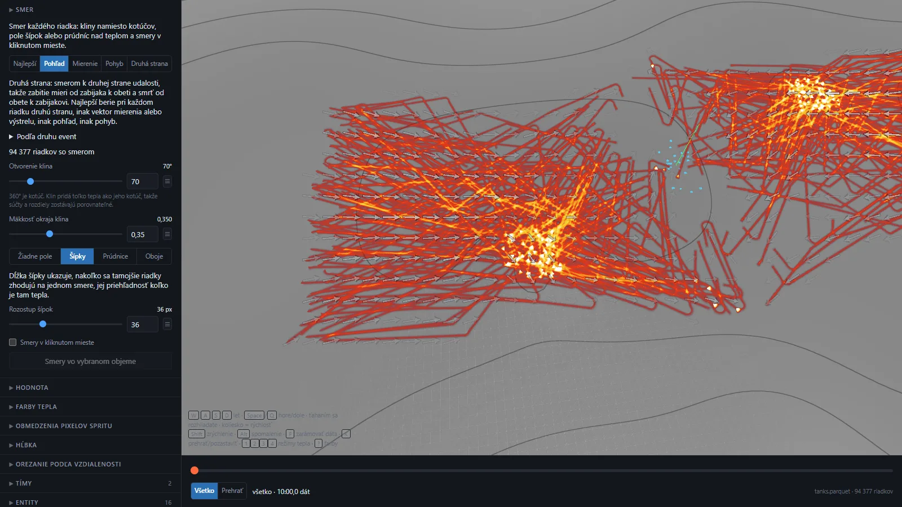

# Smerové teplo

Obyčajné teplo ukazuje **kde** sa veci dejú. Smerové teplo ukazuje aj **akým smerom**: ktorým smerom sa ľudia pozerali, mierili, pohybovali, alebo kde bola druhá strana boja.

Obyčajný sprite je plný kotúč (360 stupňov). S **Otvorením klina** 70 stupňov sa ten istý sprite zmení na úzky klin, ktorý ukazuje smer, akým bol riadok otočený, a pridá rovnaké celkové teplo.

## Ako to použiť {#how-to-use-it}

1. Načítajte dáta, v ktorých je smer (pozri [Čo dáva riadku smer](#what-gives-a-row-a-direction)).
2. Na paneli režimov vyberte **Teplo**, **Rozdiel** alebo **Teplo tímov**.
3. Otvorte sekciu **Smer** na bočnom paneli.
4. Vyberte **zdroj** (ktorý smer použiť) a potom zapnite kreslenie:
   - znížte **Otvorenie klina** pod 360° a každý riadok sa nakreslí ako klin, ktorý ukazuje svoj smer, namiesto kotúča;
   - vyberte **Pole** na nakreslenie šípok alebo prúdníc nad teplom;
   - zaškrtnite **Smery v kliknutom mieste** a kliknite na teplo, aby ste dostali polárny graf toho miesta.

Stavový riadok hovorí, koľko riadkov má smer z vybraného zdroja.

## Nastavenia {#settings}

| Nastavenie | Predvolené | Čo robí |
|---|---|---|
| Zdroj: **Najlepšie**, **Pohľad**, **Mierenie**, **Pohyb**, **Druhá strana** | Najlepšie | Aký smer dostane každý riadok. *Najlepšie* zoberie pre riadok druhú stranu, inak mierenie, inak pohľad, inak pohyb. |
| **Podľa druhu udalosti** | ako vyššie | Iný zdroj pre každý druh udalosti, napríklad *Druhá strana* pre zabitia a *Pohľad* pre pozície. Zobrazí sa, keď dáta majú stĺpec udalostí s najviac 40 hodnotami. |
| **Otvorenie klina** | 360° | 360° je normálny kotúč (vypnuté). Menšie je užší klin. Klin pridá toľko tepla, koľko jeho kotúč, takže súčty a rozdiely zostanú porovnateľné. |
| **Mäkkosť okraja klina** | 0,35 | 0 je klin s ostrým okrajom, 1 mäkký vejár. |
| **Pole**: Bez poľa, Šípky, Prúdnice, Obe | Bez poľa | Šípky: dĺžka šípky ukazuje, aký veľký je súhlas riadkov na jeden smer, jej nepriehľadnosť, koľko tepla tam je. Šípky sa ukážu len tam, kde je teplo. |
| **Rozostup šípok** | 28 px | Vzdialenosť medzi šípkami na obrazovke. |
| **Animovať prúdnice** | zapnuté | Prúdnice tečú, keď je zapnuté. |
| **Smery v kliknutom mieste** | vypnuté | Kliknite na teplo, aby ste videli smery na tom mieste (nižšie). |
| **Smery vo vybranom objeme** | | Ten istý graf pre všetko vnútri vybraného [objemu](volumes.md). |

## Polárny graf na mieste {#the-polar-chart-at-a-spot}

Keď je zapnuté **Smery v kliknutom mieste**, kliknite na teplo. Riadky blízko toho bodu (do 1,5 polomeru spritu) sa zozbierajú do ružice 24 výsekov po 15°:

- **oranžové** lupienky: odchádzajúce smery (kam riadky ukazujú);
- **modré** lupienky: prichádzajúce smery (odkiaľ prišli);
- **plocha** lupienka rastie s jeho počtom; šípka ukazuje hlavný smer;
- čiary pod grafom uvádzajú hlavný smer, ako silno sa riadky zhodujú (R, 0 až 1), rozptyl v stupňoch a počet riadkov.

0° je na grafe hore, čo je svet −Z (sever pre nahrávky Tacview). Miesto je tiež označené v 3D pohľade šípkou a krúžkom.

## Čo dáva riadku smer {#what-gives-a-row-a-direction}

| Zdroj | Potrebuje v dátach |
|---|---|
| Pohľad | stĺpec odchýlky (namapovaný ako smer pohľadu): `yaw`, `heading`, `azimuth`, `view_yaw`, `rot_z` |
| Mierenie | dvojice čísel ako `aim_x`/`aim_y`, `shot_x`/`shot_y`, `fire_x`/`fire_y`, `hit_dir_x`/`hit_dir_y` (voliteľné `…_z`) |
| Pohyb | nič navyše: krok od predchádzajúcej vzorky tej istej osoby (najviac 10 s predtým, tá istá relácia) |
| Druhá strana | stĺpec, ktorý pomenúva druhú stranu udalosti (`other`, `victim`, `target`, `killer`, `attacker`, `shooter`, `other_player` ...), ktorého hodnoty sú mená osôb; zabitie ukazuje od vraha k obeti, smrť od obete k vrahovi |

## Tipy {#tips}

- Kliny potrebujú nejakú veľkosť na obrazovke; pod niekoľko pixelov sa znova kreslia ako kotúče.
- Použite *Druhú stranu* na riadkoch zabití, aby ste videli, **odkiaľ** sa boje vyhrali, a *Pohľad* na riadkoch pozícií, aby ste videli, **kam sa ľudia pozerajú**.
- Pri **Rozdiele** kliny oboch strán ukazujú svojimi smermi, takže sporné línie paľby vynikajú.
