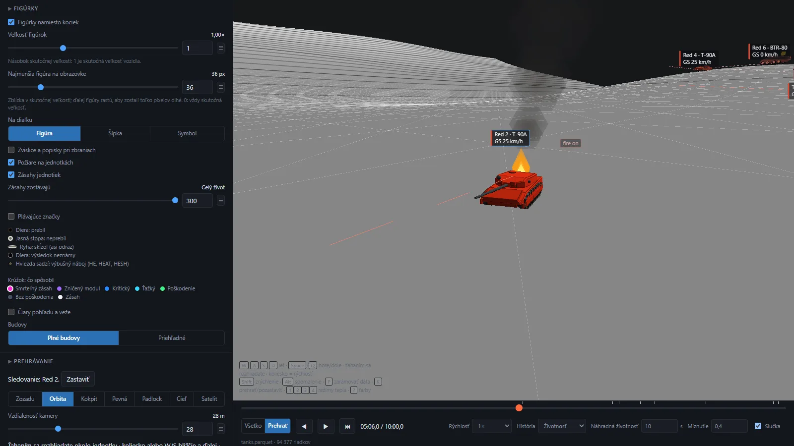

# Figúrky

**Figúrka** je malý 3D model toho, čím jednotka naozaj je: tank, prúdové lietadlo, loď, vojak. [Prehrávanie](match-replay.md) kreslí každú jednotku ako jej figúrku v skutočnej veľkosti, namiesto jednoduchej krabice.

Je tu asi 2 000 pomenovaných vozidiel, lietadiel, lodí, zbraní a vojakov, všetky vytvorené samotným prehliadačom.

## Čo je v katalógu {#what-is-in-the-catalogue}

| Oblasť | Príklady |
|---|---|
| Ľudia | vojak stojaci, drepiaci, ležiaci; ostreľovač, protitankový, zdravotník, posádka |
| Pozemné | tanky, bojové vozidlá pešiaka, protivzdušná obrana, delostrelectvo, nákladné autá a osobné autá, vlaky a električky |
| Vzduch | stíhačky, útočné lietadlá, bombardéry, dopravné lietadlá, vrtuľníky, od dvojplošníkov po moderné prúdové lietadlá |
| More | bojové lode podľa triedy, lietadlové lode, ponorky, člny, obchodné lode |
| Zbrane | rakety, raketomety, bomby, torpéda, svetlice a plevy |
| Značky | dymové, zábleskové a zápalné granáty, uložené bomby, vlajky, miesta zrodu, body trasy |

## Ako sa figúrky robia {#how-the-figures-are-made}

- **Postavené podľa zverejnených rozmerov.** Väčšina figúrok je vytvorená stavebnicou figúrok prehliadača z verejných čísel: dĺžka, šírka, výška, cestné kolesá, veža a delo, krídla a chvost. Ich tvar sa potom doladí podľa verejných fotografií, výkresov a zverejnených rozmerov. Nepoužívajú sa modely žiadnej hry.
- **Voľné modely.** Niekoľko figúrok používa voľné 3D modely (CC0 alebo CC BY), kde sú pravdivejšie, niekedy spojené s postavenou trupom. Autori diel CC BY sú uvedení na [Poďakovanie za figúrky](figure-credits.md); diela CC0 nevyžadujú uvedenie a tam nie sú vypísané.
- Každá figúrka má plnú, hrubú a vzdialenú verziu (úrovne detailu, LOD), takže sa dá nakresliť tisíce naraz.

## Akú figúrku jednotka dostane {#which-figure-a-unit-gets}

Prehliadač sa pozrie na vlastné stĺpce údajov:

1. **Názvy** - stĺpce s názvami *Name*, *Vehicle*, *Unit*, *Unit type*, *Model*, *Aircraft*, *Plane*, *Tank*, *Ship*, *Craft*, *Loadout*, *Kit* alebo *Figure* - sa porovnajú s katalógom: presne, cez asi 4 000 alternatív (herné id jednotiek z viacerých hier), podľa najdlhšieho známeho začiatku (`F-16C_50` je F-16C), alebo podľa najkratšieho názvu figúrky, ktorý sa začína rovnako.
2. Názov, ktorého figúrka nesedí na **typ** jednotky, sa nepoužije (nákladné auto menom *Typhoon* nie je stíhačka).
3. **Typy** - stĺpce s názvami *Type*, *Class*, *Kind*, *Category*, *Icon*, *Role* alebo *Domain* - dajú figúrku triedy: značky Tacview (`Air+FixedWing`, `Ground+Heavy+Armor+Vehicle+Tank`, `Sea+Watercraft+Warship`, `Weapon+Missile`), ikony mapy alebo obyčajné slová (tank, helicopter, infantry).
4. Údaje, v ktorých nie je ani jedno, sú údaje o ľuďoch: každý je vojak.

Najľahší spôsob, ako dostať správne figúrky, je stĺpec `vehicle` so skutočnými názvami, alebo stĺpec `type` so značkami Tacview.

**Moja jednotka sa zobrazuje ako krabica alebo vojak.** Pridajte stĺpec `vehicle` so skutočným názvom, alebo stĺpec `type` so značkou Tacview. Nad jednotkou podržte myš a uvidíte, ktorý názov sa našiel. Údaje, ktoré takéto stĺpce majú, ale o jednotke nič nehovoria, nechajú ju ako krabicu; údaje bez oboch sa kreslia ako vojaci.

## Nastavenia {#settings}

Sekcia **Figúrky** na bočnom paneli prehrávania nastaví veľkosť, najmenšiu veľkosť na obrazovke, čím sa stanú vzdialené jednotky (figúrka, šípka, symbol) a efekty, ktoré sa na nich kreslia. Pozri [Prehrávanie zápasu](match-replay.md#figures). Dym, oheň a iné časované efekty: [Figúrky v prekrytí figúrok](figure-replay.md).

## Voliteľný lokálny balík figúrok {#an-optional-local-figure-pack}

Na svojom počítači si môžete ponechať voliteľný balík vlastných figúrok. Jeho figúrky nahrádzajú figúrky z katalógu s rovnakými názvami. Nikdy nie je súčasťou repozitára ani zverejnenej verzie; bez neho sa nič nemení.
