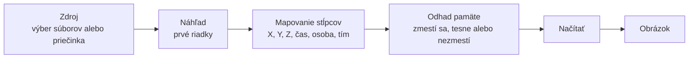

# Ako dostať dáta dnu

Skôr než 3DHeat niečo nakreslí, potrebuje tabuľku: každý riadok hovorí, kde niečo bolo a ak to viete, kedy a kto. Táto časť ukazuje, ako sa súbor zmení na obrázok. Zatiaľ nemáte dáta? Vyskúšajte [ukážkové dáta](demo-data.md).

**Urobte to hneď:**

1. Na bočnom paneli Heatmapy otvorte **Zdroj** a stlačte **Súbory…** (alebo pustite súbor či priečinok na oblasť na pustenie).
2. Pozrite sa na **Mapovanie stĺpcov**: políčka sú zvyčajne už vyplnené.
3. Skontrolujte, že **Odhad pamäte** hovorí *zmestí sa*.
4. Stlačte **Načítať**.

Všetko, čo karta Heatmapa zobrazuje, pochádza z jednej **dátovej sady**: tabuľky riadkov, každý s pozíciou a voliteľne s časom, osobou, skupinou, reláciou, smerom pohľadu a ľubovoľným počtom ďalších stĺpcov uchovaných na filtrovanie. Táto časť vysvetľuje, ako sa dátová sada vytvorí.

## Cesta od súborov k obrázku {#the-path-from-files-to-picture}

1. **Výber súborov** v paneli **Zdroj** - jeden súbor, viac, strom priečinkov alebo pustením. Akceptujú sa Parquet, CSV, Tacview, GPS stopy a ďalšie; úplný zoznam je v [Dátové formáty](data-formats.md#files). Pozri [Načítanie súborov](loading-files.md).
2. **Náhľad.** Otvorí sa prvý súbor výberu: názvy jeho stĺpcov, prvých 50 riadkov, ktoré stĺpce vyzerajú číselne, a (pri Parquet) logický typ každého stĺpca a vlastné čítacie pokyny súboru, položka päty `heat3d`.
3. **Automatické mapovanie.** Stĺpce sa priradia úlohám - X, Y, Z, čas, osoba, relácia, skupina, smer pohľadu - a niekoľko sa ponechá na filtrovanie. Každý odhad sa zobrazí v paneli **Mapovanie stĺpcov** a dá sa zmeniť. Pozri [Mapovanie stĺpcov](column-mapping.md) a [Osi, jednotky a čas](axes-units-and-time.md).
4. **Počítanie.** Počet riadkov každého súboru sa načíta (presne z pätiek Parquet, odhadom pri CSV), takže panel môže ešte pred načítaním povedať, koľko pamäte načítanie potrebuje a či sa zmestí. Ak sa nezmestí, navrhne načítať každý *N*-tý riadok. Pozri [Pamäť a rozpočty](memory-and-budgets.md).
5. **Načítať.** Pracovný proces na pozadí spracuje iba mapované stĺpce každého súboru - viac súborov naraz, až do rozpočtu [vlákien čítania](memory-and-budgets.md#parser-threads) - a zlúči ich v poradí výberu do jednej dátovej sady: jeden spoločný slovník osôb, skupín a relácií naprieč všetkými súbormi, jeden spoločný časový začiatok, všetky riadky zoradené podľa času. Pozri [Relácie, osoby a skupiny](sessions-persons-groups.md).
6. **Nahratie.** Hlavné vlákno oznámi „Nahrávam N riadkov do GPU“ na jednu snímku a potom zabalí riadky do pamäte GPU v rámci rozpočtu GPU. Pozri [Rezidencia pamäte GPU](gpu-memory.md).
7. **Prvý obrázok.** Kamera zarámuje dáta, polomer spritov a nasýtenie sa nastavia podľa rozsahu dát a počtu riadkov a po 8 vykreslených snímkach sa nasýtenie zmeria z samotného obrazu ([Farba a expozícia](colour-and-exposure.md)).

## Požiadavky kontrolované pred načítaním {#requirements-checked-before-a-load}

| Potreba | Čo sa stane bez nej |
|---|---|
| **Aspoň dve z X / Y / Z** | Načítanie sa odmietne. Pri presne dvoch je tretia os 0 a dáta sa kreslia ako plochá rovina v 3D scéne - čo chce mapové teplo pohľadom zhora. |
| Stĺpec času | Voliteľný. Bez neho je časová os vypnutá, pohľad zostane v režime **Všetko** a bočný panel to povie. |
| Stĺpec osoby | Voliteľný. Potrebný pre [prekrytie figúrok](box-replay.md) (figúrka pre každú osobu), [teplo čiar](line-heat.md) (trasa každej osoby), interpoláciu, stopy a históriu **Životnosť**. |
| Stĺpec skupiny | Voliteľný. Potrebný pre [teplo tímov](team-heat.md) a režim [rozdielu](difference.md) (aspoň dve skupiny). |

Režim, ktorý načítané dáta nepodporujú, je v lište režimov zašedený; po najazdení myšou sa zobrazí, prečo.

## Bez vlastných dát {#without-your-own-data}

Panel **Dátová sada** (pod **Zdroj**) má [syntetický generátor](synthetic-generator.md), ktorý vytvorí dátovú sadu v tvare battle royale ľubovoľnej veľkosti. Hodí sa na vyskúšanie prehliadača a na test, čo stroj zvládne.

## Stránky v tejto časti {#pages-in-this-section}

- [Načítanie súborov](loading-files.md) - výbery, priečinky, pretiahnutie, zlučovanie viacerých súborov, pravidlo pohybových súborov, priebeh a zrušenie
- [Mapovanie stĺpcov](column-mapping.md) - každé pole panela mapovania, ako automatické mapovanie hádá, nápovedy `heat3d`
- [Osi, jednotky a čas](axes-units-and-time.md) - os hore, prevrátenie, mierka jednotiek, jednotky času, smer pohľadu
- [Relácie, osoby a skupiny](sessions-persons-groups.md) - čo každá robí, limity, zdieľané mená, veľkosť entít, panel Dátová sada
- [Syntetický generátor](synthetic-generator.md)
- [Pamäť a rozpočty](memory-and-budgets.md) - model nárokov na pamäť, kontrola zmestenia, redukcia riadkov, strop triedenia, rozpočty zdrojov
