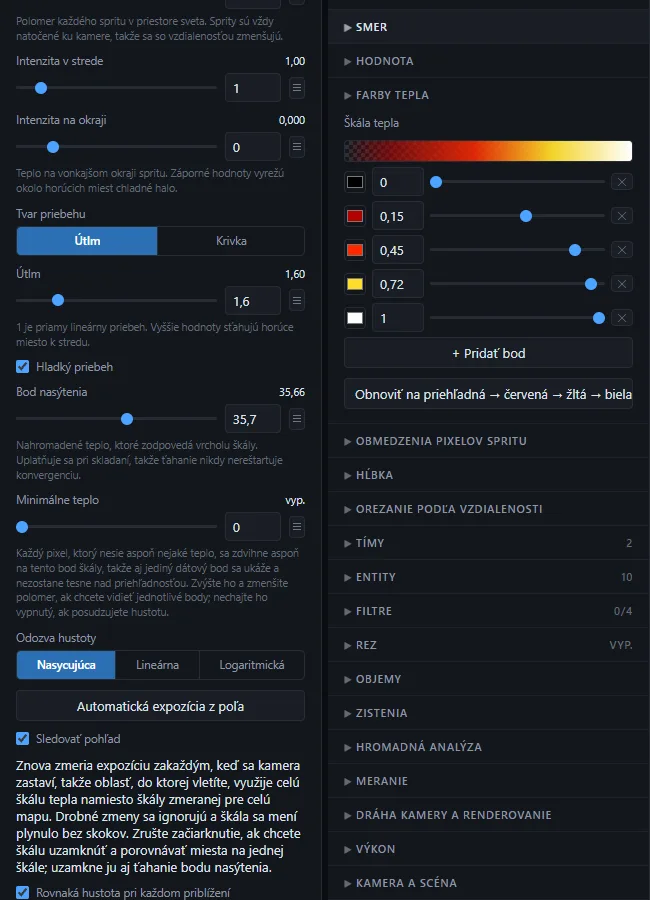

# Teplo

Teplo maľuje miesta, kde sa stalo veľa vecí: červená tam, kde sa stalo trochu, bielo rozžeravená tam, kde sa stalo veľa. Odpovedá na otázku „kde sa to deje a koľko“.

**Teplo** (klávesa 1) je predvolený režim. Každý viditeľný [riadok](glossary.md) prispieva okrúhlym [spritom](glossary.md), ktorý je otočený ku kamere; prekrývajúce sa sprity sa sčítajú v buffera s pohyblivou desatinnou čiarkou; súčet sa premieta cez farebnú škálu – štandardne priehľadná → červená → žltá → biela – a kreslí sa cez scénu.

Obrázok ukazuje teplo kola strieľačky na leveli s budovami: horúce miesta sú v miestnostiach a na schodoch, nielen na zemi.

## Ako to použiť {#how-to-use-it}

1. Načítajte dáta a stlačte `1` (alebo vyberte **Teplo** na paneli režimov).
2. Ak je všetko biele alebo prázdne, stlačte **Automatická expozícia z poľa** v sekcii **Tvar tepla**.
3. Zmeňte **Polomer spritu**, kým sa susedné bodky nespoja do pásov: menší ukazuje jednotlivé miesta, väčší ukazuje oblasti.
4. Otvorte **Farby tepla**, ak chcete zmeniť farby, alebo **Hĺbku**, aby kopce a steny skrývali teplo za sebou.

Tie isté panely tvarujú [Rozdiel](difference.md), [Teplo tímov](team-heat.md) a [Teplo z čiar](line-heat.md); líšia sa v tom, čo sa pridáva (so znamienkom, sfarbené alebo pozdĺž čiar), nie v tom, ako.

## Panely a ich predvolené hodnoty {#the-panels-and-their-defaults}

Každý ovládací prvok je vysvetlený na vlastnej stránke; stĺpec Podrobnosti na ňu odkazuje. Posuvníky majú vedľa seba napísané políčko a úchyt na ťahanie (malý úchyt vpravo: ťahajte hore alebo dole, ďalej je rýchlejšie, Shift na jemné ovládanie); kde dráha posuvníka končí pred skutočným limitom, úchyt ho môže prekročiť až po *strop posuvu* uvedený tu. Hodnoty označené *pri načítaní* sa prepočítajú pri každom novom datasete.

### Tvar tepla (otvorené) {#heat-shape-open}

| Ovládací prvok | Predvolené | Rozsah (strop posuvu) | Podrobnosti |
|---|---|---|---|
| **Polomer spritu** | 6 m; pri načítaní rozsah / 120 | 0,05-2000 m, logaritmicky (50 000) | [Tvar spritu](sprite-shape.md#sprite-radius) |
| **Intenzita v strede** | 1 | 0-10 (1000) | [Tvar spritu](sprite-shape.md#centre-and-edge-intensity) |
| **Intenzita na okraji** | 0 | -2-10 (1000) | [Tvar spritu](sprite-shape.md#centre-and-edge-intensity) |
| **Tvar priebehu** | *Útlm* | *Útlm* / *Krivka* | [Tvar spritu](sprite-shape.md#ramp-shape-falloff-or-curve) |
| **Útlm** (len pri Útlme) | 1,6 | 0,1-8 (64) | [Tvar spritu](sprite-shape.md#falloff) |
| **Hladký priebeh** (len pri Útlme) | zapnuté | | [Tvar spritu](sprite-shape.md#falloff) |
| Editor krivky (len pri Krivke) | predvoľba *Hladká* | | [Tvar spritu](sprite-shape.md#the-curve-editor) |
| **Bod nasýtenia** | 24; pri načítaní odhad, potom odmeraný | 0,1-4000, logaritmicky (10 000 000) | [Farba a expozícia](colour-and-exposure.md#saturation-point) |
| **Minimálne teplo** | vypnuté (0) | 0-100 % | [Farba a expozícia](colour-and-exposure.md#minimum-heat) |
| **Odozva hustoty** | *Nasycujúca* | *Nasycujúca* / *Lineárna* / *Logaritmická* | [Farba a expozícia](colour-and-exposure.md#density-response) |
| **Automatická expozícia z poľa** | | tlačidlo | [Farba a expozícia](colour-and-exposure.md#auto-exposure) |
| **Sledovať pohľad** | zapnuté | | Znova meria expozíciu zakaždým, keď sa kamera zastaví, takže oblasť, do ktorej vletíte, využije celú farebnú škálu. Drobné zmeny sa ignorujú a škála sa plynule posúva. Zrušte začiarknutie alebo ťahajte **Bod nasýtenia**, ak chcete škálu uzamknúť a porovnávať miesta na jednej škále. [Farba a expozícia](colour-and-exposure.md#follow-the-view) |
| **Rovnaká hustota pri každom priblížení** | zapnuté | | Farba znamená ten istý počet riadkov na plochu terénu, nech ste akokoľvek blízko. Sprite, ktorý obmedzenie pixelov zväčší (ďaleko) alebo zmenší (zblízka), zachová teplo, ktoré by pridal pri svojej skutočnej veľkosti, takže obraz exponovaný zďaleka nezoslabne, keď doň preletíte. Keď je vypnuté, obmedzený sprite pridá svoju plnú váhu pri obmedzenej veľkosti. [Tvar spritu](sprite-shape.md#pixel-clamps) |
| **Sploštiť na rovinu terénu** | vypnuté | | [Tvar spritu](sprite-shape.md#flatten-onto-ground-plane) |

### Farby tepla (zatvorené) {#heat-colours-closed}

| Ovládací prvok | Predvolené | Podrobnosti |
|---|---|---|
| Farebné vzorky skupín a **Oddelenie farieb** (len Teplo tímov) | 1,4 | [Teplo tímov](team-heat.md) |
| Editor **Škála tepla** (*Kladná (pripočítavajúce tímy)* v Rozdiele, *Škála nepriehľadnosti* v Teple tímov) | priehľadná → červená → žltá → biela | [Farba a expozícia](colour-and-exposure.md#the-ramp-editor) |
| **Obnoviť na priehľadná → červená → žltá → biela** | | |
| Škála **Záporná (odpočítavajúce tímy)** (len Rozdiel) | priehľadná → zelená → modrá → fialová | [Rozdiel](difference.md#colours) |

### Obmedzenia pixelov spritu (zatvorené) {#sprite-pixel-clamps-closed}

| Ovládací prvok | Predvolené | Rozsah (strop posuvu) | Podrobnosti |
|---|---|---|---|
| **Min. polomer v pixeloch** | 1 px | 0-16 (512) | [Tvar spritu](sprite-shape.md#pixel-clamps) |
| **Max. polomer v pixeloch** | 96 px | 2-1024, logaritmicky (8192) | [Tvar spritu](sprite-shape.md#pixel-clamps) |

### Hĺbka (otvorené) {#depth-open}

| Ovládací prvok | Predvolené | Podrobnosti |
|---|---|---|
| **Skryť za terénom** | zapnuté | [Hĺbka a orezávanie](depth-and-culling.md#hide-behind-terrain) |
| **Skryté za geometriou** | 0,8 (*o 80 % tmavšie*) | [Hĺbka a orezávanie](depth-and-culling.md#hidden-behind-geometry) |

### Orezanie podľa vzdialenosti (zatvorené) {#distance-culling-closed}

| Ovládací prvok | Predvolené | Rozsah (strop posuvu) | Podrobnosti |
|---|---|---|---|
| **Blízko** | vypnuté (0) | 0,5-5000 m, logaritmicky, spodok dráhy = vypnuté (200 000) | [Hĺbka a orezávanie](depth-and-culling.md#distance-culling) |
| **Ďaleko** | vypnuté (0) | 1-200 000 m, logaritmicky, spodok = vypnuté (10 000 000) | [Hĺbka a orezávanie](depth-and-culling.md#distance-culling) |
| **Rezať rovinou** | zapnuté | | [Hĺbka a orezávanie](depth-and-culling.md#distance-culling) |
| **Rezať aj level** | zapnuté | | [Hĺbka a orezávanie](depth-and-culling.md#distance-culling) |

Klávesy: `[` a `]` posúvajú vzdialenejšiu hranicu dnu a von, `\` ju prepína ([Hĺbka a orezávanie](depth-and-culling.md#keyboard)).

### Smer a Hodnota {#direction-and-value}

Pod sekciou Tvar tepla sú ešte dve sekcie. **Smer** kreslí každý riadok ako klin a pridáva šípky: pozri [Smerové teplo](directional-heat.md). **Hodnota** váži teplo podľa toho, čo každý riadok stál alebo priniesol: pozri [Váženie hodnoty](value-weighting.md).

## Čo sa ukladá {#what-is-saved}

Vyššie uvedené nastavenia tepla sa medzi reláciami neukladajú: obnovenie stránky vráti predvolené hodnoty. V prehliadači sa uchovávajú dve veci: posledná rýchlosť prehrávania (`heat3d.speed`, pozri [Časová os](timeline.md)) a nastavenia vzdialených figúr [prekrytia figúr](box-replay.md) (štýl symbolov, veľkosť, značky zásahov a podobne). Rovnako jazyk, [obrátené osi sveta](camera.md#invert-world-axis), zapamätané mená áut na karte pretekov a [knižnica levelov](level-library.md). Úplný zoznam je na stránke [Uložené nastavenia](ref-settings-storage.md).
