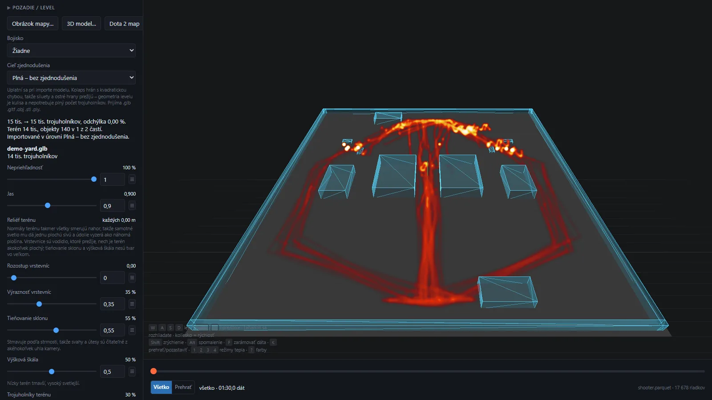

# Teplo

Teplo maľuje miesta, kde sa stalo veľa vecí: červená tam, kde sa stalo trochu, bielo rozžeravená tam, kde sa stalo veľa. Odpovedá na otázku „kde sa to deje a koľko“.

**Teplo** (klávesa 1) je predvolený režim. Každý viditeľný [riadok](glossary.md) prispieva okrúhlym [spritom](glossary.md) otočeným ku kamere; prekrývajúce sa sprity sa sčítajú vo vyrovnávacej pamäti s pohyblivou desatinnou čiarkou; súčet sa prevedie cez škálu farieb - predvolene priehľadná → červená → žltá → biela - a nakreslí sa cez scénu.

Obrázok ukazuje teplo jedného kola streľby na leveli s budovami: horúce miesta sú v miestnostiach a na schodoch, nie len na zemi.

## Ako to použiť {#how-to-use-it}

1. Načítajte dáta a stlačte `1` (alebo vyberte **Teplo** na lište režimov).
2. Ak je všetko biele alebo prázdne, stlačte **Automatická expozícia z poľa** v sekcii **Tvar tepla**.
3. Zmeňte **Polomer spritu**, kým sa susedné bodky nespoja do pásov: menší ukáže jednotlivé škvrny, väčší oblasti.
4. Otvorte **Farby tepla** na zmenu farieb alebo **Hĺbka**, aby kopce a steny skrývali teplo za sebou.

Tie isté panely tvarujú [Rozdiel](difference.md), [Teplo tímov](team-heat.md) a [Teplo čiar](line-heat.md); líšia sa tým, čo sa pridáva (so znamienkom, sfarbene alebo pozdĺž čiar), nie spôsobom, akým sa to robí.

## Panely a ich predvolené hodnoty {#the-panels-and-their-defaults}

Každé ovládanie nižšie zodpovedá parametru shaderu, takže zmena nestojí nič okrem prekreslenia. Posuvníky majú vedľa seba políčko na číslo a úchyt na ťahanie (malý úchyt vpravo: ťahajte hore alebo dole, ďalej je rýchlejšie, Shift na jemné nastavenie); ak stopa posuvníka končí pred skutočnou hranicou, úchyt môže ísť až za ňu do *stropu jogu* uvedeného tu. Hodnoty označené *pri načítaní* sa prepočítajú pri každej novej dátovej sade.

### Tvar tepla (otvorené) {#heat-shape-open}

| Ovládač | Predvolená hodnota | Rozsah (strop jogu) | Podrobnosti |
|---|---|---|---|
| **Polomer spritu** | 6 m; pri načítaní rozsah / 120 | 0,05-2000 m, logaritmicky (50 000) | [Tvar spritu](sprite-shape.md#sprite-radius) |
| **Intenzita v strede** | 1 | 0-10 (1000) | [Tvar spritu](sprite-shape.md#centre-and-edge-intensity) |
| **Intenzita na okraji** | 0 | -2-10 (1000) | [Tvar spritu](sprite-shape.md#centre-and-edge-intensity) |
| **Tvar priebehu** | *Útlm* | *Útlm* / *Krivka* | [Tvar spritu](sprite-shape.md#ramp-shape-falloff-or-curve) |
| **Útlm** (len pri Útlm) | 1,6 | 0,1-8 (64) | [Tvar spritu](sprite-shape.md#falloff) |
| **Hladký priebeh** (len pri Útlm) | zapnuté | | [Tvar spritu](sprite-shape.md#falloff) |
| Editor krivky (len pri Krivka) | predvoľba *Hladká* | | [Tvar spritu](sprite-shape.md#the-curve-editor) |
| **Bod nasýtenia** | 24; pri načítaní odhad, potom meraný | 0,1-4000, logaritmicky (10 000 000) | [Farba a expozícia](colour-and-exposure.md#saturation-point) |
| **Minimálne teplo** | vypnuté (0) | 0-100 % | [Farba a expozícia](colour-and-exposure.md#minimum-heat) |
| **Odozva hustoty** | *Nasycujúca* | *Nasycujúca* / *Lineárna* / *Logaritmická* | [Farba a expozícia](colour-and-exposure.md#density-response) |
| **Automatická expozícia z poľa** | | tlačidlo | [Farba a expozícia](colour-and-exposure.md#auto-exposure) |
| **Sledovať pohľad** | zapnuté | | Expozícia sa znovu meria zakaždým, keď sa kamera zastaví, takže oblasť, do ktorej vletíte, využije celú škálu farieb. Malé zmeny sa ignorujú a stupnica sa plynule posúva. Vypnite to alebo ťahajte **Bod nasýtenia**, aby ste stupnicu zamkli a porovnávali miesta na jednej stupnici. [Farba a expozícia](colour-and-exposure.md#follow-the-view) |
| **Rovnaká hustota pri každom priblížení** | zapnuté | | Farba znamená rovnaký počet riadkov na plochu zeme, bez ohľadu na to, ako blízko ste. Sprite, ktorý pixelové hranice zväčšia (ďaleko) alebo zmenší (zblízka), si zachová teplo, ktoré by pridal vo svojej skutočnej veľkosti, takže obrázok exponovaný z diaľky nezbledne, keď doň vletíte. Vypnuté: ohraničený sprite pridá svoju plnú váhu pri ohraničenej veľkosti. [Tvar spritu](sprite-shape.md#pixel-clamps) |
| **Sploštiť na rovinu terénu** | vypnuté | | [Tvar spritu](sprite-shape.md#flatten-onto-ground-plane) |

### Farby tepla (zavreté) {#heat-colours-closed}

| Ovládač | Predvolená hodnota | Podrobnosti |
|---|---|---|
| Vzorky skupín a **Oddelenie farieb** (len Teplo tímov) | 1,4 | [Teplo tímov](team-heat.md) |
| Editor **Škála tepla** (*Kladná (pripočítavajúce tímy)* pri Rozdiel, *Škála nepriehľadnosti* pri Teplo tímov) | priehľadná → červená → žltá → biela | [Farba a expozícia](colour-and-exposure.md#the-ramp-editor) |
| **Obnoviť na priehľadná → červená → žltá → biela** | | |
| Škála **Záporná (odpočítavajúce tímy)** (len Rozdiel) | priehľadná → zelená → modrá → fialová | [Rozdiel](difference.md#colours) |

### Pixelové hranice spritu (zavreté) {#sprite-pixel-clamps-closed}

| Ovládač | Predvolená hodnota | Rozsah (strop jogu) | Podrobnosti |
|---|---|---|---|
| **Min. polomer v pixeloch** | 1 px | 0-16 (512) | [Tvar spritu](sprite-shape.md#pixel-clamps) |
| **Max. polomer v pixeloch** | 96 px | 2-1024, logaritmicky (8192) | [Tvar spritu](sprite-shape.md#pixel-clamps) |

### Hĺbka (otvorené) {#depth-open}

| Ovládač | Predvolená hodnota | Podrobnosti |
|---|---|---|
| **Skryť za terénom** | zapnuté | [Hĺbka a orezávanie](depth-and-culling.md#hide-behind-terrain) |
| **Skryté za geometriou** | 0,8 (*o 80 % stmavšie*) | [Hĺbka a orezávanie](depth-and-culling.md#hidden-behind-geometry) |

### Orezanie podľa vzdialenosti (zavreté) {#distance-culling-closed}

| Ovládač | Predvolená hodnota | Rozsah (strop jogu) | Podrobnosti |
|---|---|---|---|
| **Blízko** | vypnuté (0) | 0,5-5000 m, logaritmicky, dolný koniec stopy = vypnuté (200 000) | [Hĺbka a orezávanie](depth-and-culling.md#distance-culling) |
| **Ďaleko** | vypnuté (0) | 1-200 000 m, logaritmicky, dolný koniec = vypnuté (10 000 000) | [Hĺbka a orezávanie](depth-and-culling.md#distance-culling) |
| **Rezať rovinou** | zapnuté | | [Hĺbka a orezávanie](depth-and-culling.md#distance-culling) |
| **Rezať aj level** | zapnuté | | [Hĺbka a orezávanie](depth-and-culling.md#distance-culling) |

Klávesy: `[` a `]` posúvajú vzdialenú hranicu dnu a von, `\` ju prepína ([Hĺbka a orezávanie](depth-and-culling.md#keyboard)).

### Smer a Hodnota {#direction-and-value}

Pod sekciou Tvar tepla sú ešte dve sekcie. **Smer** kreslí každý riadok ako kliny a pridáva šípky: pozri [Smerové teplo](directional-heat.md). **Hodnota** váži teplo podľa toho, čo každý riadok stál alebo zarobil: pozri [Váženie hodnôt](value-weighting.md).

## Čo sa ukladá {#what-is-saved}

Nastavenia tepla sa medzi reláciami neukladajú: nové načítanie stránky obnoví predvolené hodnoty. V prehliadači sa uchovávajú dve veci: posledná rýchlosť prehrávania (`heat3d.speed`, pozri [Časová os](timeline.md)) a nastavenia figúrok vzdialených od pohľadu v [prekrytí figúrok](box-replay.md) (štýl symbolov, veľkosť, značky zásahov a podobne). Rovnako jazyk, [obrátené svetové osi](camera.md#invert-world-axis), zapamätané mená áut na karte pretekov a [knižnica levelov](level-library.md). Úplný zoznam je na [Uložené nastavenia](ref-settings-storage.md).
