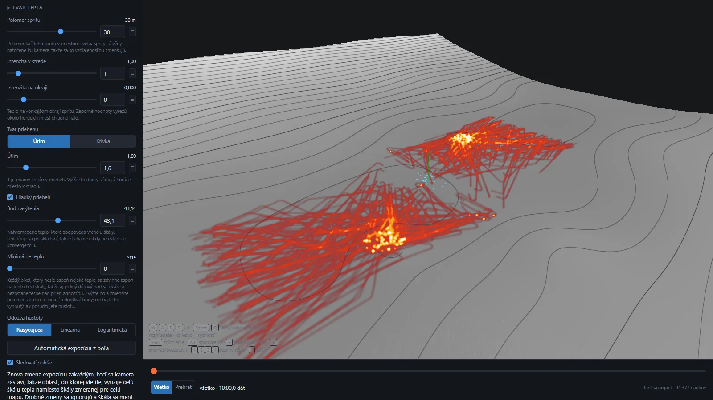
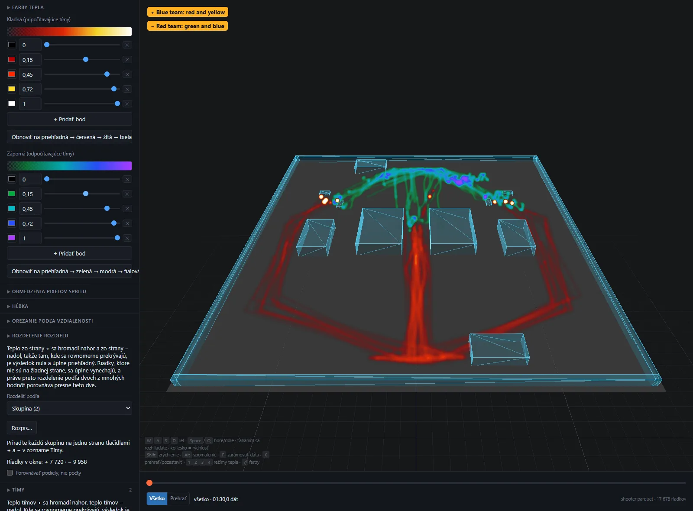
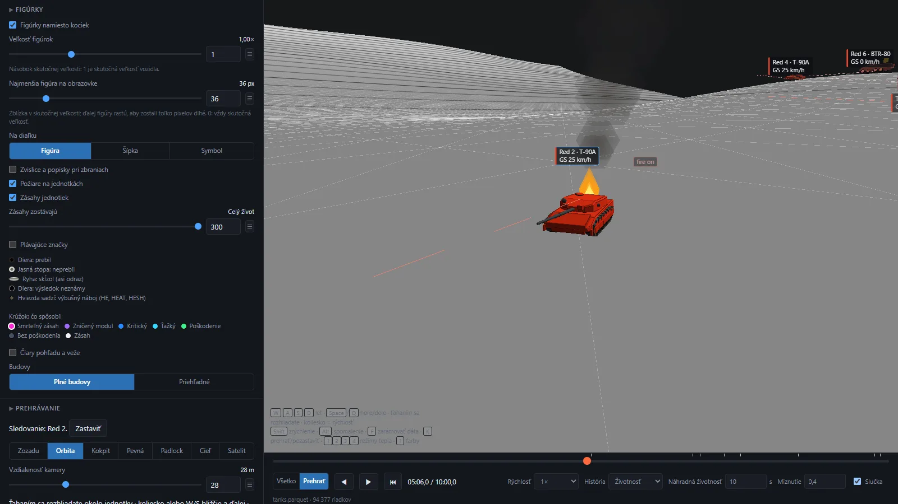
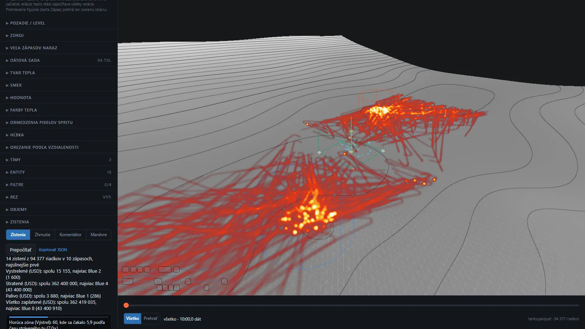
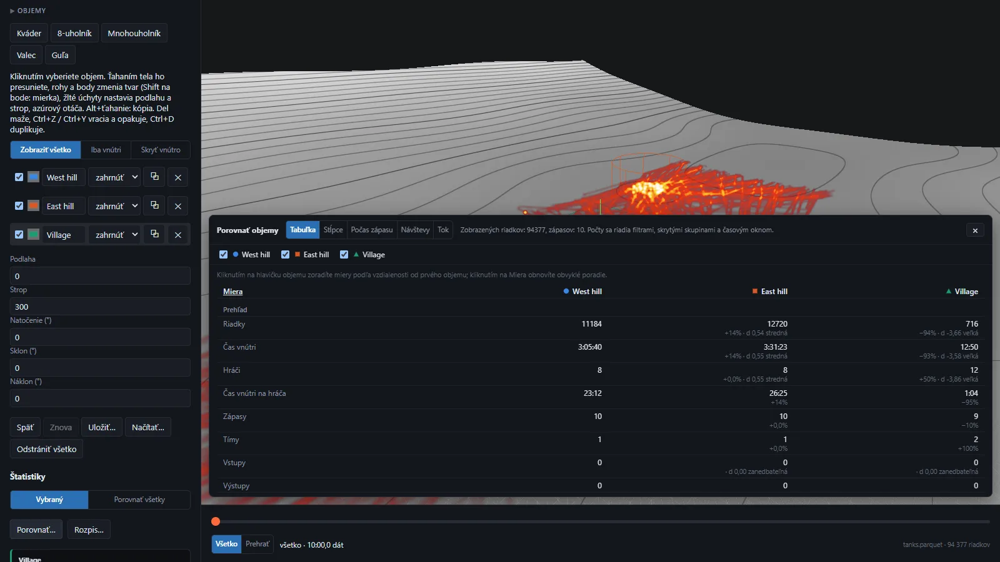
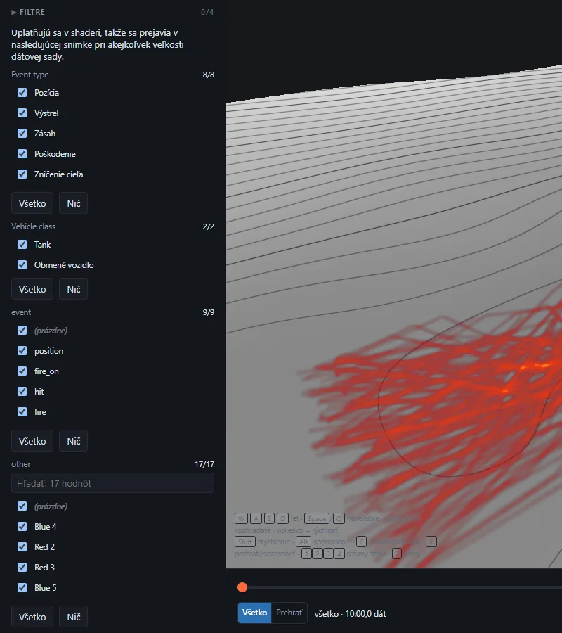
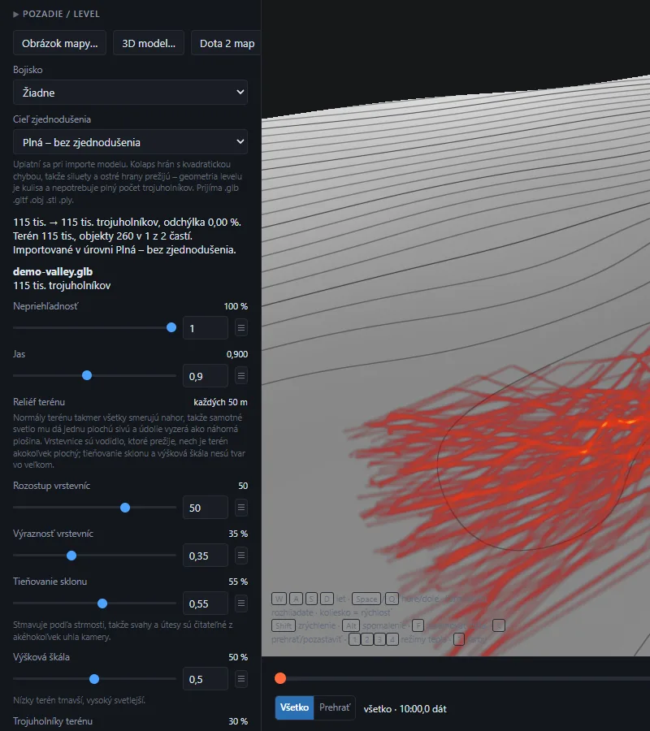

# 3DHeat

3DHeat ukazuje, kde sa v hre niečo stalo - kam hráči chodili, kde bojovali a kde padli - ako žiariace farby, v ktorých môžete letieť, alebo ako malé 3D figúrky, ktoré zápas znovu prehrávajú.

Načítajte pozície - CSV, Parquet, nahrávky Tacview, prekonvertované záznamy, jeden súbor, priečinok alebo tisíce zápasov - a pozerajte ich ako **heatmapu, v ktorej môžete letieť**, ako **figúrky, ktoré prehrávajú zápas**, ako čiary pozdĺž trás, ktorými ľudia išli, alebo ako jednu populáciu proti druhej. Sama nájde, čo vyniká, a beží úplne vo vašom prehliadači: nikam sa nič neposiela.



**Ste tu noví?** Vytvorte [ukážkové dáta](demo-data.md) a prejdite ich siedmimi krokmi. Každý obrázok na tejto stránke bol urobený s nimi.

## Čo to robí {#what-it-does}

| | |
|---|---|
|  | **[Režimy tepla](heat-modes.md)** - teplo, [rozdiel](difference.md) (červená tam, kde bola jedna strana viac, zelenomodrá tam, kde druhá), [teplo tímov](team-heat.md), [teplo čiar](line-heat.md); [smerové teplo](directional-heat.md) s klinmi, poliami šípok a polárnymi grafmi; teplo [vážené hodnotou](value-weighting.md): čo stoja zbrane, vozidlá a palivo. |
|  | **[Prehrávanie zápasu](match-replay.md)** - každá jednotka ako [figúra](figures.md) toho, čím je, symboly NATO alebo ruské z diaľky, rakety a stopy výstrelov, značky zásahov, trosky, požiare, veže, ciele, kamery v štýle Tacview a taktický displej; [veľa zápasov naraz](many-matches.md). |
|  | **[Zistenia](insights.md)** - silné pozície, smrtiace terény, pasce na spawnoch, úzke miesta a vynikajúci hráči, nájdené a zoradené s dôkazmi; písomné zhrnutie, voliteľne od AI podľa vašej voľby; komentátor pre jeden zápas; [šošovka znalostí](knowledge.md). |
|  | **[Objemy](volumes.md)** - kreslite kvádre, hranoly, valce a gule, filtrujte podľa nich, počítajte, čo sa v nich deje, exportujte to a porovnávajte miesta vedľa seba; [rozpis](breakdown.md), kto a čo si v mieste vedie najlepšie. |
|  | **[Filtre](filters.md)** - podľa typu udalosti, hráča alebo AI, triedy vozidla, hodnoty, ľubovoľného stĺpca, na grafickej karte pri akejkoľvek veľkosti dát. |
|  | **[Levely](levels.md)** - obrázky máp, 3D levely vytvorené [nástrojmi na dáta](#related-repositories), zjednodušenie, [pozadie sveta](world-backdrop.md) so skutočným terénom pre letové dáta. |

Ďalej: karta [Analýza pretekov](race-analysis.md) pre kolá závodných hier, karta [Zápas](match-analysis.md) so súhrnmi Counter-Strike 2, [Taktická tabuľa](tactics-board.md) s plánmi na leveli, [analýza zásahov](hit-analysis.md) podľa vozidla, [hromadná analýza](mass-analysis.md) tisícov zápasov, [dráhy kamery a video](camera-path-and-video.md), [40 jazykov](languages.md), [metrické alebo imperiálne jednotky](settings.md).

## Karty {#the-tabs}

Karty sú hore na bočnom paneli, pod menom, jednotkami a ponukou jazyka.

| Karta | Na čo slúži |
|---|---|
| **Heatmapa** | Ľubovoľná tabuľka pozícií: režimy tepla, prekrytie figúrok, filtre, objemy, zistenia, levely, meranie a video. |
| **Analýza pretekov** | Dve alebo viac kôl jednej trate: kde sa stráca čas, prečo a čo zmeniť. |
| **Zápas** | Prehrávanie figúrok zápasu a súhrny zápasov Counter-Strike 2. |
| **Taktika** | Plány na leveli: figúrky, trasy, hodené pomôcky, oblasti a poznámky v krokoch, ktoré sa dajú prehrať. |
| **Vozidlá** | Kde bola každá jednotka zasiahnutá, kým a čím. |

## Inštalácia a spustenie {#install-and-run}

### Windows, jednoducho {#windows-the-easy-way}

Koreňový priečinok repozitára obsahuje tri dávkové súbory.

| Súbor | Čo robí |
|---|---|
| `start.bat` | Spustí prehliadač. Nájde Node.js aj vtedy, keď nie je v `PATH` (hľadá v `%ProgramFiles%\nodejs`, `%ProgramFiles(x86)%\nodejs` a `%LOCALAPPDATA%\Programs\nodejs`). Ak Node.js chýba, ponúkne inštaláciu verzie LTS príkazom `winget install -e --id OpenJS.NodeJS.LTS`. Pri prvom spustení sa pred stiahnutím závislostí (asi 300 MB do `node_modules\` v tomto priečinku, nič systémovo) opýta. Odmietne spustenie, ak niečo už počúva na porte 5273, a odkáže na `restart.bat`. Ak je priečinok git kópia bez lokálnych zmien a existuje novšia verzia, opýta sa, či chcete aktualizovať (Y/N; bez odpovede do 60 s zostane táto verzia; pozri [Aktualizácie](updates.md)). Potom spustí vývojový server na `http://127.0.0.1:5273/` a otvorí prehliadač. **Okno je server**: nechajte ho otvorené; zavretím alebo stlačením Ctrl+C sa zastaví. |
| `restart.bat` | Spustí `stop.bat quiet` a potom `start.bat`. Treba ho len po zmene `vite.config.ts`, pridaní závislosti alebo keď server zamrzne - zmeny zdrojového kódu sa načítajú za chodu. |
| `stop.bat` | Zastaví to, čo počúva na porte 5273, podľa ID procesu zisteného cez `netstat`, nikdy podľa názvu obrazu, takže ostatné procesy Node.js v počítači zostanú bežať. Asi dve sekundy počká, kým sa socket uvoľní. S argumentom `quiet` na konci nepozastaví. |

### Ručne (ľubovoľný OS) {#by-hand-any-os}


```bash
git clone --recursive https://github.com/Holdi601/3DHeat.git
cd 3DHeat
npm install
npm run dev      # http://127.0.0.1:5273
```

Priečinok `exporters/` obsahuje samostatné nástroje na dáta ako git submoduly, každý je vlastný repozitár; po obyčajnom klone spustite `git submodule update --init`. Samotný prehliadač ich na beh nepotrebuje. `exporters/ext/` obsahuje voliteľné konvertory (War Thunder, World of Tanks, World of Warships, prehrávky Squad; mapy DCS a IL-2), oddelené, aby problém s jedným z nich nezasiahol nič iné.

Žiadne herné dáta sa s tým nedodávajú: levely, mapy a nahrávky vytvárate na svojom počítači pomocou nástrojov, z hier, ktoré vlastníte.

### Skripty npm {#npm-scripts}

| Skript | Čo spúšťa |
|---|---|
| `npm run dev` | Vývojový server Vite na porte 5273, viazaný na `127.0.0.1`. |
| `npm run build` | Kontrola typov (`tsc --noEmit`) a produkčný balík do `dist/`. |
| `npm run preview` | Slúži produkčný balík. |
| `npm run typecheck` | Samotná kontrola typov. |
| `npm test` / `npm run test:watch` | Jednotkové a integračné testy (vitest). |
| `npm run smoke` | Ovláda skutočnú aplikáciu v headless Chromium a kontroluje, že plátno má pixely s farbami dát; snímky idú do `tools/.smoke/`. Očakáva bežiaci vývojový server. |
| `npm run smoke:f16` | Rovnaká sada s `?heat=f16`, ktorá vynúti cestu akumulácie half-float (pozri [Akumulácia half-float](half-float-accumulation.md)). |
| `npm run bench` | Test rýchlosti načítania, zapíše `tools/.smoke/ingest-bench.json`. |
| `npm run test:heavy` | Testy, ktoré potrebujú veľké reálne dátové súbory; ak súbory chýbajú, samy sa preskočia. |
| `npm run inspect -- <file.parquet>` | Vypíše schému súboru Parquet a niekoľko riadkov (`tools/inspect-parquet.mjs`). |

### Čo pridáva vývojový server {#what-the-dev-server-adds}

Prehliadač je statická webová stránka, ale vývojový server (pozri `vite.config.ts`) pridáva dve lokálne cesty, ktoré statické nasadenie `dist/` nemá:

- `/__host/memory` hlási nainštalovanú a voľnú RAM počítača a, ak ju vie prečítať, pamäť grafickej karty (z `nvidia-smi`, alebo na Windows z registra zobrazovacieho adaptéra). Vďaka tomu môžu [rozpočty pamäte](memory-and-budgets.md) používať skutočné čísla namiesto obmedzených odhadov prehliadača.
- `/__heat3d/update` skontroluje, či je kópia za najnovšou verziou, a môže ju rýchlo posunúť vpred ([Aktualizácie](updates.md)).

Server sa viaže iba na `127.0.0.1`, takže k žiadnej z týchto ciest sa nedá dostať zo siete. Otvorte ho ako `http://127.0.0.1:5273`: `localhost` sa môže preložiť na IPv6 slučku `::1`, kde nič nepočúva. Neposiela hlavičky cross-origin izolácie (COOP/COEP): prehliadač nepoužíva `SharedArrayBuffer` a workery odovzdávajú dáta prenosom, ktorý ich nepotrebuje.

## Požiadavky na prehliadač a GPU {#browser-and-gpu-requirements}

- **Prehliadač s WebGPU alebo WebGL2.** WebGPU sa skúša ako prvé (Chrome a Edge ho majú); bez neho sa použije backend WebGL2. WebGL2 musí ponúkať `EXT_color_buffer_float` (kreslenie do float textúr), inak prehliadač zobrazí „Cannot initialise the renderer.“ Pozri [Dva backendy](backends.md). Prehliadač sa vyvíja a testuje v Chromiu; iné prehliadače nie sú overené.
- **Zapnutá hardvérová akcelerácia.** Ak prehliadač kreslí na procesore (SwiftShader, llvmpipe, Microsoft Basic Render Driver a podobne), červený pruh hore na bočnom paneli to oznámi a povie, ako to opraviť. Pozri [Detekcia softvérového renderovania](software-rendering.md).
- **Diskrétna GPU pomáha, ale nie je potrebná.** Oba backendy žiadajú adaptér s vysokým výkonom. Množstvo dát, ktoré sa dá držať v GPU, je rozpočet, ktorý vidíte a viete ho zmeniť ([Pamäť a rozpočty](memory-and-budgets.md)).
- **Voliteľné funkcie** používajú ďalšie API prehliadača: vykresľovanie videa potrebuje WebCodecs `VideoEncoder` s VP9 alebo VP8 ([Dráha kamery a video](camera-path-and-video.md)); zjednodušovanie sietí levelov potrebuje WebAssembly; pretiahnutie priečinkov používa File and Directory Entries API; knižnica levelov používa IndexedDB; gamepady používajú Gamepad API.

## Mapa dokumentácie {#documentation-map}

**Začiatok**: [Ukážkové dáta](demo-data.md) · [Ako dostať dáta dnu](getting-data-in.md) ([načítanie súborov](loading-files.md), [mapovanie stĺpcov](column-mapping.md), [osi, jednotky a čas](axes-units-and-time.md), [relácie, osoby a skupiny](sessions-persons-groups.md), [Tacview](tacview-acmi.md), [konvertory](converters.md), [.3dheat](container.md), [pamäť a rozpočty](memory-and-budgets.md))

**Pozrieť**: [Režimy tepla](heat-modes.md) ([teplo](heat.md), [tvar spritu](sprite-shape.md), [farba a expozícia](colour-and-exposure.md), [hĺbka a orezávanie](depth-and-culling.md), [rozdiel](difference.md), [teplo tímov](team-heat.md), [teplo čiar](line-heat.md), [prehrávanie v kocke](box-replay.md), [smerové teplo](directional-heat.md), [váženie hodnôt](value-weighting.md)) · [Časová os](timeline.md) · [Levely](levels.md) ([obrázky máp](map-images.md), [3D levely](model-levels.md), [vzhľad](level-appearance.md), [knižnica](level-library.md), [pozadie sveta](world-backdrop.md), [jeho zdroje](world-backdrop-sources.md)) · [Kamera](camera.md) ([gamepad](gamepad.md), [klávesy](keyboard-reference.md)) · [Dráha kamery a video](camera-path-and-video.md)

**Analyzovať**: [Filtre a nástroje](filters-and-tools.md) ([filtre](filters.md), [tímy](teams-list.md), [entity](entities.md), [rez](slice.md), [meranie](measure.md), [objemy](volumes.md), [rozpis](breakdown.md)) · [Zistenia](insights.md) ([šošovka znalostí](knowledge.md)) · [Hromadná analýza](mass-analysis.md)

**Prehrávanie**: [Prehrávanie zápasu](match-replay.md) · [Veľa zápasov naraz](many-matches.md) · [Figúrky](figures.md) ([v prekrytí figúrok](figure-replay.md), [autorstvo](figure-credits.md)) · [Parita s Tacview](tacview-parity.md) · [Analýza zásahov](hit-analysis.md)

**Ďalšie karty**: [Analýza pretekov](race-analysis.md) ([metóda](race-analytics.md), [ďalšie hry](other-games.md)) · [Analýza zápasu](match-analysis.md) · [Taktická tabuľa](tactics-board.md) ([rýchlosti](tactics-speeds.md))

**Prehliadač**: [Slovník pojmov](glossary.md) · [Nastavenia, jednotky a klávesy](settings.md) · [Jazyky](languages.md) · [Aktualizácie](updates.md) · [Vnútorné časti renderovania](rendering-internals.md) ([backendy](backends.md), [akumulácia](accumulation.md), [vzorkovanie a rozpočty](sampling-and-budgets.md), [half-float](half-float-accumulation.md), [pamäť GPU](gpu-memory.md), [softvérové renderovanie](software-rendering.md), [výkon a štatistiky](performance-and-stats.md)) · [Dátové formáty](data-formats.md) · [Referencia](reference.md) · [Údržba dokumentácie](maintaining.md)

## Súvisiace repozitáre {#related-repositories}

Prehliadač číta dáta; tieto nástroje ich vytvárajú. Každý je vlastný verejný repozitár (MIT) s vlastnou dokumentáciou. Žiadny z nich nedodáva herné dáta: levely, mapy a nahrávky vytvárate na svojom počítači, z hier, ktoré vlastníte.

| Repozitár | Čo robí | Na čo je dobrý |
|---|---|---|
| [3DHeat-GameFiles](https://github.com/Holdi601/3DHeat-GameFiles) | Číta trate a levely z archívov, ktoré hry dodávajú (Forza Horizon, BeamNG, Assetto Corsa Rally; čítače Unreal, Unity, Frostbite a Source 2), ako glTF | 3D level pod vaším teplom alebo prehrávaním |
| [3DHeat-GameCapture](https://github.com/Holdi601/3DHeat-GameCapture) | Zaznamenáva telemetriu kôl z rozhraní, ktoré závodné hry zverejňujú, a z herného videa rekonštruuje levely | kolá pre Analýzu pretekov; level tam, kde sa súbory nedajú prečítať |
| [3DHeat-UnrealExporter](https://github.com/Holdi601/3DHeat-UnrealExporter) | Plugin pre Unreal Editor, ktorý exportuje level ako jeden súbor glTF | levely vašich vlastných projektov Unreal |
| [3DHeat-CS2](https://github.com/Holdi601/3DHeat-CS2) | Dema Counter-Strike 2 na tabuľky tepla a súhrny zápasov, mapy CS2 na geometriu | teplo CS2, prehrávania a karta Zápas |
| [3DHeat-Watcher](https://github.com/Holdi601/3DHeat-Watcher) | Na pozadí zaznamenáva vašu hru z toho, čo hry zverejňujú: telemetriu, herné integrácie, logy, prehrávky | vaše vlastné štatistiky bez ručnej práce |
| [3DHeat-Ext-WarThunder](https://github.com/Holdi601/3DHeat-Ext-WarThunder) | Prehrávky War Thunder (`.wrpl`) na tabuľky: letecké a pozemné trasy, výstrely, zásahy, zostrely, veže, ciele | prehrávky War Thunder, značky zásahov a zistenia |
| [3DHeat-Ext-WoT](https://github.com/Holdi601/3DHeat-Ext-WoT) | Prehrávky World of Tanks na tabuľky: pozícia každého vozidla, smrti a zostrely | teplo a prehrávky World of Tanks |
| [3DHeat-Ext-WoWs](https://github.com/Holdi601/3DHeat-Ext-WoWs) | Prehrávky World of Warships na tabuľky: pozícia a potopenie každej lode | teplo a prehrávky World of Warships |
| [3DHeat-Ext-Squad](https://github.com/Holdi601/3DHeat-Ext-Squad) | Dema serverov Squad na tabuľky: pozícia, tím a squad každého hráča | teplo a prehrávky Squad |
| [3DHeat-Ext-DCS](https://github.com/Holdi601/3DHeat-Ext-DCS) | Terény DCS World z vašej vlastnej inštalácie na levely: zem, cesty, mestá, letiská, polia, voda | DCS a nahrávky Tacview na ich skutočnom teréne |
| [3DHeat-Ext-IL2](https://github.com/Holdi601/3DHeat-Ext-IL2) | Mapy IL-2 Great Battles na levely | nahrávky IL-2 na ich mape |

## Stručne o rozložení zdrojového kódu {#source-layout-briefly}

| Priečinok | Obsah |
|---|---|
| [`src/data/`](https://github.com/Holdi601/3DHeat/tree/main/src/data) | Výber súborov, načítanie CSV a Parquet, automatické mapovanie, validácia, model pamäte, zostavovač dátových sád, spracovanie modelov, klasifikácia, zjednodušovanie, knižnica levelov |
| [`src/render/`](https://github.com/Holdi601/3DHeat/tree/main/src/render) | Slučka snímok (`engine.ts`), vzorkovanie, oba backendy, kamera, gamepad, meranie, dráha kamery, nahrávanie videa |
| [`src/state/`](https://github.com/Holdi601/3DHeat/tree/main/src/state) | Stav aplikácie (`store.ts`) so všetkými predvolenými hodnotami, doménové typy (`types.ts`), krivka spritov |
| [`src/ui/`](https://github.com/Holdi601/3DHeat/tree/main/src/ui) | Panely bočného panela, časová os, prekrytia |
| [`src/race/`](https://github.com/Holdi601/3DHeat/tree/main/src/race), [`src/match/`](https://github.com/Holdi601/3DHeat/tree/main/src/match) | Karty Analýza pretekov a Zápas |
| [`src/i18n/`](https://github.com/Holdi601/3DHeat/tree/main/src/i18n) | Preklady |
| [`src/insights/`](https://github.com/Holdi601/3DHeat/tree/main/src/insights) | Zistenia: detektory, zhrnutie, komentátor, poskytovatelia AI, šošovka znalostí |
| [`src/mass/`](https://github.com/Holdi601/3DHeat/tree/main/src/mass) | Hromadná analýza mnohých zápasov |
| [`src/volumes/`](https://github.com/Holdi601/3DHeat/tree/main/src/volumes) | Objemy, ich štatistiky, export a porovnanie |
| [`src/breakdown/`](https://github.com/Holdi601/3DHeat/tree/main/src/breakdown) | Rozpis a faktory |
| [`src/overlay/`](https://github.com/Holdi601/3DHeat/tree/main/src/overlay) | Prekrytie mnohých zápasov |
| [`src/figures/`](https://github.com/Holdi601/3DHeat/tree/main/src/figures) | Katalóg figúrok a jeho zostavovač |
| [`src/vehicle/`](https://github.com/Holdi601/3DHeat/tree/main/src/vehicle) | Analýza zásahov (karta Vozidlá) |
| [`src/tactics/`](https://github.com/Holdi601/3DHeat/tree/main/src/tactics) | Taktická tabuľa |
| [`src/world/`](https://github.com/Holdi601/3DHeat/tree/main/src/world) | Pozadie sveta |
| [`src/units/`](https://github.com/Holdi601/3DHeat/tree/main/src/units) | Merné jednotky |
