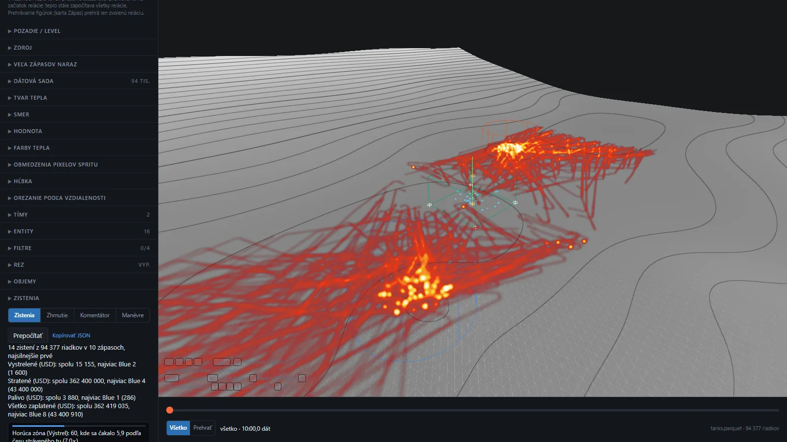
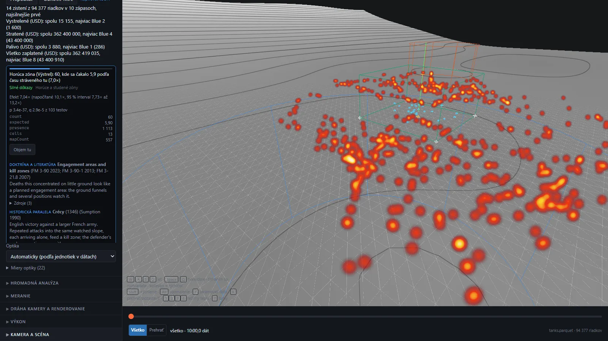
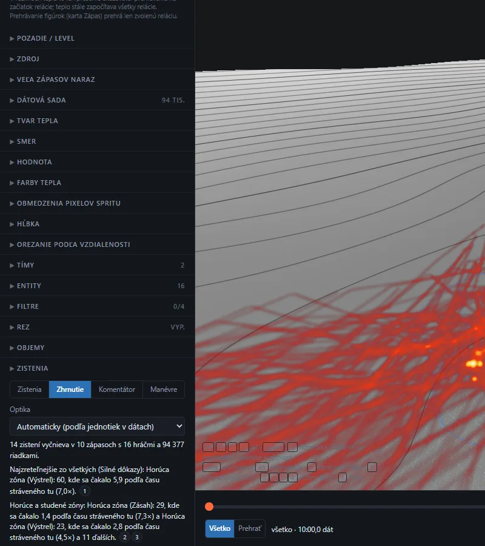
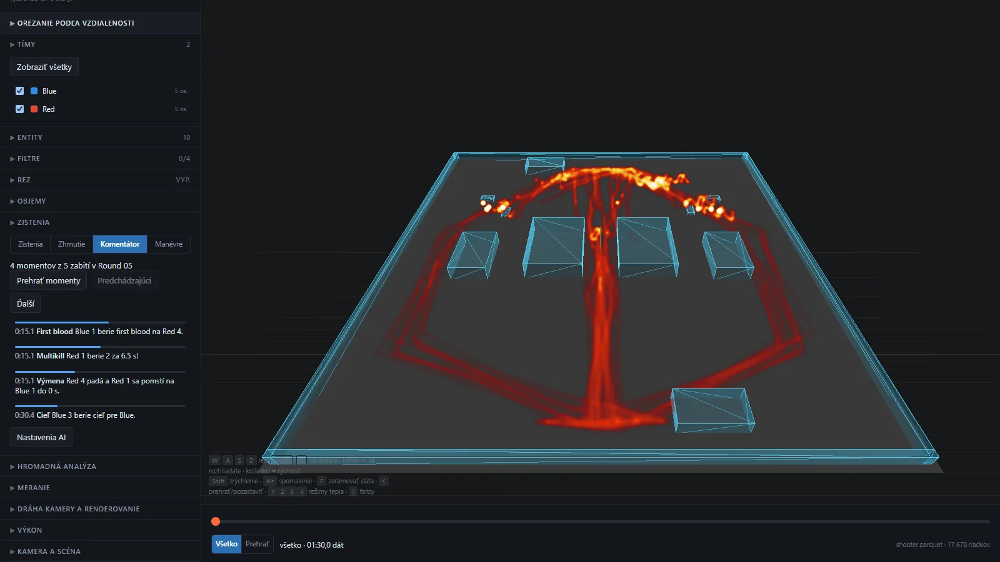

# Zistenia

**Zistenia** prejdú načítané dáta a hľadajú, čo vyniká - silné pozície, smrtiace terény, pasce na spawnoch, úzke miesta, hráči ďaleko nad svojimi rovesníkmi - a povedia vám to, najsilnejšie prvé, s dôkazmi. Použite ich, ak sa za minútu chcete dozvedieť, kde sa zápas vyhral alebo prehral. Potom môžu napísať zhrnutie a v jednom prehraní fungovať ako komentátor, ktorý skáče ku veľkým momentom.

Všetko sa počíta vo vašom prehliadači. Nič neodchádza z vášho počítača, pokiaľ nezapnete externú AI (pozri [Externú AI](#external-ai)).

Sekcia **Zistenia** je na bočnom paneli kariet Heatmapa a Zápas. Má tri záložky: **Zistenia**, **Zhrnutie** a **Komentátor**.

## Zistenia {#findings}

1. Načítajte dáta a otvorte **Zistenia**. Stlačte **Nájsť zistenia** (ukazuje sa „Počítam… n%“ ako priebeh).
2. Čítajte zoznam. Každé zistenie má pruh sily, jednu vetu, kvalitu dôkazov (*Silné dôkazy*, *Dobré dôkazy* alebo *Nejaké dôkazy*), detektor, ktorý ho našiel, a triedu vozidla, kde na tom záleží.
3. **Kliknite na zistenie**: prehliadač použije jeho filtre, presunie kameru na miesto a skočí na čas, a otvorí podrobnosti: efekt s 95 % intervalom, hodnoty p a q, spočítané dôkazy a **Objem tu**, ktorý nakreslí [objem](volumes.md) okolo miesta.
4. **Obnoviť filtre** vráti vaše filtre. **Kopírovať JSON** skopíruje celú správu.

Počítanie používa aktuálne filtre, skryté skupiny a vybraný zápas v celom časovom rozsahu. Keď potom filtre zmeníte, poznámka to povie; stlačte **Spočítať znova**.

Riadky na vrchu zoznamu (napríklad súčty peňazí) zhrnú celé dáta pred zisteniami.

### Detektory {#the-detectors}

| Detektor | Čo nájde | Potrebuje v dátach |
|---|---|---|
| **Silné pozície** | Miesta s oveľa lepšími pomermi zabití ku smrti než zvyšok mapy a *bezpečný terén*, kde na čas strávený tam zomiera málo ľudí | udalosti zabití a smrti |
| **Horúce a studené zóny** | Miesta, kde sa druh udalosti (výstrely, zásahy, dobývanie ...) deje oveľa častejšie alebo zriedkavejšie, než predpovedá čas strávený tam | stĺpec udalostí |
| **Otvorený terén a krytie** | Smrti na otvorenom proti blízkej geometrii levelu a pomaly oproti rýchlemu pohybu | smrti; 3D level pre časť geometrie |
| **Spawny** | Silné spawny, pasce na spawnoch, bezpečné spawny, čas do prvého kontaktu | čas a osoby |
| **Trieda podľa miesta** | Trieda vozidla alebo hráči proti AI, ktorí si v oblasti vedú oveľa lepšie alebo horšie | zabitia plus stĺpec triedy vozidla alebo hráč/AI |
| **Hráči** | Hráči, ktorí zabíjajú alebo umierajú oveľa viac alebo menej než ostatní v tej istej triede | osoby a zabitia |
| **Úzke miesta a boky** | Úzke miesta (oveľa viac prechodov než okolitý terén) a bočné trasy (málo použité, no vedú k zabitiam) | osoby |
| **Hodnota** | *Drahý terén* a *Zárobkový terén* | [stĺpce hodnôt](value-weighting.md) |
| **Čo rozhodlo kolá** | Čo odlišovalo vyhraté kolá od prehraných a hráči, ktorí pridali alebo stratili najviac pravdepodobnosti výhry (pozri [Kto vyhral](#who-won-what-decided-the-rounds)) | kolá, zabitia a smrti a [stĺpce výsledku](data-formats.md#outcome-columns) (`won`) |

Detektory, ktoré na dátach nemôžu bežať, sú dole v zozname s dôvodom.

### Ako sa zistenia radia {#how-findings-are-ranked}

Každé miesto alebo skupina sa testuje voči zvyšku mapy (presné binomické alebo mierové testy). Miera falošných objavov je držaná na 5 % (Benjamini-Hochberg). Náhoda môže vyzerať ako vzor; toto drží falošné poplachy nízko: medzi zobrazenými zisteniami sa očakáva najviac asi jedno z dvadsiatich ako náhoda. Efekty z málo udalostí sa pred radením stiahnu k „žiadnemu efektu“. Zobrazí sa najviac 60 zistení a každý detektor dostane niekoľko miest pri vrchu.

### Kto vyhral: čo rozhodlo kolá {#who-won-what-decided-the-rounds}

Kde dáta hovoria, kto vyhral každé kolo ([stĺpec výsledku](data-formats.md#outcome-columns) `won`: CS2, Rainbow Six Siege, War Thunder ...), Zistenia sa točia okolo výsledku. Pre každú stranu rozdelia kolá podľa toho, čo sa v nich stalo, a porovnajú podiely výhier:

| Faktor | Kolá strany s ním | ... a bez neho |
|---|---|---|
| Úvodný súboj | strana získala prvé zabitie | strana zomrela prvá |
| Nákup | jej nákup bol lepší než nákup druhej strany | horší |
| Vymenená prvá smrť | jej prvá smrť bola vymenená do 5 s | nevymenená |
| Položenie | strana položila bombu | bez položenia |
| Vybavenie | viac granátov než v jej bežnom kole | menej |
| Skorý kontakt | prvý súboj prišiel pred mediánom času zápasu | neskôr |
| Držané miesto | hráč stál na mieste 5 s alebo dlhšie | nikto |
| Skoro dosiahnuté miesto | hráč sa tam dostal v prvých 25 s (trasa) | nikto |

Každé porovnanie je rozdiel dvoch podielov výhier s jeho 95 % intervalom (Newcombe), Fisherovým presným p a q cez všetky vyskúšané faktory (Benjamini-Hochberg). Vetva s menej ako 8 kolami je označená *málo kôl*. Tie pod 5 % mierou falošných objavov sa stanú zisteniami; najsilnejšie sa radia nad zistenia ostatných detektorov (zistenie o výsledku váži 1,35-krát viac než zistenie s rovnakým účinkom a dôkazmi).

Vymyslený príklad zo 40 kôl:

> **T** vyhrala 79 % z 19 kôl, v ktorých držala **Mid**, oproti 24 % z 21 bez neho (55 bodov, 95 % od 26 do 74) - q 0,004.

Sleduje aj **pravdepodobnosť výhry** kola - šancu, ktorú mala každá strana v každom okamihu, podľa živých mužov, položenia a času: prispôsobenú kolám, keď ich je 30 alebo viac, inak z pevného apriórneho modelu (a text povie, z ktorého). Z nej vychádzajú **zlomové okamihy** (zabitia a položenia, ktoré šancu posunuli najviac) a **pridaná pravdepodobnosť výhry** každého hráča: zabitia a položenia, ktoré urobil, sa mu počítajú k dobru, jeho smrti proti nemu, v hodnote kôl za zápas, v priemere na kolo s intervalom, testované voči nule. Miesta dostanú rovnakú bilanciu: ktorá strana získala najviac v súbojoch, ktoré sa tam odohrali.

Dáta potrebujú kolá, zabitia a smrti s oboma stranami a stĺpec `won`; pomenované miesta (`place`) pre držané miesta, stĺpec `buy` pre nákup.

## Zhrnutie {#debrief}

Záložka **Zhrnutie** zapíše zistenia do krátkeho textu: úvod, najjasnejšie zistenie, jedno o taktike, jedno o vyvažovaní, potom - kde dáta hovoria, kto vyhral - čo rozhodlo kolá, zvyšok zoskupený podľa detektora a koľko stojí na slabších dôkazoch.

Čo rozhodlo kolá, prináša štyri odseky: skóre a odkiaľ pochádzajú pravdepodobnosti výhry; najsilnejšie faktory s ich číslami, intervalom a q (keď žiadny neprejde mierou falošných objavov, text povie *zatiaľ nič nie je isté* a aj tak vymenuje najsilnejšie); tri najväčšie zlomové okamihy; a hráči, ktorí pridali a stratili najviac pravdepodobnosti výhry, s miestami, ktoré získali najviac. Vymyslený príklad:

> T vyhrala 23 a CT vyhrala 17 zo 40 kôl so známym výsledkom (T: 58 %, 95 % od 42 % do 72 %). Pravdepodobnosti výhry pochádzajú z modelu prispôsobeného týmto kolám.
>
> Čo odlišovalo vyhraté kolá od prehraných: T vyhrala 79 % z 19 kôl, v ktorých držala Mid, oproti 24 % z 21 bez neho (55 bodov, 95 % od 26 do 74) (q 0,004), ...
>
> Zlomové okamihy: kolo 17 v 48 s, zabitie strany CT na mieste B zmenilo jej šancu z 31 % na 58 % a kolo vyhrala, ... Každý odsek má očíslované tlačidlá, ktoré ukazujú jeho zistenia. **Kopírovať text** ho skopíruje.

Vstavaný rozprávač funguje offline, vo vašom jazyku. Výber **Optika** nad ním (pozri [Šošovku znalostí](knowledge.md)) určuje, akú literatúru odseky citujú.

### Externá AI {#external-ai}

**Nastavenia AI** umožňuje, aby zhrnutie napísal model AI podľa vašej voľby:

| Nastavenie | Význam |
|---|---|
| **Poskytovateľ** | Anthropic (Claude), OpenAI (ChatGPT), OpenRouter, Ollama (lokálne), LM Studio (lokálne), server llama.cpp (lokálne) alebo ľubovoľný koncový bod kompatibilný s OpenAI |
| **Základná URL**, **Model** | Vyplní poskytovateľ; **Vypísať modely** sa opýta servera |
| **Kľúč API** | Posiela sa iba na základnú URL. Nikdy sa nezapisuje do logov ani sa neukladá v pohľadoch, exportoch či súboroch `.3dheat`. Väčšina lokálnych serverov nepotrebuje žiadny. |
| **Zapamätať kľúč v tomto prehliadači** | Predvolene vypnuté: kľúč sa zabudne pri zatvorení stránky |
| **Použiť externú AI** | Predvolene vypnuté |
| **Posielať mená hráčov** | Predvolene vypnuté: hráči sa posielajú ako P1, P2 ... |

Potom napíšte voliteľnú otázku a stlačte **Napísať pomocou AI**. Posielajú sa len zistenia a ich čísla - nikdy riadky vašich dát. Odpoveď sa postupne načíta; citované zistenia sa stanú tlačidlami. Kde dáta hovoria, kto vyhral, model dostane pokyn začať tým, čo rozhodlo kolá, s intervalom a q každého čísla, a povedať, keď faktor stojí na málo kolách alebo keď pravdepodobnosti výhry pochádzajú z apriórneho modelu.

## Komentátor {#caster}

Pre **jeden zápas** (ak je načítaných viac, vyberte jeden) **Komentátor** nájde momenty hodné pozornosti: prvú krv, viacnásobné zabitia, výmeny, záchrany v koncovke, zmeny pri cieľoch, návraty, vynikajúcich hráčov, dlhé výstrely a **zlomové okamihy** - zabitia, ktoré najviac posunuli šancu strany vyhrať kolo (podľa hráčov, ktorí na každej strane zostali nažive, v kolách bez znovuzrodenia).

Kde dáta hovoria, kto vyhral každé kolo, povie to každý moment: *„Anna zhodí Bena: šanca strany T vyhrať kolo sa mení z 38 % na 62 % - a kolo vyhrajú.“* Moment strany, ktorá potom vyhrala, má väčšiu váhu, keď komentátor vyberá, ktoré momenty ponechá, a návrat sa počíta vo vyhratých kolách.

- Kliknite na moment: pohľad prejde na prehrávanie, skočí tesne pred neho, prelietne tam a sleduje hráča.
- **Prehrať momenty** prehrá každý až do konca a ide ďalej; **Predchádzajúci** / **Ďalší** sa pohybujú medzi nimi.
- S externou AI zapnutou **Komentár od AI** napíše komentár zo zoznamu momentov (druhy, časy, mená alebo pseudonymy, tímy, triedy, vzdialenosti).

Potrebuje osoby a udalosti zabití/smrti (alebo dobývania); stĺpec `other`/`victim` umožňuje výmeny a dlhé výstrely.

## Šošovka znalostí {#knowledge-lens}

Zistenie sa dá čítať cez **optiku** zavedených poznatkov: vojenská doktrína, vzdušný a námorný boj, operácie v mestách, herný dizajn a esport (alebo *Automaticky*, podľa jednotiek v dátach). Otvorené zistenie potom ukáže najbližšiu položku **doktríny a literatúry** a **historickú paralelu**, s odkazmi, a **Miery optiky** počíta miery z tejto literatúry na dátach (prispôsobenia Lanchester, pomery výmen, pomery síl, polia paľby, kľúčový terén, výmeny, iniciatíva). Zhrnutie a výzva pre AI ich obsahujú. Všetko o tom: [Šošovka znalostí](knowledge.md).

Miery optiky merajú aj to, ako sa hráči správajú ako dav a ako skupina - zarovnanie a krúženie, navádzanie trás, pruhy a stopy, nahustenie, vodcovia a nasledovníci, zaostávajúci, zlomový bod pri stratách, riziko po stratenom živote, série, zhoda pri nákupe a reakcia na prichádzajúcu paľbu - každé voči vlastnému nulovému modelu: [Kolektívne správanie](collective-behaviour.md).

## Dáta, vďaka ktorým zistenia fungujú {#data-that-makes-insights-work}

- pozície s **časom**, **osobou** a stĺpcom **tímu**;
- stĺpec **udalostí** so zabitiami a smrťami (`kill`, `death`) a inými (`hit`, `fire`, `capture` ...);
- stĺpec **druhej strany** (`other`, `victim`) pre výmeny a smery;
- stĺpec **vozidla** alebo **typu** pre triedy; stĺpec `ai` pre hráčov proti AI;
- stĺpec **relácie** / **zápasu** / **kola**, keď je zápasov viac.

[Ukážkové dáta](demo-data.md) majú všetky.
