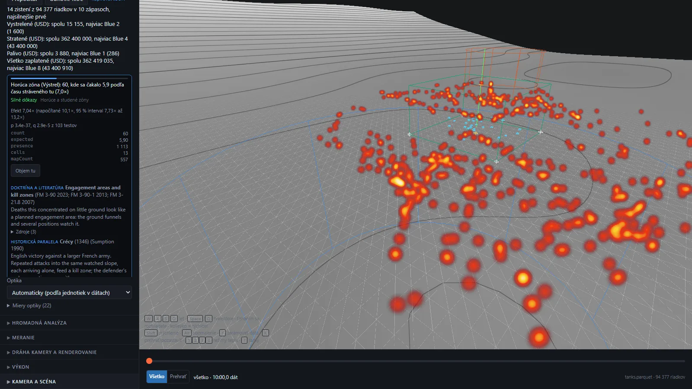

# Znalostná optika

Keď [Zistenia](insights.md) niečo nájdu, táto časť to vysvetľuje pomocou myšlienok z vojenskej histórie, herného dizajnu a analýzy športu a uvádza knihu alebo štúdiu, z ktorej to pochádza. Použite ju na to, aby ste sa dozvedeli *prečo* je vzor dôležitý, nielen že existuje.

## Vyskúšajte to {#try-it}

1. Načítajte dáta a otvorte **Zistenia**, potom stlačte **Nájsť zistenia**.
2. Kliknutím na zistenie ho otvorte.
3. Prečítajte si **Doktrína a literatúra** a **Historická paralela**; úplné odkazy sú zbalené pod nimi.
4. Zmeňte **Optika** (napríklad na *Vojenská doktrína*), aby ste to isté zistenie čítali cez iný okruh literatúry.

## Ako to funguje {#how-it-works}

Panel Zistenia posudzuje svoje zistenia tak, ako by to robil profesionálny analytik: cez vojenskú doktrínu a operačný výskum, historické stretnutia
a literatúru o herným dizajne, dizajne levelov a analytike. Robí to offline, z kurátorskej znalostnej základne v prehliadači, a tú istú látku odovzdá
externému modelu, keď píše zhrnutie.

## Čo panel ukazuje {#what-the-panel-shows}

- **Optika** vyberá okruh literatúry, cez ktorý sa zistenia čítajú: *Automaticky* (podľa druhov jednotiek v dátach: lietadlá, lode, pozemné vozidlá, pechota),
  *Vojenská doktrína*, *Vzdušný boj*, *Námorný*, *Mestský*, *Herný dizajn a vyváženosť*, *E-šport*. Záznamy mimo vybranej optiky sa vynechajú.
- Každé otvorené zistenie ukazuje svoj najbližší záznam **doktrína a literatúra** a svoju najbližšiu **historickú paralelu**, s úplnými odkazmi zbalenými pod nimi.
- **Miery optiky** vypisuje miery analýzy operácií počítané nad rovnakými riadkami (nižšie), každú s jej významom a jej literatúrou.
- **Zhrnutie** pridá riadky pre vedúce zistenia a miery optiky: "Doktrína a literatúra: ..." a "Historická paralela: ...", každý s citáciami autor-rok a odkazmi zbalenými pod ním.
- **Napísať pomocou AI** odošle najrelevantnejšie záznamy (zhrnutie, ponaučenie, zistenia, ktoré sa k nim vzťahujú, úplné odkazy) spolu so správou a požiada model, aby ich citoval podľa ID - `{concept.lanchester-square}` - a nepoužíval žiadne iné zdroje.

Označenia sú preložené; samotné znalosti sú v angličtine.

## Miery optiky {#lens-metrics}

Počítajú sa v worker-i zistení, v tom istom prechode cez riadky ako detektory (`src/insights/lensMetrics.ts`). Každá sa vynechá, keď ju dáta nedokážu niesť.

| Miera | Čo meria | Potrebuje |
|---|---|---|
| Lanchesterov fit | Straty každej strany za 20 s regresované na sily živých oboch strán (Poisson, chyby kvázi-vierohodnosti); exponenty pri nepriateľskej a vlastnej sile, testované voči kvadratickému zákonu (cielená paľba) a lineárnemu zákonu (plošná paľba) | čas, tímy, zabitia a smrti |
| Pomer výmeny | Zabitia na smrť podľa strany a miesta; podiel smrtí na najsmrtiacejšom teréne, ktorý drží 5 % času, oproti podielu, ktorý dá samotná náhoda pri takom počte smrtí; Giniho koeficient smrtí voči času; Moranovo I pre miery smrti | zabitia a smrti |
| Miestny silový pomer | Priateľské a nepriateľské jednotky živé v dosahu stretu pri každom zabití (dosah nastavený z dát: dvojnásobok mediánu vzdialenosti k najbližšiemu nepriateľovi); podiel zabití miestne nadradenej strany a jej prebytok nad tým, čo predpovedajú samotné čísla | čas, tímy, osoby |
| Polia paľby | Viditeľnosť z najrušnejších miest zabití na 2,5D povrchu prekážok (geometria levelu až po výšku steny, alebo prechádzaný terén) oproti priemernému miestu a poradová korelácia výhľadu a podielu zabití | pozície; načítaný level to spresní; nie pre vzduch |
| Energetický stav | Špecifická energia (výška plus výška, ktorú by rýchlosť kúpila) vzdušných zabijakov a vzdušných obetí, porovnaná Mann-Whitneyho štatistikou | triedy lietadiel, čas, výška |
| Kľúčový terén | Ako často je dané miesto medzi troma najrušnejšími miestami zabití zápasu | viac zápasov |
| Vzájomná podpora (výmeny) | Smrti zodpovedané zabitím spoluhráča v dosahu stretu a do 5 s | čas, tímy |
| Prvý úder | Stretnutia - zabitia zoskupené podľa zápasu, podľa 20 s ticha a podľa troch dosahov stretu vzdialenosti - vyhrané stranou, ktorá skórovala prvá | čas, tímy |
| Model salvy | Hughesova rovnica salvy fitovaná na 20 s obdobia lodí v kontakte: lode vyradené z boja na jednu útočnú loď a zachránené na jednu bránenú loď; Lanchesterov fit len na lodiach | triedy lodí, čas, tímy |
| Bojová účinnosť | Zabitia na jednotkohodinu v akcii každej strany a pomer dvoch najväčších (hodnota bojovej účinnosti v Dupuyho zmysle) s jej 95 % intervalom, a podiel zabití každej strany pri rovnakých miestnych počtoch | čas, tímy |
| Dosahy stretu | Vzdialenosť k najbližšiemu nepriateľovi pri zabitiach, pri odpáleniach a pri prvom výstrele každého života (zistenie až po stret), podľa druhu jednotky | čas, tímy; odpálenia tam, kde ich dáta majú |
| Reťaz zabití | Sekundy od posledného odpálenia zabijaka po zabitie a od jeho prvého výstrelu v boji po zabitie | čas; odpálenia alebo udalosti paľby |
| Koncentrácia alebo rozptyl | V každom 20 s období rozptyl dvoch najväčších strán a podiel zabití, ktorý vezme tá užšie zoskupená | čas, tímy |
| Vylietania | Na stranu: vylietania (vzlety alebo spawny lietadiel), pristátia, stratené lietadlá a zabitia lietadlami; miera strát a zabitia na vylietanie | triedy lietadiel; vzlety alebo spawny |

Dáta s kolami pridávajú merania z boja zblízka a e-športu - pravdepodobnosť výhry kola, hodnota akcií, otváracie súboje, výmeny, peeker proti držiteľovi, mierenie,
krížová paľba, pomôcky, prevaha v počte, clutche, zostavy, po položení bomby, smrteľné lievieky a vplyv hráča: pozri [Boj zblízka a kolá](close-quarters.md).

Trate a tímy pridávajú merania kolektívneho správania z vedy o davoch, kolektívneho pohybu, behaviorálnej ekonómie a vojenskej psychológie - zarovnanie a krúženie,
stádo po trase, pruhy a stopy, tlačenie, vedúci a nasledovníci, zaostávajúci, bod zlomu, riziko po stratách, série, dohoda o nákupe a potlačenie, každé voči
vlastnému nulovému modelu: pozri [Kolektívne správanie](collective-behaviour.md).

Zbrane, návnady a budovy sa nepočítajú ako jednotky. Tam, kde riadky zbraní pomenúvajú svoju odpaľujúcu jednotku (stĺpec `Shooter` alebo `Launcher`, ako ho majú dáta odvodené z Tacview),
odpálenie sa pripisuje tej jednotke, podľa jej názvu alebo ID objektu.

## Ako sa zistenia stretnú s literatúrou {#how-findings-meet-the-literature}

Záznamy a zistenia sa stretávajú cez **taxonómiu vzorov** (`src/insights/knowledge/patterns.ts`): koncentrácia, lokálna prevaha, cielená a plošná paľba, úzke miesta, zóny zabíjania,
polia paľby, reverzný svah, bočný útok, vzájomná podpora, energetická výhoda, tlak pri spawnovaní, vyváženosť a tak ďalej. Každý druh detektora a každá miera optiky
hovorí, ktoré vzory jej čísla ukazujú (`src/insights/lens.ts`); každý záznam znalostí hovorí, ktoré vzory sa ho týkajú, s váhou. Relevantnosť záznamu pre zistenie je
vážené prekrytie, škálované tým, ako dobre sa doména záznamu (pevnina, vzduch, more, mesto) hodí na dáta, a silou samotného zistenia. Zdôvodnenie, ktoré sa ukáže, sú
čísla zistenia v jednej vete, za ktorou nasleduje ponaučenie záznamu.

## Katalóg {#catalogue}

Každý vzor, pojem, metóda, historický prípad, dizajnový princíp a štúdia, s bibliografiou: pozri [Katalóg znalostí](knowledge-catalogue.md).

## Pre vývojárov {#for-developers}

### Pridávanie záznamov {#adding-entries}

1. Vyberte súbor podľa typu: `concepts.ts` a `concepts-more.ts`, `methods.ts`, `cases.ts`, `cases-land.ts`, `cases-air-sea.ts`, `cases-esports.ts`, `design.ts` (dizajnové princípy) alebo `studies.ts` v `src/insights/knowledge/`.
2. Dajte mu nové ID `<type>.<slug>` (nikdy nepoužívajte znova staré), jeho optiky, domény a vzory, ktorých sa týka, s váhami 0..1. Pridajte vzor do `patterns.ts` len vtedy, keď ho zistenie môže ukázať, a namapujte ho z nejakého zistenia alebo miery v `lens.ts`.
3. Zhrnutie a ponaučenie napíšte **vlastnými slovami**. Citáty len z diel vo verejnej doméne (`pd: true` v odkaze), a krátke.
4. Citujte: pridajte každé nové dielo do `refs.ts` s autormi, rokom, názvom a vydavateľom (časopis s ročníkom a stranami); URL alebo DOI, kde existuje verejný záznam.
5. Spustite `npx vitest run src/insights/lens.test.ts` (jedinečné ID, známe vzory, riešiteľné odkazy, citáty z verejnej domény, prípady s dátumom a výsledkom) a `node tools/knowledge-doc.mjs`, aby sa obnovil [katalóg](knowledge-catalogue.md).
