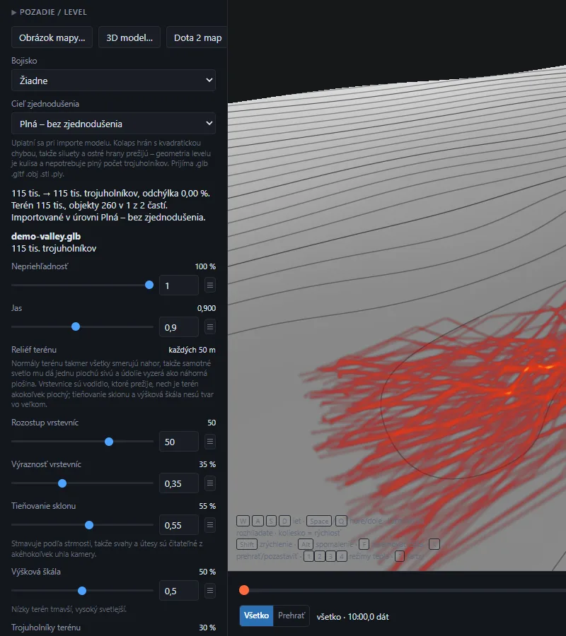

# Levely a geometria pozadia

Level je 3D miesto, kde sa hra odohrala – mapa, mesto, trať. Keď ho dáte za svoje dáta, vidíte, *kde* je teplo. Panel **Pozadie / level** (pozri [Slovník pojmov](glossary.md) pre „level“) dáva tri druhy kontextu:

- **obrázok mapy**, georeferencovaný dvoma kotvami – pozri [Obrázky máp](map-images.md);
- **3D level** – `.glb`, `.gltf`, `.obj`, `.stl` alebo `.ply` – rozdelený na terén, objekty a vodu a pri importe zjednodušený – pozri [3D levely](model-levels.md) a [Vzhľad levelu](level-appearance.md);
- **skutočný svet ako pozadie** – pre nahrávku, ktorá hovorí, kde na Zemi sa nachádza (súbor Tacview ACMI): skutočný terén, cesty, voda, letiská a budovy, stiahnuté z otvorených dát – pozri [Skutočný svet ako pozadie](world-backdrop.md).

Keď nie je nič načítané, scéna je tmavá s mriežkou a farebnými osami (**Mriežka** a **Osi** v [Kamera a scéna](camera.md)) a panel hovorí *Nič nie je načítané – scéna ukazuje mriežku a osi. Pridajte obrázok mapy alebo sieť levelu, aby teplo malo kontext.*

Level zdieľajú všetky tri karty: trať načítaná na karte Analýza pretekov je ten istý level, aký ukazuje teplotná mapa.

## Položte level za svoje dáta {#put-a-level-behind-your-data}

1. Najprv načítajte dáta ([Získavanie dát](getting-data-in.md)), aby sa level k nim prispôsobil.
2. Na bočnom paneli otvorte **Pozadie / level**.
3. Stlačte **Obrázok mapy…** pre obrázok alebo **3D model…** pre 3D level a vyberte súbor. Pri nahrávke zo skutočného sveta použite namiesto toho **Skutočný svet ako pozadie** alebo **Bojisko**.
4. Počkajte, kým riadok priebehu dokončí. Veľký model sa najprv zjednoduší (pozri **Cieľ zjednodušenia** nižšie).
5. Stlačte **F** vo výreze, aby sa zarámovalo všetko. Používajte **Nepriehľadnosť** a **Jas**, kým teplo nevynikne z levelu.
6. Stlačte **Uložiť do knižnice**, ak level budete používať znova ([Knižnica levelov](level-library.md)).

## Čo level robí pre teplo {#what-a-level-does-for-the-heat}

- **Zakrýva**: dátové body za ním sa stlmia podľa plochy a dátové body za terénom sa skryjú ([Hĺbka a orezávanie](depth-and-culling.md)). Bez levelu nie je žiadne zakrytie.
- **Reže** ho [Rez](slice.md) a pri *Rezať aj level* aj [orezanie podľa vzdialenosti](depth-and-culling.md#distance-culling), spolu s teplom.
- Je jediná vec, ktorú [hĺbka ostrosti](camera.md#depth-of-field) rozmazáva, okrem mriežky a kociek.
- 3D level **rozšíri ďalšiu rovinu kamery**, keď je väčší než dáta: blízka a ďalšia rovina sa kalibrujú z datasetu a exportovaná mapa široká niekoľko kilometrov by inak celá ležala za ďalšou rovinou a nechala prázdny pohľad. Ďalšia rovina sa stane 3 × vodorovným rozsahom levelu, keď je to väčšie, blízka rovina sa posúva s ňou (aspoň ďaleko / 100 000), aby sa udržala presnosť hĺbky, na ktorej závisí zakrytie, a rýchlosť letu sa zvýši aspoň na rozsah / 12. Rozširuje sa vždy, nikdy sa nezužuje.

## Panel zhora nadol {#the-panel-top-to-bottom}

| Časť | Podrobnosti |
|---|---|
| **Obrázok mapy…**, **3D model…** | Načítajte jeden; nahradí aktuálny level. |
| **Skutočný svet ako pozadie**, **Zabudnúť dlaždice máp** | Len pre dataset s geografickým odkazom: postaviť skutočné miesto pod ním ako level, alebo zmazať stiahnuté dlaždice. [Skutočný svet ako pozadie](world-backdrop.md) |
| **Cieľ zjednodušenia** | Rozpočet trojuholníkov pre ďalší import modelu: *Plný – bez zjednodušenia* (predvolené), *Vysoký – 8 M*, *Stredný – 3 M*, *Nízky – 800 k*, *Silueta – 100 k*. [3D levely](model-levels.md#simplification) |
| Priebeh a **Zrušiť** | Počas dekódovania alebo importu. |
| Poznámka k importu | Trojuholníky pred a po, rozdelenie na terén / objekty / vodu, použitá úroveň detailu. |
| Názov a veľkosť | `šírka×výška px · x × z m/px` pre obrázok, `N trojuholníkov (z M)` pre model. |
| **Nepriehľadnosť**, **Jas** | Oba druhy. |
| Ovládacie prvky obrázka | **Odfarbiť**, **Prevrátiť sever/juh**, **Umiestnenie** (dve kotvy), **Prispôsobiť hraniciam dát**, **Výška**. [Obrázky máp](map-images.md) |
| Ovládacie prvky modelu | Reliéf terénu, voda, trojuholníky terénu, drôtený model, textúra, zachytená farba, objekty, klasifikácia častí. [Vzhľad levelu](level-appearance.md) |
| **Uložiť do knižnice**, **Odstrániť** | [Knižnica levelov](level-library.md); Odstrániť level uvoľní. |
| **Knižnica** | Levely uložené v tomto prehliadači. [Knižnica levelov](level-library.md) |

## Stránky v tejto sekcii {#pages-in-this-section}

- [Obrázky máp](map-images.md)
- [3D levely](model-levels.md) – formáty, časti, klasifikácia, zjednodušenie, textúry
- [Vzhľad levelu](level-appearance.md) – každý ovládací prvok pre 3D level
- [Knižnica levelov](level-library.md)
- [Skutočný svet ako pozadie](world-backdrop.md) – skutočný svet pod nahrávkou z otvorených dát

Ako dostať levely z hier a motorov je úloha samostatných nástrojov exportéra (pozri [README](https://github.com/Holdi601/3DHeat/blob/main/README.md) repozitára); kontrakt, do ktorého zapisujú, je zhrnutý v [3D levely](model-levels.md#the-exporter-contract).
