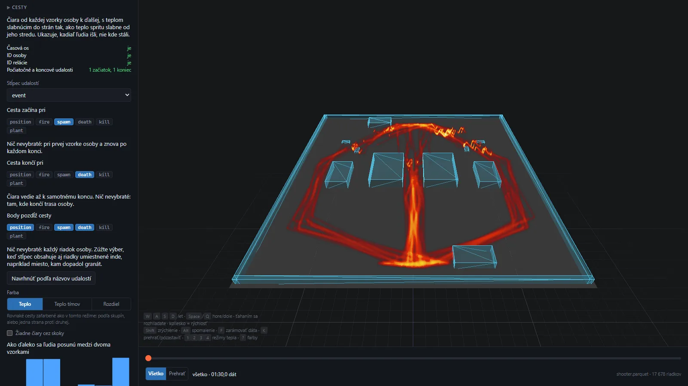

# Čiarové teplo

Teplo ukazuje, kde ľudia stáli. Čiary ukazujú cesty, ktorými kráčali.

**Čiary** (kláves 4) je čiarové teplo: čiara od každej [vzorky osoby](glossary.md) k jej ďalšej, rozptýlená
rovnakým úbytkom, aký má [sprite](glossary.md) - napríč cez čiaru namiesto okolo bodu. Ukazuje, kam ľudia *išli*,
nie kde stáli: chodba prejdená raz je rovnako viditeľná ako izba, v ktorej sa kempovalo, a riedke vzorky rýchleho
hráča sa spoja do súvislej trasy namiesto bodkovanej stopy. Potrebuje stĺpec osoby a stĺpec času.

## Ako to použiť {#how-to-use-it}

1. Stlačte `4` (alebo vyberte **Čiary** v lište režimov).
2. Otvorte **Cesty** a skontrolujte zelený zoznam: časová os a ID osoby musia byť prítomné.
3. Stlačte **Navrhnúť podľa názvov udalostí**, aby sa doplnilo, kde trasy začínajú a končia.
4. Prečítajte riadok štatistiky: "N ciest, z toho M dosiahne koniec".
5. Ak čiary skáču cez mapu, upravte **Najdlhší krok** (pozri [Limit skoku](#the-jump-limit)).

Čiara má zmysel len medzi začiatkom a koncom, takže panel **Cesty** hovorí, čím je trasa ohraničená. Všetko od
[Pravidiel trasy](#the-rules-of-a-route) ďalej sú podrobnosti, ktoré môžete preskočiť.

## Panel Cesty {#the-routes-panel}

Zobrazuje sa nad panelmi tepla v režime Čiary.

### Čo dáta majú {#what-the-data-has}

Zoznam kontroly, zelený, keď je prítomné, oranžový, keď nie:

| Riadok | Stavy |
|---|---|
| **Časová os** | *prítomná* / *chýba - potrebná* |
| **ID osoby** | *prítomné* / *chýba - potrebné* |
| **ID relácie** | *prítomné* / *žiadna - všetky riadky sú jedna relácia* |
| **Počiatočné a koncové udalosti** | *N začiatkov, M koncov* / *nič nevybrané - celé stopy* (zelené len so stĺpcom udalostí a aspoň jedným začiatkom a jedným koncom) |

### Ovládanie {#controls}

| Ovládací prvok | Význam |
|---|---|
| **Stĺpec udalostí** | Stĺpec kategórie, ktorého hodnoty sú udalosti (spawn, smrť, pozícia, ...). *Žiadny - celé stopy*: stopa každej osoby v každej relácii je jedna trasa, zlomená tam, kde má stopa medzeru. Ponúkajú sa len stĺpce ponechané na filtrovanie pri načítaní. |
| **Cesta začína pri** | Hodnoty udalostí, ktoré začínajú trasu (spawn, respawn, nasadenie). Nič nevybrané: trasa začína pri prvej vzorke osoby a znova po každom konci. |
| **Cesta končí pri** | Hodnoty udalostí, ktoré trasu ukončujú (smrť, extrakcia, teleport). Čiara ide až po samotný koncový riadok. Nič nevybrané: trasa končí tam, kde končí stopa osoby. |
| **Body pozdĺž cesty** | Hodnoty udalostí, ktorých riadky ležia pozdĺž trasy. Nič nevybrané: každý riadok osoby. Zúžte to, keď stĺpec obsahuje aj riadky umiestnené inde, napríklad kde dopadla granát. |
| **Navrhnúť podľa názvov udalostí** | Doplní tri zoznamy podľa názvov hodnôt (nižšie). |
| **Farba** | *Teplo*, *Teplo tímov* alebo *Rozdiel*. Tie isté trasy vo farbení toho režimu: každá skupina vo svojom odtieni, alebo jedna strana proti druhej, so zoznamom skupín, rozdelením a farebnými škálami, ktoré fungujú ako v týchto režimoch. Predvolené *Teplo*. Teplo tímov a rozdiel potrebujú stĺpec skupiny. |
| **Žiadne čiary cez skoky** / **Najdlhší krok** | Ďalšia vzorka osoby ďalej než toto je respawn, teleport alebo pád, nie miesto, kam išla, takže žiadna čiara nespojí tieto dve. Doplní sa pri načítaní, keď dáta ukážu jasnú medzeru (nižšie), a vypne sa, keď nie. Funguje so stĺpcom udalostí aj bez neho. |
| Riadok štatistiky | `N ciest, z toho M dosiahne koniec, K segmentov`, aktualizovaný niekoľkokrát za sekundu. |

Každý zoznam je riadok prepínacích čipov, jeden na hodnotu, najčastejšie prvé; ukazovanie na čip zobrazí jeho počet
riadkov. Ponúka sa najviac 120 hodnôt (*ďalších N hodnôt sa nezobrazuje*).

Výber iného stĺpca udalostí použije návrh, keď návrh vyberie ten istý stĺpec, inak začne s prázdnymi zoznamami.

### Návrh {#the-suggestion}

Pri každom načítaní a pri **Navrhnúť podľa názvov udalostí** ([`suggestLineSettings`](https://github.com/Holdi601/3DHeat/blob/main/src/data/lines.ts)):

- **Stĺpec udalostí:** prvý ponechaný stĺpec kategórie s názvom `event`, `eventname` alebo `eventtype`; inak `kind`, `type` alebo `action`; inak
  ktorýkoľvek obsahujúci *event*, *kind*, *action* alebo *type*.
- **Začiatky:** hodnoty obsahujúce *spawn, deploy, join, enter, start, begin, respawn, revive, land/landed/landing, drop* - pokiaľ sa zhodujú aj s koncovým slovom.
- **Konce:** hodnoty obsahujúce *death, died, dead, kill/killed, eliminat…, extract, evac, teleport, leave, left, disconnect, quit, exit, end, finish, downed* - okrem hodnôt `kill` a `kills` (zabitie je to, čo robí zabijak, nie koniec jeho trasy).
- **Body:** hodnoty, ktoré sú presne *position, location, player location, move, movement, tick, sample* alebo *pos*; keď sa nájde aspoň jedna, začiatky a konce sa pridajú aj k bodom. Keď sa nenájde žiadna, body zostanú prázdne (každý riadok).

### Limit skoku {#the-jump-limit}

Kde ľudia skáču, dĺžky krokov spadajú do dvoch skupín s takmer ničím medzi nimi: čo osoba prejde medzi dvoma vzorkami, a šírka mapy.
Pri načítaní ([`suggestMaxJump`](https://github.com/Holdi601/3DHeat/blob/main/src/data/lines.ts)) sa kroky spočítajú na každé zdvojnásobenie ich
štvorcovej dĺžky, až 16 miliónov, a limit sa umiestni do stredu prvého rozsahu nad mediánom, ktorý má šírku aspoň jedno zdvojnásobenie dĺžky,
drží pod 0,02 % krokov na každý stĺpec a má kroky za sebou. Bez takého rozsahu sa nič neorezáva, lebo skok by sa nedal odlíšiť od rýchleho auta;
ručné zapnutie limitu potom začne na desatine uhlopriečky dát.

Graf nad limitom ukazuje, aké dlhé kroky naozaj sú, s čiarou na limite: stĺpce napravo od neho sa nekreslia. Obe osi sú logaritmické, lebo
skoky môžu byť stotina krokov a tisíckrát dlhšie. Ukážte na stĺpec pre jeho rozsah a podiel; kliknutím na graf umiestnite limit tam.
Pod ním je podiel krokov nad limitom.

## Pravidlá trasy {#the-rules-of-a-route}

Riadky sa prechádzajú v poradí času, po osobách ([`buildLines`](https://github.com/Holdi601/3DHeat/blob/main/src/data/lines.ts)):

1. Riadky [zdieľaného názvu](sessions-persons-groups.md#names-worn-by-several-things-at-once) sa preskočia úplne.
2. Keď sú body vybrané, riadok, ktorý nie je ani začiatok, ani koniec, ani bod, sa preskočí.
3. Riadky sa sledujú na osobu a reláciu, takže osoba, ktorej relácie sa v poradí času prelínajú, má jednu trasu v každej. Trasa sa uzavrie, keď predchádzajúci riadok nemal nasledovníka (jej [životnosť](sessions-persons-groups.md#person) je "žiadna") - trasa nikdy neprekročí hranicu relácie ani medzeru, o ktorej načítanie rozhodlo, že nemá ďalšiu vzorku. Na akej trase riadok je, sa vypočíta raz a ponechá, 4 bajty na riadok, takže zmena najdlhšieho kroku túto časť nezopakuje.
4. Riadok **začiatku** uzavrie každú otvorenú trasu a otvorí tam novú.
5. Keď sú začiatky vybrané, riadok mimo trasy sa ignoruje. Bez začiatkov otvorí trasu každý riadok mimo trasy, ktorý nie je koncom.
6. Každý iný riadok vnútri trasy pridá **segment** od predchádzajúceho riadku trasy k tomuto.
7. **Koncový** riadok, ktorý trasu predĺži, ju uzavrie za jej segmentom; táto trasa sa počíta ako *dosiahla koniec*.
8. Krok dlhší ako **Najdlhší krok** uzavrie trasu tam, kde bola, a nová trasa začne na vzdialenom konci, pokiaľ riadok nie je koniec. Cez to sa nekreslí čiara a riadok štatistiky ho počíta.

Každý segment sa uloží na svoj *koncový* riadok, takže segmenty zostávajú v poradí času, a [časová os](timeline.md), vzorkovač,
[filtre](filters.md), viditeľnosť skupín aj znamienko rozdielu s nimi pracujú rovnako ako s bodmi. Filter sa preto uplatní na riadok,
kde segment končí.

## Prehrávanie {#playback}

V režime **Všetko** sa každá trasa kreslí celá. V režime **Prehrať** je každá osoba bod, ktorý sa pohybuje medzi svojimi vzorkami
a kreslí svoju trasu za sebou:

- segment, ktorý začína za prehrávacou hlavou, sa nekreslí;
- segment, v ktorom je osoba uprostred, sa kreslí až po jej interpolovanú pozíciu, s koncovým uzáverom na hlave;
- teplo doznieva na **chvoste**: pri histórii *Kumulatívne* je chvost neobmedzený a celá doterajšia trasa zostáva; pri *Okno* doznieva na nulu
  počas *Rozsahu* (predvolene 30 s). Pri *Životnosť* je chvost tiež *Rozsah*, a v režime Čiary časová os zobrazuje pre túto históriu aj políčko *Rozsah*
  (namiesto *Záložnej životnosti* a *Doznievania*, ktoré čiarové teplo nepoužíva).

Počas prehrávania sa každý snímok kreslí celý, nie nahromadený, lebo hlavy sa hýbu každý snímok a kĺzavý priemer by každú rozmazal do pruhu.

## Pre vývojárov {#for-developers}

### Pamäť {#memory}

Trasy sa stavajú na hlavnom vlákne, keď sa vstúpi do režimu Čiary (alebo keď sa zmenia nastavenia trás), a uvoľnia sa, keď sa z neho odíde:
5 bajtov na riadok v pamäti a 8 bajtov na riadok na GPU (štartová pozícia každého segmentu, kvantovaná na 16 bitov na os v ohraničujúcom
rámci dát, a jeho príznaky).

### Ako sa čiara kreslí {#how-a-line-is-drawn}

Obe backendy kreslia každý segment z jeho koncového riadku ako **18 vrcholov** ([`lineHeatVs`](https://github.com/Holdi601/3DHeat/blob/main/src/render/webgl2/shaders.ts) a jeho WGSL dvojník):

- Polovičná šírka na každom konci je [polomer sprite](sprite-shape.md#sprite-radius) v tej vzdialenosti toho konca, s uplatnenými pixelovými orezmi.
  Čiara užšia ako 2,5 px sa kreslí 2,5 px široká a jej teplo sa zmenší, aby sa to zhodovalo, takže tenké čiary ani nezmiznú, ani nezjasnejú.
- Teplo klesá **napríč** čiarou tou istou škálou ako sprite - úbytok alebo krivka, intenzita v strede a na okraji.
- Okrúhle uzávery sa kreslia **len** tam, kde trasa začína alebo končí, aby sa spoje medzi po sebe idúcimi segmentmi nezmenili na reťaz perál.
- Geometria sa stavia v priestore obrazovky a tam sa lineárne interpoluje, takže úbytok zostáva vycentrovaný na čiare, nech ide akokoľvek do hĺbky.
  Segment prechádzajúci blízkou rovinou sa tam zrezáva, nie zahodí.

Bodové teplo a čiarové teplo ukladajú na riadok veľmi rozdielne množstvá tepla, takže sýtosť sa pri prepínaní medzi nimi znovu meria
([Farba a expozícia](colour-and-exposure.md#auto-exposure)).
