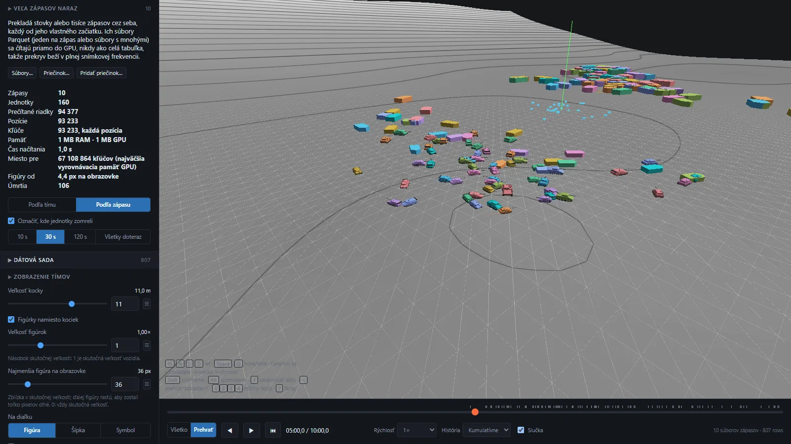

# Veľa zápasov naraz

**Veľa zápasov naraz** prehráva mnohé zápasy na sebe, takže vidíte, kam bežne chodia hráči každého zápasu. Použite ho na porovnanie stoviek alebo tisícov zápasov na jednom obrázku.

Každý zápas začína od svojho vlastného začiatku a jeho jednotky sa hýbu ako figúrky. Súbory idú priamo do grafickej karty a nevytvára sa žiadna úplná tabuľka, takže to beží plynulo tam, kde by bežné načítanie vyčerpalo pamäť.

## Ako to použiť {#how-to-use-it}

1. Otvorte **Veľa zápasov naraz** na bočnom paneli Heatmapy.
2. Stlačte **Súbory…** (vyberte veľa súborov), **Priečinok…** (priečinok aj jeho podpriečinky) alebo **Pridať priečinok…** (pridá k tomu, čo je načítané).
3. Prehliadač prepne na prekrytie figúrok a začne od začiatku. Stlačte **Prehrať**.

Každý súbor je jeden zápas (alebo ich obsahuje viac). Fungujú súbory Parquet a kontajnery [`.3dheat`](container.md). Súbor potrebuje stĺpec pozície, času a jednotky; stĺpce mena, typu a strany sa zachovajú. Ostatné súbory a bočné súbory konvertorov (let, správy, udalosti, chat, ciele) sa preskakujú. Pre bežnú tabuľku pozri [Ako dostať dáta dnu](getting-data-in.md).

## Nastavenia {#settings}

| Nastavenie | Čo robí |
|---|---|
| **Podľa tímu** / **Podľa zápasu** | Farba podľa strany, alebo farba pre každý zápas. |
| **Označiť, kde jednotky zomreli** | Značka, kde každá jednotka zomrela, na 10 s, 30 s, 120 s alebo doteraz. |

Panel ukazuje, koľko zápasov, jednotiek, riadkov a pozícií sa prečítalo, použitú pamäť a čas načítania. *Miesta pre* je, koľko ďalších pozícií by grafická karta ešte zvládla. *Figúrky od* je veľkosť na obrazovke, pod ktorou sa jednotka kreslí ako malá šípka namiesto svojej figúrky.

Vzhľad figúrok používa rovnaké ovládače ako [prehrávanie zápasu](match-replay.md#figures): **Veľkosť figúrok**, **Najmenšia figúra na obrazovke** a **Na diaľku**.

## Tipy {#tips}

- Keď by sa všetko nezmestilo do pamäte, pozície sa zredukujú (zachová sa len pozícia každých niekoľko metrov) a panel to povie.
- Režimy tepla fungujú aj na dátach prekrytia.
- Štatistiky naprieč tisíckami zápasov bez ich kreslenia pozri v [Hromadnej analýze](mass-analysis.md).
