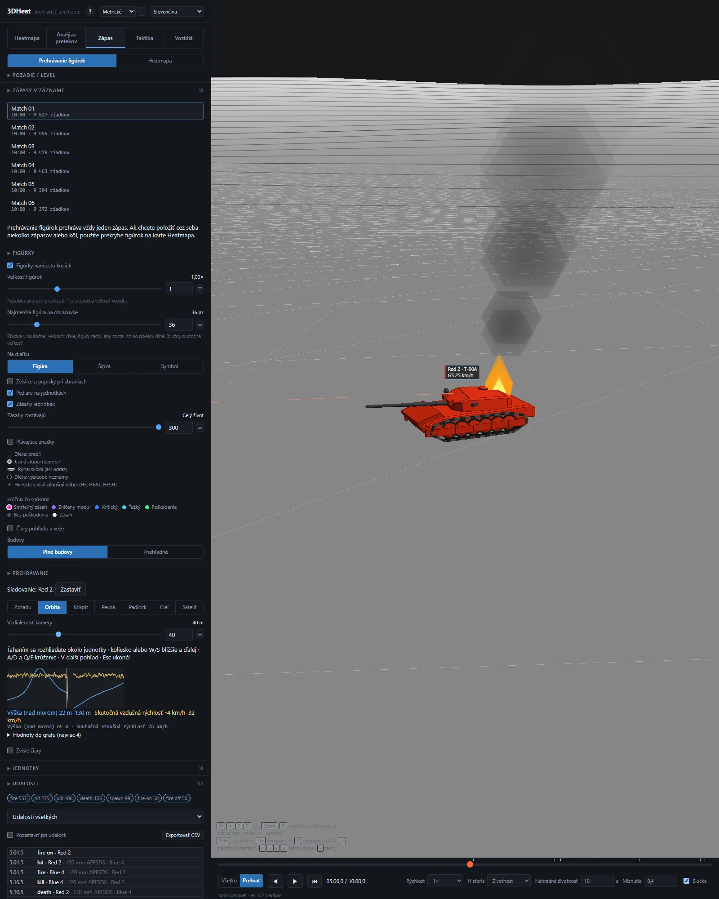
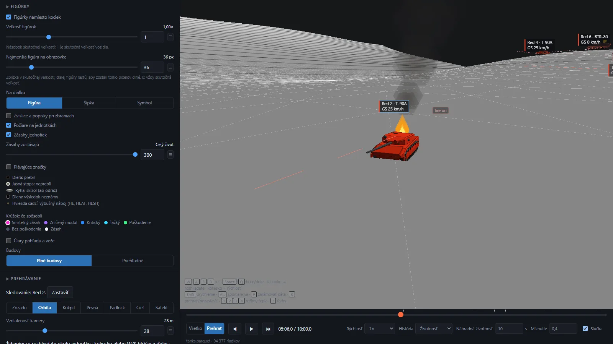
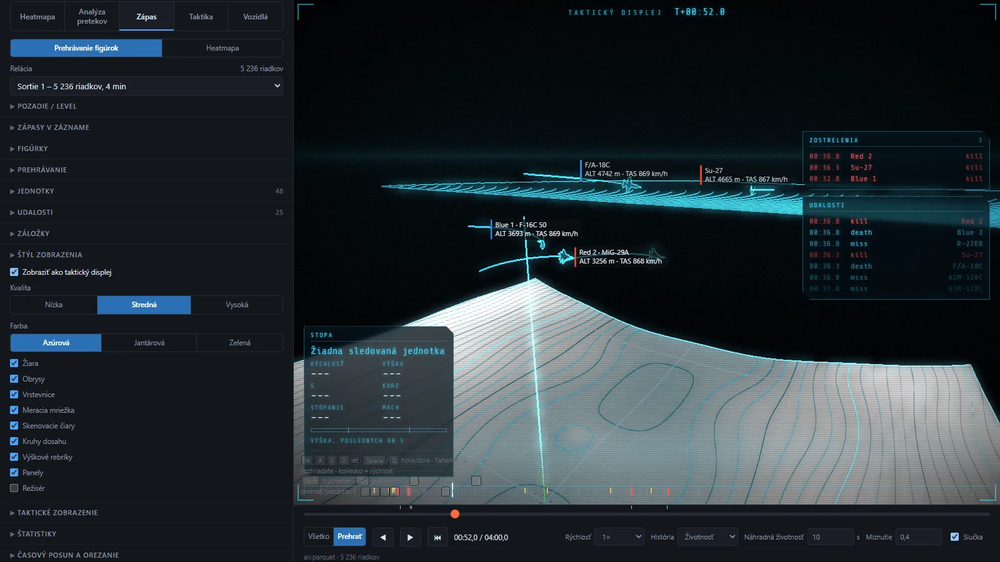
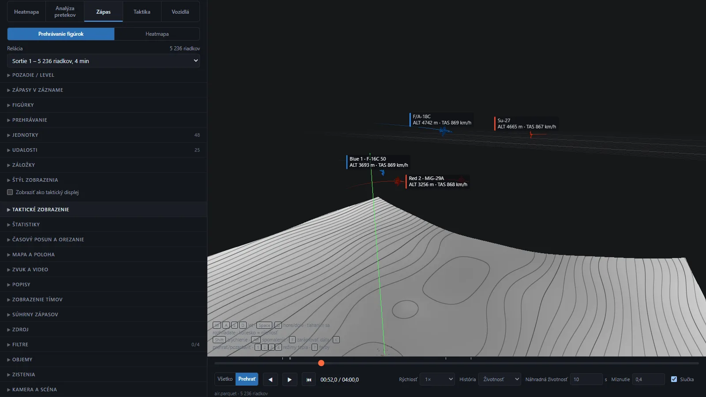

# Prehranie zápasu

Prehrávanie je film zápasu, v ktorom je každý hráč nakreslený ako to, čím jazdil alebo lietal. Použite ho na to, aby ste si boj pozreli znova, sledovali jednu jednotku a videli, kto koho zasiahol.

Výstrely, zásahy, požiare a trosky sa kreslia na jednotkách a cieľoch na mape. Kamery, popisky a taktický displej vám pomáhajú čítať boj. Poznáte Tacview? [Parita s Tacview](tacview-parity.md) ukazuje, kde je každý jeho nástroj.

## Spustenie prehrávania {#start-a-replay}

1. Načítajte záznam cez **Zdroj → Súbory…** alebo ho pustite na panel Zdroj (ľubovoľná tabuľka so stĺpcom **osoba** a **čas**, súbor Tacview, prekonvertované prehrávanie, [`.3dheat`](container.md) zápas). Pozri [Získavanie dát](getting-data-in.md).
2. Otvorte kartu **Zápas** a vyberte **Prehrávanie figúrok**, alebo vyberte **Prekrytie figúrok** na paneli režimov na karte Teplo.
3. V časti **Zápasy v zázname** vyberte jeden zápas, všetky naraz, alebo viac.
4. Stlačte **Prehrať** na časovej osi (alebo `K`). Ťahaním časovej osi skočíte inam.

Figúrky nahradia kocky pri každej jednotke, ktorej meno alebo typ je známy (pozri [Figúrky](figures.md)). Dáta bez stĺpca mena alebo typu sa kreslia ako vojaci.

## Figúrky {#figures}

| Nastavenie (sekcia **Figúrky**) | Predvolené | Čo robí |
|---|---|---|
| **Figúrky namiesto kociek** | zapnuté | Vypnuté kreslí obyčajné kocky. |
| **Veľkosť figúrok** (násobok skutočnej veľkosti) | 1 | 1 je skutočná veľkosť; 0,25 až 20-násobok (logaritmická škála). Väčšia pomáha z diaľky. |
| **Najmenšia figúra na obrazovke** | 36 px | Vzdialené figúry sa zväčšia, aby zostali takto veľké, 0 až 200 px; 0 ponechá skutočnú veľkosť. |
| **Na diaľku**: Figúra, Šípka, Symbol | Figúra | Čím sa stane vzdialená jednotka. |
| **Symboly** | NATO (APP-6) | NATO (APP-6), ruské taktické značky, ikony **Herná mapa**, alebo **Len tvary (pre farboslepých)**. |
| **Veľkosť symbolu**, **Moja strana**, **Nepriateľ / Neutrálny**, **Značky kurzu** | 28 px (12 až 64), automaticky, nepriateľ, zapnuté | Ako vyzerajú symboly a ktorá strana je priateľská. |
| **Zvislé čiary** | zapnuté | Čiara od každej jednotky priamo dole k zemi, aby sa výšky dali čítať v 3D. |
| **Zvislice a popisky pri zbraniach** | vypnuté | Čiary k zemi a popisky pri raketách a bombách. |
| **Požiare na jednotkách** | zapnuté | Plamene od chvíle, keď jednotka začne horieť, až kým sa oheň neuhasí. |
| **Zásahy jednotiek** | zapnuté | Značky, kde dopadli výstrely (nižšie). **Zásahy zostávajú**: 1 až 300 sekúnd, alebo **Celý život**. **Plávajúce značky**: značky nakreslené nad povrchom. |
| **Čiary pohľadu a veže** | vypnuté | Prerušovane: kam hráč hľadí; plne: kam mieri delo. |
| **Budovy** | plné | Plné alebo priehľadné budovy, keď ich mapa vykresľuje. |

### Symboly na diaľku {#symbols-at-a-distance}

Keď by jednotka bola menšia než **Najmenšia figúra na obrazovke**, môže sa z nej stať symbol, ktorý zostane čitateľný. Tvar hovorí o druhu (napríklad zaoblená krabica so stopou pásu pre obrnenú techniku); farba hovorí o strane. Otvorte ponuku **Symboly**, ak chcete zmeniť štýl.

### Značky zásahov, trosky a požiare {#hit-marks-wrecks-and-fires}

- **Značky zásahov** sedia na povrchu, kam výstrel dopadol, v mierke figúry. Ich vzhľad hovorí, čo sa stalo: diera (prešlo), jasný striekanec (neprešlo), zárez (odrazilo sa), hviezda od sadzí (výbušná strela). Farebný krúžok hovorí, čo urobila: smrteľný zásah, modul zničený, kritický, vážny, poškodenie, bez poškodenia, zásah. Ak nad značkou podržíte kurzor, zobrazí sa názov strely.
- Zničená jednotka sa kreslí **zuhoľnatená** ako troska od smrti, kým sa neobjaví znova alebo nie je odstránená; jej symbol je prečiarknutý.
- **Požiare** horia na jednotke od chvíle, keď začne horieť, až kým sa neuhasí.
- **Veže** sa otáčajú tam, kam podľa dát mieri delo (alebo, bez toho, kam hľadí hráč).

### Zbrane, návnady a stopovače {#weapons-decoys-and-tracers}

Keď je zapnuté **Zbrane, výstrely a zásahy** (sekcia Pohľad tímu): rakety, bomby a torpéda lietajú ako vlastné figúry so stopou dymu; guľky a granáty sú stopovače; nárazy a výbuchy blikajú. Stopovač nakreslený **prerušovane** bol odvodený zo zásahu, lebo dáta nemali výstrel. Svetlice a plevy sa kreslia ako návnady; sú skryté v zozname jednotiek, pokiaľ nie je označené *Návnady a granáty*.

## Kamery {#cameras}

Kliknutím na jednotku alebo jej popisok ju **budete sledovať**; sekcia **Replay** ponúka **Zozadu**, **Orbita**, **Kokpit** (s head-up displejom, `H`), **Pevná**, **Padlock**, **Cieľ** a **Satelit**. `V` ich prepína, **Vzdialenosť kamery** nastaví, ako ďaleko. `Esc` zastaví sledovanie.

- **Pohľad na dve jednotky**: vyberte **Cieľ** (alebo Ctrl/Alt-klik na jednotku) a pozrite sa na ňu z tej, ktorú sledujete; **Vymeniť** ich vymení.
- **Miera**: Shift-klik na dve jednotky ukáže smer, vzdialenosť a rozdiel výšok medzi nimi.
- **2D mapa** (`M`): rohový alebo celý pohľad, so stopami a menami.
- **Záložky** (`B`): uložte okamih a kameru; zoznam obsahuje aj zabitia, smrti a značky samotného záznamu.
- **Udalosti**: každá udalosť v poradí času; kliknutie tam skočí. `Page Up` / `Page Down` skáču medzi udalosťami; **Pozastaviť pri udalosti** zastaví pri každej.

## Taktický displej {#tactical-display}

Sekcia **Taktické zobrazenie** kreslí, pre žiadnu jednotku, vybrané, všetky, alebo jeden druh (lietadlá, pozemné, lode, zbrane): vektory rýchlosti a dráhu vpred, čiary nosa a vztlaku, radarové kužele, zámky, dátové spojenia, zóny a čiary zapojenia, zorné čiary, kam hráči hľadia (kužele pohľadu), namierenie veže a zaznamenanú kameru.

### Štýl zobrazenia {#display-style}

`T` (alebo prepínač **Zobraziť ako taktický displej**) prepne vzhľad na štýl radarovej obrazovky: žiara, obrysy, vrstevnice, mriežka merania, skenovacie čiary, krúžky dosahu, rebríky výšok, panely so zabitiami a udalosťami a **Režisér**, ktorý kameru sám presúva k udalostiam.

## Ciele {#objectives}

Keď zápas prichádza s cieľmi, sekcia **Ciele** ich kreslí na mape: zóny dobytia (s vlastníkom a priebehom dobývania), miesta odrodenia, letiská, oblasti a ciele bombardovania, každú vrstvu možno zapnúť alebo vypnúť, s popiskami. Sú vidno cez zem. Pri načítaných viacerých herných režimoch **Režim** filtruje zápasy podľa režimu. Ciele pochádzajú zo zápasového súboru prekonvertéra vedľa záznamu alebo vo vnútri kontajnera [`.3dheat`](container.md).

## Popisky a štatistiky {#labels-and-statistics}

- **Popisky**: pravidlá pre každý druh (**Vybrané**, **Lietadlá**, **Zem**, **Lode**, **Zbrane**, **AI**): zobraziť alebo nie, ktoré hodnoty, a **Priorita** určuje, kto dostane miesto, keď sa popisky prekrývajú. **Neprekrývať popisy** presunie popisok vedľa jednotky, keď by zakryl inú, a tam, kde nie je miesto, ho vynechá. **Veľkosť popisov** je 60 až 250 %. **Späť na meno, stroj, výšku a rýchlosť** pravidlá obnoví.
  - Pozemné jednotky začínajú menom, strojom a rýchlosťou.
  - Lietadlá začínajú menom, strojom, výškou a rýchlosťou.
  - Lode začínajú menom, strojom, rýchlosťou a kurzom.
  - Ak nad jednotkou podržíte kurzor, uvidíte každú jej hodnotu.
- **Štatistiky**: za tím a jednotku: zabitia, smrti, výstrely, zásahy, pomer zásahov, vzlety, pristátia, čas vo vzduchu, najvyššia rýchlosť, výška a G, vzdialenosť. Export do CSV.
- **Grafy**: hodnoty jednotky v čase, dve jednotky porovnané, alebo jedna hodnota oproti inej.

## Veľa zápasov naraz {#many-matches-at-once}

Ak chcete položiť stovky alebo tisíce zápasov cez seba, pozrite si [Veľa zápasov naraz](many-matches.md). Podrobnosti o figúrach (dym, oheň, ďalšie časované efekty): [Figúry v prekrytí figúr](figure-replay.md). Zoznam funkcií Tacview: [Parita s Tacview](tacview-parity.md), podstránka tejto stránky.
