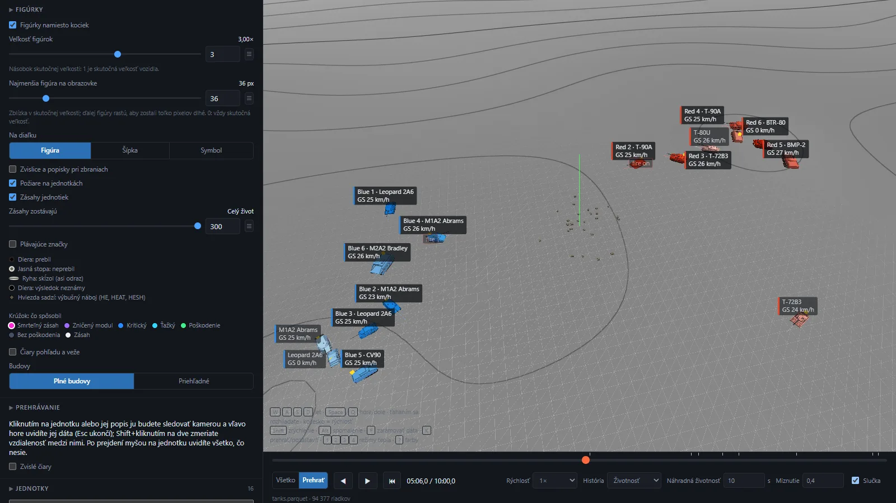
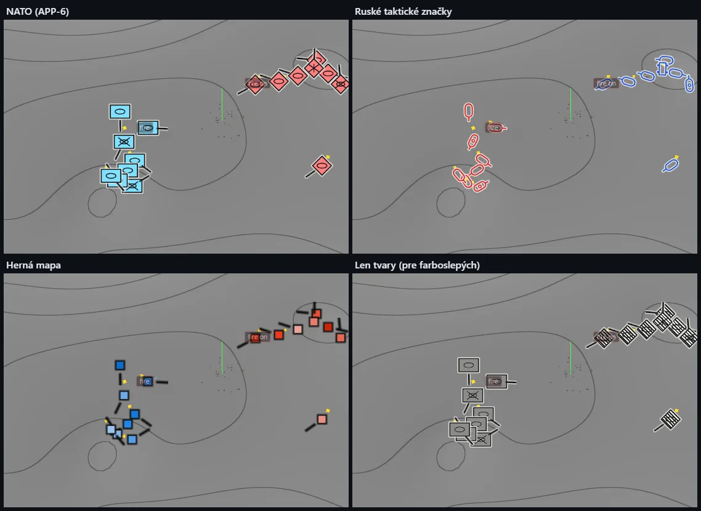

# Prehranie zápasu

Prehrávanie je film zápasu, v ktorom je každý hráč nakreslený ako to, čím riadil. Použite ho na to, aby ste si boj znovu pozreli, sledovali jednu jednotku a videli, kto koho zasiahol.

Výstrely, zásahy, požiare a trosky sa kreslia na jednotkách a cieľoch na leveli. Kamery, popisky a taktický displej vám pomáhajú čítať boj. Poznáte Tacview? [Parita s Tacview](tacview-parity.md) ukazuje, kde je každý z jeho nástrojov.

## Spustenie prehrávania {#start-a-replay}

1. Načítajte záznam cez **Zdroj → Súbory…** alebo pustením na panel Zdroj (ľubovoľná tabuľka so stĺpcom **osoby** a **času**, súbor Tacview, prekonvertovaný záznam, zápas [`.3dheat`](container.md)). Pozri [Ako dostať dáta dnu](getting-data-in.md).
2. Otvorte kartu **Zápas** a vyberte **Prehrávanie figúrok**, alebo vyberte **Prekrytie figúrok** na lište režimov karty Heatmapa.
3. Pod **Zápasy v zázname** vyberte jeden zápas, všetky naraz, alebo viac.
4. Stlačte **Prehrať** na časovej osi (alebo `K`). Ťahaním časovej osi skočíte.

Figúrky nahradia kocky pre každú jednotku, ktorej názov alebo typ je známy (pozri [Figúrky](figures.md)). Dáta bez stĺpca názvu alebo typu sa kreslia ako vojaci.

## Figúrky {#figures}

| Nastavenie (sekcia **Figúrky**) | Predvolená hodnota | Čo robí |
|---|---|---|
| **Figúrky namiesto kociek** | zapnuté | Vypnuté kreslí obyčajné kocky. |
| **Veľkosť figúrok** (násobok skutočnej veľkosti) | 1 | 1 je skutočná veľkosť; 0,25 až 20-násobok (logaritmická škála). Väčšia pomôže z diaľky. |
| **Najmenšia figúra na obrazovke** | 36 px | Vzdialené figúrky zväčšia, aby zostali takto veľké, 0 až 200 px; 0 ponechá skutočnú veľkosť. |
| **Na diaľku**: Figúra, Šípka, Symbol | Figúra | Čím sa stane vzdialená jednotka. |
| **Symboly** | NATO (APP-6) | NATO (APP-6), ruské taktické značky, ikony **Herná mapa**, alebo **Len tvary (pre farboslepých)**. |
| **Veľkosť symbolu**, **Moja strana**, **Nepriateľská / Neutrálna**, **Značky kurzu** | 28 px (12 až 64), automaticky, nepriateľská, zapnuté | Ako vyzerajú symboly a ktorá strana je priateľská. |
| **Zvislé čiary** | zapnuté | Čiara od každej jednotky kolmo k zemi, aby bolo v 3D vidno výšky. |
| **Zvislice a popisky pri zbraniach** | vypnuté | Čiary k zemi a popisky na raketách a bombách. |
| **Požiare na jednotkách** | zapnuté | Plamene od okamihu, keď jednotka chytí oheň, až kým sa neuhasí. |
| **Zásahy jednotiek** | zapnuté | Značky, kde výstrely zasiahli (nižšie). **Zásahy zostávajú**: 1 až 300 sekúnd, alebo **Celý život**. **Plávajúce značky**: značky nad povrchom. |
| **Čiary pohľadu a veže** | vypnuté | Prerušované: kam hráč pozerá; plné: kam mieri delo. |
| **Budovy** | plné | Plné alebo priehľadné budovy, keď ich level vykresľuje. |

### Symboly na diaľku {#symbols-at-a-distance}

Keď by jednotka bola menšia než **Najmenšia figúra na obrazovke**, môže sa z nej stať symbol, ktorý zostane čitateľný. Tvar prezrádza druh (napríklad zaoblená kocka s pásovou stopou pre obrnené vozidlo); farba prezrádza stranu. Otvorte ponuku **Symboly** a zmeňte štýl.

### Značky zásahov, trosky a požiare {#hit-marks-wrecks-and-fires}

- **Značky zásahov** sú na povrchu, kam výstrel narazil, v mierke figúrky. Ich vzhľad hovorí, čo sa stalo: diera (prešlo), jasný striek (neprešlo), ryha (odrazilo sa), hviezdica zo sadzí (výbušný náboj). Farebný krúžok hovorí, čo urobil: zabíjajúci zásah, zničený modul, kritický, vážny, poškodenie, bez poškodenia, zásah. Po najazdení na značku uvidíte názov náboja.
- Zničená jednotka sa kreslí **zuhoľnatená** ako vrak od svojej smrti, kým sa neobjaví znova alebo nie je odstránená; jej symbol je prečiarknutý.
- **Požiare** horia na jednotke od okamihu, keď chytí oheň, až kým sa neuhasí.
- **Veže** sa otáčajú tam, kam dáta hovoria, že mieri delo (alebo, bez toho, kam sa pozerá hráč).

### Zbrane, návnady a stopy {#weapons-decoys-and-tracers}

Pri zapnutých **Zbrane, výstrely a zásahy** (sekcia Zobrazenie tímov) lietajú riadené strely, rakety, bomby a torpéda ako vlastné figúrky so stopou dymu; guľky a projektily sú svetelné stopy; nárazy a výbuchy blikajú. Stopa nakreslená **prerušovane** sa odvodila zo zásahu, lebo dáta nemali výstrel. Svetlice a plevy sa kreslia ako návnady; v zozname jednotiek sú skryté, pokiaľ nie je zaškrtnuté *Klamné ciele a strely*.

## Kamery {#cameras}

Kliknutím na jednotku alebo jej popisok ju **nasledujete**; sekcia **Prehrávanie** ponúka **Zozadu**, **Orbita**, **Kokpit** (s head-up displejom, `H`), **Pevná**, **Padlock**, **Cieľ** a **Satelit**. `V` ich prepína, **Vzdialenosť kamery** nastaví, ako ďaleko. Esc zastaví.

- **Pohľad na dve jednotky**: vyberte **Cieľ** (alebo Ctrl/Alt-klik na jednotku), aby ste sa na ňu pozreli zo sledovanej; **Vymeniť** ich prehodí.
- **Miera**: Shift-klik na dve jednotky ukáže smer, vzdialenosť a rozdiel výšok medzi nimi.
- **2D mapa** (`M`): roh alebo celé zobrazenie, so stopami a menami.
- **Záložky** (`B`): uložia okamih a kameru; zobrazia sa aj vlastné zabitia, smrti a značky záznamu.
- **Udalosti**: každá udalosť v časovom poradí; kliknutie tam skočí. `Page Up` / `Page Down` skáču medzi udalosťami; **Pozastaviť pri udalosti** zastaví pri každej.

## Taktické zobrazenie {#tactical-display}

Sekcia **Taktické zobrazenie** kreslí pre žiadnu jednotku, vybrané, všetky alebo jeden druh (lietadlá, zem, lode, zbrane): vektory rýchlosti a dráhu dopredu, čiary nosa a vztlaku, kužele radarov, zámky, dátové spojenia, zóny a čiary zapojenia, čiary videnia, kam hráči pozerajú (kužele pohľadu), namierenie veže a zaznamenanú kameru.

### Štýl zobrazenia {#display-style}

`T` (alebo prepínač **Zobraziť ako taktický displej**) prepne vzhľad na štýl radarovej obrazovky: žiara, obrysy, vrstevnice, mriežka merania, skenovacie čiary, krúžky dosahu, rebríky výšok, panely so zabitiami a udalosťami a **Režisér**, ktorý kameru sám presúva k udalostiam.

## Ciele {#objectives}

Ak zápas prichádza s cieľmi, sekcia **Ciele** ich nakreslí na leveli: zóny dobývania (s vlastníkom a priebehom dobývania), spawny, letiská, oblasti a ciele bombardovania, každá vrstva sa dá prepínať, s popiskami. Vidieť ich cez zem. Pri načítaní viacerých herných módov **Režim** filtruje zápasy podľa módu. Ciele pochádzajú zo súboru zápasu konvertora vedľa záznamu alebo vo vnútri kontajnera [`.3dheat`](container.md).

## Popisky a štatistiky {#labels-and-statistics}

- **Popisky**: pravidlá podľa druhu (**Vybrané**, **Lietadlá**, **Zem**, **Lode**, **Zbrane**, **AI**): zobraziť alebo nie, ktoré hodnoty, a **Priorita** pre to, kto dostane miesto, keď sa popisky prekrývajú. **Neprekrývať popisy** presunie popisok vedľa jednotky, keď by zakryl inú, a tam, kde nie je miesto, ho vynechá. **Veľkosť popisov** je 60 až 250 %. **Späť na meno, stroj, výšku a rýchlosť** obnoví pravidlá.
  - Pozemné jednotky začínajú s menom, vozidlom a rýchlosťou.
  - Lietadlá začínajú s menom, vozidlom, výškou a rýchlosťou.
  - Lode začínajú s menom, vozidlom, rýchlosťou a kurzom.
  - Po najazdení na jednotku uvidíte každú hodnotu, ktorú má.
- **Štatistiky**: pre každý tím a jednotku: zabitia, smrti, výstrely, zásahy, pomer zásahov, vzlety, pristátia, čas vo vzduchu, najvyššia rýchlosť, výška a G, vzdialenosť. Export CSV.
- **Grafy**: hodnoty jednotky v čase, dve jednotky porovnané, alebo jedna hodnota oproti inej.

## Veľa zápasov naraz {#many-matches-at-once}

Na položenie stoviek alebo tisícov zápasov na seba pozri [Veľa zápasov naraz](many-matches.md). Podrobnosti o figúrkach (dym, oheň, ďalšie časované efekty): [Figúrky v prekrytí figúrok](figure-replay.md). Zoznam funkcií Tacview: [Parita s Tacview](tacview-parity.md), podstránka tejto stránky.
