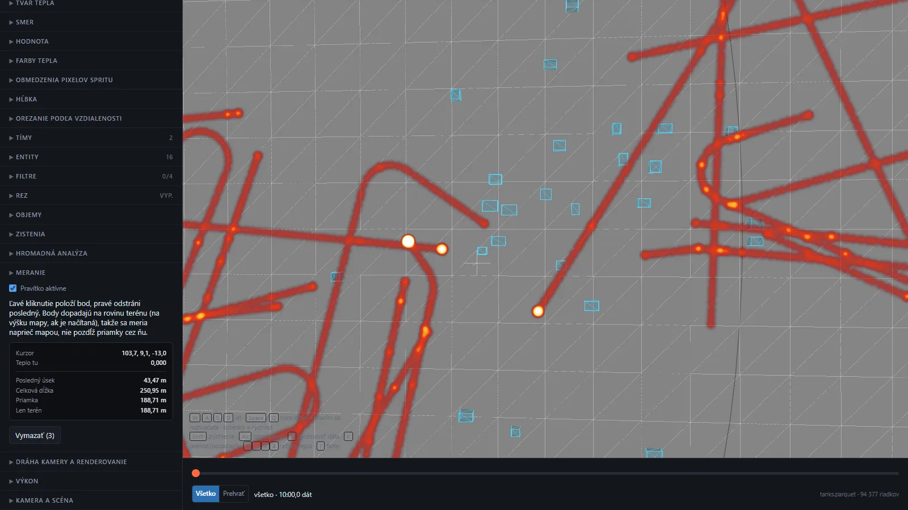

# Miera

**Miera** premení myš na pravítko a povie vám, aká je rušná miesto pod kurzorom. Použite ju, keď chcete zistiť, aká ďaleko sú od seba dve miesta, alebo koľko premávky má jedno miesto.

## Vyskúšajte to {#try-it}

1. Otvorte **Miera** na bočnom paneli a zaškrtnite **Pravítko aktívne**.
2. Ľavým kliknutím kliknite na tri miesta na mape. Každé kliknutie položí bod.
3. Prečítajte **Celková dĺžka** (dĺžka celej cesty) a **Posledný úsek** (posledná časť).
4. Pravým kliknutím odstránite posledný bod, alebo stlačte **Vymazať (3)** a odstráňte všetky.

| Akcia | Účinok |
|---|---|
| Ľavé kliknutie | Položí bod tam, kde kurzor pretína rovinu terénu. Kliknutie, ktoré sa medzi stlačením a uvoľnením pohlo o viac ako 4 pixely, je ťah kamerou, nie bod. |
| Pravé kliknutie | Odstráni posledný bod. |
| Pohyb | Pozícia kurzora a teplo pod ním sa aktualizujú živo. |

Kamera funguje, kým je pravítko zapnuté: ťahanie sa stále rozhliada, klávesy stále lietajú. Kým je pravítko zapnuté, berie každé kliknutie, takže [výber kliknutím](camera.md#click-to-pick) čaká, kým sa vypne.

**Rovina terénu** je výška [obrazu mapy](map-images.md), keď je obraz mapy načítaný; inak najnižšie Y datasetu (bez neho 0). Body na nej dopadajú, takže pravítko meria cez mapu, nie po priamke cez ňu. Pri 3D úrovni je rovina stále najnižšie Y datasetu, nie povrch úrovne - pre bod na skutočnom povrchu vypnite pravítko a kliknite naň ([výber kliknutím](camera.md#click-to-pick)), čo načíta súradnice z vlastných trojuholníkov úrovne.

## Údaje {#readouts}

| Riadok | Význam |
|---|---|
| **Kurzor** | Svetové X, Y, Z bodu pod kurzorom, na rovine. |
| **Teplo tu** | Koľko tepla je na pixeli kurzora. Väčšie číslo znamená viac premávky na tom mieste. Je to hodnota, ktorá sa dáva do farebnej škály predtým, než ju bod sýtosti vydelí, takže ju môžete porovnať s [Bodom sýtosti](colour-and-exposure.md#saturation-point). |
| **Posledný úsek** | Vzdialenosť od posledného bodu ku kurzoru (alebo medzi posledným a predposledným bodom). |
| **Celková dĺžka** | Dĺžka lomenej čiary cez každý bod a kurzor. |
| **Priamka** | 3D vzdialenosť od prvého bodu ku kurzoru (alebo posledného bodu). |
| **Len terén** | To isté, len na osiach X a Z. |
| **Vymazať (N)** | Odstráni všetky body. |

Vzdialenosti sa zobrazujú v centimetroch pod 1 jednotkou, v metroch pod 1 000, v kilometroch nad ňou - za predpokladu, že jedna svetová jednotka je meter ([Osi, jednotky a čas](axes-units-and-time.md#unit-scale)). Súradnice sú svetové súradnice, aj keď je os [obrátená na zobrazenie](camera.md#invert-world-axis).

Body a čiara medzi nimi sa kreslia ako prekrytie v zobrazení, s veľkosťou podľa rozostupu mriežky. Body pravítka sa v pohľadoch neukladajú; zostanú, keď načítate iné údaje.

## Pre vývojárov {#for-developers}

**Teplo tu** sa číta z GPU najviac každých 120 ms, lebo čítanie jediného pixela zastaví kanál. Používa rovnakú cestu ako `engine.readHeatProbe()`: vydelí sa zosilnením, s ktorým bola snímka zapísaná, takže na ceste akumulácie v polovičnej presnosti (`?heat=f16`) je v rovnakých jednotkách ako na 32-bitovom cieli ([Akumulácia v polovičnej presnosti](half-float-accumulation.md)).
