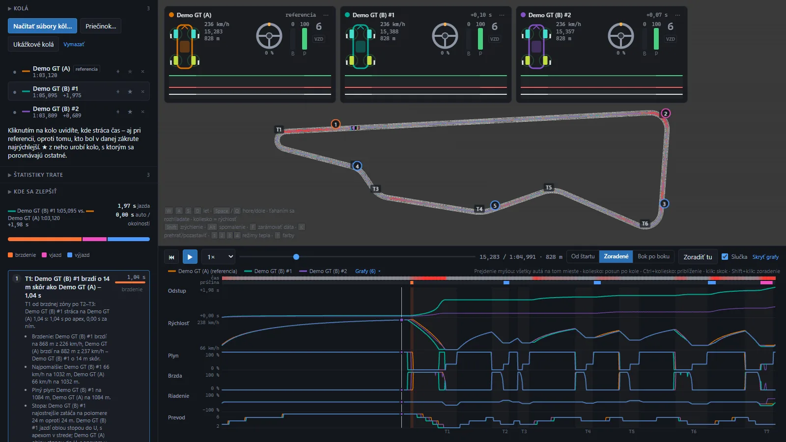

# Analýza pretekov

Jazdili ste rovnakú trať dvakrát. Karta **Analýza pretekov** prehrá obe jazdy spolu v 3D, ukáže, kde bolo jedno kolo pomalšie, a povie vám prečo.
Ešte nemáte kolá? Stlačte **Ukážkové kolá**.

Karta porovnáva dve alebo viac kôl jednej trate. So teplovou mapou zdieľa plátno, kameru a načítaný model trate (**Pozadie / level**); všetko ostatné je vlastné: vlastný bočný panel a vlastná lišta pod pohľadom. Slová ako *kolo*, *referencia* a *vrchol zákruty* sú v [slovníku](glossary.md).

Táto stránka je mapa karty. Každá časť má vlastnú stránku:

| Stránka | Čo pokrýva |
|---|---|
| [Načítanie kôl](race-loading-laps.md) | každý formát súboru, priečinky a trate, názvy áut, ukážkové kolá, zoznam kôl, referencia a zameranie |
| [Prehrávanie a 3D scéna](race-replay-and-scene.md) | prenosová lišta, tri režimy prehrávania, zarovnanie áut, kamera za autom, čiary, mapy, autá, popisy, zrkadlené svety |
| [Grafy a HUD](race-charts-and-hud.md) | grafy vzdialenosti, výber grafov, pohyb myšou a priblíženie, karty áut, tabuľka kanálov |
| [Udalosti ovládania auta](race-control-events.md) | zablokovania, prešmyk kolies, pretáčavosť, pretočenia, podtáčavosť, zásahy, havárie, ABS/TC, ručná brzda, vzduch - ako sa každá zisťuje, so všetkými prahmi |
| [Analýza zákruta po zákrute](race-corner-analysis.md) | zarovnanie podľa vzdialenosti, zákruty a úseky, časová bilancia zákruty, každá príčina a poradie, v akom sa skúšajú, tvar čiary a rady |
| [Profily áut a porovnanie](race-car-profiles.md) | čo každé auto dokáže, zmerané z jeho kôl; *Porovnanie áut*; čo auto rozhoduje v každej zákrute |
| [Štatistiky trate](race-course-statistics.md) | veľa kôl jednej trate: chyby podľa zákruty a druhu, mapa chýb, export do heatmapy, výkonnostné limity |
| [Analytika pretekov: metóda](race-analytics.md) | výskum za pravidlami, so zdrojmi |
| [Ostatné pretekárske hry](other-games.md) | čo prehliadač robí s kolami z každej hry: šmyk a driftu dopočítané tam, kde hra ich neposiela, zrkadlené svety, dodatočné kanály |

## Obrazovka {#the-screen}

**Bočný panel**, zhora nadol (sekcie sa dajú zložiť):

1. **Kolá** - načítať, zoznam, zobraziť/skryť, referencia, zameranie, prenasledovanie.
   Pozri [Načítanie kôl](race-loading-laps.md).
2. **Štatistiky trate** - až od troch načítaných kôl.
   Pozri [Štatistiky trate](race-course-statistics.md).
3. **Kde sa zlepšiť** - zistenia zameraného kola, zákruta po zákrute.
   Pozri [Analýza zákruta po zákrute](race-corner-analysis.md).
4. **Zákruta po zákrute** (alebo *Zákruta po zákrute - trieda X* pri viacerých
   triedach) - najrýchlejšie kolo cez každú zákrutu a jeho čiara. Zobrazí sa pri
   dvoch alebo viacerých kolách.
5. **Ovládanie auta** - zablokovania, šmyky, podtáčanie a zásahy zameraného kola.
   Pozri [Udalosti ovládania auta](race-control-events.md).
6. **Porovnanie áut** (alebo **Auto**, keď je jedno auto) - pozri
   [Profily áut a porovnanie](race-car-profiles.md).
7. **Pohľad** - ktorá mapa sa maľuje na trať a čo sa kreslí.
   Pozri [Prehrávanie a 3D scéna](race-replay-and-scene.md).
8. Spoločné panely **Level** a **Kamera a scéna** (model trate, prevrátenie osí,
   kamera) - opísané pri teplovej mape a v [Kamere](camera.md).

**Pohľad** zobrazuje trať, jazdené čiary, mapu, autá, popisy pripnuté na trať
a až šesť kariet áut vľavo hore (pozri [Grafy a HUD](race-charts-and-hud.md)). Bez
načítaných kôl hovorí: "Žiadne kolá nie sú načítané - pustite sem dva alebo viac
súborov kôl alebo načítajte ukážkové kolá z bočného panela."

**Lišta pod pohľadom** obsahuje prenosové ovládanie prehrávania a, pokiaľ nie je
skrytá, grafy vzdialenosti.

## Rýchly štart {#quick-start}

1. Otvorte kartu **Analýza pretekov** (vedľa **Heatmapa** hore v bočnom paneli).
2. Získajte kolá. Stlačte **Ukážkové kolá**, aby ste videli, čo karta robí s tromi
   vymyslenými kolami. Pre vlastné kolá ich najprv nahrajte
   ([formáty súborov a rekordéry](race-loading-laps.md#file-formats)), potom stlačte
   **Načítať súbory kôl…** alebo **Priečinok…**, alebo pustite súbory či priečinky na pohľad.
3. Najrýchlejšie celé kolo sa stane referenciou; najpomalšie iné kolo sa zameria.
   Kliknutím na ľubovoľné kolo v zozname ho zameriate; ★ z kola urobí referenciu.
4. Prečítajte si **Kde sa zlepšiť**. Kliknite na zistenie: autá sa zarovnajú 40 m
   pred ním, kamera ho zarámuje, prehrávanie ním prejde a otvoria sa merania.
5. Pohybom myši nad grafmi presuniete každé auto na ten meter; Shift+klik ich tam zarovná.

## Klávesnica {#keyboard}

Kým je karta Pretekov otvorená:

| Kláves | Robí |
|---|---|
| **K** | prehrávanie / pauza |
| **Home** | späť na začiatok prehrávania |
| číselné klávesy | nič (v teplovej mape prepínajú režimy) |

Klávesy napísané do textového poľa alebo rozbaľovacieho zoznamu sa ignorujú. Klávesy
kamery fungujú ako v teplovej mape (**W A S D**, **Medzera** nahor, **Q** nadol, **Shift**
rýchlejšie, **Alt** pomalšie, myšou sa obzerajte; všetko v [Kamere](camera.md)); **F**
zarámuje načítané kolá (ako to robí načítanie kôl).

## Mnoho kôl {#many-laps}

- Všetky načítané kolá sa analyzujú a spočítajú; desiatky trvajú sekundu alebo dve.
- Nad **8** kolami (`SHOW_ALL_UP_TO`) sa pridané kolá kreslia len vtedy, keď sú
  referenciou, zameraným kolom alebo najlepším kolom triedy zameraného kola.
  Prepínajú sa *Zobraziť všetky* / *Len skúmané*.
- Nad **10** viditeľnými autami (`PLAIN_PAST`) sa kolá, ktoré sa nepozerajú (nie
  zamerané, nie prenasledované auto ani referencia), kreslia s čiarami zredukovanými
  na bod každých 6 m namiesto 1,5 m, a autá obyčajne.
- Grafy kreslia najviac **8** kôl; HUD ukazuje najviac **6** kariet.
- Štatistiky trate sa zobrazia od **3** kôl.

Podrobnosti: [Štatistiky trate](race-course-statistics.md#performance-with-many-laps).

## Predvolené nastavenia zobrazenia {#default-view-settings}

| Nastavenie | Predvolene |
|---|---|
| Mapa | Mapa času |
| Jazdené čiary, Autá, Pneumatiky a odpruženie, Popisy, Trať z kôl | zapnuté |
| Všetky hodnoty na kartách | vypnuté |
| Veľkosť auta | 1× |
| Grafy | zobrazené |
| Režim prehrávania | Od čiary |
| Rýchlosť prehrávania | 1× |
| Slučka | zapnutá |

Nič z toho sa neukladá; obnovenie stránky začne od predvolených nastavení. V prehliadači sa
pamätá: jazyk a názvy áut zistené zo súborov kôl (pozri [Načítanie kôl](race-loading-laps.md#car-names)).

## Pre vývojárov {#for-developers}

### Čo sa stane, keď sa kolá načítajú {#what-happens-when-laps-are-loaded}

Pri každej zmene množiny kôl, referencie alebo jazyka sa celá analýza spustí znova (`analyse` v
[`src/race/analysis.ts`](https://github.com/Holdi601/3DHeat/blob/main/src/race/analysis.ts)):

1. Ku každému kolu sa pridajú odvodené kanály tam, kde ich hra neposiela: uhol driftu, prešmyk kolies
   z rýchlostí kolies, vo vzduchu, voľný povrch, rýchlosť otáčania
   ([`derive.ts`](https://github.com/Holdi601/3DHeat/blob/main/src/race/derive.ts)).
2. Vyberie sa referencia a každé kolo sa premietne na jej dráhu a prevzorkuje každé 2 m
   ([`align.ts`](https://github.com/Holdi601/3DHeat/blob/main/src/race/align.ts)).
3. Z kôl sa zistí, či je svet hry zrkadlený
   ([`handedness.ts`](https://github.com/Holdi601/3DHeat/blob/main/src/race/handedness.ts)).
4. Zákruty sa nájdu na referencii a zoskupia do úsekov od jednej brzdnej zóny k ďalšej
   ([`segments.ts`](https://github.com/Holdi601/3DHeat/blob/main/src/race/segments.ts)).
5. Pre každé auto: jeho obálka (priľnavosť, brzdenie, ťah podľa rýchlosti), jeho profil, jeho krivky pneumatík
   ([`envelope.ts`](https://github.com/Holdi601/3DHeat/blob/main/src/race/envelope.ts),
   [`profile.ts`](https://github.com/Holdi601/3DHeat/blob/main/src/race/profile.ts),
   [`control.ts`](https://github.com/Holdi601/3DHeat/blob/main/src/race/control.ts)).
6. Pre každé kolo a úsek: čo urobilo (bod brzdenia, najpomalší bod, plný plyn, ...) a čiara, ktorou išlo
   ([`line.ts`](https://github.com/Holdi601/3DHeat/blob/main/src/race/line.ts)).
7. Pre každé kolo: jeho udalosti ovládania auta, každá položená na kolo, s ktorým sa tam porovnáva.
8. Pre každé kolo a úsek: časová bilancia oproti jeho porovnávaciemu kolu a zistenie slovami.
9. Časová mapa a mapa príčin pre každé kolo.

Texty sa vytvárajú v aktuálnom jazyku; zmena jazyka spustí analýzu znova (a premenuje ukážkové kolá).
Zlyhanie analýzy sa zobrazí pod tlačidlami **Kolá** ako chyba a kolá zostanú načítané.

### Zdrojové súbory {#source-files}

| Súbor | Úloha |
|---|---|
| `src/race/adapters.ts`, `ibt.ts` | čítanie súborov kôl |
| `src/race/lap.ts`, `carNames.ts`, `synthetic.ts` | typ kola, pomenovanie, ukážkové kolá |
| `src/race/derive.ts`, `handedness.ts` | odvodené kanály, zrkadlené svety |
| `src/race/align.ts`, `segments.ts`, `line.ts` | os vzdialenosti, zákruty, čiary |
| `src/race/analysis.ts` | porovnávané zákruty, príčiny, zistenia |
| `src/race/envelope.ts`, `profile.ts` | čo auto dokáže |
| `src/race/control.ts`, `impacts.ts` | ovládanie auta, zásahy a havárie |
| `src/race/stats.ts` | mnoho kôl |
| `src/race/replay.ts`, `scene.ts`, `glyph.ts`, `geometry.ts` | prehrávanie a kreslenie |
| `src/race/schema.ts`, `graphs.ts` | tabuľka kanálov, riadky grafov |
| `src/ui/race/*` | bočný panel, grafy, HUD, popisy |
| `src/state/raceStore.ts` | stav karty a hodiny prehrávania |
