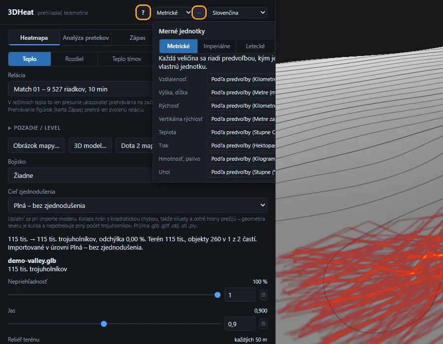
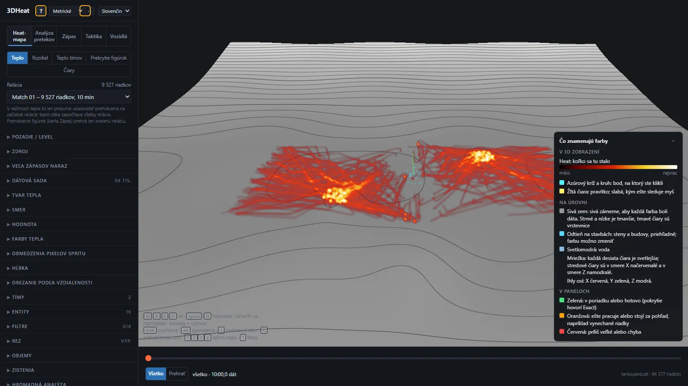
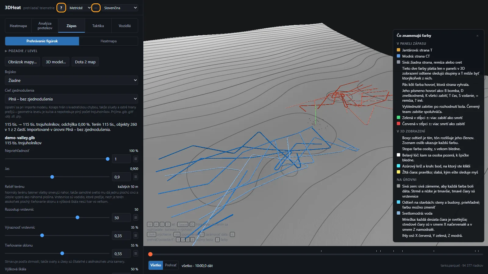

# Nastavenia, jednotky a klávesy

Malé ovládače hore na bočnom paneli menia, ako s vami prehliadač hovorí: jazyk, jednotky (metre alebo stopy, km/h alebo uzly) a režim pomoci, ktorý vysvetľuje farby. Vaše voľby si prehliadač pamätá.

## Hlavička {#the-header}

Hore na bočnom paneli:

| Ovládač | Čo robí |
|---|---|
| **?** | Režim pomoci: čo znamená každá farba (aj `?` alebo `F1`) |
| Ponuka **Jednotky** | Metrické, Imperiálne, Letecké alebo Námorné |
| Tlačidlo **...** vedľa **Jednotky** | Otvorí „Vyberte jednotku pre každú veličinu“: jeden rozbaľovací zoznam pre každú veličinu |
| Ponuka **Jazyk** | Jazyk prehliadača: [40 jazykov](languages.md), alebo jazyk prehliadača |

Čísla, ktoré napíšete do políčka, môžu obsahovať bodku alebo čiarku (`0.35` alebo `0,35`). Prehliadač prijme oboje a čísla zobrazuje tak, ako ich píše jazyk prehliadača.

## Jednotky {#units}

1. Vyberte predvoľbu v ponuke **Jednotky**. Všetky veličiny sa prepnú naraz.
2. Ak chcete zmeniť len jednu veličinu, kliknite na tlačidlo **...** vedľa nej a vyberte jednotku pre túto veličinu. Ponuka potom ukáže `*` za predvoľbou.
3. Veličina, ktorú ste nenastavili, nasleduje predvoľbu. Ak chcete ísť späť, vyberte „Ako predvoľba“.

| Veličina | Metrické (predvolené) | Imperiálne | Letecké | Námorné |
|---|---|---|---|---|
| Vzdialenosť | km | mi | NM | NM |
| Výška, dĺžka | m | ft | ft | m |
| Rýchlosť | km/h | mph | kt | kt |
| Vertikálna rýchlosť | m/s | ft/min | ft/min | m/s |
| Teplota | °C | °F | °C | °C |
| Tlak | hPa | inHg | hPa | hPa |
| Hmotnosť, palivo | kg, l | lb, gal | lb, gal | t, m³ |
| Uhol | stupne | stupne | stupne | stupne |

Ďalšie jednotky, ktoré môžete vybrať pre jednu veličinu: vzdialenosť km, mi, NM; rýchlosť km/h, m/s, kt, mph; vertikálna rýchlosť m/s, ft/min, m/min; teplota °C, °F, K; tlak hPa, inHg, mmHg, psi; hmotnosť kg, lb, t; uhol stupne alebo NATO mils (6 400 na kruh). Jednotky sú v prehliadači všade rovnaké: popisky, karty, grafy, štatistiky.

## Režim pomoci {#help-mode}

Stlačte `?` alebo `F1`, alebo kliknite na tlačidlo **?**. Zobrazí *Čo znamenajú farby*: legendy pre 3D zobrazenie, teplotné škály, farby tímov, farby úrovne, farby stavu panelov, panel zápasu a pohľad na pretek. Zostane zapnutý, kým ho nevypnete. Na karte Zápas vysvetľuje aj farby panela zápasu.

## Čo si prehliadač pamätá {#what-the-browser-remembers}

Tieto nastavenia sa uchovávajú vo vašom prehliadači medzi návštevami (nikam sa neposielajú):

- jazyk, jednotky a režim pomoci;
- nastavenia figúrky, symbolu, popisu, kamery a taktického zobrazenia replaye;
- rýchlosť prehrávania a zrkadlenie;
- záložky pre každý záznam, hlasitosti pre každý dataset, taktické vrstvy;
- nastavenia externej AI (kľúč len ak zaškrtnete *Zapamätať*).

Nastavenia tepla, filtre a režim sa pri každom načítaní začínajú odznova. Úplný vygenerovaný zoznam: [Uložené nastavenia](ref-settings-storage.md).

## Klávesy, ktoré prehliadač z prehliadača ponecháva {#keys-the-viewer-keeps-from-the-browser}

Relácia s veľkými dátami sa načítava dlho, preto prehliadač bráni tomu, aby ju prehliadač omylom zahodil:

- `Ctrl`/`Cmd` + písmená, ktoré by tlačili, ukladali, otvárali, znovu načítali, zatvárali alebo otvárali nové okná, nerobia nič mimo textových polí; `F1`, `F3`, `F5`, `F6` a `F7` nerobia nič.
- Zatvorenie alebo znovunačítanie karty s načítanými dátami alebo úrovňou sa najprv opýta.
- Na celej obrazovke prehliadač zamkne klávesy, ktoré používa (W, T, N, S, R, P, Q, Esc), aby ich prehliadač nezachytil.

Presný zoznam: [Klávesy prehliadača](ref-browser-keys.md). Všetky vlastné klávesy prehliadača: [Referencia klávesnice a myši](keyboard-reference.md).
