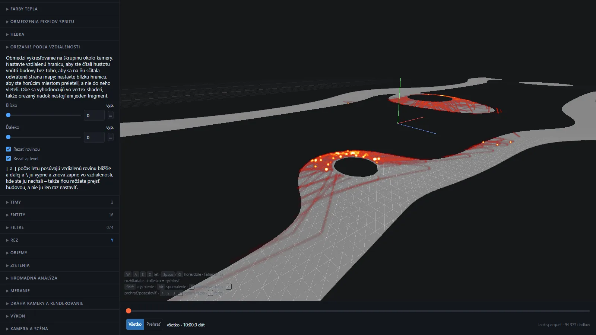

# Rez

**Rez** prereže svet ako kus koláča, takže môžete pozrieť dovnútra budov. Použite ho, keď steny skrývajú zaujímavé teplo, napríklad keď chcete vidieť jedno poschodie budovy.

## Vyskúšajte to {#try-it}

1. Načítajte úroveň a nejaké údaje a otvorte **Rez**.
2. Zaškrtnite **Rozrezať svet**. Os je **Výška**.
3. Potiahnite **Pozícia** nahor a nadol: vrstva sa pohybuje cez úroveň.
4. Nastavte **Hrúbka** tenko pre pôdorys, alebo širšie pre „všetko pod týmto“.
5. Nechajte **Mimo vrstvy** na 0, aby sa ostatné odstránili, alebo ho zvýšte, aby ostala slabá stopa.



Vrstva reže **geometriu úrovne a dátové body spoločne** - rezať len úroveň by nechalo teplo viať tam, kde bola jej budova. Je to protiklad [zakrytia hĺbky](depth-and-culling.md): keď úroveň správne skrýva to, čo je za ňou, skryje sa aj vnútro budovy. Panel sa zobrazí, keď je čo rezať (dataset alebo 3D úroveň); jeho hlavička ukáže os, keď je zapnuté, inak *vypnuté*.

```
bočný pohľad      Pozícia = kde je vrstva
 ----------       Hrúbka = aká vysoká je vrstva
 | poschodie 3 |
 |=========|  <--- vrstva (ponechaná)
 | poschodie 2 |  <--- mimo: odstránené (alebo slabé)
 | poschodie 1 |
 ----------
```

## Ovládače {#controls}

| Ovládač | Predvolene | Význam |
|---|---|---|
| **Rozrezať svet** | vypnuté | Zapne vrstvu. Kým je pozícia na svojej počiatočnej hodnote 0 a hrúbka na počiatočnej 500, zapnutie ich presunie do stredu osi a na 15 % jej rozsahu. |
| Os | **Výška** | *Výška* (Y), *X* alebo *Z*. Zmena osi presunie vrstvu do stredu novej osi. |
| **Pozícia** | stred | Stred vrstvy, vo svetových jednotkách, cez rozsah osi (500 krokov). |
| **Hrúbka** | 15 % rozsahu | Od 1/500 rozsahu po dvojnásobok rozsahu, v logaritmických krokoch. Ukáže *za svetom*, keď je široká ako rozsah: jedna strana potom siaha za svet a je to obyčajný rez, nie vrstva. |
| **Mimo vrstvy** | 0, *odstránené* | Koľko z toho, čo leží mimo, zostane viditeľné, 0 - 100 %. Slabá stopa toho, čo bolo odrezané, sa často číta ľahšie než úplné odstránenie. |
| **Rezať aj dátové body** | zapnuté | Vypnuté nechá teplo celé, takže je vidieť cez rez - užitočné na vidieť, čo je nad a pod vrstvou. |

Rozsah osi je rozsah 3D úrovne, keď je načítaná, inak rozsah datasetu.

Rez je nezávislý od [orezávania vzdialenosťou](depth-and-culling.md#distance-culling), ktoré reže pozdĺž smeru pohľadu, nie pozdĺž osi sveta; obe sa spájajú. Zmena ktoréhokoľvek nastavenia rezu reštartuje akumuláciu tepla.

## Pre vývojárov {#for-developers}

Vrstva sa testuje na svetovej pozícii každého riadka vo vertex shaderi: riadok mimo nej má svoj príspevok vynásobený hodnotou *Mimo*, takže pri 0 je odmietnutý ešte pred kreslením ktoréhokoľvek fragmentu. Shadery úrovne aplikujú ten istý test na každý fragment terénu, štruktúr a vody.
